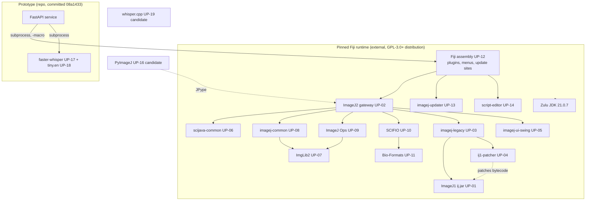

# F03 — Upstream Dependency and Source Manifest

## Executive Summary

The authoritative record of every upstream component, its exact revision, licence declaration and intended use is [`docs/data/upstream-manifest.yaml`](../data/upstream-manifest.yaml). This document explains how that file was produced, how the components relate, and the rules for changing it. It does not repeat the per-component rows.

Two facts anchor everything:

1. **The runtime is a pinned binary Fiji distribution** (archive 20261013-1517, 1,379-file SHA-256 inventory in [`external/fiji.lock.json`](../../external/fiji.lock.json)). It lives outside the repository at `C:\Users\arnav\Documents\dev\Fiji`. **VERIFIED**: `verify_runtime` returned lock hash `f6695397…bafa` on 2026-10-17.
2. **Source for analysis is pinned to tags matching the installed jars**, for example `ij-1.54p.jar` ↔ `imagej/ImageJ@v1.54p`. Shallow clones of these tags are kept in `C:\Users\arnav\Documents\dev\fiji-research-cache`, outside the repository. Every source citation in this documentation set resolves against these revisions.

## Method (reproducible)

1. Installed versions were read from the jar filenames in `Fiji/jars` (**VERIFIED**, 2026-10-17 listing).
2. For each component, `git ls-remote --tags` was used to find the matching release tag. The repository was then shallow-cloned at that tag (`git clone --depth 1 --branch <tag>`). The SHA was recorded with `git rev-parse HEAD`.
3. Components without a matching tag are pinned to the default branch SHA and flagged:
   - Fiji: the installed assembly is `2.18.1-SNAPSHOT`.
   - PyImageJ and whisper.cpp: not installed.
   - tutorials.
4. Licence declarations were taken from the repository's LICENSE file at the pinned revision. Licence *obligations* and the per-jar licence scan belong to A24.

| Revision class | Components | Confidence |
|---|---|---|
| Release tag = installed jar version | ImageJ, imagej2, imagej-legacy, ij1-patcher, imagej-ui-swing, scijava-common, imglib2, imagej-common, imagej-ops, scifio, imagej-updater, script-editor, imagej-plugins-commands, faster-whisper | VERIFIED version match. Byte identity of jar and source build not checked. |
| Default-branch SHA | fiji (SNAPSHOT), pyimagej, whisper.cpp, tutorials | INFERRED as close to, but not identical with, any installed artefact |
| Remote tag only (not cloned) | Bio-Formats v8.5.0 | SHA VERIFIED via `ls-remote` |

## Dependency relationships

The ImageJ1/ImageJ2/legacy relationships are only summarised here. Their verified internals are in A07 and A15.

## Notable runtime contents relevant to architecture

The pinned distribution already contains `flatlaf-3.6.1.jar`, JavaFX 23.0.2 jars, `appose-0.12.0.jar` (Java↔Python IPC), Groovy 4.0.28 and Jython 2.7.4 (**VERIFIED** by filename). A21 evaluates whether these can be used. Their presence alone does not prove that a UI built on them would work. That remains **INFERRED** until probed.

## Rules for changing the manifest

1. Upgrading the runtime is a separate, reviewed change. Follow the procedure in [`docs/setup.md`](../setup.md) ("Intentional updates"), then update `upstream-manifest.yaml` so its revisions match the new jars, and re-run the A30/D18 reference comparisons.
2. A component enters the product source tree only with a documented integration reason and a `DEC-nnn` entry. As of this stage, **no upstream source is vendored**. The repository contains only licence/notice copies in [`third_party/`](../../third_party/NOTICE.md).
3. The research cache is disposable. It can be recreated from this manifest with `git clone --depth 1 --branch <tag> <repo>`.

## Unknowns

- **UNKNOWN:** whether the `fiji@main` SHA corresponds exactly to the installed `fiji-2.18.1-SNAPSHOT.jar`. To verify, compare the jar's `META-INF/maven/sc.fiji/fiji/pom.properties` and the build metadata against the commit history.
- **UNKNOWN:** whether the PyImageJ and whisper.cpp revisions to adopt, if they are selected, should be the latest release tags (`1.8.0` and `v1.9.5`, confirmed with `ls-remote` on 2026-10-17) rather than the default-branch SHAs. This is decided in D19.

## Change log

- 2026-10-17: Initial manifest.
