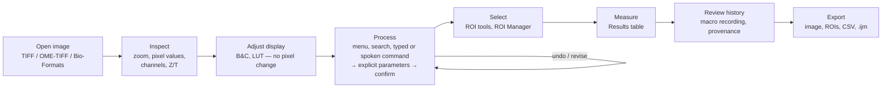

# A01 — Product Definition and Scope

## Executive Summary

The product is a **modern desktop workspace for Fiji/ImageJ**. It runs the existing Fiji runtime, with its commands, macros, plugins and image model, and gives it:

- a coherent single-workspace interface;
- direct-manipulation image viewing and ROI editing;
- integrated results, history and recording;
- command search;
- typed natural-language and spoken instructions that resolve to existing Fiji commands with explicit parameters.

It is **not** a generic AI image-analysis application. Its distinguishing property is that every scientific result is produced by original Fiji code and can be expressed as a standard ImageJ macro (F01 PR-1, PR-6).

## 1. User problem

Evidence for each problem is gathered in A05. The problems in summary:

1. Fiji's capability is very large. The installed distribution's command count is measured in A08. It is exposed through deep menus, many independent floating windows and modal dialogs. Discoverability and orientation are costly, especially for occasional users.
2. Important state is implicit: which image is active, the current selection, display range versus pixel values, and global options that change results (for example *Black background* and *Set Measurements*; see A11).
3. Reproducibility depends on the user remembering to open the Recorder and on the Recorder capturing everything. Recording gaps are analysed in A12.
4. Visual feedback is spread across windows. Results, Log, ROI Manager and image windows are separate frames.
5. Users who know *what* they want ("subtract background with a 50-pixel rolling ball, then Otsu threshold") must still find *where* it is and *how* to parameterise it.

## 2. Product statement

> For researchers who analyse microscopy and other scientific images with Fiji, the product is a desktop workspace that keeps Fiji's operations, macros and plugins, and organises them into a single modern interface with direct manipulation, visible state, integrated history and recording, and optional typed or spoken commands. Unlike AI-first image tools, it never substitutes its own processing for Fiji's, never hides a parameter, and produces standard ImageJ macros for every result.

## 3. Intended scientific workflow (illustrative; detail in A03, D16)

Every arrow represents the *same* operations Fiji offers. The modernisation lies in how they are reached, parameterised, observed and recorded.

## 4. Modernisation philosophy

| Preserve (semantics) | Modernise (experience) |
|---|---|
| The command set, menu taxonomy and command names | Command search, contextual panels, consistent dialog layout |
| Parameter names, defaults and macro option keys | Inline parameter editing, validation and live preview where Fiji supports preview |
| The ImageJ macro language and Recorder output format | An integrated history/recording view, plus editing and replay in one place |
| Image model: types, stacks/hyperstacks, calibration, LUTs, display range distinct from data | Docked image documents with visible type, calibration and dimension state |
| ROI types, modifier-key semantics, ROI Manager behaviour | Integrated ROI list and properties inspector, high-DPI canvas |
| Results tables and measurement settings | Results docked next to the image, with settings visible where they affect results |
| Plugin compatibility (by category, A13) | Legacy plugin windows hosted or launched without breaking them |

## 5. Functional boundaries

**In scope (product):** image documents; the viewer (zoom, pan, pixel readout, channels, Z/T); selections and the ROI Manager; menu, command search and dialogs for Fiji commands; measurements and Results; display adjustment; history, undo where Fiji supports it, and recording; macro editing, running and replaying; access to legacy plugins with fallback; natural-language command resolution; voice input; provenance and export.

**Out of scope:**

- reimplementing processing algorithms;
- a proprietary workflow language replacing ImageJ macros;
- training or bundling image-analysis ML models;
- cloud storage;
- multi-user collaboration;
- mobile platforms;
- guaranteed compatibility with every third-party update site.

**Boundary cases**, to be decided by analysis:

- A batch-processing UI beyond Fiji's existing *Process › Batch*: A03, A31.
- Hosting 3D viewers (3D Viewer, BigDataViewer) inside the workspace rather than as external windows: A13, A15.
- Support for an LLM that runs locally rather than through a hosted API: A17, A25.

## 6. Goals, non-goals and success criteria

| ID | Goal | Measurable success criterion (verification in A30/D18) |
|---|---|---|
| G-1 | Scientific fidelity | For every supported command, pixel and measurement outputs equal a reference execution in the original Fiji GUI/macro at the same parameters, within the tolerances defined in A30. |
| G-2 | Familiarity | A Fiji user can find any command in the installed catalogue through either the menu path they already know or search. Each command shows the same parameter names as its Fiji dialog. |
| G-3 | Visible state | The active image, selection, type, calibration and dimension position are always visible. Options that affect results are shown before execution. |
| G-4 | Reproducibility | Every applied operation from any input modality appears in history as ImageJ macro text. Replaying that macro in the original Fiji reproduces the result (G-1 tolerances). |
| G-5 | Controlled NL/voice | Typed or spoken instructions resolve to catalogue commands with explicit parameters, shown before execution. Ambiguity triggers clarification rather than a guess (A17, A19). |
| G-6 | Plugin coexistence | Each installed plugin is assigned a compatibility category (A13), and the UI states the category's behaviour. |

| Non-goal | Why |
|---|---|
| Faster algorithms than Fiji | Out of scope. Fidelity matters more than performance (PR-1). |
| Replace the macro language | PR-2, PR-6 |
| Fully autonomous analysis agent | PR-4 |
| Aesthetic redesign without functional gain | Brief §1.4, A05 (aesthetic issues are separated from usability ones) |

## 7. Constraints

See F01. In addition:

- the Fiji runtime is the pinned external installation (F03);
- the speech stack must run offline on CPU on the development laptop (A16, A22).

## Requirement implications

1. **CR-A01-01:** The system shall produce all image-processing and measurement results by invoking Fiji/ImageJ commands or APIs in the pinned runtime. It shall never use substitute implementations. *Rationale:* PR-1, G-1.
2. **CR-A01-02:** The system shall record every applied operation, whatever its input modality, as ImageJ macro text in a session history. *Rationale:* PR-6, G-4.
3. **CR-A01-03:** The system shall display the resolved command and all its parameters before executing any instruction that came from typed natural language or speech. *Rationale:* PR-4, G-5.
4. **CR-A01-04:** The system shall make every command in the installed command catalogue reachable through its original menu path and through search. *Rationale:* G-2.

## Risks

- **R-A01-01:** Scope creep towards full Fiji parity before the hackathon. Likelihood: high. Impact: medium. Mitigation: the tiered scope in A31.
- **R-A01-02:** NL/voice features dominate the demo and the UI drifts back to a prompt box. Likelihood: medium. Impact: high (a brief §1.4 violation). Mitigation: D11/D12 make the viewer and menus primary, with NL/voice as auxiliary panels.

## References

- F01 Project Charter; F02 Repository and Prototype Audit.
- Brief: "Master Prompt — Scientific Software Modernisation Project", Parts 1 and 11 (owner-provided, 2026-10-17).
