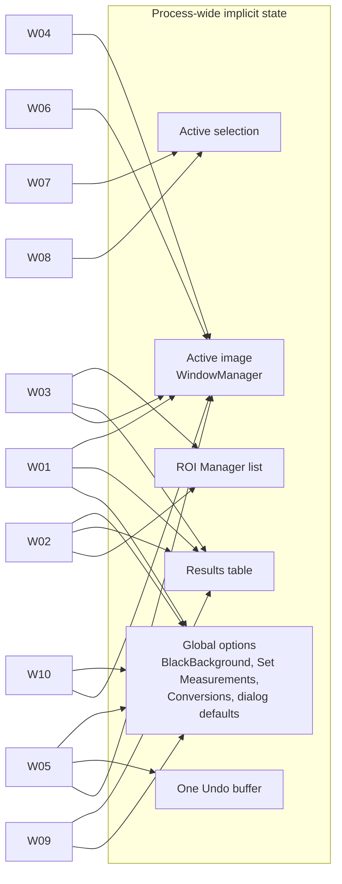

# A03 — Existing User Workflow Inventory

## Executive Summary

This document records 13 representative Fiji workflows, each from import to export. For each one it gives the real menu path, the command name as `run()` sees it, the windows involved, the state carried between steps, whether the macro Recorder captures it, and its pain points. Menu paths come from the pinned install: `Fiji/jars/ij-1.54p.jar!/IJ_Props.txt`, `imagej/ImageJ@v1.54p:ij/Menus.java` and each plugin jar's `plugins.config`. Workflow semantics come from the imagej.net documentation.

Three patterns run through every workflow. They are the main inputs to design:

1. **Implicit shared state carries each workflow forward.** This state is the active image, the active selection (ROI), the ROI Manager list, the single Results table and global options. No step names its inputs explicitly (**VERIFIED** for the core: `ij/WindowManager.java#L69-L75`, `ij/plugin/filter/Analyzer.java#L40`).
2. **Every core step is a named command with a key=value option string.** This is the `run("Command", "options")` contract that the Recorder emits and macros replay (**VERIFIED** as documented: [Macro language, Recorder](https://imagej.net/ij/developer/macro/macros.html#recorder), accessed 2026-10-17). It is the natural contract for natural-language and voice front ends, because those front ends can drive existing commands without reimplementing them (**PROPOSED**).
3. **Plugin-driven workflows (TrackMate, Trainable Weka Segmentation, Cell Counter) leave the `run()` contract.** They use their own wizards and windows, so recordability ranges from complete to none (W11, W12).

Problem IDs `UP-nn` are defined in [A05](A05-usability-workflow-problems.md).

## Purpose and Scope

**In scope:** what users do in the pinned Fiji GUI today, at the level of menu commands, dialogs, windows and state. The inventory gives designers what they need to preserve semantics (A02 lists what must stay familiar) and to place natural-language and voice entry points.

**Out of scope:**
- Algorithm internals (A08/A11).
- The full command catalogue (`docs/data/`, owned elsewhere).
- Runtime behaviour. No workflow here was executed. Menu paths are **VERIFIED** against the installed jars. Behaviour is **VERIFIED as documentation** unless a source line is cited.

## Sources and Evidence

| Evidence | Use |
|---|---|
| `Fiji/jars/ij-1.54p.jar!/IJ_Props.txt` (read with `unzip -p` into the G6 scratch folder) | Submenu commands and their `[key]` shortcuts |
| `imagej/ImageJ@v1.54p:ij/Menus.java#L110-L238` | Top-level File/Edit/Image/Process/Analyze commands. These are hard-coded and are not in IJ_Props. |
| `plugins.config` inside `Fiji/plugins/*.jar` and `Fiji/jars/TrackMate-8.1.6.jar` | Plugin menu paths |
| `Fiji/plugins/bio-formats_plugins-8.5.0.jar!/loci/plugins/in/importer-options.txt` | Bio-Formats importer dialog labels |
| Dialog source (`ParticleAnalyzer.java#L342-L360`, `ZProjector.java#L295-L299`, `BackgroundSubtracter.java#L96-L101`) | Option labels and therefore macro keys |
| imagej.net and imagej.net/ij/docs pages (cited per workflow) | Step semantics and acknowledged pitfalls |

Many imagej.net pages carry the banner "The content of this page has not been vetted since shifting away from MediaWiki". Examples are Particle Analysis, the TrackMate getting-started page and Rolling Ball. The ImageJ User Guide describes IJ 1.46r. Where these pages disagree with the pinned jars, the jars win (see the §Constraints table).

## Technical Details

### Shared conventions (apply to all workflows)

| Convention | Detail | Evidence |
|---|---|---|
| Active image | Commands act on `WindowManager.getCurrentImage()`. This is the thread's temporary image if one is set, otherwise the frontmost image window. | **VERIFIED** `ij/WindowManager.java#L69-L75` |
| Option string | Each dialog field becomes a key: the first word of the label, lower-cased. Examples are `rolling=50 light`, `size=50-Infinity`, `projection=[Max Intensity]`. | **VERIFIED as documentation** ([macros.html#recorder](https://imagej.net/ij/developer/macro/macros.html#recorder)); labels **VERIFIED** in the dialog source cited per workflow |
| Shortcuts | In IJ_Props a lower-case `[x]` means Ctrl+x and an upper-case one means Ctrl+Shift+x. With "Require control key for shortcuts" unchecked (Edit › Options › Misc…), the bare key works on image windows. | **VERIFIED as documentation** ([shortcuts.html](https://imagej.net/ij/docs/shortcuts.html), [Guide 146-4](https://imagej.net/ij/docs/guide/146-4.html), accessed 2026-10-17) |
| Results | Measure (Ctrl+M) appends one row to the single system Results table. Columns follow the global Set Measurements bitmask. | **VERIFIED** `Analyzer.java#L40` (`systemMeasurements` is loaded from Prefs) |
| Undo | Single-level. It is reset whenever the active window changes. | **VERIFIED** `ij/Undo.java#L30`, `ij/WindowManager.java#L48` |

### Workflow inventory

Command names in `code` are the exact menu labels used by `run()`.

#### W01 — Open a microscopy file (Bio-Formats), adjust Brightness/Contrast, measure

| Aspect | Content |
|---|---|
| Steps | 1. **File › Import › Bio-Formats** or **Plugins › Bio-Formats › Bio-Formats Importer** (`plugins.config`: `loci.plugins.LociImporter("location=[Local machine] windowless=false ")`). File › Open also routes many formats to Bio-Formats. Importer dialog labels: `View stack with:` (default Hyperstack), `Color_mode:` (default Default), `Split_channels`, `Open_all_series`, `Autoscale` (default true), `Display_metadata`, `Display_ROIs`, `Specify_range for each series`, `Crop on import`. 2. **Image › Adjust › Brightness/Contrast…** [Ctrl+Shift+C] (`ij.plugin.frame.ContrastAdjuster`). Use the sliders, Auto or Set, and optionally Apply. 3. **Analyze › Set Measurements…**. 4. Draw a selection with a toolbar tool. 5. **Analyze › Measure** [Ctrl+M]. 6. **File › Save As › Results…** or File › Save from the Results window. |
| Recorded macro shape | `run("Bio-Formats Importer", "open=[…] autoscale color_mode=Default view=Hyperstack stack_order=XYCZT");` then `setMinAndMax(a,b);` (only from Set/Auto/Apply), `run("Set Measurements...", "area mean min integrated redirect=None decimal=3");`, `makeRectangle(…)`, `run("Measure");` |
| Windows | Main window, importer dialog, image window (hyperstack with C/Z/T sliders), B&C frame (non-modal), Set Measurements dialog, Results table |
| State carried | Active image; display range (LUT min/max, which is not pixel data); active ROI; global measurement settings; Results rows |
| Recordability | Importer: recorded with full options (**VERIFIED as documentation**, [imagej.net/formats/bio-formats](https://imagej.net/formats/bio-formats)). B&C slider drags are **not** recorded. Recording happens only in the Apply, Auto and Set handlers (**VERIFIED** `ContrastAdjuster.java#L724-L732`, `#L858-L862`, `#L922-L938`, `#L1068-L1081`). |
| Pain points | Importer options persist, and the Windowless importer "runs with the last used settings" (UP-08). Autoscale changes only the display, but users confuse display with data, and Apply rewrites 8-bit/RGB pixels (UP-07; [image.html](https://imagej.net/ij/docs/menus/image.html): "This option currently only works with 8-bit images and stacks and with RGB stacks"). Bio-Formats "does not work in headless mode, even when running as a macro" (documented on the Bio-Formats page; relevant to back-end design). |
| Sources | [Bio-Formats](https://imagej.net/formats/bio-formats); [OME: load images into ImageJ](https://bio-formats.readthedocs.io/en/latest/users/imagej/load-images.html); [Image menu](https://imagej.net/ij/docs/menus/image.html); [Guide 146-28](https://imagej.net/ij/docs/guide/146-28.html) (all accessed 2026-10-17) |

#### W02 — Threshold and Analyze Particles cell counting

| Aspect | Content |
|---|---|
| Steps | 1. Open and, if needed, **Image › Type › 8-bit**. 2. **Image › Adjust › Threshold…** [Ctrl+Shift+T]: choose a method (Default plus 15 others), tick "Dark background", then Apply, or **Process › Binary › Convert to Mask**. 3. Optionally **Process › Binary › Fill Holes**, **Process › Binary › Watershed**. 4. **Analyze › Set Measurements…**. 5. **Analyze › Analyze Particles…**: fields `Size (units^2):`, `Pixel units`, `Circularity:`, `Show:` (Nothing/Overlay/Overlay Masks/Outlines/Bare Outlines/Ellipses/Masks/Count Masks), and the checkboxes Display results, Exclude on edges, Clear results, Include holes, Summarize, Overlay, Add to Manager, Composite ROIs, Record starts. 6. Save the Results and Summary tables. |
| Recorded macro shape | `setAutoThreshold("Otsu dark");` `setOption("BlackBackground", true);` `run("Convert to Mask");` `run("Watershed");` `run("Analyze Particles...", "size=50-Infinity show=Outlines display clear summarize add");` |
| Windows | Image, Threshold frame, Binary Options (hidden), Analyze Particles dialog, Results, Summary, ROI Manager, Drawing-of window |
| State carried | Threshold levels on the processor; the **BlackBackground** global (`Prefs.blackBackground`, `ij/Prefs.java#L76`); measurement settings; dialog values. Analyze Particles keeps static defaults between runs (`ParticleAnalyzer.java#L102`). ROI Manager contents. |
| Recordability | Auto-threshold method selection is recorded as `setAutoThreshold(...)`. On a pre-thresholded image, Convert to Mask records the manual levels only as a **comment** `//setThreshold(a, b)` (**VERIFIED** `ij/plugin/Thresholder.java#L221-L222`), so a replay does not reproduce a hand-tuned threshold. The Recorder inserts `setOption("BlackBackground", …)` only before Convert to Mask, Erode, Dilate and Skeletonize, and only once per recording (**VERIFIED** `ij/plugin/frame/Recorder.java#L579-L581`, `#L1015-L1022`). Fill Holes, Open, Close-, Watershed and Analyze Particles do not trigger it. |
| Pain points | Mask polarity depends on a hidden option (UP-04). Analyze Particles needs a binary image ("Automatic particle analysis requires a 'binary', black and white, image"), and touching cells need Watershed (UP-17). The Results table is appended unless "Clear results" is ticked (UP-09). |
| Sources | [Particle Analysis](https://imagej.net/imaging/particle-analysis); [Analyze menu](https://imagej.net/ij/docs/menus/analyze.html); [Guide 146-29](https://imagej.net/ij/docs/guide/146-29.html) (Convert to Mask, Binary Options, Watershed) |

#### W03 — ROI-based intensity measurement across channels and time

| Aspect | Content |
|---|---|
| Steps | 1. Open a multichannel/time-lapse hyperstack (W01). 2. Draw ROIs and **Edit › Selection › Add to Manager** [Ctrl+T], or open **Analyze › Tools › ROI Manager…**. 3. Set Measurements: Mean, Integrated Density, and "Display label". 4. In the ROI Manager, use **Measure** (all ROIs if none is selected) or **More» › Multi Measure** ("One row per slice" option) to measure every ROI on every slice. 5. Optionally use **Image › Stacks › Plot Z-axis Profile** for a single ROI over time. 6. Save the Results; save ROIs with **More» › Save…** (.zip). |
| Recorded macro shape | `roiManager("Add");` … `roiManager("Multi Measure");` or `roiManager("multi-measure" + options)` (**VERIFIED** `ij/plugin/frame/RoiManager.java#L1192`, `#L1201`) |
| Windows | Image, ROI Manager, Results, Channels Tool [Ctrl+Shift+Z], optional plot window |
| State carried | ROI Manager list (global, shared by all images); per-ROI C/Z/T position; the current channel/slice/frame of the hyperstack; Set Measurements; "Redirect to" target |
| Recordability | ROI Manager button actions are recorded as `roiManager(...)`. ROI geometry is recorded only as drawn (`makePolygon(...)` etc.), so files with hand-drawn ROIs are replayed by loading the saved .zip, not from the macro. |
| Pain points | ROI Manager is not tied to an image, so stale ROIs from the previous image are measured (UP-09). "Delete and Measure act on all ROIs when none are selected" ([Guide 146-30](https://imagej.net/ij/docs/guide/146-30.html)). Channel and time context is implicit in the slider positions (UP-02). |
| Sources | [Guide 146-30, ROI Manager](https://imagej.net/ij/docs/guide/146-30.html); [Analyze menu](https://imagej.net/ij/docs/menus/analyze.html) |

#### W04 — Figure preparation: Z-projection, multichannel composite, scale bar

| Aspect | Content |
|---|---|
| Steps | 1. **Image › Stacks › Z Project…**: `Start slice:`, `Stop slice:`, `Projection type` (Average Intensity, Max Intensity, Min Intensity, Sum Slices, Standard Deviation, Median), `All time frames` (`ZProjector.java#L24-L25`, `#L295-L299`). 2. **Image › Color › Make Composite** or **Image › Color › Merge Channels…** (C1–C7, Create composite, Keep source images, Ignore source LUTs). 3. Set LUTs with **Image › Lookup Tables › …** and display ranges per channel with B&C plus the **Channels Tool** [Ctrl+Shift+Z]. 4. **Analyze › Set Scale…** if the metadata lacks a calibration. 5. **Analyze › Tools › Scale Bar…** (Width, Height, Font Size, Color, Background, Location, Bold, Hide Text, Overlay). 6. **Image › Overlay › Flatten** [Ctrl+Shift+F] or **Image › Color › Stack to RGB**. 7. **File › Save As › Tiff…/PNG…**. |
| Recorded macro shape | `run("Z Project...", "projection=[Max Intensity]");` `run("Make Composite");` `run("Scale Bar...", "width=10 …");` `run("Flatten");` `saveAs("PNG", …);` |
| Windows | Source stack, projection window (a new image), Channels Tool, B&C, Scale Bar dialog, flattened RGB (another new image) |
| State carried | The new image becomes active after each of steps 1, 2 and 6; calibration; per-channel display ranges and LUTs; overlay |
| Recordability | All the menu commands are recorded. Per-channel B&C slider settings are not, unless Set is used (W01). |
| Pain points | Each step creates a new window that the user must track (UP-01). If "Overlay" is unchecked, the scale bar is drawn into the pixels ([Guide 146-30](https://imagej.net/ij/docs/guide/146-30.html)), which is an irreversible data change. Z Project on a hyperstack projects only the current frame unless "All time frames" is ticked ([Guide 146-28](https://imagej.net/ij/docs/guide/146-28.html)) (UP-08). |
| Sources | [Z-functions](https://imagej.net/imaging/z-functions); [Guide 146-28](https://imagej.net/ij/docs/guide/146-28.html); [Guide 146-30](https://imagej.net/ij/docs/guide/146-30.html) |

#### W05 — Background subtraction and segmentation

| Aspect | Content |
|---|---|
| Steps | 1. **Process › Subtract Background…** (`Rolling ball radius:` px, `Light background`, `Separate colors` (RGB only), `Create background (don't subtract)`, `Sliding paraboloid`, `Disable smoothing`, Preview; `BackgroundSubtracter.java#L96-L102`). 2. **Process › Filters › Gaussian Blur…** or **Median…**. 3. Global threshold (W02), or **Image › Adjust › Auto Threshold** (Fiji Auto Threshold plugin: Method, Try all, Ignore black/white, White objects on black background, Stack, Use stack histogram), or **Auto Local Threshold** for uneven illumination. 4. **Process › Binary › Convert to Mask**, **Watershed**. 5. **Edit › Selection › Create Selection** or Analyze Particles with Add to Manager. 6. Measure on the original image via **Set Measurements › Redirect to:**, or by transferring the selection with **Edit › Selection › Restore Selection** [Ctrl+Shift+E] on the original. |
| Recorded macro shape | `run("Subtract Background...", "rolling=50");` `run("Gaussian Blur...", "sigma=2");` `setAutoThreshold("Li dark");` `run("Convert to Mask");` `run("Set Measurements...", "area mean redirect=original.tif decimal=3");` |
| Windows | Image, the dialogs with live Preview, Threshold or Auto Threshold, ROI Manager, Results |
| State carried | Processed pixels overwrite the original in place (one Undo level, UP-03). "Redirect to" names a window title (`Analyzer.java#L45-L47`, `#L164`, `#L216`). Selection transfer depends on the active image. |
| Recordability | Recorded. The redirect target is recorded by window title, so the macro breaks when titles change (UP-10). |
| Pain points | The radius rule ("at least the size of the largest object that is not part of the background", Rolling Ball page) is not visible in the dialog. Two different auto-threshold implementations can give different results: the Threshold applet uses 256 bins even for 16-bit images ([Auto Threshold](https://imagej.net/plugins/auto-threshold)) (UP-04). Users must keep a duplicate to measure raw intensities (UP-03). |
| Sources | [Rolling Ball Background Subtraction](https://imagej.net/plugins/rolling-ball-background-subtraction); [Guide 146-29](https://imagej.net/ij/docs/guide/146-29.html); [Segmentation](https://imagej.net/imaging/segmentation); [Auto Threshold](https://imagej.net/plugins/auto-threshold) |

#### W06 — Colocalisation with Coloc 2

| Aspect | Content |
|---|---|
| Steps | 1. Open a two-channel image and **Image › Color › Split Channels**. 2. Optionally draw an ROI or create a mask image of the same xyz size. 3. **Analyze › Colocalization › Coloc 2** (pinned `plugins.config`: `Analyze>Colocalization, "Coloc 2", sc.fiji.coloc.Coloc_2`). Dialog: Channel 1, Channel 2, ROI or mask, algorithm checkboxes, PSF (pixels), Costes randomisations, "Show Save PDF Dialog". 4. Read the Log window and the PDF report. |
| Recorded macro shape | `run("Coloc 2", "channel_1=C1-x.tif channel_2=C2-x.tif roi_or_mask=<None> …");` (documented as macro-callable; quoting issues fixed in 2.1.0) |
| Windows | Two channel windows, Coloc 2 dialog, Log, scatter-plot and PDF result windows |
| State carried | Channel images selected **by window title**; ROI or mask |
| Recordability | Recorded (documented). |
| Pain points | The documented path "Analyze › Colocalization Analysis › Coloc 2" differs from the pinned jar's "Analyze › Colocalization" (see §Constraints). Pitfalls named by the docs include "Coloc 2 does NOT perform object based colocalization measurements", "time series will fail", and "Do, at the very very least, 10 iterations (100 would be better)". Results go to the Log rather than the Results table, so they are hard to collect in a batch (UP-09). |
| Sources | [Coloc 2](https://imagej.net/plugins/coloc-2); [Colocalization Analysis](https://imagej.net/imaging/colocalization-analysis); Bolte & Cordelières (2006), [doi:10.1111/j.1365-2818.2006.01706.x](https://doi.org/10.1111/j.1365-2818.2006.01706.x) |

#### W07 — Manual counting (Multi-point tool and Cell Counter)

| Aspect | Content |
|---|---|
| Steps | **Multi-point:** select the Point tool, then shift-click points (Alt-click deletes). Options (double-click the tool): Mark width, Auto-measure, Auto-next slice, and counter types. Use **Analyze › Measure** or **Edit › Selection › Add to Manager**. **Cell Counter:** **Plugins › Analyze › Cell Counter** (pinned `plugins.config`, `sc.fiji.cellCounter.Cell_Counter`), then Initialize, choose the counter type, click cells, use Results, and Save Markers / Load Markers (XML). |
| Recorded macro shape | `makeSelection("point", xs, ys);` (Multi-point). Cell Counter clicks are not recorded; persistence goes through the Markers XML. |
| Windows | Image, Point Tool options, Cell Counter frame, Results |
| State carried | The point selection lives on the active image and is lost when replaced by another selection unless it was added to the ROI Manager. Cell Counter keeps its own marker model. |
| Recordability | Partial (point coordinates). Cell Counter: **INFERRED** not recordable, because the docs list no macro interface. Verify with the Recorder (UNKNOWN until probed). |
| Pain points | The docs say the Multi-point tool "now replicates most of the functionality of Cell Counter" and recommend it. Two overlapping tools exist (UP-12). Cell Counter "Opens off-screen on 1024 pixel wide and smaller monitors" (UP-13). In the Guide, "marks modify the image (it may be wise to work with a copy)" refers to the Mark option. |
| Sources | [Cell Counter](https://imagej.net/plugins/cell-counter); [Guide 146-19, Point Tool](https://imagej.net/ij/docs/guide/146-19.html) |

#### W08 — Line intensity profile

| Aspect | Content |
|---|---|
| Steps | 1. Straight-line tool (Shift constrains to horizontal/vertical; double-click the tool sets the line width). 2. **Analyze › Plot Profile** [Ctrl+K] (`ij.plugin.Profiler("plot")`, `Menus.java#L225`). 3. In the plot window, use List, Copy, Save, or **Live** mode. 4. Optionally set **Edit › Options › Plots…** (vertical profile, fixed range). |
| Recorded macro shape | `makeLine(x1,y1,x2,y2);` `run("Plot Profile");` (values can be read with `getProfile()`) |
| Windows | Image, plot window (a new ImagePlus-backed plot) |
| State carried | Line ROI and its width; global plot options |
| Recordability | Recorded. |
| Pain points | A wide line or rectangle silently changes the semantics to a column-averaged profile ([Guide 146-30](https://imagej.net/ij/docs/guide/146-30.html)) (UP-08). Plot windows add to the window clutter (UP-01). |
| Sources | [Guide 146-30, Plot Profile](https://imagej.net/ij/docs/guide/146-30.html); [Tools](https://imagej.net/ij/docs/tools.html) |

#### W09 — Batch processing a folder

| Aspect | Content |
|---|---|
| Steps | **Option A:** **Process › Batch › Macro…** (`ij.plugin.BatchProcessor`, IJ_Props `batch03`). Fields: Input…, Output… (if empty, nothing is saved), Output format, Add macro code, Test (runs on the first image), Open…, Save…. Paste the recorded commands, then Process. **Option B:** Script Editor › **Templates › ImageJ 1.x › Batch › Process Folder (ImageJ Macro)**, or a hand-written `getFileList()` loop with `setBatchMode(true)`. **Option C:** **Process › Batch › Measure…**, **Convert…**, or **Virtual Stack…**. |
| Recorded macro shape | The batch processor applies the macro to each opened image. Option B is a user-authored macro. |
| Windows | Batch Process dialog; in Option B, the Script Editor |
| State carried | The Results table across all files (one table, appended); global options as at run time |
| Recordability | The batch run itself is not a recorded step; the batch macro is the record. |
| Pain points | "The batch processor will silently override existing files with the same name". It does not descend into subfolders, and open() and close() should be avoided in the batch macro ([Guide 146-29](https://imagej.net/ij/docs/guide/146-29.html)) (UP-11). Turning a recording into a folder loop needs macro editing ([apply-operation-to-a-complete-directory](https://imagej.net/tutorials/apply-operation-to-a-complete-directory)), including `action(input, output, filename)` wrappers. "ImageJ can get confused when it has to open or close windows" (UP-02). |
| Sources | [Batch Processing](https://imagej.net/scripting/batch); [Guide 146-29](https://imagej.net/ij/docs/guide/146-29.html); [Apply operation to a directory](https://imagej.net/tutorials/apply-operation-to-a-complete-directory) |

#### W10 — Record a macro, then edit it

| Aspect | Content |
|---|---|
| Steps | 1. **Plugins › Macros › Record…** (`ij.plugin.frame.Recorder`; also in the image right-click popup). Choose Record: Macro, JavaScript, BeanShell, Java or similar. 2. Perform GUI actions. 3. Press **Create** to open the text in an editor (the Fiji Script Editor). 4. Generalise the macro by hand: replace literal titles with `getTitle()`, paths with `getDirectory()`, and so on. 5. Run it with **Run**, **Plugins › Macros › Run…**, or install it with **Plugins › Macros › Install…** (no default shortcut; the `[M]` in IJ_Props belongs to **Plugins › Install…**, `ij.plugin.PluginInstaller`). |
| Recorded macro shape | `run("Measure"); run("Label");` (documented example) |
| Windows | Recorder frame, Script Editor, plus whatever the recorded actions open |
| State carried | The recording assumes the GUI state at its start: open images, titles, global options, ROI Manager contents. |
| Recordability | Not applicable: this workflow *is* recording. Coverage gaps are inventoried in A05 UP-10. |
| Pain points | The docs warn that you "might need to edit the recorded macro to make it usable with other images than the one you used". Merge Channels, for example, records image names ([imagej.net/scripting/macro](https://imagej.net/scripting/macro)). Options set before recording started are absent from the recording (UP-05). |
| Sources | [Introduction into Macro Programming](https://imagej.net/scripting/macro); [Macro language: Recorder](https://imagej.net/ij/developer/macro/macros.html#recorder) |

#### W11 — Plugin-driven workflow: TrackMate

| Aspect | Content |
|---|---|
| Steps | **Plugins › Tracking › TrackMate** (`fiji.plugin.trackmate.TrackMateRunner`, TrackMate-8.1.6 `plugins.config`). Wizard panels: Start (calibration, dimensionality, ROI), choose detector, detector configuration (estimated blob diameter, threshold, median filter, sub-pixel localisation), detection, initial spot filtering by quality, select view, spot filtering, select tracker (for example Simple LAP: max linking distance, gap-closing distance and max frame gap), tracking, track filtering, display options, plotting, actions (export, save XML). |
| Windows | Image (hyperstack), the TrackMate wizard frame, TrackScheme, plot windows, Log |
| State carried | The TrackMate `Model`/`Settings` inside the wizard. The saved XML stores an absolute path to the image, not the image itself. |
| Recordability | The docs make no claim of GUI recordability. The scripting page says "The macro language is too limited to work with such awesome things as TrackMate" and gives Jython against the `Model`, `Settings` and `TrackMate` classes. **INFERRED:** GUI sessions are not macro-replayable; reuse goes through saved XML or scripts. |
| Pain points | Calibration and dimension order matter: "ImageJ tends to assume that stack always are Z-stack on a single time-point" (UP-18). Initial filtering: "this step is irreversible" (UP-03). The wizard is outside the `run()` contract, so natural-language driving needs a separate adapter (see A06). |
| Sources | [TrackMate](https://imagej.net/plugins/trackmate/); [Getting started](https://imagej.net/plugins/trackmate/tutorials/getting-started); [Scripting TrackMate](https://imagej.net/plugins/trackmate/scripting/scripting); Tinevez et al. (2017), [doi:10.1016/j.ymeth.2016.09.016](https://doi.org/10.1016/j.ymeth.2016.09.016); Ershov et al. (2022), [doi:10.1038/s41592-022-01507-1](https://doi.org/10.1038/s41592-022-01507-1) |

#### W12 — Plugin-driven workflow: Trainable Weka Segmentation

| Aspect | Content |
|---|---|
| Steps | **Plugins › Segmentation › Trainable Weka Segmentation** (`trainableSegmentation.Weka_Segmentation`, Trainable_Segmentation-4.0.0; a 3D variant exists). Draw traces with selection tools and assign them to classes, then Train classifier, Toggle overlay, Create result / Get probability, Save classifier / Load classifier, Apply classifier (to other images). |
| Recorded macro shape | `run("Trainable Weka Segmentation");` then `call("trainableSegmentation.Weka_Segmentation.trainClassifier");` and so on, one `call` per button (documented as "completely compatible with the popular ImageJ macro language") |
| Windows | Custom TWS window that wraps the image; result or probability windows; Settings dialog |
| State carried | Traces per class, the feature stack and the classifier, all inside the plugin instance |
| Recordability | Recorded through `call(...)`. Traces are recorded per addition, as documented. |
| Pain points | "Save data" stores ARFF feature vectors, not the ROIs (save those via the ROI Manager). Gabor features "may take some time and memory". The plugin replaces the normal image window, so it breaks the active-image convention (UP-02). |
| Sources | [Trainable Weka Segmentation](https://imagej.net/plugins/tws/); Arganda-Carreras et al. (2017), [doi:10.1093/bioinformatics/btx180](https://doi.org/10.1093/bioinformatics/btx180) |

#### W13 — Stitching and registration

| Aspect | Content |
|---|---|
| Steps | **Stitching:** **Plugins › Stitching › Grid/Collection stitching** (`plugin.Stitching_Grid`; also Pairwise stitching). Choose the type (Grid: row-by-row, column-by-column, snake by rows or columns; Filename defined position; Unknown position; Positions from file). Set grid size, tile overlap, first tile index, directory, filename pattern, fusion method (Linear Blending, Average, Median, Max/Min Intensity, Overlay into composite, Do not fuse), the thresholds, and "compute overlap". **Registration:** **Plugins › Registration › Register Virtual Stack Slices** (source/output folders, feature model, registration model translation…elastic, save transforms). Alternatives are **Descriptor-based registration (2d/3d)** and **Descriptor-based series registration (2d/3d + t)**. StackReg is scriptable but is not in the pinned install (see §Constraints). Correct 3D Drift is documented, but its menu entry was not found in the pinned jar's `plugins.config`; it is UNKNOWN whether the script provides it. |
| Recorded macro shape | `run("Grid/Collection stitching", "type=[Grid: row-by-row] … fusion_method=[Linear Blending] …");` (documented as "completely macro-scriptable") |
| Windows | Multi-page wizard dialogs, Log (progress), fused result image |
| State carried | File-system state (tile folder, TileConfiguration.txt, output folder) rather than open images |
| Recordability | Stitching: recorded (documented). Register Virtual Stack Slices: only a Jython example is documented, so recordability is UNKNOWN. |
| Pain points | Long multi-dialog parameter sets (UP-16). Memory: "Even using virtual memory with maximum memory allocation can still be too much for some computers" (Grid/Collection page). "The plugin is not build to register different channels to each other" (Image Stitching page). Output is TIFF only for Register Virtual Stack Slices. |
| Sources | [Image Stitching](https://imagej.net/plugins/image-stitching); [Grid/Collection Stitching (static wiki)](https://imagej.net/imagej-wiki-static/Grid/Collection_Stitching_Plugin); [Register Virtual Stack Slices](https://imagej.net/plugins/register-virtual-stack-slices); [Correct 3D Drift](https://imagej.net/plugins/correct-3d-drift); Preibisch et al. (2009), [doi:10.1093/bioinformatics/btp184](https://doi.org/10.1093/bioinformatics/btp184) |

## Diagrams and Inventories

### Cross-workflow state dependency

### Recordability summary

| Workflow | Fully recorded | Partially recorded | Not recorded (GUI) |
|---|---|---|---|
| W01 | Importer, Measure | B&C (Set/Auto/Apply only) | B&C slider drags |
| W02 | Auto threshold, binary ops, Analyze Particles | Manual threshold (comment only); BlackBackground (only before 4 commands) | — |
| W03 | ROI Manager buttons | ROI geometry (as drawn) | — |
| W04 | All menu commands | Per-channel display | — |
| W05 | All | Redirect (by title) | — |
| W06 | Coloc 2 | — | — |
| W07 | Multi-point | — | Cell Counter (INFERRED) |
| W08 | All | — | — |
| W09 | (the macro is the record) | — | — |
| W11 | — | — | TrackMate wizard (INFERRED) |
| W12 | Each button via `call()` | — | — |
| W13 | Grid/Collection stitching | — | Register Virtual Stack Slices (UNKNOWN) |

## Constraints and Limitations

| Discrepancy or limit | Pinned evidence | Documentation |
|---|---|---|
| Coloc 2 menu path | `Analyze>Colocalization` (`Colocalisation_Analysis-3.1.0.jar!/plugins.config`) | "Analyze › Colocalization Analysis › Coloc 2" ([Coloc 2](https://imagej.net/plugins/coloc-2)) |
| StackReg / TurboReg | No `StackReg` or `TurboReg` jar in `Fiji/jars` or `Fiji/plugins` (`ls` on 2026-10-17) | Documented as a separate install ([StackReg](https://bigwww.epfl.ch/thevenaz/stackreg/)) |
| Correct 3D Drift | `Correct_3D_Drift-1.0.7.jar` is present, but its `plugins.config` contains no menu entry | The page names a `Correct_3D_Drift.py` script under Plugins/Registration |
| Auto Threshold path | Not checked in the jar | The page gives both "Image › Adjust › Auto Threshold" and "Image › Auto Threshold" |

None of these workflows was executed in this stage. A runtime walk-through, recording each workflow with the Recorder on the pinned Fiji, is needed to upgrade the INFERRED recordability cells.

## Requirement implications

- **CR-A03-01:** The system shall execute core processing and measurement steps by invoking the existing Fiji command (the `run("Command", "options")` contract or its Java equivalent) rather than reimplementing them. *Rationale:* all 13 workflows are compositions of existing commands; reimplementation would break parity (F04 §10.3).
- **CR-A03-02:** The system shall make the current image, selection, ROI Manager list, Results table and every result-affecting global option visible and inspectable at the time a command runs. *Rationale:* every workflow depends on implicit state (diagram above).
- **CR-A03-03:** The system shall record each executed step with its fully resolved options, including values that the legacy Recorder omits or comments out (manual threshold levels, BlackBackground for all binary commands, display range). Each recorded step shall be replayable to the same numerical result. *Rationale:* gaps in W01, W02 and W05.
- **CR-A03-04:** The system shall reference images in recorded workflows by a stable identifier rather than by window title. *Rationale:* W05 (Redirect), W06 (Coloc 2 channels) and W10 break on title changes.
- **CR-A03-05:** The system shall support plugin-driven workflows whose state lives inside the plugin (TrackMate, TWS, Cell Counter) by hosting their existing UI unchanged. It shall not attempt to drive them through the `run()` contract unless the plugin exposes one. *Rationale:* W11, W12 and W07 sit outside `run()`.
- **CR-A03-06:** The system shall support applying a recorded workflow to a folder of files without requiring the user to edit macro code. It shall report, before running, which files will be overwritten. *Rationale:* W09 pain points.
- **CR-A03-07:** The system shall preserve the existing menu paths and command names as a navigable command structure. *Rationale:* the documentation, tutorials and forum answers cited here all use these paths (see A02).

## Risks

- **R-A03-01:** The inventory may not reflect real usage frequency. No usage telemetry exists, and the selection follows tutorials. *Likelihood:* Medium. *Impact:* Medium (design priorities). *Mitigation:* validate against image.sc tag frequencies, or a short user survey (A02).
- **R-A03-02:** Documentation-derived steps may differ from pinned behaviour, as the Coloc 2 path already does. *Likelihood:* Medium. *Impact:* Medium. *Mitigation:* a runtime Recorder walk-through of W01–W13 on the pinned Fiji, stored as probes.
- **R-A03-03:** Plugin GUIs (TrackMate, TWS) may not embed in a new shell without modification. *Likelihood:* Medium. *Impact:* High (parity). *Mitigation:* A15-type analysis of GUI dependence before design commits.

## References

- ImageJ docs: [Image menu](https://imagej.net/ij/docs/menus/image.html), [Analyze menu](https://imagej.net/ij/docs/menus/analyze.html), [Keyboard shortcuts](https://imagej.net/ij/docs/shortcuts.html), [Tools](https://imagej.net/ij/docs/tools.html), [Macro language](https://imagej.net/ij/developer/macro/macros.html#recorder); User Guide 1.46r sections [146-4](https://imagej.net/ij/docs/guide/146-4.html), [146-19](https://imagej.net/ij/docs/guide/146-19.html), [146-28](https://imagej.net/ij/docs/guide/146-28.html), [146-29](https://imagej.net/ij/docs/guide/146-29.html), [146-30](https://imagej.net/ij/docs/guide/146-30.html). All accessed 2026-10-17.
- imagej.net: [Bio-Formats](https://imagej.net/formats/bio-formats), [Particle Analysis](https://imagej.net/imaging/particle-analysis), [Z-functions](https://imagej.net/imaging/z-functions), [Rolling Ball](https://imagej.net/plugins/rolling-ball-background-subtraction), [Segmentation](https://imagej.net/imaging/segmentation), [Auto Threshold](https://imagej.net/plugins/auto-threshold), [Coloc 2](https://imagej.net/plugins/coloc-2), [Colocalization Analysis](https://imagej.net/imaging/colocalization-analysis), [Cell Counter](https://imagej.net/plugins/cell-counter), [Batch Processing](https://imagej.net/scripting/batch), [Apply operation to a directory](https://imagej.net/tutorials/apply-operation-to-a-complete-directory), [Macro programming](https://imagej.net/scripting/macro), [TrackMate](https://imagej.net/plugins/trackmate/), [TrackMate getting started](https://imagej.net/plugins/trackmate/tutorials/getting-started), [Scripting TrackMate](https://imagej.net/plugins/trackmate/scripting/scripting), [TWS](https://imagej.net/plugins/tws/), [Image Stitching](https://imagej.net/plugins/image-stitching), [Register Virtual Stack Slices](https://imagej.net/plugins/register-virtual-stack-slices), [Correct 3D Drift](https://imagej.net/plugins/correct-3d-drift). All accessed 2026-10-17.
- OME: [Load images into ImageJ](https://bio-formats.readthedocs.io/en/latest/users/imagej/load-images.html) (accessed 2026-10-17). Thévenaz, [StackReg](https://bigwww.epfl.ch/thevenaz/stackreg/) (accessed 2026-10-17).
- Papers: Bolte & Cordelières (2006); Tinevez et al. (2017); Ershov et al. (2022); Arganda-Carreras et al. (2017); Preibisch et al. (2009). Full entries are in `BIBLIOGRAPHY.md`, with the agent G6 draft in the scratch bib.
- Upstream code: `imagej/ImageJ@v1.54p` (03382be1) files cited inline. Local jars are under `Fiji/jars` and `Fiji/plugins` at lock `f66953972bb5…bafa`.

## Change log

- 2026-10-17: Initial draft (agent G6).
