# A04 — Complete Existing Fiji UI Audit

## Executive Summary

The pinned Fiji (ImageJ 1.54p inside Fiji 2.18.1-SNAPSHOT, Java 21.0.7) presents a **multi-window desktop UI**. It has a small main frame (menu bar, toolbar, status/progress bar, Fiji search field), and every image, table, plot and tool is a separate top-level OS window. Seventeen screenshots of the real runtime were captured for this audit (method and caveats in §4). The UI is built mostly from **AWT heavyweight components** in ImageJ1 (`ij.ImageJ`, `ij.gui.ImageWindow`, `ij.plugin.frame.*`, `ij.text.TextWindow`), mixed with **Swing/FlatLaf** windows contributed by SciJava/Fiji (Script Editor, Command Finder, search bar, Welcome window) (**VERIFIED**, P50/P51 window class listing).

What must be preserved is mostly *semantics*, not appearance:

- an implicit **current image** that receives every command (`WindowManager.setCurrentWindow`);
- **display range separate from pixel data** (B&C sliders versus *Apply*);
- **threshold as a non-destructive overlay** until *Apply*/*Convert to Mask*;
- ROI **modifier-key algebra** (Shift add, Alt subtract, Shift square/constrain, Ctrl centre, Alt aspect);
- **macro-recordable `GenericDialog`s**, where each field label becomes a `key=value` option and the dialog is skipped when options are supplied;
- the **hyperstack C/Z/T position** model with a 1-based subtitle (`c:2/3 z:4/8 t:3/5`);
- single-key **shortcuts** that do not need Ctrl by default.

The weaknesses a modern UI should address are:

- window sprawl;
- a single-level undo that is reset whenever the active image changes;
- a status line used for everything;
- custom-painted AWT canvases (toolbar, `TextPanel`, plots), which are not accessible to assistive technology (**INFERRED**);
- tools that silently re-target whichever image is frontmost;
- a Recorder that does not faithfully reproduce programmatic calls (**VERIFIED** observation, P50).

## Purpose and Scope

This document audits the *existing* Fiji GUI as a baseline for the Fiji Modernisation Project. For each significant component it records behaviour, implementing class, limitations and a **preservation requirement**. It ends with a seed legacy→modern map (§7.2). The full command inventory is G1's [`docs/data/commands.csv`](../../data/commands.csv), so this document lists only the top-level and key submenus. Out of scope: the internals of algorithms, the plugin loading mechanism (A08/A11) and the macro language grammar.

## Sources and Evidence

| Source | Use | Evidence class |
|---|---|---|
| `imagej/ImageJ@v1.54p` (03382be1): `ij/ImageJ.java`, `ij/gui/{Toolbar,ImageWindow,ImageCanvas,StackWindow,GenericDialog,Roi,PolygonRoi}.java`, `ij/plugin/frame/*.java`, `ij/Menus.java`, `ij/Executer.java`, `ij/WindowManager.java`, `ij/ImagePlus.java`, `ij/plugin/Animator.java`, `ij/Undo.java` | Behaviour and implementation | VERIFIED (source) |
| `Fiji/jars/ij-1.54p.jar!/IJ_Props.txt` (472 lines, extracted with `unzip -p`) | Menu table and shortcuts | VERIFIED (installed binary) |
| `Fiji/macros/StartupMacros.fiji.ijm` (installed copy) | Fiji toolbar macro tools, image popup menu | VERIFIED (installed file) |
| `imagej/imagej-legacy@imagej-legacy-3.0.0`: `net/imagej/legacy/search/SearchBarHacker.java`, `FocusSearchBar.java` | Fiji search bar and `L` override | VERIFIED (source) |
| `imagej/imagej-updater@imagej-updater-2.0.3`: `DefaultUpdateService.java#L65,L113-L125` | Suppressing the updater autocheck | VERIFIED (source and P52) |
| Probes P50–P52 (this agent) | GUI staging, screenshots, side effects | VERIFIED (runtime) |
| [ImageJ User Guide IJ 1.46r](https://imagej.net/ij/docs/guide/) (accessed 2026-10-17), [Keyboard Shortcuts](https://imagej.net/ij/docs/shortcuts.html) (accessed 2026-10-17), [menus index](https://imagej.net/ij/docs/menus/) (accessed 2026-10-17) | Cross-check of documented behaviour | VERIFIED as documentation only (the guide is for 1.46r, which predates the pin) |

### 4.1 Screenshot method (P50/P51/P52)

- **Launch.** Fiji was started in GUI mode with `fiji-windows-x64.exe -Dimagej.updater.disableAutocheck=true --java-home=<bundled JDK> --allow-multiple --run <P50-gui-staging.groovy>`. The property is read in `DefaultUpdateService.onEvent(UIShownEvent)` (`imagej/imagej-updater@imagej-updater-2.0.3:src/main/java/net/imagej/updater/DefaultUpdateService.java#L116`). P50 logged `autocheckDisabled=true`, no updater window appeared, and no `updater` preference key was written (P52) (**VERIFIED**).
- **Synthetic content only.** The staged content was `synthetic-blobs` (8-bit, 256×254, 30 random filled ovals with seed 42, Gaussian σ=2, noise 6), a duplicate with `setAutoThreshold("Default dark")`, and `hyperstack-demo` (`newImage(..., "8-bit composite-mode label", 320, 240, 3, 8, 5)`). Nothing was downloaded and nothing was saved.
- **Screen saver.** The interactive desktop was behind the Windows screen saver for the whole session: `OpenInputDesktop` returned the desktop `Screen-saver` (P52). Screen-based capture (`CopyFromScreen`) therefore failed with "The handle is invalid", and keyboard injection was not possible. Two screen-independent methods were used instead. Neither reads screen pixels, so no non-Fiji content can appear:
  - **Method A, `PrintWindow`.** Win32 `PrintWindow(hwnd, PW_RENDERFULLCONTENT)` on each window owned by the Fiji PID (P51 `-Mode printwindow`). Java answers at 100 % scale while the display is at 150 %, so each bitmap was cropped to the Java logical window size (`-TrimX 8 -TrimW w-8 -TrimH h-8`). This method includes the native title bar and the AWT menu bars. It rendered the main window's **toolbar canvas blank**.
  - **Method B, in-process `Window.printAll`.** Run inside Fiji (P50 `snapWin`). It renders the Java component tree. Native title bars and AWT menu bars are not drawn.
- **Not captured.** An expanded menu, the toolbar right-click popups and native `PopupMenu`s could not be captured (they need input on the interactive desktop). These are **UNKNOWN** visually, though their source is documented below.
- **Redaction.** One screenshot (Script Editor) has the Windows user-name node redacted.

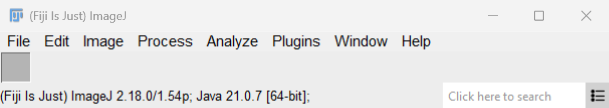
*Fig. 1: Main window (method A). It shows the title `(Fiji Is Just) ImageJ`, the AWT menu bar, the toolbar (blank, a capture artefact), the status line and the Fiji search field.*

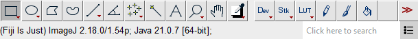
*Fig. 2: Toolbar and status line (method B). It shows the 1.54p tools followed by the Fiji StartupMacros tools `Dev`, `Stk`, `LUT`, pencil, paintbrush, flood fill and `>>`.*

## Verified Findings

Each component below has a table with the same rows: **Behaviour**, **Implementation**, **Limitations**, **Preserve** (the preservation requirement). Unless a row says otherwise, line references are to `imagej/ImageJ@v1.54p`.

### 5.1 Main window (`ij.ImageJ`)

| | |
|---|---|
| Behaviour | AWT `Frame` titled `(Fiji Is Just) ImageJ` (Fig. 1), 625×116 logical px (P50). It is laid out with `BorderLayout`: the menu bar, the `Toolbar` in the centre, and a status panel holding a `JLabel` status line and a `ProgressBar` canvas in the east. In Fiji, imagej-legacy rebuilds the status panel with MigLayout and adds a `SwingSearchBar` ("Click here to search") and a configure button (`imagej/imagej-legacy@imagej-legacy-3.0.0:src/main/java/net/imagej/legacy/search/SearchBarHacker.java#L99-L208`). Clicking the status line or the main window calls `Undo.reset()`, runs `System.gc()` and shows the version and free memory (`ij/ImageJ.java#L403-L409`). Closing it asks "Are you sure you want to quit ImageJ?" when windows are open (`#L849-L853`). On a clean quit it calls `Prefs.savePreferences()` (`#L864`) (**VERIFIED**). |
| Implementation | `ij.ImageJ extends Frame implements ActionListener, ..., KeyListener` (`#L77`). It is also the **global `KeyListener`**: toolbar, status line, progress bar, image canvases and many tool windows forward their keys to it (`#L169,L180,L184`; `StackWindow#L77`). Dependencies: `Menus`, `Toolbar`, `ProgressBar`, `WindowManager`, `Executer`, `Prefs`. |
| Limitations | It is a fixed, non-dockable strip. The single status line is shared by tool hints, pixel read-out, progress messages and errors. Its global key routing depends on focus being in an ImageJ-owned window. Killing the process skips `Prefs.savePreferences()`: P52 confirmed no `IJ_Prefs.txt` was written, while SciJava `PrefService` keys **were** written immediately to `HKCU\Software\JavaSoft\Prefs` (**VERIFIED**, P52). |
| Preserve | A persistent, always-reachable command surface (menu or search) and a status/read-out area that is visible while the user works on an image. Quit-time confirmation for unsaved images. |

### 5.2 Menu hierarchy

- **Top-level menus.** `File, Edit, Image, Process, Analyze, Plugins, Window, Help` (Fig. 1). They are built in `Menus.addMenuBar()`, which hard-codes the core items with shortcuts (`ij/Menus.java#L110-L256`) and loads the rest from `IJ_Props.txt` and the plugin jars (**VERIFIED**).
- **Key submenus.** These are created in source and populated from `IJ_Props.txt`:
  - `File>New`, `File>Open Samples`, `File>Open Recent`, `File>Import`, `File>Show Folder`, `File>Save As`;
  - `Edit>Selection`, `Edit>Options`;
  - `Image>Type` (checkbox items `8-bit` … `Lab Stack`, `#L158-L169`), `Image>Adjust`, `Image>Color`, `Image>Stacks` (with `Animation_` and `Tools_`), `Image>Hyperstacks`, `Image>Transform`, `Image>Zoom`, `Image>Overlay`, `Image>Lookup Tables`;
  - `Process>Noise/Shadows/Binary/Math/FFT/Filters/Batch`;
  - `Analyze>Gels/Tools`.

  The `Plugins` menu is populated from plugin jars (`addPluginsMenu()`, `#L231`). Fiji adds its own submenus through imagej-legacy. The authoritative list is G1's [`commands.csv`](../../data/commands.csv).
- **Window menu.** This menu is dynamic. Its fixed items are `Show All` (shortcut `]`), `Main Window [enter]`, `Put Behind [tab]`, `Cascade` and `Tile` (`#L233-L240`), followed by one item per open window (`WindowManager.addWindow` → `Menus.addWindowMenuItem`, `ij/WindowManager.java#L294-L315`) (**VERIFIED**).
- **Image right-click popup.** The popup on an image comes from `IJ_Props.txt` `popup01..popup11` (Show Info…, Properties…, Rename…, Measure, Histogram, Duplicate Image…, Original Scale, Record…, Find Commands…, Capture Screen). Fiji's `StartupMacros.fiji.ijm` replaces it with the `"Popup Menu"` macro, defined by `var pmCmds = newMenu("Popup Menu", …)` (installed file, lines 63–75) (**VERIFIED** source; the popup itself was not captured).
- **Preserve.** The **menu path is part of the public API**. Macros call commands by *label* (`run("Gaussian Blur...", ...)`), and labels such as `In [+]`, `Next Slice [>]` and `Start Animation [\]` include the shortcut decoration. `IJ.convert()` keeps legacy names working (`ij/IJ.java#L343-L404`). A modern UI may reorganise *presentation*, but it must keep every command reachable by its exact label and must not rename labels (**PROPOSED**).

### 5.3 Toolbar (`ij.gui.Toolbar`)

| Tool (ID) | Right-click / long-press (or Alt-click) options | Double-click | Source |
|---|---|---|---|
| Rectangle (0) | Rectangle / Rounded Rectangle / Rotated Rectangle | `Roi Defaults...` (`Rounded Rect Tool...` if rounded) | `Toolbar.java#L167-L177`, `#L1241-L1248` |
| Oval (1) | Oval / Elliptical / Selection Brush Tool | brush size dialog (`showBrushDialog`) | `#L179-L189`, `#L1249-L1251` |
| Polygon (2), Freehand (3) | — | — | `#L653-L658` |
| Line (4) / Segmented (5) / Freehand line (6) | Straight / Segmented / Freehand / Arrow tool | Line Width adjuster (`ij.plugin.frame.LineWidthAdjuster`), or `Arrow Tool...` in arrow mode | `#L200-L213`, `#L1258-L1263` |
| Angle (14) | — | angle dialog | `#L1264-L1266` |
| Point/Multi-point (7) | Point Tool / Multi-point Tool | `Point Tool...` | `#L191-L198`, `#L1267-L1269` |
| Wand (8) | — | `Wand Tool...` | `#L1270-L1272` |
| Text (9) | — | `Fonts...` | `#L1273-L1275` |
| Magnifier (11) | Reset Zoom, Zoom In, Zoom Out, View 100%, Zoom To Selection, Scale to Fit, Set..., Maximize | `ImageCanvas.unzoom()` | `#L215-L224`, `#L1252-L1257` |
| Hand (12) | — | — | `#L688-L690` |
| Colour picker / dropper (13) | White/Black, Black/White, Red…Magenta, Foreground..., Background..., Colors..., Color Picker... | `Color Picker...` | `#L226-L240`, `#L1276-L1279` |
| Custom slots 15–21 | macro tool `"<name> Options"` or plugin tool popup | macro `Options` / `PlugInTool.showOptionsDialog()` | `#L1197-L1203`, `#L1230-L1238` |
| `>>` (last) | "More Tools" switch menu (toolsets) | — | `#L143`, `#L1211-L1214` |

- **Hover help.** When the pointer is over a tool, `Toolbar.showMessage` writes a hint to the status line, for example `"*Rectangle*, rounded rect or rotated rect (alt or long click to switch)"` (`#L614-L697`).
- **Double-click detection.** A double-click is a second press within `DOUBLE_CLICK_THRESHOLD = 650` ms (`#L47,L1224`) (**VERIFIED**).
- **Fiji additions.** In Fiji the custom slots hold `Developer Menu Tool` (`Dev`), `Stacks Menu Tool` (`Stk`), `LUT Menu Tool`, `Pencil Tool`, `Paintbrush Tool` and `Flood Fill Tool`, from `StartupMacros.fiji.ijm` lines 89–185 (Fig. 2) (**VERIFIED**).
- **Limitations.** The toolbar is a custom-painted AWT `Canvas` with no per-button focus or accessible name (**INFERRED** from `class Toolbar extends Canvas`, `Toolbar.java#L22`). Sub-tool variants are hidden behind long-press or right-click. Tool state is global, so one tool applies to all images.
- **Preserve.** The tool **set** and **variants**. That the active tool is a *mode* applied to whichever image is clicked. That double-click opens the tool's options. That macro-defined and plugin-defined tools can occupy toolbar slots (`macro "X Tool - <icon>"`, `PlugInTool`).

### 5.4 Image windows (`ij.gui.ImageWindow`, `ij.gui.StackWindow`)

| | |
|---|---|
| Behaviour | Each image is its own `Frame`. The **title** is the image title plus `" (V)"` for a virtual stack, `" (G)"` for global calibration, and `" (NN%)"` when zoom ≠ 100 % (`ij/ImagePlus.java#L1192-L1207`). The **subtitle line** is drawn by `ImageWindow.drawInfo` inside an enlarged top inset (`ImageWindow.java#L257-L305`). It contains `[n/N (label); ]` for stacks, then calibrated size and unit with pixel size in brackets or `WxH pixels`, then the type (`8-bit`/`16-bit`/`32-bit`/`RGB`, plus `(inverting LUT)` if applicable), then the memory size (`createSubtitle`, `#L309-L379`). Hyperstacks use `StackWindow.createSubtitle` (`StackWindow.java#L259`). Observed examples: `256x254 pixels; 8-bit; 64K` (Fig. 3) and `c:2/3 z:4/8 t:3/5 ("2,4,3"); 320x240 pixels; 8-bit; 8.8MB` (Fig. 4). In composite mode the subtitle is drawn in the current channel's colour (`#L287-L296`). Closing a modified image asks `Save changes to "<title>"?` with Yes/No/Cancel (`#L422-L442`) (**VERIFIED**). |
| Implementation | `ImageWindow extends Frame implements FocusListener, WindowListener, WindowStateListener, MouseWheelListener` (`#L16`), wrapping an `ImageCanvas`. `StackWindow` adds `ScrollbarWithLabel` sliders. Activation calls `WindowManager.setCurrentWindow(this)` (`#L602-L616`). |
| Limitations | One OS window per image means no tabbing, docking or linked layout, and many windows for multi-image work. The subtitle is the only always-visible metadata, and it is painted text (not selectable). |
| Preserve | Always-visible **dimension/type/size/position** metadata per image, using the same 1-based C/Z/T notation. Unsaved-change protection. Image identity by **title** (macros use `selectImage("title")`) and by **ID**. |

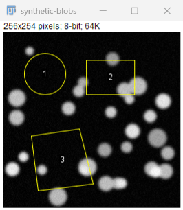
*Fig. 3: `synthetic-blobs` with three ROI Manager ROIs shown via *Show All* with labels (method A).*

### 5.5 Canvas: zoom, pan and pixel read-out (`ij.gui.ImageCanvas`)

- **Zoom levels.** These are fixed: `1/72, 1/48, 1/32, 1/24, 1/16, 1/12, 1/8, 1/6, 1/4, 1/3, 1/2, 0.75, 1, 1.5, 2, 3, 4, 6, 8, 12, 16, 24, 32` (`ImageCanvas.java#L810-L813`).
- **Zooming in.** `zoomIn(sx,sy)` first tries to **enlarge the window** (`canEnlarge`). Only when it cannot does it shrink `srcRect` around the cursor (`#L841-L868`).
- **Magnifier tool.** Click zooms in. Alt/Ctrl/Meta-click zooms out. Shift-click zooms to the selection (`#L1177-L1189`).
- **Keyboard and wheel zoom.** `+`/`=`/`-` keys work everywhere (§5.18). Ctrl- or Shift-wheel zooms about the cursor (`ImageWindow.java#L665-L672`).
- **Panning.** Panning uses the hand tool or **holding Space** with any tool (`IJ.setKeyDown(VK_SPACE)` sets `spaceDown`, `ij/IJ.java#L1114-L1119`, and `ImageCanvas.mousePressed` calls `setupScroll` when `IJ.spaceBarDown()`, `#L1136-L1139`). On a single image the plain wheel scrolls vertically, or horizontally with Space held (`ImageWindow.java#L673-L682`).
- **Pixel read-out.** `ImageCanvas.mouseMoved` → `ImagePlus.mouseMoved` writes `" x=…, y=…[, z=…], value=…"` to the status line (`ImagePlus.java#L2786-L2792`). Calibrated coordinates are shown with the raw value in brackets (`getLocationAsString`, `#L2823-L2842`). Values are formatted by type (`getValueAsString`, `#L2848-L2879`): 8/16-bit `value=v` or `value=cal (raw)`, 32-bit 4 decimal places, RGB `r,g,b (#hex)`, and indexed colour `index=…, value=r,g,b`. Holding Alt appends the image title (**VERIFIED**).
- **Limitations.** Discrete zoom only, with no continuous or pinch zoom. Window resizing is coupled to zoom. The read-out is transient text in the shared status line, with no persistent pixel inspector. The canvas is AWT and painted, so it has no accessibility tree (**INFERRED**).
- **Preserve.** **Calibrated and raw values together**. Read-out semantics per bit depth. Cursor-anchored zoom. Space-to-pan as a quasi-modal override. The discrete zoom ladder, at least as keyboard steps, because users and macros (`run("In [+]")`) rely on it.

### 5.6 Navigation (keyboard and mouse)

Source: `ImageJ.keyPressed` (`ij/ImageJ.java#L425-L579`), `keyTyped` (`#L627-L638`), `StackWindow.mouseWheelMoved` (`StackWindow.java#L171-L205`), `Animator.nextSlice/previousSlice` (`ij/plugin/Animator.java#L266-L320`).

- **Arrow keys.** With no ROI, or with Shift held, ←/→ step through the stack and ↑/↓ zoom. With a ROI and no modifier they **nudge the ROI** by one pixel. Alt- or Ctrl-arrow calls `roi.nudgeCorner` (resize) (`#L530-L557`).
- **Hyperstacks.** *Next/Previous Slice* changes **channel**. With Ctrl or Space held it changes **slice**, and with Alt it changes **frame** (`Animator.java#L271-L282`). On a plain stack, Alt steps by 10 slices (`#L284-L287`).
- **Mouse wheel.** In a `StackWindow` the wheel steps slices when `Prefs.mouseWheelStackScrolling` is true (the default, `ij/Prefs.java#L201`). On a hyperstack this goes through `Next Slice [>]` (`#L189-L193`).
- **Preserve.** The **modifier-dependent meaning** of the arrow keys (ROI nudge versus slice versus zoom). This is muscle memory for expert users, and a modern UI must not reassign these keys silently (**PROPOSED**).

### 5.7 Selections and modifier keys (`ij.gui.Roi`, `ImageCanvas`)

| Gesture | Effect | Source |
|---|---|---|
| Shift + drag (new area selection, existing ROI) | Add to selection (`Roi.ADD_TO_ROI`) | `ImageCanvas.java#L1453-L1466` |
| Alt + drag | Subtract (`Roi.SUBTRACT_FROM_ROI`) | same |
| Shift while dragging rectangle/oval | Constrain to square/circle; constrain translation to 90° steps | `Roi.java#L1282`, `#L882`, `#L1141` |
| Ctrl while dragging | Grow from centre | `Roi.java#L1283` |
| Alt while dragging | Keep aspect ratio | `Roi.java#L1284` |
| Shift-click polygon handle | Add a vertex (`addHandle`) | `PolygonRoi.java#L803-L805` |
| Alt/Ctrl-click polygon handle | Delete a vertex (`deleteHandle`) | `PolygonRoi.java#L800-L802` |
| Ctrl while drawing a line | Integer coordinates | `Line.java#L127` |
| Esc during modification | `roi.abortModification` | `ImageJ.java#L645-L653` |
| Wand click | `IJ.doWand(imp,x,y,tolerance,mode)`, recorded as `doWand(...)` | `ImageCanvas.java#L1196-L1232` |

- **Restrictions.** Add/subtract modes apply only to area tools, the wand and the point tool (`#L1459-L1460`).
- **Limitations.** Modifier semantics are invisible (status hints only) and are platform-dependent (Meta replaces Ctrl on macOS). There is no on-screen affordance for boolean ROI operations.
- **Preserve.** The complete modifier algebra and **sub-pixel/integer coordinate semantics**, because they change measurement results. ROI geometry types (`Roi`, `OvalRoi`, `PolygonRoi`, `Line`, `PointRoi`, `ShapeRoi`, `RotatedRectRoi`, `EllipseRoi`) must stay distinct.

### 5.8 ROI Manager (`ij.plugin.frame.RoiManager`)

| | |
|---|---|
| Behaviour | Buttons: `Add [t]`, `Update`, `Delete`, `Rename...`, `Measure`, `Deselect`, `Properties...`, `Flatten [F]`, `More »`, plus `Show All` and `Labels` checkboxes (`RoiManager.java#L136-L143`; Fig. 5). The `More »` popup holds `Open...`, `Save...`, `Fill`, `Draw`, `AND`, `OR (Combine)`, `XOR`, `Split`, `Add Particles`, `Multi Measure`, `Multi Plot`, `Multi Crop`, `Sort`, `Specify...`, `Remove Positions...`, `Labels...`, `List`, `Interpolate ROIs`, `Scale...`, `Rotate...`, `Translate...`, `ROI Manager Action`, `Help` and `Options...` (`#L177-L200`). Default ROI names are `yyyy-xxxx` (centre y-x, zero-padded), prefixed by the slice for stacks (`getLabel`, `#L511-L534`). Observed: `0060-0060`, `0065-0155`, `0185-0085`. *Measure* writes one Results row per selected ROI, labelled `image:roi` (Fig. 6) (**VERIFIED**). |
| Implementation | `RoiManager extends PlugInFrame` (AWT) containing a Swing `JList` (`#L30,L94-L108`). It is a singleton (`RoiManager.getInstance()`) and the macro `roiManager(...)` functions address it. |
| Limitations | One global manager for all images. ROIs are bound to images only by position/name conventions. Boolean operations are hidden under `More »`. AWT/Swing mixing. |
| Preserve | The ROI list as a **first-class, scriptable collection** with stable index order (macros use `roiManager("select", i)`). Multi-select measure. `.roi`/`.zip` interchange. Show All / Labels overlay. Per-ROI C/Z/T positions. |

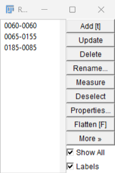
*Fig. 5: ROI Manager (method A).*

### 5.9 Results, table and Log windows (`ij.text.TextWindow`, `TextPanel`, `ij.measure.ResultsTable`)

| | |
|---|---|
| Behaviour | A `TextWindow` frame with menus `File` (Save As… ^S, Rename…, Duplicate…), `Edit` (Cut, Copy, Clear, Select All, Find…, Find Next), `Font`, and for Results a `Results` menu (Clear Results, Summarize, Distribution…, Set Measurements…, Sort…, Plot…, Options…) (`ij/text/TextWindow.java#L160-L202`; Fig. 6). The Log is the same class without a header row (Fig. 15). |
| Implementation | `TextPanel extends Panel`, which draws its rows on a custom `TextCanvas extends Canvas` (`ij/text/TextPanel.java#L24`, `ij/text/TextCanvas.java#L6`). The data model is `ResultsTable`. |
| Limitations | The table is painted text, not a native table: there is no cell editing, typed columns or accessible grid (**INFERRED**). "Results" is a special singleton table that `Measure` appends to. |
| Preserve | The **singleton "Results" table semantics** (macros: `nResults`, `getResult`, `setResult`, `Table.*`). Column naming from Set Measurements. Row labels `image:roi`. The decimal-places setting. Copy as tab-separated text. |

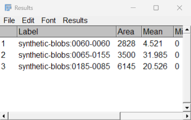
*Fig. 6: Results after `roiManager("Measure")` (method A).*

### 5.10 Histogram and plot windows (`ij.gui.HistogramWindow`, `ij.gui.PlotWindow`)

- **Both are `ImageWindow` subclasses.** The plot or histogram is an image, and the subtitle reads `300x246 pixels; RGB; 288K` for the histogram (Fig. 10).
- **Histogram window.** It shows N, Mean, StdDev, Min, Max and Mode, with `List`, `Copy`, `Log` and `Live` buttons (`HistogramWindow.java#L199-L209`).
- **Plot window.** It has `List`, `Data »`, `More »` and `Live` buttons (Fig. 11; `PlotWindow.java#L239`). Its read-out is suppressed for pixel values (`ImagePlus.getValueAsString` returns `""` for `PlotWindow`, `#L2849-L2850`) and instead shows plot coordinates in the subtitle (observed `284.20x251.48 (696x405)…`).
- **Limitations.** These are raster plots, so text is not accessible and they cannot be zoomed as vectors except by re-plotting. *Live* mode follows the current ROI.
- **Preserve.** Underlying data is exportable (`List`), plot styling is scriptable (`Plot.*` macro functions), and the Live link to the current selection.

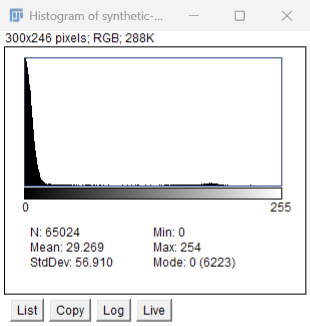 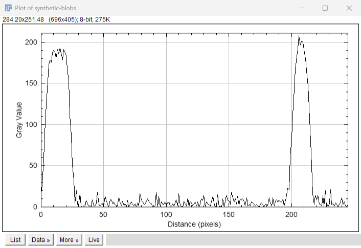

### 5.11 Brightness/Contrast (`ij.plugin.frame.ContrastAdjuster`)

| | |
|---|---|
| Behaviour | Non-modal `PlugInDialog` "B&C" (Fig. 7) with a histogram, *Minimum*, *Maximum*, *Brightness* and *Contrast* sliders, and buttons `Auto`, `Reset`, `Set`, `Apply` (`#L217-L229`). Sliders change only the **display range** (`setMinAndMax`); pixel data is unchanged. *Apply* rewrites pixels through a lookup table after a warning ("the pixel values will change if you click OK"). For stacks it asks "Apply LUT to all N stack slices?". It is refused for 32-bit images (`apply`, `#L639-L733`). Recording: slider drags are **not** recorded. `Set` records `setMinAndMax(min,max)` (`recordSetMinAndMax`, `#L1067-L1081`), `Auto` records `run("Enhance Contrast", "saturated=0.35")` (`#L857-L862`) and `Apply` records `run("Apply LUT"[, "stack"])` (`#L725-L732`) (**VERIFIED**). Variants: `Window/Level` (`arg "wl"`) and `Color Balance` (`arg "balance"`) (`#L68-L72`). |
| Limitations | Silently re-targets whichever image becomes active. Interactive changes leave no record unless *Set* is used. Composite images need per-channel handling via the Channels tool. |
| Preserve | **Display range ≠ pixel values.** Any modern viewer contrast control must be non-destructive by default, with an explicit, warned, recordable *Apply*. The 16-bit display range and the "default 16-bit range" semantics must be kept. |

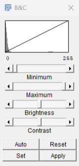

### 5.12 Threshold dialog (`ij.plugin.frame.ThresholdAdjuster`)

| | |
|---|---|
| Behaviour | Non-modal "Threshold" dialog (Fig. 8). It has a histogram with the selected range, the percentage above threshold (observed `13.47 %`), lower and upper sliders with numeric fields, a method choice (`AutoThresholder.getMethods()`, default `Default`), a display mode `Red`/`B&W`/`Over/Under` (`#L28`), checkboxes `Dark background`, `Stack histogram`, `Don't reset range`, `Raw values` and `16-bit histogram` (`#L212-L232`), and buttons `Auto`, `Apply`, `Reset`, `Set`. While open, the threshold is shown as a red **LUT overlay** (Fig. 9), so pixels are unchanged. *Apply* runs `Convert to Mask` (or, for 32-bit images, offers `NaN Background`) (`apply`, `#L837-L866`). It records `setAutoThreshold("<method> [dark]")`, `setThreshold(min,max[,"raw"])` and `run("Convert to Mask")` (`#L394-L396,L526-L528,L802-L819`) (**VERIFIED**). |
| Limitations | Overlay colour is the only cue. The dialog tracks the active image via `ImageListener` (`#L285,L360`). Method parameters are hidden. |
| Preserve | Threshold as a **reversible display state** that is distinct from the binary result. The method name and *dark background* flag are part of the recorded call, and numerical thresholds are recorded for reproducibility. |

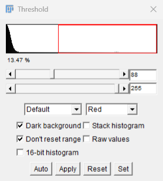 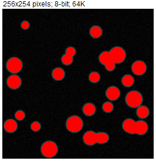

### 5.13 Stacks and hyperstacks (`StackWindow`, `ScrollbarWithLabel`, `Animator`)

- **Sliders.** `StackWindow` adds one `ScrollbarWithLabel` per non-singleton dimension: `c`, `z` and `t` (`StackWindow.java#L69-L103`; Fig. 4). The `t` slider, or `z` when there is no `t`, carries a **play/pause icon**. Clicking it toggles `Start Animation [\]`, and Alt-click opens `Animation Options...` (`ScrollbarWithLabel.java#L217-L223`).
- **Keyboard.** `\` starts or stops animation, and Alt+`\` opens the options (`ImageJ.keyTyped`, `ImageJ.java#L627-L638`).
- **Position notation.** Positions are 1-based `(c,z,t)`. `Stack.setPosition(2,4,3)` produced `c:2/3 z:4/8 t:3/5` (P50).
- **Limitations.** The sliders are AWT scrollbars with single-letter labels. There are no dimension names or units on the slider, and no multi-dimensional overview.
- **Preserve.** The **C/Z/T model and order**. The 1-based display of positions while the stack index stays linear (`getStackIndex`). Animation fps per image (`Animation Options...`). Wheel and keyboard stepping semantics (§5.6).

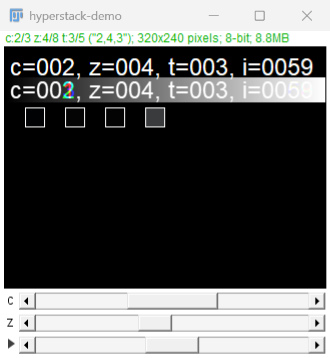
*Fig. 4: 3-channel, 8-slice, 5-frame composite hyperstack (method A).*

### 5.14 Channels tool and composite modes (`ij.plugin.frame.Channels`, `ij.CompositeImage`)

- **Dialog.** "Channels" (`Z` shortcut; Fig. 12). The mode choice offers `Composite`, `Color`, `Grayscale`, `Composite Max`, `Composite Min` and `Composite Invert` (`Channels.java#L11-L12`). Per-channel visibility checkboxes are shown in composite mode.
- **`More »` menu.** It holds `Make Composite`, `Create RGB Image`, `Split Channels`, `Merge Channels...`, `Show LUT`, `Invert LUTs`, and the LUTs `Red`, `Green`, `Blue`, `Cyan`, `Magenta`, `Yellow` and `Grays` (`#L14-L15`).
- **Modes in code.** `CompositeImage` defines `COMPOSITE=1, COLOR=2, GRAYSCALE=3, TRANSPARENT=4` and `MAX_CHANNELS=8` (`CompositeImage.java#L13-L14`). The dialog is refreshed when a composite image is activated (`ImageWindow.java#L614-L615`) (**VERIFIED**).
- **Preserve.** Composite mode is a **display** property. Channel visibility (`Stack.setActiveChannels("101")`) is display state, separate from data. Per-channel LUT and display range.

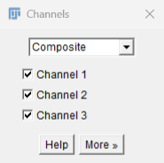

### 5.15 Plugin and tool windows

- **Base classes.** ImageJ1 tool windows extend `PlugInFrame` (`Frame`) or `PlugInDialog` (`Dialog`) (`ij/plugin/frame/PlugInFrame.java#L8`, `PlugInDialog.java#L9`):
  - `PlugInFrame`: Recorder, RoiManager, Editor, ColorThresholder, Commands, Fitter, LineWidthAdjuster, MemoryMonitor, PasteController, SyncWindows;
  - `PlugInDialog`: ContrastAdjuster, ThresholdAdjuster, Channels, ColorPicker.
- **SciJava/Fiji windows.** These are Swing windows under the FlatLaf Light look and feel (P52 registry key `look/And/Feel=/Flat/Laf /Light`):
  - **Script Editor** (`org.scijava.ui.swing.script.TextEditor`, Fig. 14), with menus `File, Edit, Language, Templates, Run, Tools, Window, Options, Help`, an Outline/File Explorer side pane, `Run`/`Batch`/`Kill` buttons, `REPL` and an output pane;
  - **Command Finder** (`ij.plugin.CommandFinder`, a `JFrame`, Fig. 16);
  - **Welcome to Fiji** (`org.scijava.ui.swing.viewer.SwingDisplayWindow`, shown on the first GUI start only; P50 attempt-1 log; preference `org.scijava.welcome…/firstRun-2.18.0/1.54p=false` written, P52).
- **Third-party plugins.** These may use either toolkit or open their own frames (**INFERRED**; see A08/A11).
- **Limitations.** Two widget toolkits with different fonts, scaling and keyboard behaviour (visible when Fig. 14 is compared with Fig. 5). Window geometry is persisted in two different stores: `IJ_Prefs.txt` on clean quit, and Java Preferences immediately (P52).
- **Preserve.** Plugins that open their own windows must keep working. A modern shell must **host or tolerate foreign AWT/Swing windows** rather than assume it owns all UI (**PROPOSED**; feasibility in A15).

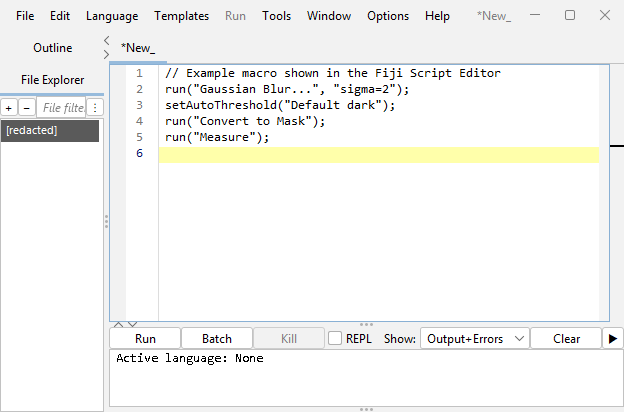

### 5.16 Recorder (`ij.plugin.frame.Recorder`)

| | |
|---|---|
| Behaviour | Frame "Recorder" (Fig. 13) with a `Record:` choice of `Macro`, `JavaScript`, `BeanShell`, `Python` or `Java` (`Recorder.java#L27`), a `Name:` field, and `Create`, `Run` and `Help` buttons. While it is open, `Executer.run` wraps every menu command in `Recorder.setCommand(cmd)` … `Recorder.saveCommand()` (`ij/Executer.java#L64-L68`). `GenericDialog` getters append `key=value` options. Image activation records `selectImage("title")` when not in a macro (`WindowManager.java#L53-L54`). Commands run *from macros* are not recorded unless `Recorder.recordInMacros` is set (`#L24,L156,L372`). |
| Observation (P50) | With `recordInMacros=true`, the staged macro `run("Gaussian Blur...", "sigma=2")` was recorded as `run("Gaussian Blur...");`. `run("Set Measurements...", "area mean min centroid display ...")` was recorded **without** `centroid display`, although the Results table shows that `display` took effect (Fig. 6). `roiManager("Measure")` appeared as three `run("Measure")` lines (Fig. 13) (**VERIFIED** observation). The cause is **UNKNOWN**. To verify it, repeat with an interactive dialog and compare the recorded options, and trace `GenericDialog.getNextNumber` with `recorderOn` (`GenericDialog.java#L1189-L1236,L1506-L1511`). |
| Limitations | It records only what passes through `Executer`/`GenericDialog`/explicit `Recorder.record` calls. Interactive tool changes (B&C drags, many ROI edits) leave gaps. It is not a faithful log of programmatic execution. |
| Preserve | Recording **as macro text in the user's language of choice**, using the exact command labels and option keys that `run()` accepts, so that recorded output can be replayed. A modern history panel should be a *superset* of this, not a replacement (**PROPOSED**). |

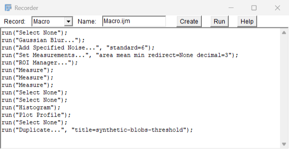

### 5.17 Status bar and progress bar

- **Status line.** `IJ.showStatus(s)` sets the `JLabel` (`ImageJ.java#L312-L313`). `IJ.showStatus` honours `protectStatusBar` (`ij/IJ.java#L452-L476`). Writers include tool hints, the pixel read-out, the startup message `ImageJ <ver>; Java …; N commands`, and progress text from commands.
- **Progress bar.** It is a separate `Canvas` (`ij/gui/ProgressBar.java#L12`), driven by `IJ.showProgress(double)` and `IJ.showProgress(i,n)` (`IJ.java#L774-L785`). `show(progress, showInBatchMode)` controls whether it shows in batch mode (`ProgressBar.java#L77`).
- **Limitations.** The status line holds one message at a time and is overwritten constantly. There is no notification history and no per-task progress or cancellation, apart from Esc (`abortPluginOrMacro`, `ImageJ.java#L645-L663`).
- **Preserve.** The plugin API (`IJ.showStatus`, `IJ.showProgress`) must still surface somewhere, and Esc must abort the running macro or plugin.

### 5.18 Keyboard shortcuts

- **Matching rules.** Shortcuts are matched in `ImageJ.keyPressed` (`ij/ImageJ.java#L425-L579`) in this order:
  1. text-ROI typing;
  2. one-key **macro shortcuts** from installed macros (`Menus.getMacroShortcuts`, `#L469-L483`);
  3. menu shortcuts (`Menus.getShortcuts`), used **without Ctrl unless `Prefs.requireControlKey`** is set (`#L492-L499`). The Shift variant is stored as `keyCode+200` (`ij/Menus.java#L1587`);
  4. hard-coded keys.

  Fiji's search bar replaces `l` with *Focus Search Bar* and removes the shortcut from *Find Commands...* (`SearchBarHacker.java#L201-L206`; default `overrideShortcut=true`, `#L74`).

| Key | Command | Source |
|---|---|---|
| o / O | Open... / Open Next | `Menus.java#L112-L113` |
| w / W | Close / Close All | `#L130-L131` |
| s / R | Save / Revert | `#L132,L134` |
| p | Print... | `#L137` |
| z | Undo (single level, see §5.20) | `#L140` |
| x c v | Cut / Copy / Paste | `#L142-L145` |
| f / d / I | Fill / Draw / Invert | `#L150-L152` |
| i / P | Show Info... / Properties... | `#L173-L174` |
| X / D / e | Crop / Duplicate... / Scale... | `#L181-L184` |
| S / r | Smooth / Repeat Command | `#L192,L207` |
| m / h / k | Measure / Histogram / Plot Profile | `#L210,L224,L225` |
| ] | Window>Show All | `#L234` |
| n / N / V | New Image... / Text Window / System Clipboard | `IJ_Props.txt` L25–29 |
| a / A / E / y / t | Select All / Select None / Restore Selection / Selection Properties / Add to Manager | L70–95 |
| C / T / Z / K | Brightness/Contrast / Threshold / Channels Tool / Color Picker | L121–144 |
| > < / H / \\ | Next/Previous Slice / Orthogonal Views / Start Animation | L149–166 |
| + - / 4 / 5 | Zoom In/Out / Original Scale / View 100% | L205–208 |
| b / F / Y | Add Selection (overlay) / Flatten / Overlay Options | L215–227 |
| 1 2 3 | Gel lanes | L349–351 |
| M / j / u | Install... / Interactive Interpreter / Record... | L374–390 |
| U / l / L / G / B | Control Panel / Find Commands (Fiji: Focus Search Bar) / Commands... / Capture Screen / Blobs sample | L402–445 |
| Tab | Put Behind (cycle images) | `ImageJ.java#L513` |
| Backspace/Delete | Delete the selected overlay ROI, else `Clear` | `#L514-L522` |
| = + - , . ; / | Zoom / slice / Reslice fall-backs | `#L500-L508,L525-L529` |
| Arrows | §5.6 | `#L530-L557` |
| Esc | Abort ROI edit, else abort macro/plugin | `#L559-L561` |
| Enter | Bring the main window to front | `#L562` |
| Space (held) | Temporary hand tool | `IJ.java#L1114` |
| Alt+u / Alt+m / Alt+A in Text ROI | µ / µ / Å | `ImageJ.java#L458-L463` |

- **Documentation cross-check.** The ImageJ docs agree that shortcuts work without Ctrl unless "Require control key for shortcuts" is set ([guide 146-4](https://imagej.net/ij/docs/guide/146-4.html), accessed 2026-10-17) (**VERIFIED as documentation**).
- **Preserve.** **Single-key shortcuts on the image** (no Ctrl), user-installable macro shortcuts that take precedence, and Shift-letter as a distinct binding. A modern UI must not intercept these keys while an image has focus (**PROPOSED**).

### 5.19 `GenericDialog` conventions

| | |
|---|---|
| Behaviour | Modal AWT `Dialog` (Fig. 17: `Gaussian Blur...` with `Sigma (Radius): 2.00`, `Preview`, `OK`, `Cancel`). In **macro mode** (`Macro.getOptions()!=null`, `GenericDialog.java#L120-L121`) the dialog is never shown (`showDialog` disposes it, `#L1506-L1511`). Each `getNext*()` reads its value from the options string using a key derived from the field label (`Macro.getValue(macroOptions,label,…)`, `#L1195-L1198`). Numeric fields accept macro variable names (`&var`) and report invalid values as `Macro Error … Key: "<key>"` (`#L1213-L1226`). When recording, each getter appends `key=value` (`recordOption`, `#L1229-L1265`), except that the **Preview checkbox is never recordable** (`#L568`). `setSmartRecording(true)` omits unchanged values (`#L1116`). `addPreviewCheckbox(pfr)` connects the dialog to the `PlugInFilterRunner` for live preview (`#L590-L606`, `#L1513-L1514`). `addDialogListener` provides validation on change (`#L1169`). `addHelp(url)` adds a Help button (`#L1912`). `NonBlockingGenericDialog` is the non-modal variant. |
| Limitations | The layout is a vertical list of AWT fields with no grouping, units or validation feedback beyond an error dialog. It is modal, so it blocks other windows. Preview is per-filter and optional. |
| Preserve | **Field label → macro key mapping** (keys are the first word of the label, lower-cased, and are part of the macro API). Skip-dialog-when-options-given. Preview that does not record. Cancel leaves no side effects. Any modern dialog must produce **identical option strings** (**PROPOSED**; the parity metric is in A30). |

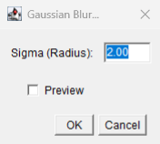

### 5.20 Multi-window behaviour and the "current image"

- **Current image.** Every image is a top-level window. The **current image** is the most recently activated `ImageWindow` (`WindowManager.setCurrentWindow`, `ij/WindowManager.java#L31-L55`).
- **Activation side effects.** Activating an image calls `Undo.reset()` (**undo is lost on window switch**, `#L48`), trims the previous image's snapshot buffer unless `Prefs.keepUndoBuffers` is set (`#L43-L44`), updates menus, and records `selectImage` (`#L53-L54`).
- **Undo.** Undo is single-level static state (`ij/Undo.java#L30-L39`).
- **Window management.** `Window>Tile` and `Cascade` are implemented in `ij/plugin/WindowOrganizer.java#L24-L30,L132`. *Put Behind* (`Tab`) is `WindowManager.putBehind()` (`#L500`). Enter brings the main window to the front (`WindowManager.toFront`, `#L633-L640`).
- **Re-targeting tool windows.** B&C, Threshold and Channels follow the active image (Channels via `ImageWindow.windowActivated`, `ImageWindow.java#L614-L615`; Threshold via `ImageListener`). This was observed during capture: activating each window changed what B&C showed (P51 log ordering; **VERIFIED** observation).
- **Commands run asynchronously.** Commands run on their own thread named after the command, below normal priority (`Executer`, `ij/Executer.java#L36-L51`). *Repeat Command* replays `previousCommand`.
- **Limitations.** Focus-dependent targeting is error-prone (a command can land on the wrong image), undo is lost on switch, and window clutter grows with each image.
- **Preserve.** **An explicit, visible "current image"** that commands, macros (`selectImage`, `getImageID`) and tools agree on. Asynchronous command execution with Esc-abort. *Put Behind*/cycle semantics.

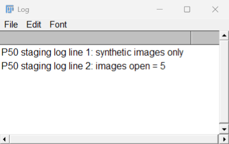 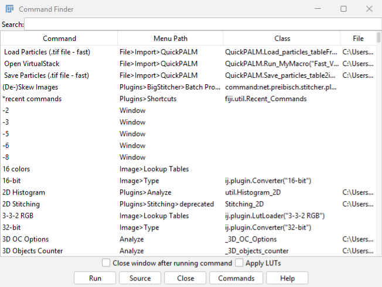
*Fig. 15–16: Log window and Command Finder (columns Command / Menu Path / Class / File; options `Close window after running command`, `Apply LUTs`; buttons Run, Source, Close, Commands, Help).*

## Diagrams and Inventories

### 7.1 Event routing (VERIFIED from source)

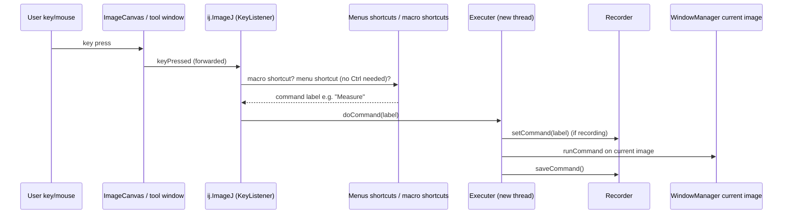

### 7.2 Legacy component → candidate modern counterpart (seed for the feature map)

All counterparts are **PROPOSED** unless marked otherwise. Preservation notes refer to §5.

| Legacy component (class) | Evidence | Candidate modern counterpart | Must keep |
|---|---|---|---|
| Main frame (`ij.ImageJ`) | VERIFIED | Workstation shell: menu bar plus command palette plus status/inspector strip | Command reachability by exact label; Esc abort |
| AWT menu bar (`Menus`, `IJ_Props.txt`) | VERIFIED | Same hierarchy as a searchable menu; command palette indexing `commands.csv` | Labels and menu paths unchanged |
| Fiji search bar (`SwingSearchBar`) / Command Finder | VERIFIED | Command palette (also the NL/voice entry point) that resolves to existing commands | `l`/`L` behaviour; shows the menu path |
| Toolbar (`Toolbar` canvas) | VERIFIED | Accessible tool rail with visible variants and an options popover | Tool IDs and variants; double-click = options; macro/plugin tools |
| `ImageWindow` per image | VERIFIED | Tabbed/tiled image viewports in one window; detachable | Title/ID identity; subtitle metadata; Save-changes prompt |
| `ImageCanvas` zoom/pan | VERIFIED | GPU viewport with the same discrete zoom steps plus continuous zoom | Cursor-anchored zoom; Space-pan; calibrated + raw read-out |
| Status-line pixel read-out | VERIFIED | Persistent pixel inspector panel | Value formatting by bit depth |
| `StackWindow` sliders | VERIFIED | Labelled dimension scrubbers (C/Z/T with names/units) plus play controls | 1-based C/Z/T; animation fps; key/wheel semantics |
| `Channels` dialog | VERIFIED | Channel panel (visibility, LUT, per-channel range) | Composite modes; display-only semantics |
| `ContrastAdjuster` (B&C) | VERIFIED | Display-range panel bound to the visible viewport, plus explicit *Apply* | Non-destructive by default; recordable Set/Apply |
| `ThresholdAdjuster` | VERIFIED | Threshold panel with overlay preview and an explicit *Create mask* | Method + dark flag + numeric range recorded |
| `RoiManager` | VERIFIED | ROI layer panel per image, plus a global list view | Index order; `roiManager()` macro API; `.roi/.zip` |
| `TextWindow`/`ResultsTable` | VERIFIED | Accessible data grid (sortable, typed), linked to ROIs | "Results" singleton semantics; TSV copy |
| `HistogramWindow`/`PlotWindow` | VERIFIED | Vector charts with data export | `List` data; Live link |
| `GenericDialog` | VERIFIED | Inspector-style parameter form generated from the same fields | Identical option string; preview not recorded |
| `Recorder` | VERIFIED | History panel that emits a replayable macro (plus the other languages) | Exact `run()` labels/keys; never invent options |
| Log window | VERIFIED | Console panel | `IJ.log`/`print` output order |
| Script Editor (`TextEditor`) | VERIFIED | Embedded editor panel | Languages, Run/Batch/Kill |
| `PlugInFrame`/foreign plugin windows | VERIFIED (base classes), INFERRED (third-party) | Hosted or floating legacy windows | Must still open and work |
| Window menu / Tile / Cascade / Put Behind | VERIFIED | Workspace layout manager | Cycle semantics; list of open images |
| Single-level `Undo` | VERIFIED | Multi-step history (UI-level, with snapshots) | Must not change pixel results; scope to be decided (A26) |

## Constraints and Limitations

- **Screenshot coverage.** The screenshots are faithful renders of the pinned runtime, but they were taken with the screen saver active. Method A leaves the toolbar canvas blank (so it is complemented by method B), and method B omits native title bars and menus. Expanded menus, toolbar popups and the image right-click popup were **not captured** (**UNKNOWN**). To verify, rerun P50/P51 `-Mode menu` while the user is at an unlocked desktop.
- **Display scaling.** At 150 % scaling Java's `PrintWindow` response is rendered at 100 %, so the screenshot pixel sizes equal Java logical sizes, not on-screen physical sizes.
- **Documentation version.** The ImageJ User Guide is for 1.46r. Wherever source and documentation differ, the source at v1.54p is authoritative.
- **Fiji additions not covered.** Fiji-specific menu additions beyond the main frame, search bar, Script Editor and StartupMacros (for example the Plugins submenus from update sites) are covered by G1's command catalogue, not here.

## Requirement implications

- **CR-A04-01.** The modern UI shall make every existing ImageJ/Fiji command reachable by its exact menu label and path, as listed in `docs/data/commands.csv`. *Rationale:* macros and the Recorder address commands by label (§5.2).
- **CR-A04-02.** The modern UI shall show one explicit current image at all times, and every command, macro call and tool action shall target that image. *Rationale:* focus-based targeting is the main source of mis-applied commands (§5.20).
- **CR-A04-03.** Contrast/brightness controls shall change only the display range unless the user invokes an explicit *Apply*, which shall warn before changing pixels and shall record `run("Apply LUT"...)`. *Rationale:* display range ≠ pixel values (§5.11).
- **CR-A04-04.** Thresholding shall be previewed as a non-destructive overlay, and the committed result shall be produced by the existing `Convert to Mask`/`setThreshold` path, with method, dark-background flag and numeric limits recorded. *Rationale:* reproducibility (§5.12).
- **CR-A04-05.** Every parameter form that replaces a `GenericDialog` shall produce an option string that is byte-identical to the string the legacy dialog records for the same values, and Preview shall never be recorded. *Rationale:* the macro API compatibility contract (§5.19).
- **CR-A04-06.** The image viewer shall display, at all times, the legacy subtitle information: C/Z/T position (1-based), calibrated and pixel dimensions, bit depth, LUT inversion and memory size. *Rationale:* this is the only always-visible metadata today (§5.4).
- **CR-A04-07.** The pixel read-out shall report coordinates and values with the same formatting rules as `ImagePlus.getLocationAsString`/`getValueAsString`, including calibrated plus raw values. *Rationale:* scientific fidelity (§5.5).
- **CR-A04-08.** The default single-key shortcuts listed in §5.18 shall work without Ctrl when an image has focus, user-installed macro shortcuts shall take precedence, and Shift+letter shall remain a distinct binding. *Rationale:* expert muscle memory (§5.18).
- **CR-A04-09.** ROI drawing shall implement the legacy modifier semantics: Shift add/constrain, Alt subtract/aspect, Ctrl centre, Alt/Ctrl-click delete vertex, Shift-click add vertex. *Rationale:* identical ROI geometry implies identical measurements (§5.7).
- **CR-A04-10.** The ROI list shall preserve index order and remain fully addressable by the `roiManager(...)` macro functions. *Rationale:* existing macros (§5.8).
- **CR-A04-11.** Arrow, wheel and slider navigation in multi-dimensional images shall follow the legacy rules (channel by default; Ctrl/Space for slice; Alt for frame; ROI nudge when a selection exists). *Rationale:* §5.6, §5.13.
- **CR-A04-12.** The application shall provide a history/record panel whose output is valid ImageJ macro text using exact `run()` labels and keys, and shall never fabricate options that were not applied. *Rationale:* the Recorder contract, and the gaps found in P50 (§5.16).
- **CR-A04-13.** Pressing Esc shall abort the running macro or plugin, or cancel an in-progress ROI edit, as `ImageJ.abortPluginOrMacro` does. *Rationale:* §5.17.
- **CR-A04-14.** Windows opened by legacy plugins (`PlugInFrame`, `PlugInDialog`, Swing frames) shall still open and function when the modern shell is active. *Rationale:* plugin compatibility (§5.15).
- **CR-A04-15.** All toolbar tools, data tables and plots in the modern UI shall be keyboard-operable and expose accessible names and values to assistive technology. *Rationale:* the legacy toolbar, `TextPanel` and plots are painted canvases (§5.3, §5.9, §5.10).
- **CR-A04-16.** Any test or probe that launches the Fiji GUI shall pass `-Dimagej.updater.disableAutocheck=true` and shall terminate Fiji without saving. *Rationale:* avoids network checks and preference writes (§4.1, P52).

## Risks

| ID | Risk | Likelihood | Impact | Mitigation idea |
|---|---|---|---|---|
| R-A04-01 | A redesigned dialog emits option strings that differ from the legacy `GenericDialog`, which silently breaks recorded macros | Medium | High | Generate forms from the legacy dialog fields; add a golden-string parity test per command (A30) |
| R-A04-02 | Single-key shortcuts conflict with modern text inputs, the command palette or voice push-to-talk keys | High | Medium | Scope single-key bindings to viewport focus; make the push-to-talk key configurable; publish a conflict table |
| R-A04-03 | Hosting legacy AWT windows inside a modern shell is infeasible, so plugin windows float outside the workspace | Medium | Medium | Accept floating legacy windows as a fallback; assess in A15 |
| R-A04-04 | A "current image" ambiguity between the modern viewer and `WindowManager` causes commands to run on the wrong image | Medium | High | Single source of truth: the modern UI sets `WindowManager.setCurrentWindow`/`setTempCurrentImage` before every command; add a test |
| R-A04-05 | Recorder gaps (P50) propagate into the NL/voice history, giving non-replayable scripts | Medium | High | Build history from the command + option strings actually executed, not from the Recorder text; verify by replay |
| R-A04-06 | Users rely on undocumented legacy behaviour (window-enlarging zoom, `Undo.reset` on switch); changing it causes confusion or different results | Low | Medium | Document deliberate deviations; keep pixel operations identical; usability-test with expert users |
| R-A04-07 | GUI-based tests and screenshots cannot run while the user's desktop is locked or the screen saver is active | High | Low | Use the in-process (`printAll`) and `PrintWindow` methods (P50/P51); schedule interactive captures |
| R-A04-08 | A GUI run writes SciJava preferences to the registry immediately (P52), so state leaks between test runs | High | Low | Isolate preferences (separate Windows user or a `java.util.prefs` override) in automated GUI tests; UNKNOWN whether an override property exists, to be checked in scijava-common `PrefService` |

## References

- `imagej/ImageJ@v1.54p` (03382be1a0b650010b077102b5e5b20eaa6a8967): files cited inline.
- `imagej/imagej-legacy@imagej-legacy-3.0.0` (fc31a563): `src/main/java/net/imagej/legacy/search/SearchBarHacker.java`, `FocusSearchBar.java`.
- `imagej/imagej-updater@imagej-updater-2.0.3` (4819c3c4): `src/main/java/net/imagej/updater/DefaultUpdateService.java#L65,L113-L125`.
- `scijava/scijava-common@scijava-common-2.101.0` (d7219693): `org/scijava/run/console/RunArgument.java`, `org/scijava/script/run/ScriptCodeRunner.java` (the `--run <script>` path used by P50).
- `scijava/script-editor@script-editor-1.4.0` (253ad651): `org/scijava/ui/swing/script/ScriptEditor.java`, `TextEditor.java`.
- `Fiji/jars/ij-1.54p.jar!/IJ_Props.txt`; `Fiji/macros/StartupMacros.fiji.ijm` (pinned runtime f6695397…).
- Probes: `probes/P50-gui-staging.groovy` + `.out.txt`, `probes/P51-capture-fiji-windows.ps1` + `.out.txt`, `probes/P52-session-side-effects.txt`; screenshots in `references/screenshots/` (README lists method and date).
- Ferreira T., Rasband W., *ImageJ User Guide IJ 1.46r*, https://imagej.net/ij/docs/guide/ (accessed 2026-10-17).
- NIH/imagej.net, *Keyboard Shortcuts*, https://imagej.net/ij/docs/shortcuts.html (accessed 2026-10-17).
- NIH/imagej.net, *ImageJ menus documentation index*, https://imagej.net/ij/docs/menus/ (accessed 2026-10-17).

## Change log

- 2026-10-17: Initial version (agent G4).
