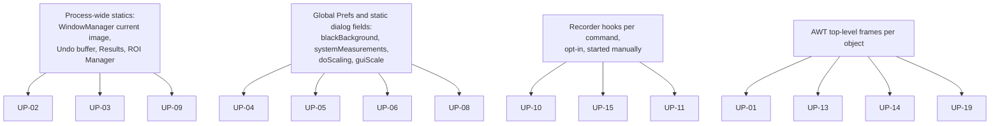

# A05 — Usability and Workflow Problems

## Executive Summary

This document lists 19 usability and workflow problems with the legacy Fiji/ImageJ1 interaction (UP-01…UP-19) plus one aesthetic item kept separate (AE-01). Each problem has evidence from source code at `imagej/ImageJ@v1.54p`, the pinned install, imagej.net documentation, image.sc threads or GitHub issues, and an explanation of why it matters scientifically.

The problems with the greatest scientific consequence are:

- Hidden global state that changes numerical results: UP-04 Black Background, UP-05 measurement settings, UP-06 conversion scaling, UP-08 persistent dialog values.
- Recording gaps that make a recorded macro differ from what the user did (UP-10).
- No provenance (UP-15).

These are correctness and reproducibility problems, not matters of taste. The project's own troubleshooting page lists option mismatches as a cause of "The same plugin gives different results on different machines!" ([Troubleshooting](https://imagej.net/learn/troubleshooting), accessed 2026-10-17).

Several problems are acknowledged upstream and have long-open issues:

- Multi-level undo: `imagej/imagej-common#3`, open since 2014 and migrated from a 2010 Trac ticket.
- An event-history recorder: `scijava/scijava-ui-swing#15`, open since 2015.
- HiDPI: `fiji/fiji#395`, open since 2025.

Most problems arise from the architecture: the active image, the single Undo and the global Results and ROI Manager are all process-wide statics. A new shell can expose these states and compensate for them, but it cannot remove them without changing ImageJ1 semantics. That trade-off belongs in the design documents (D-stage).

## Purpose and Scope

- **In scope:** interaction problems a user meets in the pinned Fiji GUI and macro tooling.
- **Out of scope:** algorithm defects and performance benchmarks.
- **Problem IDs:** each `UP-nn` is stable and is referenced by A02, A03, A06 and the design documents.

**Classification:**

- **Usability limitation:** causes errors, lost work, wrong or irreproducible results, or blocks a task.
- **Workflow friction:** slows tasks without a correctness effect.
- **Aesthetic:** appearance only. AE items are not treated as requirements drivers.

## Sources and Evidence

| Class | Sources |
|---|---|
| Source code | `imagej/ImageJ@v1.54p` (03382be1), files and lines cited per problem |
| Pinned install | `Fiji/config/jaunch/fiji.toml`, jar listings, `IJ_Props.txt` |
| Official docs | imagej.net/ij/docs (menus, User Guide 1.46r), imagej.net/learn, tutorials, plugin pages |
| Forum | forum.image.sc threads. WebFetch is refused with HTTP 403, so the threads were read through Discourse's `/t/<id>.json` endpoint; quotes are verbatim from that JSON. |
| Issue trackers | GitHub `fiji/fiji`, `imagej/imagej-common`, `imagej/imagej-legacy`, `scijava/scijava-ui-swing`, via `gh issue view`. The search API was rate-limited, so GitHub coverage is partial. |
| Literature | Aaron & Chew (2021); Miura & Nørrelykke (2021); Schmied et al. (2024); Jamali et al. (2021); Sivagurunathan et al. (2023); Biodepot Sci Rep (2022, PMC9440253) |

A forum thread shows that a problem occurs. It does not show how often. No frequency claims are made.

## Verified Findings

### Problem register

#### UP-01 — Floating multi-window interface; windows lost or hidden

| Field | Content |
|---|---|
| Class | Workflow friction, which becomes a usability limitation when the wrong window receives a command (see UP-02) |
| Mechanism | `ij.ImageJ`, `ij.gui.ImageWindow` and `ij.gui.GenericDialog` are separate AWT top-level `Frame`/`Dialog`s (`ij/ImageJ.java#L77`, `ij/gui/ImageWindow.java#L16`, `ij/gui/GenericDialog.java#L44`) — **VERIFIED**. Every result, plot, table and tool opens another window (A03 W04). |
| Evidence | image.sc ["Manage multiple windows in ImageJ"](https://forum.image.sc/t/manage-multiple-windows-in-imagej/68201) (2022): "difficulty in managing multiple windows is a general problem when many images are opened with ImageJ". ["Fiji user interface in the background…"](https://forum.image.sc/t/fiji-user-interface-in-the-background-and-two-separate-images-fixed-in-the-foreground/46344) (2020): "the image disappears 'behind' the Fiji Main Window". ["magnetic & sticky windows"](https://forum.image.sc/t/improve-imagej-user-experience-with-magnetic-sticky-windows/27986) (2019). ["ImageJ 1.52p on High DPI screen"](https://forum.image.sc/t/imagej-1-52p-on-high-dpi-screen/29716) (2019): the menu bar was restored off-screen. GitHub `fiji/fiji#397` "Main window doesn't get OS focus on Windows" (open, 2025). — **VERIFIED** (existence of reports) |
| Prior art | The SciJava MDI UI `org.scijava.ui.swing.mdi.SwingMdiUI` ships in `scijava-ui-swing-1.0.5.jar` but is not Fiji's default (A06 F2). |
| Scientific impact | **INFERRED:** time lost, and commands applied to the wrong image (UP-02). |

#### UP-02 — Implicit active image and title-based references

| Field | Content |
|---|---|
| Class | Usability limitation |
| Mechanism | Commands act on `WindowManager.getCurrentImage()`, which is the thread's temporary image or else the frontmost window (`ij/WindowManager.java#L69-L75`) — **VERIFIED**. The macro functions `selectImage(id)` and `selectWindow(title)` address images by ID, Window-menu index or title ([functions.html](https://imagej.net/ij/developer/macro/functions.html)). Recorded macros embed titles (A03 W05, W06, W10). |
| Evidence | image.sc ["getList("image.titles")…"](https://forum.image.sc/t/getlist-image-titles-collects-names-of-images-open-in-different-order-they-were-opened/75821) (2023): "the wrong window was saved with the wrong name... this is serious issue". ["Recorded Macro sequence can run only an image of specific name"](https://forum.image.sc/t/recorded-macro-sequence-can-run-only-an-image-of-specific-name-how-to-change-that/281) (2015). ["Prevent Fiji to steal focus on Windows 10"](https://forum.image.sc/t/prevent-fiji-to-steal-focus-on-windows-10/43721) (2020). ["Select specific open windows…"](https://forum.image.sc/t/select-specific-open-windows-not-only-the-last-selected-one/66931) (2022). The [Apply operation to a directory](https://imagej.net/tutorials/apply-operation-to-a-complete-directory) tutorial: "ImageJ can get confused when it has to open or close windows". — **VERIFIED** |
| Scientific impact | Measurements or saves applied to the wrong image, with files misnamed. This is silent data corruption. |

#### UP-03 — Single-level undo, reset on window switch, in-place modification

| Field | Content |
|---|---|
| Class | Usability limitation |
| Mechanism | `ij.Undo` holds one static buffer (`whatToUndo`, `ipCopy`, `impCopy`; `ij/Undo.java#L30-L39`). `WindowManager.setCurrentWindow` calls `Undo.reset()` every time the active window changes (`ij/WindowManager.java#L48`) — **VERIFIED**. "Keep multiple undo buffers" (Edit › Options › Memory & Threads…, `ij/plugin/Memory.java#L32`) only stops pixel buffers being trimmed for inactive images (`WindowManager.java#L43`). The User Guide says Undo "remains restricted to the most recent operation, but is available for each opened image" (Guide 146-27). Filters overwrite pixels in place. |
| Evidence | [Guide 146-6](https://imagej.net/ij/docs/guide/146-6.html): "ImageJ does not have a large undo/redo buffer. Undo … is currently limited to the most recent image editing / filtering operation." [Edit menu](https://imagej.net/ij/docs/menus/edit.html): "operations on entire stacks cannot be reversed using Undo". image.sc ["How to undo Image->Adjust or Process"](https://forum.image.sc/t/how-to-undo-image-adjust-or-process/2200) (2016): "ImageJ/Fiji does not provide a way to undo many steps, so you should try to keep always a copy of your original image." GitHub [imagej/imagej-common#3](https://github.com/imagej/imagej-common/issues/3), "Improve undo/redo functionality" (open since 2014). TrackMate initial filtering: "this step is irreversible" (A03 W11). — **VERIFIED** |
| Scientific impact | Raw data is lost through accidental processing unless the user keeps duplicates. Users fall back to Revert (re-reading from disk) and discard their intermediate work. |

#### UP-04 — Binary polarity depends on hidden global options (Black Background, inverting LUT)

| Field | Content |
|---|---|
| Class | Usability limitation (affects results) |
| Mechanism | `Prefs.blackBackground` (`ij/Prefs.java#L76`) changes which phase Erode, Dilate, Open, Close-, Fill Holes, Outline, Skeletonize and Watershed treat as foreground (Guide 146-29: binary commands "assume that objects are black and background is white unless Black Background is checked"). The Recorder inserts `setOption("BlackBackground", …)` only before Convert to Mask, Erode, Dilate and Skeletonize, and only once per recording session (`ij/plugin/frame/Recorder.java#L579-L581`, `#L1015-L1022`) — **VERIFIED**. A recording made with Fill Holes, Watershed or Analyze Particles, but none of those four, does not capture the setting. **INFERRED** from the cited lines; confirm with a runtime probe. |
| Evidence | [Troubleshooting](https://imagej.net/learn/troubleshooting): "a very common culprit of black-vs.-white issues is the 'Black background' option". image.sc ["Make Binary Foreground/Background Issues"](https://forum.image.sc/t/make-binary-foreground-background-issues/35812) (2020); ["Issue with 'Analyze Particles' and background color in threshold"](https://forum.image.sc/t/issue-with-analyze-particles-and-background-color-in-threshold/39810) (2020): "depending on the computer I have to click on 'Dark background' first". ["ImageJ Analyze particles with Inverted LUT"](https://forum.image.sc/t/imagej-analyze-particles-with-inverted-lut/64793) (2022). ["Black (0) background becomes selection - a bug?"](https://forum.image.sc/t/imagej-black-0-background-becomes-selection-a-bug/21927) (2019, 39 posts). ["Black Background binary option is reset after restart"](https://forum.image.sc/t/black-background-binary-option-is-reset-after-restart/63571) (2022) and GitHub `fiji/fiji#299` (open). — **VERIFIED** |
| Scientific impact | Particle counts, areas and morphology are computed on the inverted phase: background is measured as objects. The same macro gives different results on different machines. |

#### UP-05 — Measurement settings are global, persistent and invisible at measurement time

| Field | Content |
|---|---|
| Class | Usability limitation (affects results) |
| Mechanism | `Analyzer.systemMeasurements` is loaded from Prefs (`ij/plugin/filter/Analyzer.java#L40`). "Redirect to" is a static window target (`#L45-L47`, used at `#L164`). "Limit to threshold" is bit `LIMIT=256` (`ij/measure/Measurements.java#L5`). They apply to Measure, ROI Manager Measure and Analyze Particles ([Guide 146-30](https://imagej.net/ij/docs/guide/146-30.html)) — **VERIFIED**. A recording made after the settings were changed does not contain them (A03 W10). |
| Evidence | image.sc ["Gray value measurement is wrong for first image within macro loop"](https://forum.image.sc/t/gray-value-measurement-is-wrong-for-first-image-within-macro-loop/7553) (2017), reply: "Maybe 'Limit to threshold' is responsible". ["Measuring cell wall intensity after thresholding and redirect seems wrong"](https://forum.image.sc/t/measuring-cell-wall-intensity-after-thresholding-and-redirect-seems-wrong/30757) (2019). [Troubleshooting](https://imagej.net/learn/troubleshooting): "Ensure that the options of ImageJ match between the machines." — **VERIFIED** |
| Scientific impact | Mean, integrated density and area values silently depend on a threshold or another image. Methods sections omit these settings (Aaron & Chew 2021: "improper, or incomplete reporting of its use in the literature is pervasive"). |

#### UP-06 — Type conversion depends on the display range and a hidden option

| Field | Content |
|---|---|
| Class | Usability limitation (affects results) |
| Mechanism | With scaling on, the 16-bit to 8-bit conversion maps the *current display range* (`ip.getMin()`/`getMax()`, which B&C sets) to 0–255 (`ij/process/TypeConverter.java#L53-L62`). Scaling is a static flag, `ImageConverter.doScaling`, defaulting to true (`ij/process/ImageConverter.java#L15`, `#L385-L386`), set from Edit › Options › Conversions… (`ij/plugin/Options.java#L186`) — **VERIFIED**. A display-only B&C change therefore changes the pixel data at conversion. |
| Evidence | [Edit menu](https://imagej.net/ij/docs/menus/edit.html): "Check Scale When Converting to have ImageJ scale from min-max to 0-255 when converting from 16-bits or 32-bits to 8-bits… Note that Scale When Converting is always checked after ImageJ is restarted." image.sc ["ImageJ's 16 bit to 8 bit conversion"](https://forum.image.sc/t/imagejs-16-bit-to-8-bit-conversion/67719) (2022). — **VERIFIED** |
| Scientific impact | Intensity values after conversion depend on an earlier visual adjustment, so they are not comparable across images. This is the same failure class the prototype is exposed to, since it runs `run("8-bit")` unconditionally. |

#### UP-07 — Display adjustment and data modification are conflated (B&C Apply)

| Field | Content |
|---|---|
| Class | Usability limitation |
| Mechanism | B&C sliders change only the display range. **Apply** rewrites pixels for 8-bit and RGB images ([Image menu](https://imagej.net/ij/docs/menus/image.html): "This is the only B&C option that alters the pixel data of non-RGB images"). Autoscale on import (Bio-Formats) changes only the display. |
| Evidence | image.sc ["Adjusting image brightness"](https://forum.image.sc/t/adjusting-image-brightness/80342) (2023): "Apply will actually change the pixel values in a potentially irreversible way". ["Try to understand set display range"](https://forum.image.sc/t/try-to-understand-set-display-range/90163) (2023). [Troubleshooting](https://imagej.net/learn/troubleshooting): "In many cases, ImageJ performs autoscaling by default". Miura & Nørrelykke (2021): "A significant proportion of image data in research papers show signs of mishandling". — **VERIFIED** |
| Scientific impact | Users measure altered pixels and publish figures whose contrast processing goes unreported. |

#### UP-08 — Dialog values persist silently; options change semantics

| Field | Content |
|---|---|
| Class | Usability limitation |
| Mechanism | Many dialogs keep static or Prefs-backed defaults: Analyze Particles (`ParticleAnalyzer.java#L102`), the Z Project method (`ZProjector.java#L26`, `METHOD_KEY`), and the Bio-Formats Windowless importer, which "runs with the last used settings" ([Bio-Formats](https://imagej.net/formats/bio-formats)) — **VERIFIED**. Some options change the meaning of an operation: a wide line turns Plot Profile into a column average; Z Project on a hyperstack covers only the current frame unless "All time frames" is ticked (A03 W04, W08). |
| Evidence | Source and docs cited above. No forum thread was collected for this problem specifically (**INFERRED** user impact). |
| Scientific impact | A repeated analysis uses different parameters from the ones the user believes were used. |

#### UP-09 — Global ROI Manager and Results table are not bound to an image

| Field | Content |
|---|---|
| Class | Usability limitation |
| Mechanism | One system Results table receives every measurement. Analyze Particles appends unless "Clear results" is ticked ([Guide 146-30](https://imagej.net/ij/docs/guide/146-30.html)). The ROI Manager is a single global list; with no ROI selected, Measure and Delete apply to all ROIs. Coloc 2 writes to the Log, not to Results (A03 W06). |
| Evidence | image.sc ["ROI Manager Multi-Measure, Append: doesn't clear results properly"](https://forum.image.sc/t/roi-manager-multi-measure-append-doesnt-clear-results-properly/5371) (2017): "the results table started getting really long". ["ROI Manager removes rois after analyse particles"](https://forum.image.sc/t/roi-manager-removes-rois-after-analyse-particles/92218) (2024): "breaks many of my macro's". — **VERIFIED** |
| Scientific impact | Rows from previous images end up in a new dataset, and ROIs drawn on one image are measured on another. |

#### UP-10 — Macro Recorder gaps and replay divergence

| Field | Content |
|---|---|
| Class | Usability limitation (reproducibility) |
| Mechanism (VERIFIED from source) | (a) B&C slider drags are not recorded. Recording occurs only in the Apply, Auto and Set handlers (`ij/plugin/frame/ContrastAdjuster.java#L724-L732`, `#L858-L862`, `#L922-L938`, `#L1068-L1081`). (b) When Convert to Mask runs on an already-thresholded image, the manual levels are recorded as a comment `//setThreshold(a, b)` (`ij/plugin/Thresholder.java#L221-L222`). (c) Black Background is recorded only for four commands (UP-04). (d) Plugin GUIs outside `run()` are not recorded (A03 W07, W11). |
| Evidence | image.sc ["Brightness and Contrast Adjustments Not Recorded by the Fiji Macro Recorder"](https://forum.image.sc/t/brightness-and-contrast-adjustments-not-recorded-by-the-fiji-macro-recorder/122786) (2026-10-12). ["Macro Recorder results different from macro running results"](https://forum.image.sc/t/macro-recorder-results-different-from-macro-running-results/4711) (2017): "%Area from the recorder is 33.802, but … from the script … is 33.013". ["Macro recorder not recording IJ2 plugin parameters"](https://forum.image.sc/t/macro-recorder-not-recording-ij2-plugin-parameters/18926) (2018). ["BigStitcher not Macro Recordable?"](https://forum.image.sc/t/bigstitcher-not-macro-recordable/107014) (2025). ["Can't record macro step"](https://forum.image.sc/t/cant-record-macro-step-what-alternatives/4679) (2017). GitHub `fiji/fiji#281` (Register Virtual Stack Slices not recorded, open), `imagej/imagej-legacy#221`, `#200` and `#316` (open). Tutorial [Batch Processing with the ImageJ Macro Language](https://imagej.net/tutorials/batch-processing-with-ij-macro): "Occasionally, some commands will not be recorded, or not recorded correctly." — **VERIFIED** |
| Scientific impact | The recorded macro, which users submit as their method, does not reproduce the analysis that produced the published numbers. |

#### UP-11 — Batch processing requires macro editing; unsafe defaults

| Field | Content |
|---|---|
| Class | Usability limitation for PER-1/PER-2 (A02) |
| Mechanism | Process › Batch › Macro… needs pasted macro code. Scaling a recording to a folder needs a `getFileList` loop with an `action()` wrapper. The batch processor "will silently override existing files with the same name" and does not recurse into subfolders ([Guide 146-29](https://imagej.net/ij/docs/guide/146-29.html)). |
| Evidence | Tutorial [batch-processing-with-ij-macro](https://imagej.net/tutorials/batch-processing-with-ij-macro): "To automate the analysis on multiple images in a folder, we will have to setup a for loop." image.sc ["Batch Processing Image Sequences--Beginner"](https://forum.image.sc/t/batch-processing-image-sequences-beginner/76477) (2023); ["Modifying My Macro's Results/Summary and Applying it to a Batch of Images"](https://forum.image.sc/t/modifying-my-macros-results-summary-and-applying-it-to-a-batch-of-images/5758) (2017): "novice FIJI/ImageJ user here. I also have little coding experience."; ["Macro only processing one image"](https://forum.image.sc/t/macro-only-processing-one-image/75388) (2022). — **VERIFIED** |
| Scientific impact | Users process images by hand, one at a time, which brings inconsistency and selection bias. Outputs can be overwritten without warning. |

#### UP-12 — Command discoverability

| Field | Content |
|---|---|
| Class | Workflow friction |
| Mechanism | Static count over the pinned install: 339 IJ_Props command entries, 79 hard-coded `Menus.java` items, 424 non-separator `plugins.config` entries across `jars/` and `plugins/`, and 230 SciJava command plugins declaring a menu. That is about 1,070 menu declarations, plus about 40 script files. It is **INFERRED** as a lower bound on menu items. The method was `unzip -p` over every jar (G6 scratch, 2026-10-17); it is not a runtime count, and duplicates and hidden commands are not excluded. Deprecated submenus remain, for example `Plugins>Stitching>deprecated` and `Plugins>Segmentation>deprecated`. Overlapping tools remain, for example Multi-point and Cell Counter (A03 W07). Coloc 2's documented path differs from the installed one (A03). The search tools are Command Finder [l] and the Fiji search bar (`scijava-search-3.0.2`). |
| Evidence | [Guide 146-5](https://imagej.net/ij/docs/guide/146-5.html): "Navigating through the extensive list of ImageJ commands, macros and plugins may be quite cumbersome." image.sc ["Starting Command Finder"](https://forum.image.sc/t/starting-command-finder/11797) (2018): "on what part of what menu is one supposed to type Cntl-L?"; ["Can't find the search bar on Fiji/ImageJ after update"](https://forum.image.sc/t/cant-find-the-search-bar-on-fiji-imagej-after-update/110264) (2025). — **VERIFIED** |
| Note | The brief's figure of "thousands of commands" is **not** supported for the pinned base install, which has about 1,100 declarations. It may hold with many update sites enabled (UNKNOWN). |
| Scientific impact | Users pick the wrong or a deprecated tool, or skip an appropriate method (INFERRED). |

#### UP-13 — HiDPI and display-scaling inconsistency

| Field | Content |
|---|---|
| Class | Usability limitation on HiDPI and small screens |
| Mechanism | ImageJ1 has its own `Prefs.guiScale` (Edit › Options › Appearance… "GUI scale (0.5-3.0)", `ij/Prefs.java#L216`, `ij/plugin/AppearanceOptions.java#L51`), separate from Java2D scaling. The pinned launcher sets `-Dsun.java2d.uiScale=true` and cites two image.sc threads on blurry letters and changed font size (`Fiji/config/jaunch/fiji.toml#L295-L300`) — **VERIFIED**. Cell Counter "Opens off-screen on 1024 pixel wide and smaller monitors" ([Cell Counter](https://imagej.net/plugins/cell-counter)). |
| Evidence | image.sc ["How to increase the GUI font size?"](https://forum.image.sc/t/how-to-increase-the-gui-font-size/552) (2015): "there is no easy way now"; ["The Fiji UI appears either blurred or tiny"](https://forum.image.sc/t/the-fiji-ui-appears-either-blurred-or-tiny/64660) (2022); ["Adaptive HighDPI support for Swing components"](https://forum.image.sc/t/adaptive-highdpi-support-for-swing-components/44328) (2020): "ImageJ has its own scaling mechanism for its AWT based UI but that is ignored in Swing components". GitHub `fiji/fiji#395` (open, 2025). — **VERIFIED** |
| Scientific impact | Indirect: misreading values and controls (INFERRED). This is mainly an accessibility and ergonomics problem. |

#### UP-14 — Accessibility of the desktop application is unassessed

| Field | Content |
|---|---|
| Class | Usability limitation (accessibility) |
| Mechanism | `grep` for `Accessible` or `getAccessibleContext` in `imagej/ImageJ@v1.54p:ij/` returns 0 matches. ImageJ1 sets no accessible names or descriptions beyond AWT defaults (**VERIFIED** absence in source; actual screen-reader behaviour is **UNKNOWN**, needs a probe with NVDA or the Java Access Bridge). The image canvas has no text alternative. Default channel LUTs (Red, Green, Blue) are not colour-blind-safe. |
| Evidence | [imagej.net/accessibility](https://imagej.net/accessibility) excludes "The Fiji/ImageJ desktop application … outside the scope of this website". image.sc ["New tool, Colorblind Bar"](https://forum.image.sc/t/new-tool-colorblind-bar/53634) (2021): "Pure red green blue are bad choice"; ["Image accessibility / legibility: published images are often suboptimal"](https://forum.image.sc/t/image-accessibility-legibility-published-images-are-often-suboptimal/44725) (2020). No reports were found about screen readers or keyboard-only use. Absence of reports is not evidence of accessibility. — **VERIFIED** (scope statement); **UNKNOWN** (actual behaviour) |
| Scientific impact | Excludes researchers with visual or motor impairments. Figures may be unreadable for colour-blind readers. |

#### UP-15 — No automatic provenance or operation history

| Field | Content |
|---|---|
| Class | Usability limitation (reproducibility) |
| Mechanism | Nothing records what was applied to an image unless the user started the Recorder beforehand. Saved images and Results carry no processing history (**INFERRED** from the Recorder design, `ij/plugin/frame/Recorder.java`; no official statement either way was found). |
| Evidence | GitHub [scijava/scijava-ui-swing#15](https://github.com/scijava/scijava-ui-swing/issues/15) (open since 2015): "Rather than a 'Recorder' which must be proactively started, this new UI should take the form of an event history from which scripts can be generated." image.sc ["Documenting image processing: recording interactive steps…"](https://forum.image.sc/t/documenting-image-processing-recording-interactive-steps-called-from-ijm-macro/45091) (2020). Biodepot (Sci Rep 2022, [PMC9440253](https://pmc.ncbi.nlm.nih.gov/articles/PMC9440253/)): Fiji "lacks systematic version control making it difficult to reproduce workflows". Schmied et al. (2024): "there are currently no unified guidelines for best practices". Aaron & Chew (2021): "The chosen details of an image processing workflow can dramatically determine the outcome". — **VERIFIED** |
| Scientific impact | Methods sections cannot be reconstructed, which works against the community checklists (Schmied et al. 2024). |

#### UP-16 — Modal and multi-page parameter dialogs; no inline guidance

| Field | Content |
|---|---|
| Class | Workflow friction |
| Mechanism | `GenericDialog` is a modal AWT `Dialog` (`ij/gui/GenericDialog.java#L44`). Stack commands interrupt with a "Process Stack?" prompt (`ij/IJ.java#L1245-L1272`). Stitching and registration need long multi-page dialogs, and TrackMate a 12-plus-step wizard (A03 W11, W13). Key guidance, such as the rolling-ball radius rule, lives only on web pages (A03 W05). |
| Evidence | Source cited above; plugin pages cited in A03. — **VERIFIED** (mechanism); **INFERRED** (friction) |
| Scientific impact | Parameters are accepted at defaults without understanding (INFERRED). |

#### UP-17 — Preconditions are not explained before failure

| Field | Content |
|---|---|
| Class | Workflow friction |
| Mechanism | Commands require an image type or state that the UI does not show in advance. Analyze Particles "requires a 'binary', black and white, image" ([Particle Analysis](https://imagej.net/imaging/particle-analysis)). Apply in B&C "only works with 8-bit images and stacks and with RGB stacks". Bio-Formats "does not work in headless mode". Coloc 2 "time series will fail". |
| Evidence | Docs cited above. — **VERIFIED as documentation** |
| Scientific impact | Users apply workarounds, such as type conversions, that change the data (UP-06). |

#### UP-18 — Hyperstack dimension ambiguity (Z versus T, channel context)

| Field | Content |
|---|---|
| Class | Usability limitation |
| Mechanism | Dimension order and channel, slice and frame context live in slider positions and metadata. Commands act on the current C/Z/T position unless an option says otherwise (A03 W03, W04). |
| Evidence | TrackMate getting started: "ImageJ tends to assume that stack always are Z-stack on a single time-point" ([getting-started](https://imagej.net/plugins/trackmate/tutorials/getting-started)); the same page says calibration is "very important to get it right". — **VERIFIED as documentation** |
| Scientific impact | Time series are analysed as Z-stacks, which gives wrong velocities and wrong projections. |

#### UP-19 — Inconsistent UI toolkits and dialog conventions

| Field | Content |
|---|---|
| Class | Workflow friction, partly aesthetic |
| Mechanism | AWT for ImageJ1, Swing for plugins and SciJava, JavaFX in some components. They differ in scaling (UP-13), widgets and keyboard behaviour. FlatLaf is bundled (`flatlaf-3.6.1.jar`) and applies only to Swing (Edit › Options › Look and Feel, `org.scijava.ui.swing.laf.OptionsLookAndFeel`). |
| Evidence | Jar listings; the image.sc thread "Adaptive HighDPI support for Swing components" (UP-13); `fiji/fiji#395` (JavaFX/Swing DPI interaction). — **VERIFIED** |
| Scientific impact | Small; contributes to UP-13 and UP-14. |

#### AE-01 — Dated visual appearance (aesthetic only)

AWT widgets, the classic toolbar icons and the default look are perceived as dated. AE-01 is **not** a usability limitation: it produces no errors and no wrong results. It is listed so that design does not confuse visual refresh with fixing UP-01…UP-19. No evidence class applies beyond preference.

## Diagrams and Inventories

### Problem × workflow × persona

| UP | Class | Workflows (A03) | Personas most affected (A02) | Upstream acknowledgement |
|---|---|---|---|---|
| UP-01 | Friction→limitation | W04, W08, all | PER-1, PER-5 | Forum requests |
| UP-02 | Limitation | W05, W06, W09, W10 | PER-2, PER-4 | Tutorial warning |
| UP-03 | Limitation | W05, W11 | All | Guide 146-6; imagej-common#3 (open since 2014) |
| UP-04 | Limitation (results) | W02, W05 | PER-1, PER-2, PER-3 | Troubleshooting page; fiji#299 |
| UP-05 | Limitation (results) | W01–W05 | PER-1, PER-2 | Troubleshooting page |
| UP-06 | Limitation (results) | W01, W02 | PER-1, PER-2 | Edit menu docs |
| UP-07 | Limitation | W01, W04 | PER-1, PER-5 | Image menu docs |
| UP-08 | Limitation | W01, W02, W04, W08 | PER-2 | Bio-Formats docs |
| UP-09 | Limitation | W02, W03, W06, W09 | PER-2 | Guide 146-30 |
| UP-10 | Limitation (reproducibility) | W01, W02, W07, W10, W11, W13 | PER-2, PER-3, PER-4 | Tutorial; fiji#281; imagej-legacy#200/#221/#316 |
| UP-11 | Limitation | W09 | PER-1, PER-2 | Guide 146-29 |
| UP-12 | Friction | all | PER-1, PER-5 | Guide 146-5 |
| UP-13 | Limitation | all | All on HiDPI | fiji#395; launcher config |
| UP-14 | Limitation | all | Users with disabilities | Explicitly out of scope on imagej.net |
| UP-15 | Limitation (reproducibility) | all | PER-3, reviewers | scijava-ui-swing#15 (open since 2015) |
| UP-16 | Friction | W05, W11, W13 | PER-1, PER-2 | — |
| UP-17 | Friction | W01, W02, W06 | PER-1 | Plugin docs |
| UP-18 | Limitation | W03, W04, W11 | PER-2 | TrackMate docs |
| UP-19 | Friction | all | All | — |

### Structural root causes

## Constraints and Limitations

- The forum evidence is a purposive sample, so it shows that problems occur but not how often.
- GitHub coverage is partial because of rate limits.
- No runtime probe was run in this stage. The UP-04 and UP-10 source-derived claims should be confirmed by recording sessions on the pinned Fiji. The UP-14 screen-reader behaviour is UNKNOWN.

## Requirement implications

- **CR-A05-01:** The system shall show, for each executed command, the target image identity and every global option that affects that command's result: Black Background, measurement settings including Limit and Redirect, conversion scaling, and the current C/Z/T position. *Rationale:* UP-02, UP-04, UP-05, UP-06, UP-18.
- **CR-A05-02:** The system shall keep an automatic, always-on step history per image. Each step shall record the command, resolved options and relevant global options, and the history shall be exportable as an ImageJ macro that reproduces the same numerical results on the pinned Fiji. *Rationale:* UP-10, UP-15.
- **CR-A05-03:** The system shall provide multi-step undo for operations it initiates, at least back to the originally opened data. It shall warn before any operation that the underlying Fiji cannot undo, such as whole-stack operations and plugin-internal irreversible steps. *Rationale:* UP-03.
- **CR-A05-04:** The system shall distinguish display adjustments from pixel-modifying operations in the UI. It shall require confirmation before display settings are burned into data, through B&C Apply or display-dependent conversion. *Rationale:* UP-06, UP-07.
- **CR-A05-05:** The system shall bind ROI sets and measurement tables to the image they came from, while still populating the standard ImageJ ROI Manager and Results table for macro compatibility. *Rationale:* UP-09; compatibility (A02 CR-A02-03).
- **CR-A05-06:** The system shall offer "test on one image, then run on a folder" batch execution of a recorded history. It shall show the overwrite and skip plan before starting and shall not overwrite files silently. *Rationale:* UP-11.
- **CR-A05-07:** The system shall scale every UI surface it renders consistently with the OS display scale. It shall meet WCAG 2.1 AA contrast and keyboard-operability criteria for its own surfaces (PROPOSED target; justified by UP-13, UP-14). It shall offer colour-blind-safe default channel colours as an option without changing stored LUT semantics.
- **CR-A05-08:** The system shall check documented command preconditions (image type, binary state, dimensionality) before execution and explain any failure in terms of the required state. *Rationale:* UP-17.

## Risks

- **R-A05-01:** Exposing global options per command may overwhelm beginners. *Likelihood:* Medium. *Impact:* Medium. *Mitigation:* show only the options that differ from the defaults, or that are relevant to the command (D-stage).
- **R-A05-02:** A history-based undo that goes beyond ImageJ's single buffer requires snapshots, with memory cost for large stacks. *Likelihood:* High. *Impact:* Medium. *Mitigation:* replay-from-source or disk snapshots; feasibility in A-stage feasibility documents.
- **R-A05-03:** Source-derived recorder findings (UP-04, UP-10) may be incomplete because other recording paths exist. *Likelihood:* Medium. *Impact:* Medium. *Mitigation:* runtime Recorder probes for W01, W02 and W05.
- **R-A05-04:** Binding ROIs and results per image may diverge from IJ1 macro expectations of global state. *Likelihood:* Medium. *Impact:* High (parity). *Mitigation:* keep the global IJ1 objects authoritative for macros and treat the bindings as a view (CR-A05-05).

## References

- Upstream code: `imagej/ImageJ@v1.54p` (03382be1). Files: `ij/WindowManager.java`, `ij/Undo.java`, `ij/Prefs.java`, `ij/IJ.java`, `ij/ImageJ.java`, `ij/gui/ImageWindow.java`, `ij/gui/GenericDialog.java`, `ij/plugin/frame/Recorder.java`, `ij/plugin/frame/ContrastAdjuster.java`, `ij/plugin/Thresholder.java`, `ij/plugin/filter/Analyzer.java`, `ij/measure/Measurements.java`, `ij/process/TypeConverter.java`, `ij/process/ImageConverter.java`, `ij/plugin/Options.java`, `ij/plugin/Memory.java`, `ij/plugin/AppearanceOptions.java`, `ij/plugin/filter/ParticleAnalyzer.java`, `ij/plugin/ZProjector.java`.
- Pinned install: `Fiji/config/jaunch/fiji.toml#L295-L300`; `Fiji/jars/scijava-ui-swing-1.0.5.jar`; `Fiji/jars/flatlaf-3.6.1.jar`; `Fiji/jars/ij-1.54p.jar!/IJ_Props.txt`.
- ImageJ docs: [Edit menu](https://imagej.net/ij/docs/menus/edit.html), [Image menu](https://imagej.net/ij/docs/menus/image.html), [Macro functions](https://imagej.net/ij/developer/macro/functions.html); User Guide [146-5](https://imagej.net/ij/docs/guide/146-5.html), [146-6](https://imagej.net/ij/docs/guide/146-6.html), [146-27](https://imagej.net/ij/docs/guide/146-27.html), [146-29](https://imagej.net/ij/docs/guide/146-29.html), [146-30](https://imagej.net/ij/docs/guide/146-30.html).
- imagej.net: [Troubleshooting](https://imagej.net/learn/troubleshooting), [Accessibility](https://imagej.net/accessibility), [Bio-Formats](https://imagej.net/formats/bio-formats), [Particle Analysis](https://imagej.net/imaging/particle-analysis), [Cell Counter](https://imagej.net/plugins/cell-counter), [TrackMate getting started](https://imagej.net/plugins/trackmate/tutorials/getting-started), [Batch processing with IJ macro](https://imagej.net/tutorials/batch-processing-with-ij-macro), [Apply operation to a directory](https://imagej.net/tutorials/apply-operation-to-a-complete-directory).
- image.sc threads: as linked inline (thread IDs 68201, 46344, 27986, 29716, 75821, 281, 43721, 66931, 2200, 35812, 39810, 64793, 21927, 63571, 67719, 7553, 30757, 80342, 90163, 5371, 92218, 122786, 4711, 18926, 107014, 4679, 76477, 5758, 75388, 11797, 110264, 552, 64660, 44328, 53634, 44725, 45091). Read through the Discourse JSON on 2026-10-17.
- GitHub issues: `imagej/imagej-common#3`, `scijava/scijava-ui-swing#15`, `fiji/fiji#281`, `#299`, `#395`, `#397`, `imagej/imagej-legacy#200`, `#221`, `#316`. Viewed 2026-10-17.
- Literature: Aaron & Chew (2021) [doi:10.1242/jcs.254151](https://doi.org/10.1242/jcs.254151); Miura & Nørrelykke (2021) [doi:10.15252/embj.2020105889](https://doi.org/10.15252/embj.2020105889); Schmied et al. (2024) [doi:10.1038/s41592-023-01987-9](https://doi.org/10.1038/s41592-023-01987-9); Biodepot workflow builder, Sci Rep (2022) [PMC9440253](https://pmc.ncbi.nlm.nih.gov/articles/PMC9440253/).

## Change log

- 2026-10-17: Initial draft (agent G6).
