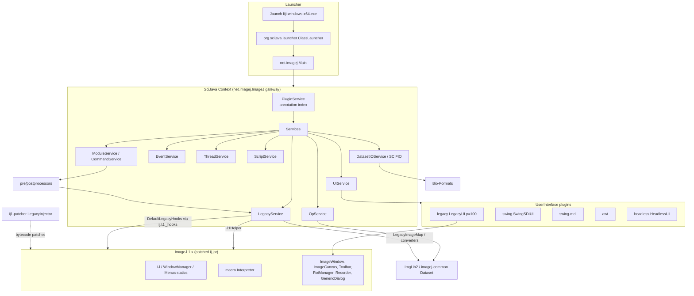

# A07 — Fiji and ImageJ Architectural Decomposition

## Executive Summary

Fiji at the pin is two applications in one JVM. ImageJ 1.x (`ij-1.54p.jar`) is a monolith of static singletons (`IJ`, `WindowManager`, `Menus`, `Interpreter`, `Recorder`) whose image model is tied to AWT windows. ImageJ2 is a SciJava `Context` of about 115 services and about 1 950 indexed plugins (P48). The two are joined by **imagej-legacy**, which bytecode-patches `ij.*` at class-load time through **ij1-patcher** (Javassist), installs `DefaultLegacyHooks`, wraps the 830 IJ1 menu commands as SciJava modules (P49 A6), and translates `ImagePlus` ↔ `Dataset` lazily, on demand.

The findings that matter for a modern UI:

1. The UI is a SciJava plugin. Five `UserInterface` plugins are installed: `legacy` (priority 100, the default), `swing` (SDI), `swing-mdi`, `awt` and `headless` (P48, P41 C3). A new UI can be added as a sixth, at runtime (`UIService.addUI`) or by annotation. P49 did this. **VERIFIED**
2. The non-IJ1 Swing SDI UI starts and displays a `Dataset` in the pinned runtime when selected with `-Dscijava.ui=swing`. IJ1 commands still run underneath it, because the legacy layer keeps a hidden `ij.ImageJ` frame (P49). **VERIFIED**
3. ImageJ2 commands, ops, SCIFIO, ImgLib2 and most IJ1 processing run without a GUI. IJ1 interaction surfaces do not: the ROI Manager, Recorder, B&C/Threshold dialogs, `ImageWindow`/`ImageCanvas` and Toolbar all throw `HeadlessException` or are null in a headless JVM (P41). The detailed classification is in [A15](A15-gui-dependence-reuse-boundaries.md).
4. `ImagePlus` ↔ `Dataset` synchronisation is **off by default**. `ImageJ2Options.isSyncEnabled()` returns `Boolean.getBoolean("imagej.legacy.sync")`. The bridge instead wraps pixels by reference whenever an IJ2 module asks for the active image. P41 J1 measured this at under 1 ms after warm-up for a 40 MB stack. **VERIFIED**

## 1. Purpose and Scope

This document decomposes the pinned Fiji into components, describes how they depend on each other and start up, and answers one question: what exists independently of the GUI, and how are UIs plugged in? Plugin families are covered in [A13](A13-plugin-architecture-compatibility.md), file formats in [A14](A14-file-formats-metadata.md), and per-subsystem GUI coupling in [A15](A15-gui-dependence-reuse-boundaries.md). Algorithms are out of scope.

## 2. Sources and Evidence

- Upstream source, cached at the tags in the front matter. SHAs are in `docs/data/upstream-manifest.yaml`. `fiji/fiji` main @ ddc9a45d has POM version `2.18.1-SNAPSHOT`, which matches the installed `jars/fiji-2.18.1-SNAPSHOT.jar`.
- Installed binaries without cached source, read with `unzip`/`javap`: `jars/scijava-ui-swing-1.0.5.jar`, `jars/scijava-ui-awt-0.1.7.jar` and `jars/app-launcher-2.3.1.jar`.
- Probes P40–P49 (`docs/01-analysis/references/probes/README-G3.md`). The pin hash was re-verified after every run.
- Background: Schindelin et al. (2012) [doi:10.1038/nmeth.2019](https://doi.org/10.1038/nmeth.2019) and Rueden et al. (2017) [doi:10.1186/s12859-017-1934-z](https://doi.org/10.1186/s12859-017-1934-z). Rueden et al. state the design goal: "if image processing plugins are agnostic to user interface, new interfaces can be developed without a loss of functionality". They describe the IJ1-patcher as modifying "ImageJ 1.x code … at runtime to expose callback hooks". This is VERIFIED as documentation. The runtime behaviour itself is established by the probes.

## 3. Component inventory

| Layer | Component (installed jar) | Role | Key types (source path at pin) | Evidence |
|---|---|---|---|---|
| Launcher | Jaunch v2.1.1 (`fiji-windows-x64.exe`, `config/jaunch/{common,jvm,fiji,python}.toml`) | Builds the JVM command line and runs the JVM in-process via libjvm (`config/jaunch.txt`: "Jaunch always uses libjvm functions") | main class `org.scijava.launcher.ClassLauncher`, argument `net.imagej.Main` (P40) | VERIFIED |
| Launcher (Java) | `app-launcher-2.3.1.jar` | Java-side bootstrap: splash, Java version check, look and feel (driven by the `-Dscijava.app.*` properties in P40) | `org.scijava.launcher.ClassLauncher`, `Splash`, `Java`, `LookAndFeel` (class list from `unzip -l`) | VERIFIED (classes); INFERRED (behaviour) |
| IJ1 | `ij-1.54p.jar` | Image model (`ImagePlus`, `ImageStack`, `ImageProcessor`), AWT GUI, menus from `IJ_Props.txt`, macro interpreter, Recorder, ROI, measurements | `ij/IJ.java`, `ij/WindowManager.java`, `ij/Menus.java`, `ij/macro/Interpreter.java`, `ij/plugin/frame/*` | VERIFIED |
| Bridge | `ij1-patcher-2.0.0.jar` | Javassist patching of `ij.*` before it loads; headless substitutes | `net/imagej/patcher/LegacyInjector.java`, `LegacyHeadless.java`, `HeadlessGenericDialog.java`, `LegacyHooks.java`, `LegacyEnvironment.java` | VERIFIED |
| Bridge | `imagej-legacy-3.0.0.jar` (100 SciJava plugins, P48) | `LegacyService`, `IJ1Helper`, `DefaultLegacyHooks`, `LegacyImageMap`, `LegacyUI`, legacy pre/postprocessors, IJ1 macro `ScriptLanguage`, converters | `net/imagej/legacy/**` | VERIFIED |
| Framework | `scijava-common-2.101.0.jar` (138 plugins) | `Context`, `PluginService`, `ModuleService`, `CommandService`, `EventService`, `ThreadService`, `UIService`, `ScriptService`, `ConsoleService`, `ConvertService` | `org/scijava/**` | VERIFIED |
| Data model | `imagej-common-2.1.2.jar`, `imglib2-8.0.0.jar` | `Dataset`, `ImgPlus`, `CalibratedAxis`/`Axes`, `ImageDisplay`, `DatasetService`; n-dimensional `Img`/`RandomAccessibleInterval` | `net/imagej/Dataset.java#L50`, `net/imagej/ImgPlus.java#L71`, `net/imagej/axis/Axes.java` | VERIFIED |
| Algorithms | `imagej-ops-2.2.0.jar` | 901 op plugin entries (P48); `OpService`/`Op` | `net/imagej/ops/OpService.java`, `Op.java` | VERIFIED |
| Algorithms (new) | `scijava-ops-*-1.0.1-SNAPSHOT.jar`, `scijava-ops-image-2.0.0-SNAPSHOT.jar`, `scijava-legacy-1.0.1-SNAPSHOT.jar` | SciJava Ops engine, bundled next to imagej-ops. `org.scijava.legacy.module.process.OpEnvironmentPreprocessorPlugin` fills `OpEnvironment` inputs. `sc.fiji.compat.SciJavaOpsFallback` only shows an error dialog and cancels when an `OpEnvironment` input stays unresolved (`fiji/fiji@ddc9a45d:src/main/java/sc/fiji/compat/SciJavaOpsFallback.java#L34-L60`) | P48 | VERIFIED (presence, fallback); UNKNOWN (which ops users reach through it) |
| IO | `scifio-0.49.2.jar` (+ `scifio-bf-compat`, `scifio-ome-xml`, `scifio-lifesci`, …) | SCIFIO `Format` plugins (29 entries, P48), `DatasetIOService` | `io/scif/SCIFIO.java`, `io/scif/services/DatasetIOService.java` | VERIFIED |
| IO | Bio-Formats 8.5.0 (`formats-api/bsd/gpl-8.5.0.jar`, `plugins/bio-formats_plugins-8.5.0.jar`) | Readers and writers; IJ1 importer/exporter (`loci.plugins.LociImporter`, `LociExporter`, `BF`) | ome/bioformats@v8.5.0 | VERIFIED |
| UI | `scijava-ui-swing-1.0.5.jar`, `scijava-ui-awt-0.1.7.jar` | `SwingSDIUI` ("swing"), `SwingMdiUI` ("swing-mdi", priority −100), `AWTUI` ("awt", −100), Swing widgets and `SwingInputHarvester` | annotation index (P48) | VERIFIED |
| UI | `imagej-ui-swing-1.2.2.jar` (26 plugins) | `Dataset` display viewers for SDI/MDI (`net.imagej.ui.swing.sdi.viewer.SwingSdiImageDisplayViewer`, `…mdi.viewer.SwingMdiImageDisplayViewer`), JHotDraw overlay tools, Swing Updater UI. **It contains no `UserInterface` plugin itself** | `imagej-ui-swing@…:src/main/java/net/imagej/ui/swing/{sdi,mdi,overlay,updater}/` | VERIFIED |
| Distribution | `fiji-2.18.1-SNAPSHOT.jar` | `sc.fiji.Main`, the compatibility services `sc.fiji.compat.*` (`DefaultFijiService`, `FijiAppConfiguration`, `DefaultLegacyPostRefreshMenus`) and the deprecated `fiji.IJ1Patcher` | `fiji/fiji@ddc9a45d:src/main/java/sc/fiji/**` | VERIFIED |
| Distribution | `imagej-updater-2.0.3.jar` | `UpdateService`, `FilesCollection`, `db.xml.gz` handling, command-line Updater (`net.imagej.updater.CommandLine`, used by `--update` in `fiji.toml`) | `imagej-updater@…:src/main/java/net/imagej/updater/` | VERIFIED |
| Scripting | `script-editor-1.4.0.jar`, `imagej-scripting-1.0.0.jar`, `scripting-{groovy,jython,javascript,beanshell,clojure,jruby,renjin,scala,python,…}` | 12 `ScriptLanguage` plugins (P48) | — | VERIFIED |

The manifest row UP-05 (`docs/data/upstream-manifest.yaml`) gives imagej-ui-swing's role as "SciJava UserInterface implementations". That is inaccurate at 1.2.2. The UI classes are in `scijava-ui-swing`, which the manifest does not list (see §10).

## 4. Diagrams

### 4.1 Component diagram



### 4.2 Dependency map (direction = "depends on")

```mermaid
flowchart LR
  fiji[fiji 2.18.1-SNAPSHOT] --> imagej[imagej 2.18.0]
  imagej --> legacy[imagej-legacy 3.0.0]
  imagej --> ops[imagej-ops 2.2.0]
  imagej --> updater[imagej-updater 2.0.3]
  imagej --> uiswing[imagej-ui-swing 1.2.2]
  imagej --> scifio[scifio 0.49.2]
  imagej --> scripting[imagej-scripting / script-editor]
  legacy --> patcher[ij1-patcher 2.0.0]
  legacy --> ij[ij 1.54p]
  legacy --> icommon[imagej-common 2.1.2]
  patcher --> javassist[javassist 3.30.2-GA]
  patcher -. patches .-> ij
  uiswing --> sjuiswing[scijava-ui-swing 1.0.5]
  ops --> icommon
  scifio --> icommon
  icommon --> imglib2[imglib2 8.0.0]
  icommon --> sjc[scijava-common 2.101.0]
  sjuiswing --> sjc
  fiji --> bf[Bio-Formats 8.5.0 plugins]
  bf --> ij
```



Edges are from `imagej2@imagej-2.18.0:pom.xml` (dependencies at L302–L438) and the jars installed (§3). Transitive edges to `scijava-ui-swing` and Bio-Formats are INFERRED from the installed jars, because their POMs were not read.

## 5. Verified Findings

### 5.1 ImageJ 1.x: static-heavy monolith

- Global mutable state lives in static fields. Examples: `WindowManager` image list and temp-image table (`imagej/ImageJ@v1.54p:ij/WindowManager.java#L69-L113`), `Macro` options keyed by `Thread` (`ij/Macro.java#L86-L103`), `Interpreter.batchMode` (`ij/macro/Interpreter.java#L41`), `Recorder.record` (`ij/plugin/frame/Recorder.java#L21`) and the `RoiManager` singleton (`ij/plugin/frame/RoiManager.java#L2068-L2087`). **VERIFIED**
- Each displayed image is an `ImagePlus` owning an `ImageWindow extends java.awt.Frame` that contains an `ImageCanvas extends java.awt.Canvas` (P45). The `ImageWindow` constructor registers itself with `WindowManager.addWindow` and becomes current (`ij/gui/ImageWindow.java#L103-L104`, `ij/WindowManager.java#L310-L317`). **VERIFIED**
- The menu tree is built from `IJ_Props.txt` inside the jar plus `plugins.config` files and underscore-named classes ([A13](A13-plugin-architecture-compatibility.md) §4). **VERIFIED**

### 5.2 ImageJ2 / SciJava Common

| Concept | Mechanism at pin | Evidence |
|---|---|---|
| `Context` | Created by `new net.imagej.ImageJ()` (`imagej2@imagej-2.18.0:src/main/java/net/imagej/ImageJ.java#L74`) → `new Context()` (`scijava-common@scijava-common-2.101.0:src/main/java/org/scijava/Context.java#L123`). It discovers all plugins and instantiates every `Service` plugin, in priority order, with `@Parameter` service injection | VERIFIED |
| Plugin discovery | `DefaultPluginFinder` loads the annotation index `META-INF/json/org.scijava.plugin.Plugin` with `Index.load(Plugin.class, classLoader)` (`…/org/scijava/plugin/DefaultPluginFinder.java#L81`). 1 950 entries across the installed jars (P48) | VERIFIED |
| `@Plugin` attributes | `type`, `name`, `menuPath`/`menu`, `priority`, `headless` ("a 'hint' … whether the plugin would behave correctly in a headless context", `…/org/scijava/plugin/Plugin.java#L150-L168`) | VERIFIED |
| `Module`/`Command` | `ModuleService.run(…)` submits a `ModuleRunner` to `ThreadService` (`…/module/DefaultModuleService.java#L244`). `ModuleRunner.run` publishes `ModuleStartedEvent`, runs preprocessors, `module.run()`, then postprocessors (`…/module/ModuleRunner.java` around L151–L174) | VERIFIED |
| Pre/postprocessors | 32 preprocessors and 4 postprocessors are installed (P48). In priority order the relevant ones are `ValidityPreprocessor` (30000), `MacroPreprocessor` (20000, fills inputs from IJ1 macro options), `ServicePreprocessor`/`GatewayPreprocessor`, `ActiveImagePlusPreprocessor` (10001), the `Active*Preprocessor` family, `RoiManagerPreprocessor`, `ResultsTablePreprocessor`, `LoadInputsPreprocessor`, the UI input harvesters (−10000; `LegacyInputHarvester`, `SwingInputHarvester`, `AWTInputHarvester`, `SwingMdiInputHarvester`), `SaveInputsPreprocessor` and `CheckInputsPreprocessor` (−10002). The postprocessors are `ResultsPostprocessor`, `MacroRecorderPostprocessor` and `DisplayPostprocessor` | VERIFIED |
| `EventService` | `publish` dispatches synchronously (`eventBus.publishNow`), `publishLater` asynchronously (`…/event/DefaultEventService.java#L98-L108`), on a `DefaultEventBus` that runs on `ThreadService` (L172) | VERIFIED |
| `ThreadService` | Thread names start `SciJava-` (`…/thread/DefaultThreadService.java#L60`). `invoke` runs on the AWT EDT through `EventQueue.invokeAndWait`, `queue` through `invokeLater` (L109–L125). P41 I8 shows that `invoke` reaches the EDT even in a headless JVM | VERIFIED |
| `UIService` | Discovers `UserInterface` plugins and honours `-Dscijava.ui=<name>` (`…/ui/DefaultUIService.java#L508-L534`, `UIService.java#L54`). Headless is `forceHeadless \|\| java.awt.headless \|\| GraphicsEnvironment.isHeadless()` (L205–L209). The default UI is `HeadlessUI` when headless, otherwise the explicit default, otherwise the highest priority (L212–L217) | VERIFIED |
| Gateway launch | `AbstractGateway.launch` runs `console().processArgs(args)`, `main().execMains()`, `ui().showUI()` (only if there is no main), `startup().executeOperations()`, and disposes the context if the UI is headless (`…/AbstractGateway.java#L102-L120`) | VERIFIED |

### 5.3 Data model: ImgLib2, imagej-common, Ops, SCIFIO, Bio-Formats

- `Dataset extends Data, ImgPlusMetadata, Img<RealType<?>>` (`imagej-common@imagej-common-2.1.2:src/main/java/net/imagej/Dataset.java#L50`). `ImgPlus<T> extends AbstractCalibratedRealInterval<CalibratedAxis>` (`…/net/imagej/ImgPlus.java#L71`). Axes are typed (`Axes.X/Y/Z/TIME/CHANNEL`) and calibrated. P43 O9 shows SCIFIO yielding axes `X:64@0.25micron, Y:48@0.25micron, Channel:3, Z:4@1.5micron, Time:2@1.0`. **VERIFIED**
- Ops: `OpService` with 901 op plugin entries in `imagej-ops-2.2.0.jar` (P48). `ops.run("stats.mean", imgPlus)` ran headless (P41 I5). **VERIFIED**
- SCIFIO and Bio-Formats paths are covered in [A14](A14-file-formats-metadata.md).

### 5.4 imagej-legacy: names verified

| Name in brief | Verified name at pin | Location | Evidence |
|---|---|---|---|
| `LegacyService` | `net.imagej.legacy.LegacyService`, `@Plugin(type = Service.class, priority = Priority.NORMAL + 1)` | `imagej-legacy@imagej-legacy-3.0.0:src/main/java/net/imagej/legacy/LegacyService.java#L121` | VERIFIED |
| `IJ1Helper` | `net.imagej.legacy.IJ1Helper`: the only class meant to touch `ij.*` directly (Javadoc at `LegacyService.java#L245-L253`) | `…/legacy/IJ1Helper.java` | VERIFIED |
| `LegacyHooks` | `net.imagej.patcher.LegacyHooks` (ij1-patcher). Installed into the injected static field `ij.IJ._hooks` (`ij1-patcher@ij1-patcher-2.0.0:src/main/java/net/imagej/patcher/LegacyInjector.java#L134`) | ij1-patcher | VERIFIED |
| `DefaultLegacyHooks` | `net.imagej.legacy.DefaultLegacyHooks extends LegacyHooks` | `…/legacy/DefaultLegacyHooks.java#L98-L181` | VERIFIED |
| `LegacyImageMap` | `net.imagej.legacy.LegacyImageMap`: `Map<ImageDisplay, ImagePlus> imagePlusTable`, `Map<ImagePlus, ImageDisplay> displayTable` (both `ConcurrentHashMap`), plus `WeakHashMap` tables for legacy-mode images | `…/legacy/LegacyImageMap.java#L94-L154` | VERIFIED |
| "ActiveImagePreprocessor" | Two exist. `net.imagej.display.process.ActiveImagePreprocessor` (imagej-common, fills `ImageDisplay`/`DatasetView`/`DataView`/`Dataset` inputs) and `net.imagej.legacy.plugin.ActiveImagePlusPreprocessor` (fills `ImagePlus`/`ImageStack`/`ImageProcessor` inputs from `WindowManager.getCurrentImage()`) | `imagej-common@…:src/main/java/net/imagej/display/process/ActiveImagePreprocessor.java#L63-L113`; `imagej-legacy@…:src/main/java/net/imagej/legacy/plugin/ActiveImagePlusPreprocessor.java#L70-L114` | VERIFIED |

### 5.5 Image synchronisation: when it happens and what it costs

- **Proactive synchronisation is disabled.** `DefaultLegacyHooks.registerImage` returns at once unless `legacyService.isSyncEnabled()` (`DefaultLegacyHooks.java#L167-L168`). It also ignores images that have no window (L173). `isSyncEnabled()` is `Boolean.getBoolean("imagej.legacy.sync")` (`ImageJ2Options.java#L147-L149`), and its Javadoc warns the feature "currently has serious bugs, and enabling it will have a serious impact on performance and stability". P41 B3 confirms the value is `false`. The ImageJ wiki page [ImageJ Legacy](https://imagej.net/libs/imagej-legacy) (accessed 2026-10-17) agrees: "automatic synchronization is disabled as it has negative performance implications". **VERIFIED**
- **On-demand translation** happens when an IJ2 module needs a `Dataset`/`ImageDisplay`. `LegacyImageDisplayService` (priority HIGH) overrides `getActiveImageDisplay()`. It takes `WindowManager.getCurrentImage()` and calls `LegacyImageMap.registerLegacyImage(imp)`, which creates and caches a display when none exists (`legacy/display/LegacyImageDisplayService.java#L113-L123`, `LegacyImageMap.java#L280-L292`). The reverse direction runs on `DisplayActivatedEvent` (`LegacyService.java#L558`, `syncActiveImage`) and `DisplayUpdatedEvent` (`LegacyImageMap.java#L676-L687`, which runs `Harmonizer.updateLegacyImage` followed by `updateAndDraw()`). **VERIFIED**
- **Cost.** Pixels are wrapped, not copied. `DisplayCreator.wrap` uses `VirtualStackAdapter.wrap(imp)`, and RGB uses converter views (`legacy/translate/DisplayCreator.java#L152-L173`). `ImagePlusCreator.createLegacyImage` uses `PlanarImgToVirtualStack`/`ArrayImgToVirtualStack`/`ImgToVirtualStack.wrap` (`legacy/translate/ImagePlusCreator.java#L110-L122`). Metadata (composite mode, colour tables, overlays → ROIs, position, name) is harmonised by copy (`DisplayCreator.harmonizeExceptPixels`, L119–L134). In P41, I2 showed that a pixel written to the `ImagePlus` was visible in the `Dataset`. J1 timed a 1024×1024×20 16-bit conversion at 131.1 ms on the first call and 0.5 ms and 0.1 ms on the next two (one run, indicative only). **VERIFIED** (mechanism); the timing is a single measurement.
- **Consequence.** Mixing IJ1 and IJ2 operations on one image works through the active-image path, but there is no continuous two-way model. The Javadoc at `LegacyService.java#L332-L340` says an `ImagePlus` cannot be referenced later "as a `Dataset` unless synchronization is enabled". This holds only for images that are not the current one, since the current `ImagePlus` is converted on demand. **INFERRED**

### 5.6 ij1-patcher: what is patched and why it matters

`LegacyInjector.inject` adds `ij.IJ._hooks` and then patches the following (`LegacyInjector.java#L125-L340`). **VERIFIED**

| Target | Patch | Line | Why it matters |
|---|---|---|---|
| `ij.IJ.runPlugIn` | `_hooks.interceptRunPlugIn(className,arg)` first; can redirect to SciJava modules (`DefaultLegacyHooks.interceptRunPlugIn` → `runLegacyCompatibleCommand`) | L186–L193 | IJ2 commands appear in IJ1 menus and macros |
| `IJ.showProgress/showStatus/log` | Forwarded to `IJ._hooks`. **Correction (lead, Phase 8):** imagej-legacy's `DefaultLegacyHooks` overrides only `log`, so IJ1 progress and status are **not** forwarded to `StatusService` by default (A20; A26 §14-C2). | L177–L198 | Log arrives through SciJava. Progress and status need a chained hook (NFR-REL-004, V-06). |
| `ImagePlus.updateAndDraw/repaintWindow/show/hide/close` | `registerImage`/`unregisterImage` hooks | L212–L226 | Seam for synchronisation (off by default) |
| `ImageWindow.setVisible/show` | Only call `super` if `_hooks.isLegacyMode()` | L229–L240 | **Can suppress image windows**, but only when no `ij.ImageJ` frame exists (§5.7) |
| `RoiManager.show/setVisible` | Same `isLegacyMode()` guard | L300–L306 | Same |
| `StackWindow.<init>` | `show()` only `if (!Interpreter.batchMode)` | L322–L328 | Batch mode keeps stacks off-screen |
| `PluginClassLoader`, `Menus` | Adds `jars/` recursively, handles fat jars, deduplicates menu entries | L242–L291 | Discovery ([A13](A13-plugin-architecture-compatibility.md)) |
| Headless only | `LegacyHeadless.patch()` (L161–L162): `GenericDialog` gets `HeadlessGenericDialog` as its superclass with AWT methods stubbed; AWT instantiations are skipped in `Menus`, `HyperStackConverter`, `Duplicator`, `GUI`; `Interpreter.batchMode` is forced to true permanently | `LegacyHeadless.java#L77-L128` | Makes macro-option-driven IJ1 commands run headless ([A15](A15-gui-dependence-reuse-boundaries.md)) |
| `LegacyExtensions.injectHooks` | Recorder, editor, `Interpreter.showError` in headless, HTTPS, app name and others | `LegacyExtensions.java#L90-L423` | — |

**Patch-order constraint.** Patching must happen before any `ij.*` class loads. When P42's first attempt imported `ij.*` in the script, `LegacyService` was rejected with "No _hooks field found in ij.IJ … Failed to patch ImageJ, because an ImageJ class was already loaded" (`probes/P42-attempt1-patch-order-failure.txt`). A JVM-resident component must therefore create the SciJava context, or call `LegacyInjector.preinit()`, before it references `ij.*`. **VERIFIED**

### 5.7 "Legacy mode" and hidden windows

`DefaultLegacyHooks.isLegacyMode()` → `LegacyService.isLegacyMode()` → `ij1Helper.getIJ() != null`, i.e. `IJ.getInstance() != null` (`LegacyService.java#L357-L359`, `IJ1Helper.java#L420-L425`). In a non-headless JVM, `LegacyService.initialize` always creates `new ij.ImageJ(NO_SHOW)` (`LegacyService.java#L466` → `ij1-patcher@…:LegacyEnvironment.java#L456-L469`, mode 2). As a result `isLegacyMode()` is true and **image windows are shown even though no main window is visible**. P42 B2/B3/C1: `isLegacyMode=true`, `ij.ImageJ visible=false`, `ImageWindow visible=true`. The suppression branch of the patch is unreachable in a normal Fiji context. **VERIFIED** (P42). The consequences are analysed in [A15](A15-gui-dependence-reuse-boundaries.md) §7.

## 6. Startup sequence

```mermaid
sequenceDiagram
  participant L as Jaunch (fiji-windows-x64.exe)
  participant CL as ClassLauncher
  participant M as net.imagej.Main
  participant C as Context
  participant LS as LegacyService
  participant IJ as ij.* (patched)
  participant UI as UIService / LegacyUI
  L->>L: read fiji.toml, jvm.toml, common.toml; build classpath jars/**, plugins/**; -Xmx 75%
  L->>CL: libjvm in-process; main(net.imagej.Main, args)
  CL->>M: splash, Java check, LaF (scijava.app.* props)
  M->>C: new ImageJ() -> new Context()
  C->>C: PluginService: Index.load(META-INF/json/org.scijava.plugin.Plugin)
  C->>LS: class init: LegacyInjector.preinit() (Javassist patches)
  C->>LS: initialize(): installHooks(DefaultLegacyHooks)
  LS->>IJ: newImageJ1(hidden=true): headless -> IJ.init; else new ij.ImageJ(NO_SHOW)
  LS->>LS: IJ1Helper.initialize; add scripts/ + plugins/ script dirs; drop "no-legacy" modules
  LS->>C: LegacyCommandFinder: IJ1 menu commands -> LegacyCommandInfo modules (830)
  M->>C: launch(args): ConsoleService.processArgs (-macro/-batch run here; --run queued)
  M->>UI: ui().showUI(): default UI legacy (p=100) -> IJ1Helper.setVisible(true)
  UI-->>C: UIShownEvent -> UpdateService auto-check (non-headless, 24 h)
  M->>C: StartupService.executeOperations (--run scripts)
  M->>C: if headless: context.dispose()
```

Evidence: P40 (command lines); `LegacyService.java#L142`, `#L445-L512`; `AbstractGateway.java#L102-L120`; `LegacyCommandline.java#L117-L192` (`-macro`/`-batch` run synchronously inside `processArgs`); `RunArgument` queues `--run` as a startup operation (`scijava-common@…:src/main/java/org/scijava/run/console/RunArgument.java`); updater check `imagej-updater@…:src/main/java/net/imagej/updater/DefaultUpdateService.java#L113-L125` (skipped for `HeadlessUI` or `-Dimagej.updater.disableAutocheck=true`). Jaunch consumes `--headless` and turns it into `-Djava.awt.headless=true -Dapple.awt.UIElement=true`; it is not forwarded to SciJava's `HeadlessArgument` (P40). **VERIFIED**

## 7. What exists without the GUI, and how UIs plug in

### 7.1 GUI-independent functionality

Verified as headless-capable at the pin (P41, P43, P46):

- the SciJava context and services;
- IJ2 commands with resolved inputs;
- ops;
- `ConvertService` ImagePlus↔Dataset conversion;
- SCIFIO reading;
- Bio-Formats `BF.openImagePlus`;
- IJ1 `IJ.run(imp, cmd, options)` for macro-option-driven filters (Gaussian Blur, Invert, Convert to Mask, Measure);
- `ResultsTable` data;
- `Overlay`;
- the macro interpreter in batch mode;
- the script service.

Exceptions and the full matrix are in [A15](A15-gui-dependence-reuse-boundaries.md) §9.

### 7.2 UI plug-in mechanism

- `UserInterface` (`scijava-common@…:src/main/java/org/scijava/ui/UserInterface.java`) requires the methods `show()`, `isVisible()`, `show(String,Object)`, `show(Display)`, `createDisplayWindow`, `dialogPrompt`, `showContextMenu`, `saveLocation`, `restoreLocation` and `requiresEDT`. It has default methods for the application frame, toolbar, status bar, console pane, clipboard and file choosers. `AbstractUserInterface` implements display-viewer lookup through `DisplayViewer` plugins (`…/ui/AbstractUserInterface.java#L81-L160`). **VERIFIED**
- Selection: highest priority (`legacy` = 100), or `-Dscijava.ui=<name>`, or `--ui <name>` (`…/ui/console/UIArgument.java`), or `UIService.setDefaultUI`. **VERIFIED**
- **Registering a new UI.** The compile-time route is `@Plugin(type = UserInterface.class, name = "…")` in an indexed jar, the same way `LegacyUI` (`legacy/ui/LegacyUI.java#L86-L90`) and `HeadlessUI` are declared. The runtime route is `UIService.addUI(name, ui)` (`DefaultUIService.java#L137-L145`). P49 B1–B4 registered a Groovy `AbstractUserInterface` subclass at runtime, listed it among the available UIs, showed it (`createUI` was called) and made it the default. **VERIFIED**
- **Hidden coupling.** Input harvesting is UI-specific. `AbstractInputHarvesterPlugin.process` returns without harvesting unless `uiService.isVisible(getUI())` (`…/ui/AbstractInputHarvesterPlugin.java#L66-L71`). A new UI therefore also needs its own `InputHarvester` preprocessor and widget plugins. Without them, unresolved required inputs reach `CheckInputsPreprocessor` and the module fails. **VERIFIED** (code); **INFERRED** (failure mode).

### 7.3 State of the alternative Swing UIs

`SwingSDIUI` ("swing") and `SwingMdiUI` ("swing-mdi") ship in `scijava-ui-swing-1.0.5.jar`. Their `Dataset` viewers ship in `imagej-ui-swing-1.2.2.jar`. In P49 (`-Dscijava.ui=swing`):

- the default UI was `SwingSDIUI`;
- `showUI()` produced a visible `SwingApplicationFrame`;
- a `Dataset` was shown by `SwingSdiImageDisplayViewer` in a `SwingDisplayWindow`;
- the hidden IJ1 frame stayed invisible;
- 830 IJ1 commands were still registered as modules;
- `IJ.run(imp, "Invert", "")` still worked.

**VERIFIED.** No probe exercised the menus, overlay tools, ROI, the B&C equivalent or plugin compatibility under the Swing UI, so their usability is **UNKNOWN**. To verify, launch with `-Dscijava.ui=swing` and drive J-series journeys manually. Sources from 2014 describe it as the "pure ImageJ2" UI reachable through "Help > Switch to Modern Mode" ([imagej-devel, May 2014](https://imagej.net/pipermail/imagej-devel/2014-May/002090.html), accessed 2026-10-17). `LegacyService.toggleLegacyMode` still implements the switch (`LegacyService.java#L361-L430`). This is historical context only.

## 8. Constraints and Limitations

- One IJ1 per JVM. Only one `LegacyService` is active per JVM (`LegacyService.java#L128-L134`, `isActive()` L241). A second context in the same JVM gets an inactive dummy. **VERIFIED**
- With the legacy UI, quitting IJ1 disposes the SciJava context (`DefaultLegacyHooks.disposing`, L563–L580), and `ij1.exitWhenQuitting(true)` is set (`IJ1Helper.java#L182`). PyImageJ warns that "the JVM and Python will both terminate when ImageJ closes" (`imagej/pyimagej@8f9b8faf:src/imagej/__init__.py` docstring of `init`). **VERIFIED**
- Process termination is unreliable. P41 (headless `--run`, no `System.exit`) and P42 (non-headless, `System.exit(0)`) did not terminate and were killed by timeouts. P43 (`System.exit`), P46 (no exit call), P47 and P49 (`Runtime.halt`) did terminate. The cause is **UNKNOWN**. To investigate, take a `jcmd <pid> Thread.print` during a hang.
- Sources for `app-launcher`, `scijava-ui-swing` and Bio-Formats are not cached. Claims about them come from binaries or GitHub reads.

## 9. Requirements or Design Implications

- Every UI-visible behaviour of Fiji is reachable through four seams. **INFERRED** from §5–7.
  1. SciJava services (`ModuleService`, `CommandService`, `ScriptService`, `OpService`, `DatasetIOService`, `EventService`).
  2. `IJ.run(imp, command, options)` with per-thread macro options.
  3. IJ1 static singletons (`WindowManager`, `RoiManager`, `ResultsTable`).
  4. Legacy hooks (status, progress, log).
- The Swing SDI UI is evidence that a non-IJ1 SciJava UI can coexist with full IJ1 command execution. It does not show that IJ1 interaction tools or plugin windows work under it. **PROPOSED**: treat it as a reference implementation for the integration points (UI plugin, display viewers, input harvester, widgets), not as a base to fork.

## 10. Risks and Unknowns

| ID | Statement | Evidence tag | How to resolve |
|---|---|---|---|
| U-A07-1 | Which user-facing commands run on SciJava Ops (`OpEnvironment`) rather than imagej-ops `OpService` at the pin | UNKNOWN | Filter the P48 index for modules with `OpEnvironment` inputs; run one of each kind |
| U-A07-2 | Whether JVM-exit hangs reproduce in the persistent-JVM design | UNKNOWN | Thread dump during a hang (above) |
| U-A07-3 | Completeness of Swing SDI/MDI UIs (menus, tools, overlays) | UNKNOWN | Manual journey test under `-Dscijava.ui=swing` |
| C-A07-1 | Manifest UP-05 misattributes the UserInterface implementations to imagej-ui-swing. scijava-ui-swing 1.0.5 is missing from the manifest | VERIFIED | Lead to amend `upstream-manifest.yaml` |

## Requirement implications

1. **CR-A07-01**: The Fiji Modernisation Project UI shall integrate with Fiji as a SciJava `UserInterface` plugin (or through `UIService.addUI`) inside the Fiji JVM, or through an equivalent JVM-resident adapter, and shall not depend on patching `ij.jar` itself. *Rationale:* this is the supported plug-in point (§7.2, P49), and ij1-patcher already owns `ij.*` patching.
2. **CR-A07-02**: Any JVM-resident component shall create the SciJava `Context` (or call `LegacyInjector.preinit()`) before loading any `ij.*` class, and shall have a start-up test that fails if `LegacyService.isActive()` is false. *Rationale:* patch-order failure (P42 attempt 1).
3. **CR-A07-03**: The UI shall provide its own input-harvester preprocessor and widget set for SciJava modules, or shall resolve all inputs before calling `ModuleService.run`. *Rationale:* harvesters run only for the visible UI they belong to (§7.2).
4. **CR-A07-04**: The design shall not rely on proactive IJ1↔IJ2 synchronisation (`imagej.legacy.sync`). It shall treat the active `ImagePlus` as the source of truth and request `Dataset` views on demand. *Rationale:* sync is off by default and documented as unstable (§5.5).
5. **CR-A07-05**: The application shall subscribe to SciJava `StatusEvent`/log/progress (fed by patched `IJ.showStatus/showProgress/log`) to present IJ1 status and progress. *Rationale:* existing seam (§5.6). *(Superseded by CR-A20-03 / NFR-REL-004: progress and status are not forwarded by default; see A26 §14-C2.)*
6. **CR-A07-06**: The JVM host shall terminate deterministically, through an explicit shutdown that disposes the context and then halts with a timeout. *Rationale:* observed exit hangs (§8).

## Risks

| ID | Risk | Likelihood | Impact | Mitigation idea |
|---|---|---|---|---|
| R-A07-01 | Upstream changes to ij1-patcher/imagej-legacy hooks (for example, the 3.0.0 major version) break a JVM-resident adapter | Medium | High | Pin versions; contract tests on hook behaviour (P41/P42 re-run per Fiji update) |
| R-A07-02 | A hidden `ij.ImageJ` frame means IJ1 windows still pop up under a new UI | High | Medium | Window policy in [A15](A15-gui-dependence-reuse-boundaries.md) §7 and CR-A15-03; batch mode or explicit window management |
| R-A07-03 | The JVM fails to exit, leaving orphan processes | Medium | Medium | Watchdog plus `Runtime.halt` after a context-dispose timeout |
| R-A07-04 | Only one IJ1 per JVM, so no isolation between workflows | High | Medium | One JVM per user session; per-thread state discipline ([A15](A15-gui-dependence-reuse-boundaries.md) §6) |

## References

- Code: repositories and tags as listed in the front matter; SHAs in `docs/data/upstream-manifest.yaml`.
- Binaries: `Fiji/jars/scijava-ui-swing-1.0.5.jar!/META-INF/json/org.scijava.plugin.Plugin`, `Fiji/jars/scijava-ui-awt-0.1.7.jar!/…`, `Fiji/jars/app-launcher-2.3.1.jar` (`javap org.scijava.launcher.ClassLauncher`), `Fiji/config/jaunch/*.toml`, `Fiji/config/jaunch.txt`.
- Probes: `probes/P40-launcher-dry-run.out.txt`, `probes/P41-headless-subsystems.out.txt`, `probes/P42-gui-jvm-hidden-windows.out.txt`, `probes/P42-attempt1-patch-order-failure.txt`, `probes/P45-class-hierarchy-javap.out.txt`, `probes/P48-plugin-index-inventory.out.txt`, `probes/P49-alternative-ui-registration.out.txt`.
- Schindelin J. et al. (2012), Fiji, [doi:10.1038/nmeth.2019](https://doi.org/10.1038/nmeth.2019).
- Rueden C.T. et al. (2017), ImageJ2, [doi:10.1186/s12859-017-1934-z](https://doi.org/10.1186/s12859-017-1934-z).
- [ImageJ Legacy](https://imagej.net/libs/imagej-legacy) (accessed 2026-10-17); [imagej-devel 2014-05](https://imagej.net/pipermail/imagej-devel/2014-May/002090.html) (accessed 2026-10-17).

## Change log

- 2026-10-17: Initial draft (agent G3).
- 2026-10-17: Lead annotation (Phase 8). Progress and status forwarding corrected per A20 source inspection.
