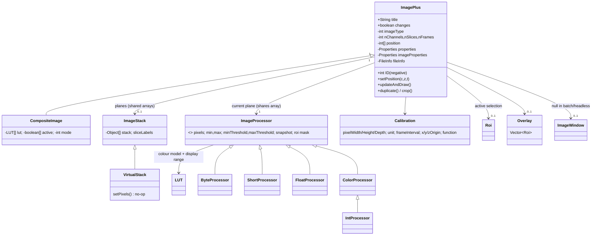
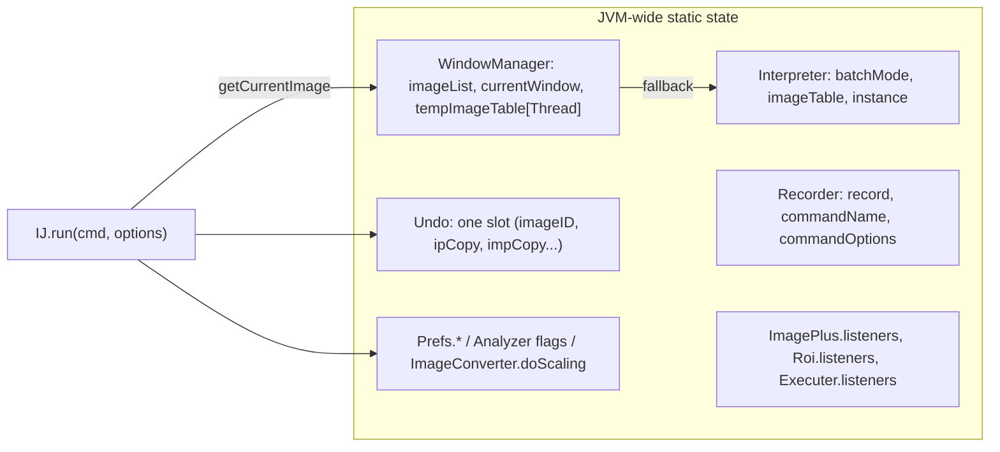

# A09 — Scientific Image and Application State Model

## Executive Summary

In ImageJ 1.x (IJ1), an image is an `ij.ImagePlus`. It wraps one `ImageProcessor`, which holds the current plane and its pixel array, and an `ImageStack` of pixel arrays that the processor shares. It also carries hyperstack dimensions, a `Calibration`, the display state (LUT and display range), an ROI, an `Overlay` and two property tables. Application state is mostly static and global. `WindowManager` keeps the image list, the "current image" and a per-thread temporary current image. `Interpreter` keeps a static batch-mode flag and a list of batch-mode images. `Undo` keeps one static buffer. Measurement settings, `Prefs.*` and the Recorder are also static.

Five consequences matter for a modern frontend:

1. `IJ.run` operates on an *implicit* current image.
2. Display range is held separately from pixels, but it controls the result of 8-bit conversion.
3. In headless Fiji, batch mode is forced on. No `imageOpened`/`imageClosed` events fire, `updateAndDraw()` is a no-op, and change notification cannot be used to mirror state.
4. Undo is single-level, static and absent for whole-stack operations.
5. Many objects share pixel arrays by reference.

The frontend therefore needs exactly one authoritative image registry, on the Java side, and must address images explicitly by ID.

## Purpose and Scope

This document defines the IJ1 object model and application state that any modernised UI has to respect, and lists the hazards of sharing that state with a non-Java frontend. ImageJ2 (`Dataset`/`ImgPlus`/`DatasetView`) is covered only in summary; detailed ImageJ2 coverage is assigned to another agent. ROIs are covered in A10, processing and measurement globals in A11, and macros and the Recorder in A12.

## Research Questions

1. Which fields and lifecycle rules define an `ImagePlus`?
2. How are the current image, temporary images and batch-mode images tracked?
3. How are changes notified, what can be undone, and who owns pixel memory?
4. How does the ImageJ2 model relate to the IJ1 model?
5. What state-sharing hazards follow for a frontend in another process or language?

## Sources and Evidence

The primary source is IJ1 code at `imagej/ImageJ@v1.54p` (SHA 03382be1, `docs/data/upstream-manifest.yaml` UP-01), read from the local cache. Runtime behaviour comes from probes P32, P33, P37 and P38 run on the pinned Fiji. Commands and outputs are in [README-G2](../references/probes/README-G2.md). Fiji-specific patching is cited from `imagej/ij1-patcher@ij1-patcher-2.0.0` and `imagej/imagej-legacy@imagej-legacy-3.0.0`. ImageJ2 types are cited from `imagej/imagej-common@imagej-common-2.1.2`.

## Verified Findings

### 1. `ImagePlus` fields and lifecycle

| Aspect | Fact | Evidence |
|---|---|---|
| Type constants | `GRAY8=0`, `GRAY16=1`, `GRAY32=2`, `COLOR_256=3`, `COLOR_RGB=4` (`imagej/ImageJ@v1.54p:ij/ImagePlus.java#L33-L45`). `getBitDepth()` returns 8/16/24/32 from the processor class (`#L1376-L1398`), where RGB is reported as 24 but stored as 32-bit `int`. | **VERIFIED** |
| Processor subclasses | `ByteProcessor`, `ShortProcessor`, `FloatProcessor` and `ColorProcessor` extend `ImageProcessor` (`ij/process/ByteProcessor.java#L13`, `ShortProcessor.java#L10`, `FloatProcessor.java#L9`, `ColorProcessor.java#L13`). `IntProcessor extends ColorProcessor` (`IntProcessor.java#L8`). | **VERIFIED** |
| Image ID | `private static int currentID = -1`, and every new image gets `ID = --currentID` (`ImagePlus.java#L77`, `#L166-L168`). IDs are therefore negative, unique within one JVM, never reused, and not stable across sessions. Probe P32 observed IDs −2 and −3. `setTemporary()` sets `ID=-Integer.MAX_VALUE`, and temporary images skip listener notification (`#L170-L176`, `#L3043-L3045`). `WindowManager.getImage(int)` treats a positive argument as the Nth image and a negative argument as an ID (`WindowManager.java#L237-L258`). | **VERIFIED** |
| Title | A mutable `String`. It is not unique, although `WindowManager.getUniqueName`/`makeUniqueName` exist (`WindowManager.java#L357-L388`). `getImage(String)` returns the *first* match (`#L282-L291`). | **VERIFIED** |
| `changes` | `public boolean changes` (`ImagePlus.java#L51`) is a plain field that any code may set. It only drives the "Save changes?" prompt; it is not a dirty-tracking system. | **VERIFIED** |
| Locking | `lock()`/`unlock()` are re-entrant per thread and `synchronized` (`#L186-L240`). `PlugInFilterRunner` exits if `imp.lock()` fails (`ij/plugin/filter/PlugInFilterRunner.java#L57-L58`). | **VERIFIED** |
| Construction and show | `show()` in batch mode, or when there is no `ImageJ` instance under a macro, does not create a window. It calls `WindowManager.setTempCurrentImage(this)` and `Interpreter.addBatchModeImage(this)`, then returns *without* firing `OPENED` (`#L492-L503`). `close()` without a window only removes the image from the batch list (`#L473-L482`). `CLOSED` fires from `flush()` (`#L2486-L2487`). | **VERIFIED**; P32 observed no opened/closed events |

### 2. Stack, hyperstack and composite state

- `ImageStack` holds `Object[] stack` with one pixel array per plane (`ij/ImageStack.java#L15`). `getProcessor(n)` builds a new processor that wraps the *same* array (`#L307-L320`). **VERIFIED** (P38: `stack.getProcessor(2)` shares pixels).
- Dimensions are `nChannels`, `nSlices` and `nFrames` (`ImagePlus.java#L65-L67`), set by `setDimensions(c,z,t)` (`#L1262`). Planes are stored in C-fastest order: `index = (t-1)*C*Z + (z-1)*C + c` (`getStackIndex`, `#L1916-L1924`). `setPosition(c,z,t)` clamps each value to the range [1, n], treats 0 as "keep current", and updates the window only if the image is displayed (`#L1850-L1874`). `setPositionWithoutUpdate` exists (`#L1879-L1883`). **VERIFIED** (P38: (2,3,4) in a 2×3×4 hyperstack gives index 24).
- `IJ.createImage` with C>1 returns a `CompositeImage` (P38). `CompositeImage extends ImagePlus` with modes `COMPOSITE=1`, `COLOR=2`, `GRAYSCALE=3` and `TRANSPARENT=4`, at most 8 channels (`ij/CompositeImage.java#L10-L14`). It holds one `LUT[] lut` per channel, `boolean[] active` and one processor per channel, `cip` (`#L25-L32`). **VERIFIED**
- **Virtual stacks.** `VirtualStack.setPixels(Object,int)` is empty (`ij/VirtualStack.java#L136-L137`). Its `getProcessor(n)` documents that the processor "may be re-used" and its pixel array replaced when the slice changes (`#L139-L148`). Edits to a virtual-stack plane are therefore lost when the user navigates away, unless a plugin writes them out. `PlugInFilterRunner` and `IJ.setupDialog` treat virtual stacks specially (`ij/IJ.java#L1276-L1283`). **VERIFIED** (code); runtime loss is **INFERRED**.

### 3. Display state versus pixel data

| Display state | Where it is held | Pixels changed? |
|---|---|---|
| Display range (min/max) | `ImageProcessor.setMinAndMax` (abstract, `ij/process/ImageProcessor.java#L495`). `ImagePlus.setDisplayRange` delegates to it for the current channel only (`ImagePlus.java#L3124-L3127`). `resetDisplayRange` honours `defaultMin/Max` and the static 16-bit default range (`#L3157-L3164`). | No for 8/16/32-bit. P32: a 16-bit pixel kept the value 10240 after `setDisplayRange(0,100)`. For RGB, B&C "Apply" changes pixels. **VERIFIED** |
| LUT | `ij.process.LUT extends IndexColorModel`, with public `min, max` (`ij/process/LUT.java#L9-L11`). `isInvertedLut()` (`ImageProcessor.java#L299`) changes how binary operations interpret foreground (A11). | No, but LUT inversion changes later binary results. **VERIFIED** |
| Threshold | `minThreshold`/`maxThreshold` on the processor, with `NO_THRESHOLD = -808080.0` (`ImageProcessor.java#L37`) and LUT update modes `RED_LUT`, `BLACK_AND_WHITE_LUT`, `NO_LUT_UPDATE` and `OVER_UNDER_LUT` (`#L59`). | No, until Convert to Mask or Apply (A11). |
| Composite channel LUTs and active channels | `CompositeImage.lut[]`, `active[]` | No |

**Display range is not inert.** With scaling on (the default, `ImageConverter.java#L15`), 16- and 32-bit to 8-bit conversion maps the *current display range* onto 0–255: `scale = 256/(max-min+1)` in `TypeConverter.convertShortToByte` (`ij/process/TypeConverter.java#L50-L63`). `ImageConverter.setDoScaling(false)` (`ImageConverter.java#L385-L387`) clamps instead. Probe P37, with pixels [0,250,500,1000]:

| Display range | Scaling | 8-bit result |
|---|---|---|
| 0–1000 | on | [0, 64, 128, 255] |
| 0–500 | on | [0, 128, 255, 255] |
| 0–500 | off | [0, 250, 255, 255] |

**VERIFIED.** A UI that lets the user drag a contrast slider and then runs "8-bit" has changed the scientific data. Probe P33 also showed 16-bit 40960 → 255 after `setMinAndMax(0,30000)`.

### 4. Calibration and metadata

- `ij.measure.Calibration` has public fields `pixelWidth`, `pixelHeight`, `pixelDepth`, `frameInterval`, `fps`, `xOrigin`, `yOrigin`, `zOrigin` and `info`. Private fields hold `unit="pixel"`, `yunit`, `zunit`, `valueUnit`, `timeUnit="sec"`, a value-calibration `function` (default `NONE=20`; also `STRAIGHT_LINE…`, `UNCALIBRATED_OD=21`, `CUSTOM=22`) and `coefficients` (`ij/measure/Calibration.java#L8-L67`). Raw/calibrated conversions are `getCValue`/`getRawValue` (`#L426`, `#L442`), and `setSigned16BitCalibration` (`#L495`) adds a signed-16 offset function. **VERIFIED**
- `getCalibration()` returns the image's *live* object, creating it lazily. If a global calibration is set, it returns a *copy* of the global one instead (`ImagePlus.java#L2729-L2740`). Edits through the getter therefore persist unless global calibration is active, in which case they are silently discarded. `setCalibration` stores a copy (`#L2743-L2750`). `setGlobalCalibration` writes a static (`#L2753-L2759`). **VERIFIED** (P38: an edit through the getter persisted; the duplicate kept its own copy).
- Metadata channels:
  - `Properties properties` (`setProperty`/`getProperty`, arbitrary objects, `#L1652-L1671`). The `"Info"` key is read by `getInfoProperty()` (`#L1634-L1643`).
  - `Properties imageProperties` (`setProp`/`getProp`, string-only, "persist if the image is saved in TIFF format", `#L1520-L1552`). `getProp` falls back to the Info string (`#L1556-L1566`).
  - `FileInfo` (original file information, `getOriginalFileInfo` `#L2461`).
  - Slice labels in `ImageStack`.

  These four channels overlap. Bio-Formats/OME metadata enters as Info text, not as structured data. **VERIFIED** (code); OME details are out of scope.

### 5. `WindowManager` and the current image

| State | Storage | Evidence |
|---|---|---|
| Image windows | `static Vector imageList`, `activations` (activation order) (`ij/WindowManager.java#L18-L19`) | **VERIFIED** |
| Non-image windows (Results, Log, ROI Manager, …) | `static Vector nonImageList` (`#L20`); `getNonImageWindows()` (`#L195-L205`) | **VERIFIED** |
| Current window | `static ImageWindow currentWindow` (`#L21`). `setCurrentWindow` trims the previous image's snapshot unless `Prefs.keepUndoBuffers`, **calls `Undo.reset()`**, and records `selectImage` (`#L31-L55`). | **VERIFIED** |
| Temporary current image | `static Hashtable tempImageTable` keyed by `Thread` (`#L25`). `getCurrentImage()` checks this thread's entry first, then falls back to the window or the last batch-mode image (`#L69-L113`). `setTempCurrentImage(img)` and `setTempCurrentImage(thread,img)` (`#L81-L97`). | **VERIFIED** |
| Batch-mode images | `ij.macro.Interpreter`: `public static boolean batchMode`, `static Vector imageTable`, `imageActivations` (`ij/macro/Interpreter.java#L41-L43`). `addBatchModeImage`/`removeBatchModeImage`/`getLastBatchModeImage` (`#L2192-L2265`). `getIDList()` concatenates window images and batch images (`WindowManager.java#L160-L180`). | **VERIFIED** |
| Headless Fiji | ij1-patcher forces `Interpreter.batchMode = true` in `IJ`'s class initialiser, rewrites `isBatchMode()` to always return `true`, and stops the interpreter resetting the flag (`imagej/ij1-patcher@ij1-patcher-2.0.0:src/main/java/net/imagej/patcher/LegacyHeadless.java#L104-L120`). | **VERIFIED** (code and P32: `isBatchMode()=true`, `getWindow()=null`) |

`IJ.run(imp, cmd, options)` sets the thread's temporary current image to `imp`, runs the command and restores the previous value (`ij/IJ.java#L410-L421`). `IJ.run(cmd, options)` with no image uses whatever `getCurrentImage()` returns (`#L310-L331`). `IJ.getImage()` calls `System.exit(0)` when no image is open and no `ImageJ` instance exists (`#L1806-L1815`). **VERIFIED.** That is fatal for an embedded backend that calls a command needing an image while none is open.

### 6. Change notification

- `ImageListener` has `imageOpened`, `imageClosed` and `imageUpdated` (`ij/ImageListener.java#L9-L13`). `ImageListenerAdapter.imageSaved` is an add-on. Listeners are a static `Vector` (`ImagePlus.java#L90`). Notification is **asynchronous** through `EventQueue.invokeLater` (`#L3043-L3070`).
- `updateAndDraw()` returns immediately when `win==null` (`#L310-L314`). In batch or headless mode, pixel changes therefore produce no `UPDATED` event from this path. P32 recorded only two `imageUpdated` events, and no opened or closed events, across creating, showing, inverting, editing, changing the display range of, and closing two images. **VERIFIED**
- `RoiListener` is static and synchronous (A10). `CommandListener` is called before each command in `Executer.run()` (A12).

**Conclusion (INFERRED):** IJ1 events are not a complete change feed. A frontend must not mirror state from them. It must ask the backend for state after every operation.

### 7. Undo

| Rule | Evidence |
|---|---|
| A single static slot holds `whatToUndo`, `imageID`, `ipCopy`, `impCopy`, `calCopy`, `roiCopy`, `lutCopy` and `overlayCopy` (`ij/Undo.java#L30-L39`). Kinds: `FILTER`, `TYPE_CONVERSION`, `PASTE`, `COMPOUND_FILTER`, `COMPOUND_FILTER_DONE`, `TRANSFORM`, `OVERLAY_ADDITION`, `ROI`, `MACRO`, `OVERLAY` (`#L14-L28`). | **VERIFIED** |
| `undo()` acts only if the current image's ID equals the saved `imageID` (`#L121-L131`). Switching windows calls `Undo.reset()` (`WindowManager.java#L47`). | **VERIFIED** |
| `FILTER` undo swaps the processor snapshot. Outside macros it toggles (undo/redo); inside macros it calls `ip.reset()` (`Undo.java#L133-L146`). | **VERIFIED**; P33 single-image Invert and Gaussian undo restored the original |
| `TRANSFORM` stores a full duplicate only for single images or composites under 200 MB (`209715200` bytes), and only outside macros unless `Prefs.supportMacroUndo` is set (`#L60-L64`). | **VERIFIED** |
| Whole-stack filtering has no undo: `Undo.reset()` "no undo for processing a complete stack" (`PlugInFilterRunner.java#L124-L126`). `Prefs.disableUndo` and `NO_UNDO` skip the snapshot (`#L106-L111`). | **VERIFIED**; P33 stack Invert was not undone |
| Single level: a second Undo does nothing (P33: Invert then Add 5; Undo 1 reverted the Add, Undo 2 left the image unchanged). | **VERIFIED** |
| Type conversion is undoable (P33: 16→8-bit Undo restored 16-bit 40960). | **VERIFIED** |
| Not undoable: anything after a window switch, whole-stack operations, operations on other images, Results/ROI Manager/table changes, prefs changes and file writes. | **INFERRED** from the above |

### 8. Memory ownership

| Operation | Shares pixels? | Evidence |
|---|---|---|
| `imp.getProcessor()` versus `imp.getStack().getPixels(current)` | Yes | P38; `ImagePlus.setProcessor2` writes `ip` pixels into the stack (`#L773-L787`) |
| `new ImagePlus(title, ip)` | Yes | P38 |
| `stack.getProcessor(n)` | Yes | P38 |
| `imp.duplicate()` | No. It copies the whole stack and **ignores and preserves** the ROI: the ROI is deleted, `Duplicator.run` is called and the ROI is restored (`#L2521-L2527`). | **VERIFIED** (P38: 16×16×3 result with an ROI present) |
| `imp.crop()` | No. It copies the ROI bounds of the current slice only. `crop("stack")`, `crop("whole-slice")` and `crop("a-b")` vary this (`#L2549-L2591`). | **VERIFIED** (P38: 4×4×1; `crop("stack")` gave 4×4×3) |
| `ip.duplicate()` | No | P38 |
| `IJ.maxMemory()` | Uses the `Memory` setting, otherwise the JVM maximum (`IJ.java#L950-L957`). P32: 24,696,061,952 bytes (about 23 GB) on this machine. | **VERIFIED** |

### 9. ImageJ2 model (summary)

- `net.imagej.Dataset extends Data, ImgPlusMetadata, Img<RealType<?>>`, with `isDirty`/`setDirty`, `getImgPlus`, `typeChange()` and `update()` (`imagej/imagej-common@imagej-common-2.1.2:src/main/java/net/imagej/Dataset.java#L50-L73`, `#L146-L149`, `#L225`). `ImgPlus<T> extends AbstractCalibratedRealInterval<CalibratedAxis> implements Img<T>` (`ImgPlus.java#L71-L72`). Axes are typed `CalibratedAxis` objects rather than fixed C/Z/T.
- `DatasetView` is the display state: `setChannelRange`, `getColorTables`, `getColorMode` and `getData` (`display/DatasetView.java#L53-L139`). ImageJ2 separates data and display explicitly, which IJ1 does not.
- imagej-legacy's `LegacyImageMap` maps each `ImagePlus` to an `ImageDisplay` (not a `Dataset`), with pixels shared by reference where possible (`imagej/imagej-legacy@imagej-legacy-3.0.0:src/main/java/net/imagej/legacy/LegacyImageMap.java#L60-L83`, maps `#L123-L131`). **VERIFIED** (code).
- **INFERRED:** in Fiji there can be two live representations of one image, with synchronisation handled by imagej-legacy (`Harmonizer`, `ImageTranslator`). A third representation in a frontend would add another layer of drift.

## Diagrams and Inventories

## Constraints and Limitations

- No GUI run was made; GUI-mode event behaviour comes from code (**INFERRED**). This matters because `updateAndDraw` does fire `UPDATED` when a window exists.
- The cost of synchronisation between `LegacyImageMap` and `Harmonizer` was not measured (**UNKNOWN**). To verify, run a Groovy probe in GUI mode that times `IJ.run` with and without an `ImageDisplay` registered.
- Thread safety beyond the `lock()` mechanism was not stress-tested (**UNKNOWN**).

## State-sharing hazards for a modern frontend

| # | Hazard | Mechanism (cited above) | Evidence | Mitigation (PROPOSED) |
|---|---|---|---|---|
| H1 | Dual source of truth | The Java `ImagePlus` and a frontend copy (and an ImageJ2 `ImageDisplay` in Fiji) can diverge. Events are incomplete (§6). | **VERIFIED** (P32) | The Java side is authoritative. The frontend holds only IDs and the last fetched snapshot, plus a revision counter the backend bumps after every command. |
| H2 | Implicit current image | `IJ.run(cmd,opts)`, macros and `Undo.undo()` use `WindowManager.getCurrentImage()`, a per-thread temporary image, the GUI focus or the last batch image (§5). | **VERIFIED** | Always use `IJ.run(imp, …)`, or `selectImage(id)` in macros. Never rely on focus. Pass the ID in every request. |
| H3 | Display range looks like pixel data but feeds conversion | 8-bit conversion uses the display range with `doScaling=true` (§3). | **VERIFIED** (P37) | Show display range as view state. Warn before conversion, and record the range and the scaling flag in provenance. |
| H4 | Titles are not identities | Titles are non-unique and mutable; `getImage(title)` returns the first match. | **VERIFIED** | Key on the ID. Show titles only as labels. |
| H5 | IDs are session-local | `--currentID` restarts in each JVM. | **VERIFIED** | Persisted workflows must reference inputs by path or content hash, not ID. |
| H6 | `System.exit` from `IJ.getImage()` | No image and `ij==null` causes JVM exit (§5). | **VERIFIED** (code) | Check that an image exists before dispatching. Run commands in a supervised process. |
| H7 | Single-level, static Undo that is cleared by window switches | §7 | **VERIFIED** (P33) | The frontend's own undo history must be snapshot- or replay-based (for example `duplicate()` before each step, within a memory budget). Do not expose IJ1 Undo as multi-level. |
| H8 | Shared pixel arrays | Processor, stack and `new ImagePlus(t, ip)` alias (§8). | **VERIFIED** (P38) | Any snapshot sent to the frontend must be a copy. Mutating previews must work on `duplicate()`. |
| H9 | Virtual-stack edits are lost | `VirtualStack.setPixels` is a no-op. | **VERIFIED** (code) | Mark virtual stacks read-only in the UI, or force "Duplicate" before editing. |
| H10 | Global calibration silently overrides per-image calibration | `getCalibration()` returns a copy of the global calibration (§4). | **VERIFIED** (code) | Show global-calibration status. Do not edit through the getter. Use `setCalibration`. |
| H11 | Thread confinement | `Macro` options, the temporary current image and `IJ.run` thread renaming are per thread. `Interpreter.batchMode`, `Undo`, `Prefs` and the Recorder are JVM-wide static (A12). Listener callbacks arrive on the EDT asynchronously. | **VERIFIED** (code) | Serialise all IJ1 calls through one worker thread per session. Do not run concurrent `IJ.run` calls against one JVM. |
| H12 | Headless differs from GUI | Batch mode is forced on, there are no windows and some components throw `HeadlessException` (A10: RoiManager; A12: Recorder). | **VERIFIED** (P30, P35) | Decide headless versus a hidden-GUI JVM before design (escalated to A15/A21). |

## Requirement implications

- **CR-A09-01** The system shall address every image operation by the `ImagePlus` ID (or by an equivalent backend handle). It shall never rely on the IJ1 current-image or focus state. *Rationale: H2, H4.*
- **CR-A09-02** The backend shall be the single authoritative store of image, ROI, display and calibration state. The frontend shall re-fetch state after every command rather than infer it from IJ1 events. *Rationale: H1; IJ1 events are incomplete headless (P32).*
- **CR-A09-03** The UI shall present display range/LUT as view state that is distinct from pixel data. Before any type conversion it shall show whether display-range scaling applies, and it shall record the range and the `ImageConverter` scaling flag in the history. *Rationale: H3, P37.*
- **CR-A09-04** The system shall provide undo that does not depend on the IJ1 single-slot `Undo`, for example by snapshotting before destructive steps within a configurable memory budget. It shall state in the UI when an operation cannot be undone. *Rationale: H7, P33.*
- **CR-A09-05** Pixel data sent to the frontend shall be a copy or an encoded rendering, never a live reference to a backend array. *Rationale: H8.*
- **CR-A09-06** The system shall detect virtual stacks and global calibration and show them in the image's status. *Rationale: H9, H10.*
- **CR-A09-07** All IJ1 calls for one session shall be serialised on one backend worker thread. *Rationale: H11.*
- **CR-A09-08** Saved workflows shall reference images by file path/URI and content hash, not by session ID or title. *Rationale: H4, H5.*
- **CR-A09-09** The backend shall check preconditions (an image is open and has the right type) before calling commands that use `IJ.getImage()`. *Rationale: H6.*

## Risks

| ID | Risk | Likelihood | Impact | Mitigation idea |
|---|---|---|---|---|
| R-A09-01 | The frontend's image list drifts from the backend's (missed events, external macros opening images) | High | High | Poll or re-query `WindowManager.getIDList()` after each command, and show a visible "re-sync" state. |
| R-A09-02 | Users unknowingly alter data by converting after contrast adjustment | Medium | High | Show a conversion confirmation that displays the mapping, and record provenance (CR-A09-03). |
| R-A09-03 | Snapshot-based undo exhausts memory on large stacks | Medium | Medium | Set a memory budget, disable undo with a visible notice above a threshold, and use disk-backed snapshots. |
| R-A09-04 | A concurrent macro and UI action corrupt state through shared statics | Medium | High | Use a single worker queue (CR-A09-07) and block the UI while a macro is running. |
| R-A09-05 | ImageJ2/legacy synchronisation causes a third representation and lag | Low | Medium | Prefer IJ1 objects as the backend truth, and measure legacy synchronisation in a GUI-mode probe. |

## References

- `imagej/ImageJ@v1.54p` (03382be1): `ij/ImagePlus.java`, `ij/ImageStack.java`, `ij/VirtualStack.java`, `ij/CompositeImage.java`, `ij/WindowManager.java`, `ij/Undo.java`, `ij/IJ.java`, `ij/ImageListener.java`, `ij/process/ImageProcessor.java`, `ij/process/LUT.java`, `ij/process/ImageConverter.java`, `ij/process/TypeConverter.java`, `ij/measure/Calibration.java`, `ij/macro/Interpreter.java`, `ij/plugin/filter/PlugInFilterRunner.java`.
- `imagej/ij1-patcher@ij1-patcher-2.0.0` (70e570dc): `src/main/java/net/imagej/patcher/LegacyHeadless.java`.
- `imagej/imagej-legacy@imagej-legacy-3.0.0` (fc31a563): `src/main/java/net/imagej/legacy/LegacyImageMap.java`.
- `imagej/imagej-common@imagej-common-2.1.2` (116286e0): `Dataset.java`, `ImgPlus.java`, `display/DatasetView.java`.
- Probes: [P32](../references/probes/P32-image-listener-batch.out.txt), [P33](../references/probes/P33-undo-batch.out.txt), [P37](../references/probes/P37-conversion-threshold-measure.out.txt), [P38](../references/probes/P38-pixel-sharing.out.txt); index [README-G2](../references/probes/README-G2.md).

## Change log

- 2026-10-17: Initial draft (agent G2).
