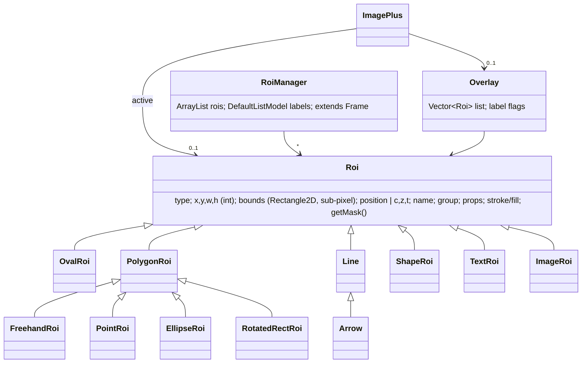
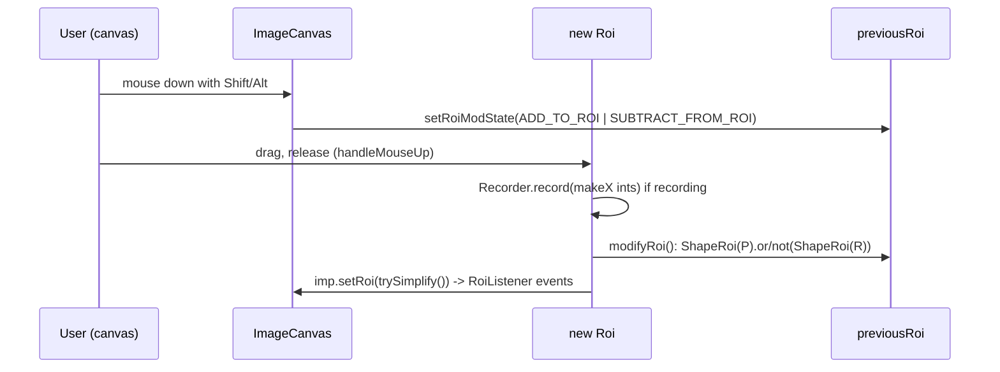

# A10 — Selection, ROI and Overlay System

## Executive Summary

The IJ1 selection model consists of one active `Roi` per `ImagePlus`, any number of `Roi`s in an `Overlay`, and a `RoiManager` list. ROI geometry is in image pixel coordinates. *Area* outlines use pixel-corner coordinates: (0,0) is the top-left corner of pixel (0,0), and a pixel belongs to an area ROI when its centre is inside. *Line* coordinates use pixel centres, a 0.5-pixel offset. ROIs may carry sub-pixel float geometry, a single stack position or a C/Z/T hyperstack position, a name, a group, colours and string properties. The `.roi`/`.zip` format preserves all of these for polygons, rectangles, lines and composite shapes. Probe P35 confirmed this, with one exception: a `PointRoi`'s single stack position was lost.

Three facts limit reuse by a modern frontend:

1. In a truly headless JVM, `RoiManager` cannot be constructed, not even its "hidden" form. A headless macro calling `roiManager("add")` stops (P35).
2. The Recorder writes interactive selections as integer `makeRectangle`/`makeSelection` calls, which loses sub-pixel geometry. Freehand ROIs are not recorded at all.
3. `Roi.containsPoint` returns `false` for any sub-pixel ROI in 1.54p (P35).

A non-Java ROI editor must therefore send geometry to the backend in full float precision, and the backend must construct ROIs through the Java API, not through recorded macro text.

## Purpose and Scope

This document covers the ROI types, the selection tools and modifiers, `RoiManager`, `Overlay`, stack/hyperstack positions, masks and coordinate conventions, ROI events, and how ROIs feed measurement. It ends with the fidelity requirements for any ROI editor written outside Java. Measurement settings are covered in A11 and recording in A12.

## Research Questions

1. What is the `Roi` hierarchy, and how do tools and modifiers create and combine ROIs?
2. How does `RoiManager` store ROIs, does it work headless, and what is the `.zip` format?
3. How do overlays, stack positions, masks and coordinate conventions work?
4. What events exist, and how do ROIs reach measurements?
5. What must a non-Java ROI editor reproduce exactly?

## Sources and Evidence

The primary source is `imagej/ImageJ@v1.54p` (03382be1), and Fiji patching comes from `imagej/ij1-patcher@ij1-patcher-2.0.0`. The probes are P35 (`.roi` round trip, masks, `RoiManager` headless) and its macro variant. Commands are in [README-G2](../references/probes/README-G2.md).

## Verified Findings

### 1. ROI types and class hierarchy

Type constants (`imagej/ImageJ@v1.54p:ij/gui/Roi.java#L51-L52`): `RECTANGLE=0`, `OVAL=1`, `POLYGON=2`, `FREEROI=3`, `TRACED_ROI=4`, `LINE=5`, `POLYLINE=6`, `FREELINE=7`, `ANGLE=8`, `COMPOSITE=9`, `POINT=10`. The constructions states are `CONSTRUCTING`, `MOVING`, `RESIZING`, `NORMAL` and `MOVING_HANDLE` (`#L50`).

| Class (file:line) | Extends | Types/notes | Evidence |
|---|---|---|---|
| `Roi` (`Roi.java#L48`) | `Object`; `Cloneable`, `Serializable`, `Iterable<Point>` | `RECTANGLE`, including the rounded rectangle (`cornerDiameter`) | **VERIFIED** |
| `OvalRoi` (`OvalRoi.java#L10`) | `Roi` | `OVAL` | **VERIFIED** |
| `PolygonRoi` (`PolygonRoi.java#L14`) | `Roi` | `POLYGON`, `FREEROI`, `TRACED_ROI`, `POLYLINE`, `FREELINE` and `ANGLE`. Integer `xp,yp` or float `xpf,ypf` relative to the bounds origin (`#L17-L18`), with optional spline fit. | **VERIFIED** |
| `FreehandRoi` (`FreehandRoi.java#L8`) | `PolygonRoi` | `FREEROI` | **VERIFIED** |
| `EllipseRoi` (`EllipseRoi.java#L11`), `RotatedRectRoi` (`RotatedRectRoi.java#L11`) | `PolygonRoi` | Parametric shapes, stored as subtypes in `.roi` | **VERIFIED** |
| `PointRoi` (`PointRoi.java#L22`) | `PolygonRoi` | `POINT`/multipoint. Per-point positions and counters; `POINTWISE_POSITION=-2` (`#L27`, `#L712-L740`). | **VERIFIED** |
| `Line` (`Line.java#L16`) | `Roi` | `LINE`. `x1d,y1d,x2d,y2d` are double; `x1..y2` are integers "for compatibility only" (`#L17-L18`). | **VERIFIED** |
| `Arrow` (`Arrow.java#L9`) | `Line` | Annotation | **VERIFIED** |
| `ShapeRoi` (`ShapeRoi.java#L21`) | `Roi` | `COMPOSITE`, backed by `java.awt.geom` shapes. Supports `or`/`and`/`xor`/`not`, and `trySimplify()` converts back to a simple ROI where possible. | **VERIFIED** |
| `TextRoi` (`TextRoi.java#L14`) | `Roi` | Text annotation | **VERIFIED** |
| `ImageRoi` (`ImageRoi.java#L11`) | `Roi` | Image overlay with opacity and zero-transparency (`#L67`, `#L96`) | **VERIFIED** |

### 2. Tools and modifiers

- `Toolbar` tool IDs (`ij/gui/Toolbar.java#L24-L38`): `RECTANGLE=0`, `OVAL=1`, `POLYGON=2`, `FREEROI=3`, `LINE=4`, `POLYLINE=5`, `FREELINE=6`, `POINT=CROSSHAIR=7`, `WAND=8`, `TEXT=9`, `UNUSED=10`, `MAGNIFIER=11`, `HAND=12`, `DROPPER=13` and `ANGLE=14`. Rectangle subtypes are `RECT_ROI`, `ROUNDED_RECT_ROI` and `ROTATED_RECT_ROI`; oval subtypes are `OVAL_ROI`, `ELLIPSE_ROI` and `BRUSH_ROI` (`#L49-L50`). **The tool IDs differ from the `Roi` type IDs** (LINE is 4 in one and 5 in the other). **VERIFIED**
- Modifiers: `ImageCanvas.setRoiModState` sets `ADD_TO_ROI` when Shift is held and `SUBTRACT_FROM_ROI` when Alt is held, but only for tools ≤ `FREEROI`, `WAND` or `POINT` (`ij/gui/ImageCanvas.java#L1453-L1467`). When the next ROI is completed, `Roi.modifyRoi` converts both ROIs to `ShapeRoi`, applies `or` (add) or `not` (subtract), calls `trySimplify()`, copies attributes and calls `imp.setRoi`. It also updates the ROI Manager entry if that ROI was selected there (`Roi.java#L1633-L1672`). Points add to or subtract from a `PointRoi` (`#L1636-L1641`). The macro equivalent is `Roi.update(add, subtract)`, used by `makeRectangle` and others (`#L1700-L1711`). **VERIFIED**

### 3. `RoiManager`

| Aspect | Fact | Evidence |
|---|---|---|
| Storage | `ArrayList rois` plus `DefaultListModel listModel` of labels, kept in parallel (`ij/plugin/frame/RoiManager.java#L46-L47`). The default label is `ZZZZ-YYYY-XXXX` (slice-centreY-centreX, zero-padded to 4–5 digits) (`#L511-L535`). | **VERIFIED** |
| GUI dependence | `RoiManager extends PlugInFrame` (a `java.awt.Frame`) (`#L30`). The no-argument constructor shows a window, or in a batch macro uses a list (`#L87-L103`). `RoiManager(boolean)` "Constructs an ROI Manager without displaying it" but still calls `super("ROI Manager")` (`#L106-L112`). Fiji patches `show()`/`setVisible()` to be no-ops outside legacy mode (`imagej/ij1-patcher@ij1-patcher-2.0.0:src/main/java/net/imagej/patcher/LegacyInjector.java#L299-L305`). | **VERIFIED** |
| Headless | In the pinned Fiji with `--headless`, both `new RoiManager(true)` and `RoiManager.getRoiManager()` throw `java.awt.HeadlessException` (P35). The macro `roiManager()` function creates `new RoiManager(true)` when none exists (`ij/macro/Functions.java#L3116-L3118`), so a headless macro stops at `roiManager("add")` while `Overlay.addSelection` succeeds (P35 macro variant). | **VERIFIED** |
| Batch-mode instance | `Interpreter.getBatchModeRoiManager()` creates a hidden `RoiManager(true)` in batch mode (`ij/macro/Interpreter.java#L2276-L2284`). `getInstance()` returns it when no window exists (`RoiManager.java#L2081-L2086`). It works in a GUI JVM with batch mode, but not headless (above). | **VERIFIED** (code); GUI-JVM behaviour **INFERRED** |
| Commands | `runCommand(String)` covers add/delete/measure/multi-measure/save/open and more (`#L2223`). `multiMeasure(ImagePlus)` returns a `ResultsTable` with one row per slice (`#L1085-L1090`). Multi-measure reads `Analyzer.getMeasurements()` (`#L1110`), so it is subject to global flags (A11). | **VERIFIED** |
| `.zip` format | `saveMultiple` writes a `ZipOutputStream` with one `<label>.roi` entry per ROI, encoded by `RoiEncoder`. Duplicate names get unique names (`#L945-L990`). `openZip` reads every `*.roi` entry through `RoiDecoder`, and the label is the entry name minus `.roi` (`#L845-L880`). | **VERIFIED** |

### 4. `.roi` binary format (`RoiEncoder`/`RoiDecoder`)

- Header layout (64 bytes, big-endian): `"Iout"`, then version, type byte, top/left/bottom/right (signed shorts), `NCoordinates`, line/rect floats, stroke width, `ShapeRoi` size, stroke and fill colours, subtype, options, arrow/aspect parameters, `POSITION` (int at 56) and the header2 offset (`ij/io/RoiDecoder.java#L11-L43`, offsets `#L47-L76`). Header2 holds the C/Z/T positions, name, overlay label colour and font, `GROUP`, image opacity, float stroke width, the properties string and the point counters (`#L78-L90`). `RoiEncoder.VERSION = 228` ("v1.52t (roi groups, scale stroke width)", `ij/io/RoiEncoder.java#L18`). **VERIFIED**
- **The file type codes differ from the `Roi` type constants:** in the file, `polygon=0, rect=1, oval=2, line=3, freeline=4, polyline=5, noRoi=6, freehand=7, traced=8, angle=9, point=10` (`RoiEncoder.java#L21-L22`). **VERIFIED**
- Integer coordinates are stored as 16-bit offsets from the bounds. When `subPixelResolution()` is set, float coordinates follow and the `SUB_PIXEL_RESOLUTION` flag is set (`#L124-L143`). Double rectangles and ovals store `XD`, `YD`, `WIDTHD` and `HEIGHTD` floats (`#L162-L183`). Polygons with more than 65,535 points are saved as a `ShapeRoi`; other types with that many points are truncated with a log message (`#L184-L195`). `EllipseRoi` and `RotatedRectRoi` store their parameters, not the polygon (`#L238-L252`). **VERIFIED**
- Probe P35 round-trip results:

| Case | Result |
|---|---|
| Float polygon x=[10.25,30.5,20.75], y=[5.125,6.5,25.875] | Decoded exactly. Name, C/Z/T (2,3,4), stroke width 1.5, property `k=v` and group 7 were all preserved. |
| Integer polygon | Decoded as integer (`subPixel=false`) |
| `Roi(1.5,2.25,10.5,4.75)` | Float bounds were preserved, and the integer bounds became (1,2,11,5). |
| `Line(0.5,0.5,10.25,3.75)` | Exact |
| `ShapeRoi` (rectangle minus oval) | Stayed type 9, with an identical 88-pixel mask |
| Multipoint with `setPosition(0,5,0)` | Z=5 was preserved |
| `PointRoi` with `setPosition(5)` (single position) | **Decoded with position 0**, for both one-point and two-point ROIs |
| `setGroup(7)` after `setStrokeColor(red)` | The stroke changed to the group colour (255,211,0) (`Roi.setGroup`, `Roi.java#L1888-L1898`) |

  The point-position loss is **VERIFIED** (P35). Its cause is **INFERRED** from `RoiDecoder.java#L379-L386`: point counters are applied after `setPosition` and can reset the per-point positions.

### 5. Overlay and stack/hyperstack position

- `Overlay` holds a `Vector<Roi> list`, with display flags for labels, names, backgrounds, scalable labels, calibration bar, `selectable` and `draggable` (`ij/gui/Overlay.java#L14-L23`). It has `add`/`remove`/`indexAt`/`toArray`/`translate`/`crop(Rectangle)`/`duplicate`/`scale`/`rotate` (`#L38-L370`). `ImagePlus.setOverlay`/`getOverlay` are at `ij/ImagePlus.java#L3379`/`#L3413`. **VERIFIED**
- ROI position: `setPosition(int n)` sets a single stack index; 0 means "all planes" (`Roi.java#L2195-L2205`). `setPosition(c,z,t)` sets a hyperstack position and `hyperstackPosition=true`, where 0 in any field means "all" (`#L2221-L2231`). `setPosition(ImagePlus)` derives the position and uses channel 0 in composite mode (`#L2238-L2249`). In an overlay, an ROI is drawn only at matching positions. For the *active* ROI (non-point), the position does not restrict visibility (`PointRoi.java#L705-L711` comment). **VERIFIED**
- `RoiManager.add` calls `roiCopy.setPosition(imp)` to tag the current position (`RoiManager.java#L418`). Selecting an ROI moves the image to its position (`#L705-L733`). **VERIFIED**

### 6. Coordinates, masks and calibration

- **Area convention:** "the coordinate (0,0) is the top-left corner of pixel (0,0)", and pixel (x,y) is inside when its centre is inside (`Roi.java#L1520-L1545`). `PolygonFiller` adds 0.5 to every coordinate. Points exactly on the left or top edge are outside, and points on the right or bottom edge are inside (`ij/process/PolygonFiller.java#L5-L21`). P35: the square (0.6…2.4)² has bounds (0,0,3,3) and a mask containing exactly one pixel, (1,1). **VERIFIED**
- **Line convention:** line coordinates refer to pixel centres. `Line` adds 0.5 when converting to an area polygon ("0.5 pxl shift: area vs. line coordinate convention", `Line.java#L525`). **VERIFIED**
- **Masks:** `Roi.getMask()` returns `null` for a plain rectangle (`Roi.java#L1734-L1739`; P35). For non-rectangular ROIs, `getMask()` returns a `ByteProcessor` the size of the bounding box (`PolygonRoi.getMask`, `PolygonRoi.java#L1236-L1251`). Callers must treat `null` as "all pixels in bounds". **VERIFIED**
- **Defect in 1.54p:** `Roi.containsPoint(x,y)` computes its result only `if (bounds == null)` (`Roi.java#L1537-L1545`). Sub-pixel ROIs carry `bounds`, so `PolygonRoi.containsPoint`, which calls `super.containsPoint` first (`PolygonRoi.java#L1201-L1203`), returns `false` for *every* point. P35: `containsPoint(1.5,1.5)` returned `false` for a float square containing (1.5,1.5), and `true` for an integer polygon. **VERIFIED.** A frontend must not use this method for hit-testing, and should report the defect upstream (PROPOSED).
- **Calibration:** ROI geometry is always in pixels. Calibrated values are derived at measurement time through `Calibration` (`pixelWidth`, `pixelHeight`, origins and the `invertY` measurement option; A09 §4, A11). The status display shows calibrated and raw sizes together (`Roi.java#L1713-L1731`). **VERIFIED**

### 7. Events

`RoiListener.roiModified(ImagePlus imp, int id)` uses the IDs `CREATED=1`, `MOVED=2`, `MODIFIED=3`, `EXTENDED=4`, `COMPLETED=5` and `DELETED=6` (`ij/gui/RoiListener.java#L8-L16`). Listeners are a static `Vector`, notified **synchronously** on the calling thread (`Roi.java#L75`, `#L2882-L2894`, `#L2920-L2926`). `CREATED` fires at most once per ROI instance (`#L2883-L2887`). `ImagePlus.setRoi`/`deleteRoi` fire `CREATED`/`DELETED`/`MODIFIED` (`ImagePlus.java#L2094`, `#L2184`, `#L2199`, `#L2265`). **VERIFIED** (code; not probed).

### 8. How ROIs feed measurement

- `Analyzer.measure()` branches on the ROI type: `POINT` goes to `measurePoint`, `ANGLE` to `measureAngle`, line ROIs to `measureLength`, and everything else to `imp.getStatistics(measurements)` (`ij/plugin/filter/Analyzer.java#L258-L286`). **VERIFIED**
- `ImagePlus.getStatistics(...)` calls `ip.setRoi(roi)` for area ROIs. A single-point `PointRoi` becomes a 1×1 rectangle (`ImagePlus.java#L1136-L1162`). `ImageProcessor.setRoi(Roi)` sets the bounds rectangle and `setMask(roi.getMask())` (`ij/process/ImageProcessor.java#L900-L915`). The statistics classes then include a pixel when `mask==null || mask[i]!=0` (`ij/process/ByteStatistics.java#L90-L98`). **VERIFIED**
- The macro recorder records interactive ROIs as integers: `makeRectangle`/`makeOval(x,y,w,h)` from `int` fields (`Roi.java#L1610-L1620`), `makeSelection` from `getPolygon()`, which returns integer coordinates (`PolygonRoi.java#L593-L595`; `ij/plugin/frame/Recorder.java#L390-L411`), `makeLine` from `int x1..y2` (`Line.java#L95`), and `makeEllipse`/`makeRotatedRectangle` cast to `int` (`EllipseRoi.java#L144`, `RotatedRectRoi.java#L158-L161`). `FreehandRoi.java` contains no Recorder call, and `PolygonRoi.handleMouseUp` records only `POLYGON`, `POLYLINE` and `ANGLE` (and points in script mode). **VERIFIED** (code).

## Diagrams and Inventories

## Constraints and Limitations

- No GUI-mode probe was run. The behaviour of the hidden batch-mode `RoiManager` in a GUI JVM, and of `RoiListener` events, comes from code (**INFERRED**). To verify, run a GUI-JVM Groovy probe (lead/G3 GUI staging) that creates `new RoiManager(true)` under batch mode and registers a `RoiListener`.
- The ImageJ2 ROI model (`net.imagej.roi`, imglib2-roi) and its conversion to and from IJ1 ROIs in imagej-legacy are not analysed (**UNKNOWN**; outside G2 scope).
- The limits of signed-short bounds (images wider than 32,767 px) were not probed (**UNKNOWN**). To verify, round-trip an ROI at x=40000 through `RoiEncoder`.

## Fidelity requirements for a non-Java ROI editor

These must round-trip exactly, because they change measured values or the file contents.

| # | Property | Why it matters | Source |
|---|---|---|---|
| F1 | Float vertex coordinates (32-bit) and the `subPixelResolution` flag | Changes the mask and therefore every statistic | §4, §6 |
| F2 | Area pixel-corner convention versus line pixel-centre convention (0.5 offset) | Off-by-half errors change masks and profiles | §6 |
| F3 | Centre-inclusion rule with the exact boundary tie-breaking of `PolygonFiller` | Determines which edge pixels are counted | §6 |
| F4 | ROI type and subtype (rectangle with corner diameter, ellipse/rotated-rectangle parameters, spline fit, composite shape) | Ellipses and rotated rectangles are stored as parameters, not polygons | §4 |
| F5 | `ShapeRoi` boolean results (holes, disjoint parts) | Subtraction creates holes that polygons cannot represent | §2, §4 |
| F6 | Position: single index versus C/Z/T, including 0 meaning "all", and `PointRoi` per-point positions and counters | Determines which plane is measured | §5 |
| F7 | Name, group, properties, stroke/fill colour and width | Stored in `.roi`; names become ROI Manager labels and zip entry names | §3, §4 |
| F8 | Rectangle mask `null` semantics | Statistics paths differ | §6 |
| F9 | Shift = add, Alt = subtract, with the tool restrictions | Familiar interaction semantics (product vision) | §2 |
| F10 | `.zip` entry naming and order | Order defines ROI Manager indices used by macros | §3 |

**PROPOSED approach.** The editor sends geometry and attributes as structured data (float arrays, type, subtype and position). The backend builds the corresponding IJ1 `Roi` subclass and returns the `RoiEncoder` bytes, or a canonical JSON derived from them, so the frontend can confirm a lossless round trip. Measurements are always computed by the backend from the backend `Roi`.

## Requirement implications

- **CR-A10-01** The system shall represent ROI geometry with 32-bit float vertices (or the native IJ1 parameters for ellipse, rotated-rectangle and rounded-rectangle types) and shall transmit it to the backend without rounding. *Rationale: F1, F4; the Recorder path rounds to integers.*
- **CR-A10-02** The system shall construct backend ROIs through the IJ1 Java API, not by generating `makeSelection`/`makeRectangle` macro text, whenever geometry is non-integer. *Rationale: §8 integer recording.*
- **CR-A10-03** The frontend's hit-testing and drawing shall implement the IJ1 area and line coordinate conventions, and a test shall compare frontend-predicted masks with `Roi.getMask()` output on fixtures. *Rationale: F2, F3.*
- **CR-A10-04** The system shall support the Shift-add and Alt-subtract modifiers with the same tool restrictions as `ImageCanvas.setRoiModState`. *Rationale: F9, interaction-semantics preservation.*
- **CR-A10-05** The system shall read and write ROI sets in the IJ1 `.roi`/`.zip` format through `RoiEncoder`/`RoiDecoder`, and shall pass a round-trip test covering every type in §1, sub-pixel geometry, C/Z/T positions, names, groups and properties. *Rationale: F4–F7, F10.*
- **CR-A10-06** The system shall either provide its own ROI-list store or run the backend in a mode in which `RoiManager` can be constructed. It shall not assume `RoiManager` works in a headless JVM. *Rationale: P35 `HeadlessException`.*
- **CR-A10-07** Point ROIs with a single stack position shall be stored with an explicit per-point or C/Z/T position, or the loss on `.roi` round trip shall be flagged to the user. *Rationale: P35 point-position loss.*
- **CR-A10-08** The system shall not use `Roi.containsPoint` for sub-pixel ROIs. *Rationale: the 1.54p defect (§6).*

## Risks

| ID | Risk | Likelihood | Impact | Mitigation idea |
|---|---|---|---|---|
| R-A10-01 | Frontend geometry and backend masks differ by half a pixel, which silently changes measurements | Medium | High | Use the conformance test in CR-A10-03, and render the backend mask outline in the UI. |
| R-A10-02 | Workflows that rely on `RoiManager` fail headless | High | High | Decide on a hidden-GUI JVM or a custom ROI store (escalated to A15/A21). |
| R-A10-03 | Recorded macros lose sub-pixel ROIs, so replay differs from the interactive result | High | Medium | Generate ROI-creation code from the frontend model with float `makeSelection` arrays, or serialise ROIs to `.roi` beside the macro (A12). |
| R-A10-04 | Upstream fixes `containsPoint` or the point-position behaviour, which changes results across versions | Low | Low | Pin the IJ1 version and re-run P35 on upgrade. |
| R-A10-05 | Very large polygons (over 65,535 points) or huge images exceed `.roi` limits | Low | Medium | Validate before saving and warn the user. |

## References

- `imagej/ImageJ@v1.54p` (03382be1): `ij/gui/Roi.java`, `PolygonRoi.java`, `PointRoi.java`, `Line.java`, `ShapeRoi.java`, `OvalRoi.java`, `EllipseRoi.java`, `RotatedRectRoi.java`, `TextRoi.java`, `ImageRoi.java`, `Arrow.java`, `FreehandRoi.java`, `Overlay.java`, `RoiListener.java`, `Toolbar.java`, `ImageCanvas.java`; `ij/plugin/frame/RoiManager.java`, `ij/plugin/frame/Recorder.java`; `ij/io/RoiEncoder.java`, `RoiDecoder.java`; `ij/process/PolygonFiller.java`, `ImageProcessor.java`, `ByteStatistics.java`; `ij/plugin/filter/Analyzer.java`; `ij/macro/Interpreter.java`, `Functions.java`; `ij/ImagePlus.java`.
- `imagej/ij1-patcher@ij1-patcher-2.0.0` (70e570dc): `LegacyInjector.java`.
- Probes: [P35 Groovy](../references/probes/P35-roi-roundtrip.out.txt), [P35 macro](../references/probes/P35-roi-manager-macro.out.txt); index [README-G2](../references/probes/README-G2.md).

## Change log

- 2026-10-17: Initial draft (agent G2).
