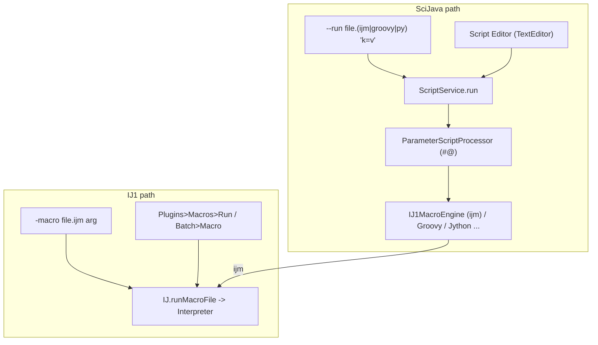

# A12 — Macro, Recorder and Scripting Infrastructure

## Executive Summary

The IJ1 macro language is a tokenised, interpreted language (`Tokenizer` → `Program` → `Interpreter`/`Functions`). Its `run(cmd, options)` call is `IJ.run`. The options string is a space-separated `key=value` list. Keys are the first word of the dialog label, lower-cased. Values may be `[bracketed]` and booleans are expressed by presence alone. `GenericDialog` reads the string through `Macro.getValue`, and a missing key falls back to the field's default. The Recorder (`ij.plugin.frame.Recorder`) is a `java.awt.Frame`. Recording works only while that frame exists, and `IJ.recording()` is hard-wired to `false` in headless mode.

Probe P30 confirmed that the Recorder cannot be constructed headless and produces nothing even when its flag is forced. Commands issued from macros or `IJ.run` are recorded only if `Recorder.recordInMacros` is set. Interactive ROIs are recorded as integers (A10).

In Fiji, scripts also run through SciJava's `ScriptService`. `.ijm` is handled by imagej-legacy's `IJ1MacroLanguage`/`IJ1MacroEngine`; both are VERIFIED to exist. `#@` script parameters are honoured only on that path. On the IJ1 `-macro` path a file with a `#@` line silently fails (P36).

The macro language has unrestricted file, process, reflection and script-engine access (`File.*`, `exec`, `call`, `eval("js"|"bsh"|"python")`), and macros can run automatically at start-up (`AutoRun`, `RunAtStartup`, `macros/AutoRun/`).

For replay fidelity, three kinds of macro must be distinguished:

- (a) macros generated by this project, which can be made complete and exact;
- (b) Recorder captures of original Fiji actions, which are lossy and incomplete;
- (c) user-authored macros, which are arbitrary code that must be sandboxed or trusted explicitly.

## Purpose and Scope

This document describes the macro language runtime, option-string semantics, batch mode, the Recorder, command listeners, script parameters and engines, the start-up and auto-run mechanisms, batch processing, and their implications for replay and security. Command parameter schemas are in A08. Global settings that change results are in A11 §6. Security policy is in A25.

## Research Questions

1. How is a macro tokenised and executed, and how does `run()` reach a plugin dialog?
2. What exactly are the options-string semantics?
3. What does batch mode change?
4. What does the Recorder record, when, and does it work without its window?
5. How do `CommandListener`/`Executer`, `#@` parameters and SciJava script engines fit in?
6. Which macro capabilities are security-relevant?
7. What does each macro category imply for replay fidelity?

## Sources and Evidence

The primary source is `imagej/ImageJ@v1.54p` (03382be1). Also used are `imagej/ij1-patcher@ij1-patcher-2.0.0` (70e570dc), `imagej/imagej-legacy@imagej-legacy-3.0.0` (fc31a563), `scijava/scijava-common@scijava-common-2.101.0` (d7219693) and `scijava/script-editor@script-editor-1.4.0` (253ad651). Installed files read without modification: `Fiji/macros/StartupMacros.fiji.ijm` and `Fiji/macros/AutoRun/AutoRun_Scripts.ijm`. The probes are P30, P31, P33, P34, P36 and P39 ([README-G2](../references/probes/README-G2.md)).

**Launcher commands verified for this document** (cwd = Fiji directory; `<jdk>` = bundled Zulu 21):

- IJ1 macro: `fiji-windows-x64.exe --java-home=<jdk> --allow-multiple --headless -macro <file.ijm> <arg>`.
- Groovy and other SciJava scripts: `fiji-windows-x64.exe --java-home=<jdk> --allow-multiple --headless --run <file.groovy|file.ijm> ["key='value',…"]`.

`--run` is listed by `fiji-windows-x64.exe --help` (Jaunch v2.1.1) as "run <plugin> in Fiji, optionally with arguments". Script stdout is not forwarded to the console, so probes write their own output files (**VERIFIED**).

## Verified Findings

### 1. Macro runtime

- `Interpreter.run(String)` appends `additionalFunctions`, tokenises with `new Tokenizer().tokenize(macro)` into a `Program` and runs it (`ij/macro/Interpreter.java#L80-L93`; `Tokenizer.java#L16`; `Program.java#L6-L24`). `run(macro, arg)` sets `argument`, and **switches batch mode on when `IJ.getInstance()==null`** (`#L100-L110`). `eval(code)` reuses the symbol table and ignores errors (`#L114-L136`). **VERIFIED**
- The interpreter's static state includes `static volatile Interpreter instance, previousInstance` (`#L40`), `public static boolean batchMode` (`#L41`) and the batch image tables (`#L42-L43`). `finishUp()` resets batch mode and the batch image list, restores RGB weights, shows pending Results and clears the hidden ROI Manager (`#L2064-L2099`). One JVM can therefore run only one macro coherently at a time (**INFERRED**).
- `Functions.doRun()` parses `run("cmd"[, "options"])` and calls `IJ.run(this.interp, arg1, arg2)` (`ij/macro/Functions.java#L692-L707`). `IJ.run(cmd, options)` calls `Macro.setOptions(options)` for the **current thread**, renames the thread with the prefix `Run$_`, and executes `new Executer(command).run()` *synchronously on the caller's thread* (`ij/IJ.java#L310-L331`). It renames old commands through a fixed table (`convert`, `#L343-L404`). **VERIFIED**
- `Executer.run()` first passes the command through every `CommandListener.commandExecuting(command)`. A listener may substitute another command or return `null` to veto (`ij/Executer.java#L54-L63`; `ij/CommandListener.java`). Then, if `IJ.recording()`, it brackets the command with `Recorder.setCommand`/`saveCommand` (`#L64-L70`). It resolves the class through `Menus.getCommands()` and `IJ.runPlugIn`, falling back to macro commands, LUTs, Open Recent and so on (`#L125-L180`). P31 showed that a `CommandListener` receives `Invert`, `Gaussian Blur...` and `Add...` from `IJ.run` headless, and that `Macro.getOptions()` inside the listener returns `sigma=3 ` and `value=10 `. **VERIFIED**
- Menu-invoked commands use `new Executer(cmd, imp)`, which starts a new thread named after the command at reduced priority (`#L36-L52`). Options are then `null`, and dialogs show interactively (**VERIFIED**, code).

### 2. Options-string semantics

| Rule | Evidence |
|---|---|
| Options are stored per thread in a `Hashtable` and are returned only if the thread name starts with `Run$_` (or `RMI TCP`). `getOptions()` appends a trailing space (`ij/Macro.java#L19-L21`, `#L86-L94`). | **VERIFIED** (P31: `sigma=7 ` after `setOptions`) |
| The key is the dialog label up to its first space or colon, lower-cased (`Macro.trimKey`, `#L159-L168`). "Sigma (Radius):" becomes `sigma`, "Calculate threshold for each image" becomes `calculate`, "Black background (of binary masks)" becomes `black` (P34). | **VERIFIED** |
| Matching: `key=` must not be preceded by a *letter*. A key preceded by `_` or a digit still matches: `_sigma=3 sigma=2` gives `3`, and `1sigma=3 sigma=2` gives `3` (`#L121-L124`; P34). Matching is case-sensitive on the options side: `SIGMA=4` is not found. | **VERIFIED** |
| Values: `'single-quoted'`, `[bracketed]` with nesting (`[C:/a b/c [1].tif]` is read intact), or the text up to the next space (`#L126-L156`; P34) | **VERIFIED** |
| Booleans: `getNextBoolean()` is true iff the key appears as a word outside brackets (`isMatch`). It is never written as `key=true` (`ij/gui/GenericDialog.java#L1340-L1380`). | **VERIFIED** |
| Missing key: the dialog field's current text, i.e. the plugin's default, is used (`GenericDialog.java#L1195-L1205`). For many plugins this is a static "last value" (A11 §4). | **VERIFIED** |
| Numbers may be macro variable names (`&var` or a bare name) resolved through `Interpreter.getVariable2`, and hex values `0x..` (`#L1206-L1228`). An invalid value raises "Numeric value expected in run() function" (`#L1219-L1225`). | **VERIFIED** |
| Duplicate first words in one dialog make the options ambiguous. The Recorder warns "Duplicate keyword … Add an underscore to the corresponding label" (`ij/plugin/frame/Recorder.java#L535-L546`). | **VERIFIED** |
| In macro mode `showDialog()` disposes the dialog without displaying it (`GenericDialog.java#L1506-L1511`). In headless Fiji, `GenericDialog`'s superclass is replaced by `HeadlessGenericDialog` (`imagej/ij1-patcher@ij1-patcher-2.0.0:src/main/java/net/imagej/patcher/LegacyHeadless.java#L78-L85`). | **VERIFIED** |
| Commands that special-case options before the dialog: `GaussianBlur` rewrites `radius=` to `sigma=` and divides by 2.5 (`ij/plugin/filter/GaussianBlur.java#L80-L84`, `#L102`). `Thresholder` rewrites `slice ` to `only ` (`ij/plugin/Thresholder.java#L66-L68`). For stacks, `stack` must be present or only the current slice is processed (`ij/IJ.java#L1262-L1266`). | **VERIFIED** |

### 3. Batch mode

- `setBatchMode(true)` sets the static flag and adopts the current temporary image. `false` displays the current batch image. `"show"`, `"hide"` and `"exit and display"` move images in or out (`Functions.java#L3444-L3505`). In batch mode, `ImagePlus.show()` creates no window and adds the image to `Interpreter.imageTable` (A09 §1). Images not displayed by the end of the macro are dropped from the table by `finishUp()` (`Interpreter.java#L2069-L2074`). **VERIFIED**
- Speed: no AWT window creation, painting or `waitTillActivated` (`ImagePlus.java#L496-L503`, `#L520-L521`). `IJ.showTime` is suppressed (`IJ.java#L962-L964`). **VERIFIED** (code). No benchmark was run; the speed-up is not quantified (**UNKNOWN**).
- In headless Fiji, batch mode is permanently on (A09 §5; `LegacyHeadless.java#L104-L120`). **VERIFIED**
- Undo inside batch macros: single-image filter and conversion undo works, stack undo does not, and there is only one level (P33). **VERIFIED**
- `RoiManager` in batch mode is a hidden instance, but that instance cannot be constructed headless (A10 §3, P35). **VERIFIED**

### 4. The Recorder

| Aspect | Fact | Evidence |
|---|---|---|
| Class | `Recorder extends PlugInFrame`, which is AWT (`Recorder.java#L16`). `public static boolean record`, `public static boolean recordInMacros` (`#L21-L24`). Modes `Macro`, `JavaScript`, `BeanShell`, `Python`, `Java`, stored in the pref `recorder.mode` (`#L26-L27`, `#L66-L68`). | **VERIFIED** |
| Needs the window | `Recorder(boolean showFrame)` constructs the frame and `TextArea` even when `showFrame=false` (`#L49-L112`). `recordingEnabled()` requires `getInstance()!=null && textArea!=null` (`#L137-L141`). All `record*` methods append to that `TextArea`. | **VERIFIED** |
| Headless | `IJ.recording()` returns `!GraphicsEnvironment.isHeadless() && Recorder.record` (`IJ.java#L2578-L2580`). P30: `new Recorder(false)` throws `HeadlessException`, and with `Recorder.record=true` forced, `IJ.recording()` is still `false`. `Recorder.recordOption` still builds `commandOptions` (`sigma=2`) without a frame, but nothing is written. | **VERIFIED** |
| What triggers a record | `Executer` calls `Recorder.setCommand(cmd)` before the command and `saveCommand()` after it (`Executer.java#L64-L68`). `setCommand` ignores commands on `Run$_` threads (that is, `IJ.run` and macros) unless `recordInMacros` is set (`Recorder.java#L151-L157`). `GenericDialog` adds options through `recordOption` while values are read, but only when `recorderOn`, which in macro mode requires `Recorder.record && Recorder.recordInMacros` (`GenericDialog.java#L1511`). | **VERIFIED** |
| Formatting | `saveCommand()` emits `run("Name", "options");` and has special cases: `Open...` → `open(path)`, Save As → `saveAs(...)`, `Make Binary` → `Convert to Mask`, `Image...` → `newImage(...)`, `Rename...` → `rename`. It prepends `setForegroundColor`/`setBlackBackground` where relevant and strips default Scale Bar options (`#L559-L700`). Script modes produce `IJ.run(imp, …)` (`#L639-L645`). | **VERIFIED** |
| `recordCall` | Records a line only in script mode, and not when the macro is running (`#L368-L384`) | **VERIFIED** |
| Smart recording | `GenericDialog.setSmartRecording(true)` omits values equal to the default (`#L1116-L1117`, `#L1203-L1206`, `#L1428`). Replay then depends on the defaults. | **VERIFIED** |
| Not recorded, or recorded only as a comment | `Threshold...`, `Brightness/Contrast...`, `Fonts...` and `Channels Tool...` without options are recorded as `//run(...)`. `Add to Manager`, `Find Commands...`, `Results...` and `Run...` are not recorded (`#L652-L670`). Preview checkbox state is not recorded (`GenericDialog.java#L568`). Freehand selections are not recorded (A10 §8). Interactive ROI geometry is rounded to integers (A10 §8). Zoom, scroll, slice navigation by mouse wheel, window arrangement and ROI Manager selection state are not recorded (**INFERRED** from the absence of `Recorder` calls in those paths). Changes made through the direct Java API never pass through `Executer` and are never recorded (**INFERRED**, `Executer.java#L64-L68`). | Mixed |
| Selection of images | `WindowManager.setCurrentWindow` records `selectImage("title")` by **title**, not ID (`ij/WindowManager.java#L53-L54`). Replay breaks when titles collide or change (A09 H4). | **VERIFIED** |

### 5. Script parameters, script engines and the Script Editor

- SciJava `#@` parameters are parsed by `ParameterScriptProcessor`, with the syntaxes `#@ <type> <name>`, `#@ <type>(attr=value, …) <name>` and `#@output …` (`scijava/scijava-common@scijava-common-2.101.0:src/main/java/org/scijava/script/process/ParameterScriptProcessor.java#L53-L98`). They are invoked from `ScriptInfo.parseParameters()` (`script/ScriptInfo.java#L287-L296`). `ScriptService.run(File|path, …, boolean process, Object... inputs)` (`script/ScriptService.java#L147-L285`). `ScriptLanguage extends ScriptEngineFactory` (`script/ScriptLanguage.java#L69`). **VERIFIED**
- The IJ1 macro engine **exists**: `net.imagej.legacy.plugin.IJ1MacroLanguage` (`@Plugin(type=ScriptLanguage.class, name="ImageJ Macro")`, names `ij1`/`imagej1`, extension `ijm`) creates `IJ1MacroEngine` (`imagej/imagej-legacy@imagej-legacy-3.0.0:src/main/java/net/imagej/legacy/plugin/IJ1MacroLanguage.java#L49-L68`). `IJ1MacroEngine.eval` prepends `var` declarations, appends a `function initializeSciJavaParameters()` that assigns the inputs (an `ImagePlus` becomes its ID, a `File` its absolute path), runs the macro through `IJ1Helper.runMacro`, then copies every macro variable back into the bindings (`IJ1MacroEngine.java#L117-L178`, `#L211-L259`). **VERIFIED**
- The IJ1 tokenizer has no `#@` handling (no `#@` occurs anywhere in `ij/`). P36: the same `.ijm` with a `#@ String name` line wrote nothing on the `-macro` path (silent failure, exit 0). Through `--run … "name='viaRun'"` it ran and bound `name=viaRun`, with `getArgument()` empty. **VERIFIED**
- Contrast with IJ1 mechanisms: `getArgument()` returns the string passed to `runMacro(file, arg)` or `-macro file arg` (`Functions.java#L264`). `Dialog.create`/`Dialog.add*`/`Dialog.show` build a `GenericDialog` at runtime (`Functions.java#L271`, `doDialog`). In headless mode these dialogs are served by `HeadlessGenericDialog`, so values must come from options (**INFERRED**).
- Fiji ships the SciJava languages `scripting-groovy`, `-jython`, `-javascript`, `-beanshell`, `-clojure`, `-jruby`, `-java`, `-scala`, `-renjin`, `-python` and `-appose-python` (`Fiji/jars/`, directory listing). The Script Editor (`org.scijava.ui.swing.script.TextEditor extends JFrame`, `scijava/script-editor@script-editor-1.4.0:src/main/java/org/scijava/ui/swing/script/TextEditor.java#L187`) runs scripts through `ScriptService` (`#L262`). **VERIFIED** (presence); the run path in detail is not traced.
- `eval("script"|"js", code)` runs JavaScript through `Macro_Runner.runJavaScript`. `eval("bsh", …)` and `eval("python", …)` call `Macro_Runner.runBeanShell`/`runPython` (`Functions.java#L3787-L3794`; `ij/plugin/Macro_Runner.java#L245`, `#L293`, `#L315`). P01/P33 confirm that `eval("script","System.exit(0);")` works in the pinned headless Fiji. **VERIFIED**

### 6. Macro sets, toolsets, start-up and auto-run

| Mechanism | Fact | Evidence |
|---|---|---|
| Macro sets | `MacroInstaller.install(text)` installs every `macro "Name" {…}` into the Plugins>Macros menu or the toolbar. `runMacroCommand(name)` lets `Executer` run them as commands (`ij/plugin/MacroInstaller.java#L70-L123`, `#L225`, `#L466`; `Executer.java#L147-L148`). | **VERIFIED** |
| AutoRun | A macro named `AutoRun` or `AutoRunAndHide` in an installed set runs on install, but not when a macro is running or the file is opened in the editor (`MacroInstaller.java#L111-L123`). `StartupRunner` runs the `RunAtStartup.ijm` macro (Edit>Options>Startup, `ij/plugin/Startup.java#L12`) and then `MacroInstaller.autoRun()` (`ij/macro/StartupRunner.java#L20-L28`), called from `ImageJ` start-up (`ij/ImageJ.java#L246`). | **VERIFIED** |
| Fiji StartupMacros | `Toolbar.installStartupMacros` looks for `StartupMacros.txt`, `.ijm` or `.fiji.ijm` in `macros/` (`ij/gui/Toolbar.java#L1606-L1615`). Fiji's `macros/StartupMacros.fiji.ijm` defines `macro "AutoRun"`, which runs every file in `macros/AutoRun/` (`Fiji/macros/StartupMacros.fiji.ijm#L46-L55`). `AutoRun_Scripts.ijm` there in turn runs every file in `plugins/Scripts/Plugins/AutoRun/` and `scripts/Plugins/AutoRun/` (`Fiji/macros/AutoRun/AutoRun_Scripts.ijm#L1-L16`). | **VERIFIED** (installed files) |
| Toolsets | `macros/toolsets/*.txt` (for example `Drawing Tools.txt`), installed from the toolbar's ">>" menu | **VERIFIED** (directory listing) |

### 7. Security-relevant capabilities

| Capability | Code | Restriction | Evidence |
|---|---|---|---|
| Arbitrary process execution | `exec(cmd…)` → `Runtime.getRuntime().exec(cmd)` (`Functions.java#L5179-L5232`) | None | **VERIFIED** |
| Reflection into any public static method | `call("class.method", args…)` loads any class through `IJ.getClassLoader()` and invokes it (`#L4607-L4660`) | None (string or int arguments) | **VERIFIED** |
| Embedded engines | `eval("js"|"script"|"bsh"|"python", code)` (`#L3787-L3794`) | None. Full Java access through the engine. | **VERIFIED** |
| File system | `File.delete`, `File.saveString`, `File.append`, `File.rename`, `File.copy`, `File.makeDirectory`, `File.openAsString`, `File.openAsRawString`, `getFileList` (`doFile`, `#L4340-L4442`; `delete` is a plain `f.delete()`, `#L4437-L4438`) | None | **VERIFIED** |
| Network | `File.openUrlAsString` → `IJ.openUrlAsString` (`#L4354-L4355`); `open(url)` | None | **VERIFIED** |
| Nested macros | `runMacro(file, arg)` → `IJ.runMacroFile`; `eval(macro)` (`#L3780-L3798`) | None | **VERIFIED** |
| Auto-execution | AutoRun, RunAtStartup, Fiji `macros/AutoRun/` and `scripts/Plugins/AutoRun/` (§6) | Writable install directory | **VERIFIED** |
| Termination | `eval("script","System.exit(0);")` exits the JVM (P01, P33); `IJ.getImage()` → `System.exit(0)` when headless with no image (A09) | None | **VERIFIED** |

The macro language therefore has the same privileges as the JVM user. It has no sandbox mode at v1.54p (**INFERRED**: no permission checks occur in the functions above). Details are in A25.

### 8. Batch processing

`Process > Batch > Macro…` (`IJ_Props.txt#L345`, `ij.plugin.BatchProcessor`) stores its input, output and format in the prefs `batch.input`, `batch.output` and `batch.format` (`ij/plugin/BatchProcessor.java#L18`, `#L114-L116`). For each file it calls `IJ.openImage(path)`, falling back to Bio-Formats, then runs the macro code through `Interpreter.runBatchMacro`. That call sets batch mode, registers the image and prepends `i=<index>;` (`#L188-L232`, `#L238-L251`; `Interpreter.java#L195-L204`). Output is saved with `IJ.saveAs(outputImage | imp, format, …)`. The virtual-stack variant passes `i` and `n` (`#L150-L161`). Built-in code templates such as "Gaussian Blur" → `run("Gaussian Blur...", "sigma=2");` sit at `#L312-L340`. **VERIFIED**

### 9. Replay fidelity by macro category

| Category | What it contains | Fidelity properties | Implications |
|---|---|---|---|
| **(a) Generated from this project's controls** | Text emitted by the frontend's action model, which knows the full parameter schema (A08) | Can be **complete**: every key explicit, `stack`/`slice` explicit, images addressed by `selectImage(id)` or a title made unique by the backend, ROIs created with float `makeSelection` arrays or loaded from `.roi`. Globals (A11 §6) can be set at the top with `setOption(…)`/`run("Set Measurements...", …)`/`run("Options...", …)`. Deterministic, if the same pinned Fiji is used. | This is the project's reproducible artefact. It must pass a round-trip test: generate, replay headless and compare with the interactive result (A30). |
| **(b) Recorder captures of arbitrary original actions** | The `Recorder` `TextArea` contents (GUI only) | **Lossy:** ROIs as integers, freehand ROIs missing, smart recording dropping defaults, B&C/threshold actions as comments, `selectImage` by title, no globals unless the command records them, no record of direct-API plugin actions or of commands issued through `IJ.run` unless `recordInMacros` is set. **GUI-only:** it does not exist headless (P30). | Treat the result as a *best-effort transcript*. Merging it into the history needs a reconciliation step: the backend `CommandListener` (P31) sees every `Executer` command, *with options for `IJ.run` calls*. The frontend should store its own structured record and use Recorder text only for display or export. |
| **(c) User-authored macros** | Arbitrary IJ1 macro code, or SciJava scripts | Arbitrary control flow, file, process and network access (§7), dependence on prefs and remembered plugin values, `#@` parameters only on the SciJava path (P36), possible `System.exit` | Run them only after explicit user consent, preferably in a separate JVM with a dedicated, disposable working copy. Capture before/after state (images, ROIs, Results) rather than trying to interpret the code. The UI cannot guarantee that replay reproduces the same output. |

**Recommendation (PROPOSED):** record the history as structured actions in the project's own format, with the command, the full option map, the image handle, ROI bytes and a snapshot of the globals. Render category (a) macro text from that record on demand. Capture category (b) with a backend `CommandListener` plus option capture, and use the GUI Recorder only for text. Execute category (c) as an opaque step with provenance (script hash, parameters, outputs).

## Diagrams and Inventories

```mermaid
sequenceDiagram
  participant M as Macro text
  participant T as Tokenizer/Interpreter
  participant F as Functions.doRun
  participant IJ as IJ.run
  participant MA as Macro (per-thread options)
  participant EX as Executer
  participant CL as CommandListener(s)
  participant R as Recorder (GUI only)
  participant P as Plugin + GenericDialog
  M->>T: tokenize -> Program
  T->>F: run("Gaussian Blur...", "sigma=2")
  F->>IJ: IJ.run(interp, cmd, opts)
  IJ->>MA: setOptions(thread, "sigma=2"); thread name "Run$_..."
  IJ->>EX: new Executer(cmd).run()  (same thread)
  EX->>CL: commandExecuting(cmd)  [can veto/replace]
  EX->>R: setCommand(cmd) only if IJ.recording() && (!Run$_ || recordInMacros)
  EX->>P: IJ.runPlugIn(className, arg)
  P->>MA: Macro.getValue(options, "sigma", default)
  EX->>R: saveCommand() -> run("Gaussian Blur...", "sigma=2");
```



## Constraints and Limitations

- No GUI-mode probe of the Recorder was made. Its GUI behaviour is from code (**INFERRED**). To verify, open the Recorder in a hidden-GUI JVM, run commands through `IJ.run` with `recordInMacros` on and off, and read `Recorder.getInstance()` text through reflection on `textArea`.
- How Fiji routes `.ijm` files from the GUI File>Open or drag-and-drop (IJ1 Editor or SciJava) is **UNKNOWN**. To verify, trace `DefaultLegacyHooks.openInEditor`/`interceptFileOpen` (`imagej-legacy`, `DefaultLegacyHooks.java#L287`, `#L377`).
- The speed of batch mode against GUI mode was not measured (**UNKNOWN**).
- Concurrency of two interpreters in one JVM was not tested (**UNKNOWN**); static `instance`/`batchMode` suggest it is unsafe.

## Requirement implications

- **CR-A12-01** The system shall store workflow history as structured actions (command, complete option map, target image handle, ROI bytes, globals snapshot) and shall generate IJ1 macro text from that record on demand. *Rationale: §9(a), Recorder lossiness.*
- **CR-A12-02** Generated macros shall specify every dialog key explicitly, including boolean keys and stack scope, and shall set the result-affecting globals (A11 §6) at the start. *Rationale: §2 missing-key fallback.*
- **CR-A12-03** Generated macros shall address images unambiguously, either by ID within a session or by titles made unique by the backend, and shall never depend on window focus. *Rationale: `selectImage` by title (§4).*
- **CR-A12-04** The backend shall capture original-Fiji commands executed in its JVM through a `CommandListener` together with `Macro.getOptions()`. It shall not depend on the IJ1 Recorder window for capture. *Rationale: P30, P31.*
- **CR-A12-05** The system shall pass a replay-equivalence test for generated macros: run headless with `-macro` against the pinned Fiji and compare numerically with the interactive run (A30). *Rationale: §9(a).*
- **CR-A12-06** When script parameters (`#@`) are used, the system shall execute the script through SciJava `ScriptService` (`--run` or the API), never through the IJ1 `-macro` path, and shall detect the silent failure mode. *Rationale: P36.*
- **CR-A12-07** User-authored macros and scripts shall run only after explicit user confirmation that names their capabilities (file, process, network, reflection and engine access), and shall be labelled non-reproducible unless they are pure command sequences. *Rationale: §7, §9(c).*
- **CR-A12-08** The system shall list and allow disabling of start-up auto-run sources (`RunAtStartup.ijm`, `AutoRun` macros, `macros/AutoRun/`, `scripts/Plugins/AutoRun/`) in any Fiji instance it launches. *Rationale: §6 auto-execution.*
- **CR-A12-09** The backend shall run at most one IJ1 macro interpreter at a time per JVM, and shall serialise UI-initiated commands while a macro runs. *Rationale: static `Interpreter.instance`/`batchMode`.*

## Risks

| ID | Risk | Likelihood | Impact | Mitigation idea |
|---|---|---|---|---|
| R-A12-01 | Users expect the Recorder to capture actions done in the new UI, but nothing is recorded headless | High | Medium | Provide the project's own history panel with "export as macro" (CR-A12-01), and document that the Recorder is not used. |
| R-A12-02 | Option-key collisions (`_`/digit prefixes, duplicate first words) cause wrong parameter binding | Low | High | Validate generated option strings against the dialog schema, and add a P34-style unit test per command. |
| R-A12-03 | A malicious or careless user macro deletes files or runs processes | Medium | High | CR-A12-07, separate JVM, working directory sandbox; A25 policy. |
| R-A12-04 | A `#@` script run through the wrong path fails silently, so the user believes it ran | Medium | Medium | CR-A12-06, and require a completion marker or return value for every scripted step. |
| R-A12-05 | Auto-run scripts in a user's Fiji alter state before the frontend connects | Medium | Medium | Launch with a controlled start-up (CR-A12-08), and snapshot globals after start-up (A11 CR-A11-03). |
| R-A12-06 | `System.exit` inside a macro kills the shared backend | Medium | High | Use process-level supervision with automatic restart and state re-hydration from the structured history. |

## References

- `imagej/ImageJ@v1.54p` (03382be1): `ij/macro/Interpreter.java`, `Functions.java`, `Tokenizer.java`, `Program.java`, `StartupRunner.java`; `ij/Macro.java`, `ij/IJ.java`, `ij/Executer.java`, `ij/CommandListener.java`, `ij/WindowManager.java`, `ij/ImageJ.java`, `ij/ImagePlus.java`; `ij/gui/GenericDialog.java`, `ij/gui/Toolbar.java`; `ij/plugin/frame/Recorder.java`, `ij/plugin/MacroInstaller.java`, `ij/plugin/BatchProcessor.java`, `ij/plugin/Macro_Runner.java`, `ij/plugin/Startup.java`, `ij/plugin/filter/GaussianBlur.java`, `ij/plugin/Thresholder.java`; `IJ_Props.txt`.
- `imagej/ij1-patcher@ij1-patcher-2.0.0` (70e570dc): `LegacyHeadless.java`.
- `imagej/imagej-legacy@imagej-legacy-3.0.0` (fc31a563): `plugin/IJ1MacroLanguage.java`, `plugin/IJ1MacroEngine.java`, `DefaultLegacyHooks.java`.
- `scijava/scijava-common@scijava-common-2.101.0` (d7219693): `script/ScriptService.java`, `ScriptLanguage.java`, `ScriptInfo.java`, `process/ParameterScriptProcessor.java`.
- `scijava/script-editor@script-editor-1.4.0` (253ad651): `TextEditor.java`.
- Installed files (read-only): `Fiji/macros/StartupMacros.fiji.ijm`, `Fiji/macros/AutoRun/AutoRun_Scripts.ijm`, `Fiji/jars/` listing; launcher `--help` output (Jaunch v2.1.1).
- Probes: [P30](../references/probes/P30-recorder-headless.out.txt), [P31](../references/probes/P31-command-listener.out.txt), [P33](../references/probes/P33-undo-batch.out.txt), [P34](../references/probes/P34-macro-options-parsing.out.txt), [P36](../references/probes/P36-script-params-macro.out.txt), [P39](../references/probes/P39-measure-accumulation-macro.out.txt); index [README-G2](../references/probes/README-G2.md).

## Change log

- 2026-10-17: Initial draft (agent G2).
