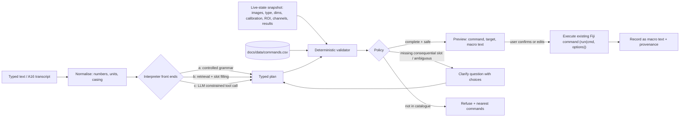

# A17 — Natural Language to Scientific Command Semantics

## Executive Summary

Natural-language (NL) and voice input must resolve to **existing Fiji commands, with their real macro option keys, applied to a specific image, channel, slice and ROI in the live session**. Many parameter values in Fiji are scientifically consequential, and many are taken silently from hidden state.

Verified examples from ImageJ 1.54p source:

- **Gaussian Blur units.** `sigma` is in pixels unless the `scaled` key is present (`GaussianBlur.java#L133-L134`).
- **Gaussian Blur remembered value.** Interactive use remembers the last sigma as the next default (`#L97-L101`).
- **Measurement set.** `Measure` uses a measurement set persisted in `IJ_Prefs` (`Analyzer.java#L40`).
- **Mask polarity.** The polarity of `Convert to Mask` depends on the global `Prefs.blackBackground` for single images (`Thresholder.java#L246`). For stacks it depends on whether the macro string contains `black` (`#L78`, `#L100`).
- **Auto threshold scope.** `setAutoThreshold()` computes the threshold inside the current ROI (`Functions.java#L3621`).
- **Composite images.** A filter on a composite-mode image processes all channels unless `slice` is passed (`IJ.java#L1258-L1261`), so "blur channel 2" is not one key.

**Recommendation (PROPOSED).** A layered interpreter in which every path emits the same **typed command plan** (catalogue command + typed slots + explicit target), checked by one deterministic validator against the catalogue and a live-state snapshot. A deterministic confirm/clarify policy then decides what happens, and an editable preview is always shown.

- **Front ends.** (a) a controlled-language grammar fast path (the prototype's approach, extended), and (b) catalogue retrieval plus slot filling, are the core. (c) An LLM with constrained function calling over the typed schema is an optional front end.
- **Rejected.** (d) LLM-generated macro code is rejected for execution. The ImageJ macro language exposes `exec()` (OS processes), `call()` (any public static Java method) and `File.delete` (`Functions.java#L5179-L5210`, `#L4607`, `#L4437`).
- **LLM probe (VERIFIED, P65).** A local 8 B model (`qwen3:8b` through Ollama) under a JSON schema produced deterministic output, refused out-of-scope requests 2/2, and had a median latency of 1.18 s. But it matched only 5/16 labelled plans exactly. It set `scaled=true` without a unit and emitted schema placeholders (`"bool"`, `"black|white"`) as values. The clarify decision must therefore be made by the validator, not by the model.
- **Privacy.** Any LLM, local or hosted, receives only text and metadata, never pixels.

## Purpose and Scope

This document defines the semantic problem of mapping typed or spoken instructions to Fiji operations. It covers grounding, parameters and units, consequential defaults, deixis, multi-step plans and preconditions, ambiguity classes, the confirm/clarify policy, implementation approaches, local versus hosted LLMs, evaluation, prior work, and the prototype baseline.

It does not cover speech recognition (A16), the command catalogue's construction (`docs/data/commands.csv`, being built in parallel by G1), the recorder/history model, or UI design.

## Research Questions

1. What must an interpreted instruction be grounded to, so that it is an *existing* Fiji operation rather than a reimplementation?
2. Which parameters and defaults change the scientific result, and where does Fiji take them from when they are not stated?
3. How should deictic references ("this image", "channel 2", "the last result") resolve against the live state?
4. Which interpretation approach gives control, auditability and acceptable accuracy, and where may an LLM safely sit?
5. How should accuracy and safety be evaluated?

## Sources and Evidence

| Source | Revision | Use |
|---|---|---|
| `fiji-research-cache/ImageJ` | v1.54p, 03382be1 | `GaussianBlur`, `Thresholder`, `Analyzer`, `AutoThresholder`, `IJ.setupDialog`, `Macro`, `GenericDialog`, `ij.macro.Functions` |
| `Fiji/jars/ij-1.54p.jar!/IJ_Props.txt` | pinned runtime | Menu-to-class table |
| `Fiji/plugins/Auto_Threshold-1.18.0.jar` | pinned runtime | Existence of the Fiji Auto Threshold plugin (listing only) |
| `fiji-research-cache/script-editor` | script-editor-1.4.0, 253ad651 | Check for built-in LLM features |
| [commands.py](../../../backend/src/fidelis/commands.py) | prototype 08a1433 | Baseline grammar |
| Probe P65 | `probes/P65-local-llm-constrained-commands.*` | Local LLM feasibility |
| Probe P61 (A16) | `probes/P61-vocabulary-biasing-and-silence.out.txt` | Speech transcripts as NL input |
| Web sources | see References | Prior work |

## Technical Details

### 1. Problem definition and pipeline

An instruction is correct only when all of the following hold:

- (i) it resolves to a catalogue command;
- (ii) every scientifically consequential slot has a value the user stated or explicitly accepted;
- (iii) the target (image, channel, slice/frame, ROI) is explicit;
- (iv) preconditions hold in the live state;
- (v) the user saw a preview of the exact operation before execution.

### 2. Command grounding

- **Catalogue.** Commands are grounded to the catalogue `docs/data/commands.csv`, which is derived from `IJ_Props.txt` and the SciJava/Fiji menus. For example: `filters02="Gaussian Blur...",ij.plugin.filter.GaussianBlur`, `binary02="Convert to Mask",ij.plugin.Thresholder("mask")`, `filters03="Median...",ij.plugin.filter.RankFilters("median")`, `stacks12="Z Project...",ij.plugin.ZProjector` (VERIFIED: `IJ_Props.txt` lines 324, 269, 325, 158).
- **Execution.** Each plan step compiles to `run("<menu label>", "<options>")`, which is the same path the Recorder emits and the same macro surface the project must preserve (VERIFIED: `Functions.java#L99`, `doRun()` at `#L692`).
- **Option keys come from dialog labels.** `Macro.trimKey` takes the label text up to the first space or colon and lower-cases it (`ij/Macro.java#L159-L168`). `GenericDialog.getNextBoolean` in macro mode treats a checkbox as true only if `key+" "` occurs in the options (`ij/gui/GenericDialog.java#L1347-L1350`). So "Sigma (Radius):" → `sigma`, "Scaled Units (µm)" → `scaled`, "Black background (of binary masks)" → `black`, "Rolling ball radius:" → `rolling`, "Light background" → `light`, "Pixel units" → `pixel` (VERIFIED: label strings at `GaussianBlur.java#L88-L91`, `Thresholder.java#L78`, `BackgroundSubtracter.java#L96-L97`, `ParticleAnalyzer.java#L342-L345`).
- **Absent checkbox key means false.** An omitted checkbox key in a macro is false, not "keep the user's current setting". This is INFERRED from `getNextBoolean` and is the reason the plan must carry every boolean explicitly.
- **Option-value quoting.** Values containing spaces are bracketed (`projection=[Max Intensity]`), and `Macro.getValue` counts nested `[`/`]` (`ij/Macro.java#L132-L140`). The plan compiler must bracket-quote and reject unbalanced brackets, so that slot values cannot inject further keys (INFERRED).
- **Legacy aliases.** For example `radius=` in Gaussian Blur is rewritten to `sigma=` and divided by 2.5 (`GaussianBlur.java#L80-L84`, `#L102`). The catalogue should record aliases so that NL output never uses them and imported macros are still understood.

### 3. Parameter extraction and units

| Command | Slot | Unit semantics in 1.54p | Evidence |
|---|---|---|---|
| Gaussian Blur... | `sigma` | Pixels unless `scaled`. With `scaled`, `sigmaX = sigma/pixelWidth` and `sigmaY = sigma/pixelHeight` (anisotropic pixels give different pixel sigmas) | VERIFIED: `GaussianBlur.java#L133-L134` |
| Gaussian Blur... | `scaled` | The checkbox exists only if the calibration unit is not "pixels". On an uncalibrated image `sigmaScaled=false` is forced | VERIFIED: `#L89-L93` |
| Gaussian Blur... | `stack` | For a stack, the macro processes all slices only if `stack ` is present; otherwise only the current slice | VERIFIED: `IJ.java#L1262-L1266` |
| Gaussian Blur... | ROI | With a non-full-height ROI the filter works on the ROI rectangle with a snapshot (`SNAPSHOT` flag) | VERIFIED: `#L62-L69` |
| Subtract Background... | `rolling` | Dialog unit label "pixels" | VERIFIED: `BackgroundSubtracter.java#L96` |
| Analyze Particles... | `size` | In calibrated units² ("Size (µm^2)") unless `pixel` is set, when the image is scaled | VERIFIED: `ParticleAnalyzer.java#L342-L345` |

Rules (PROPOSED):

- A spoken or written unit ("0.5 µm", "50 pixels") is a slot value with a unit and is converted explicitly. With no unit, the interpreter does not guess: it uses the catalogue's declared native unit and shows it in the preview ("sigma = 2 **pixels** (image is calibrated in µm; 2 px = 0.31 µm)").
- Spoken numbers are normalised first: A16 P61 shows "three" versus "3" varying with the prompt.

### 4. Scientifically consequential defaults (must never be chosen silently)

| Default | Where Fiji takes it from | Why it matters | Evidence |
|---|---|---|---|
| Auto-threshold method | `setAutoThreshold()` with no argument uses `ISODATA2` ("Default", a modified IsoData). There are 17 methods in `AutoThresholder.Method` (Default, Huang, Intermodes, IsoData, IJ_IsoData, Li, MaxEntropy, Mean, MinError, Minimum, Moments, Otsu, Percentile, RenyiEntropy, Shanbhag, Triangle, Yen) | Different methods give different masks and therefore different areas and counts | VERIFIED: `Functions.java#L3629`; `AutoThresholder.java#L11-L29`, `#L100-L123` |
| Threshold histogram region | `ip.setRoi(img.getRoi())` before thresholding | The same command gives a different threshold when a selection exists | VERIFIED: `Functions.java#L3621` |
| Dark/bright objects | `dark` keyword in the method string | It inverts which phase is foreground | VERIFIED: `ImageProcessor.java#L597` (`darkBackground = method.contains("dark")`) |
| BlackBackground (single image) | Global `Prefs.blackBackground`, persisted in IJ_Prefs (`Prefs.java#L76`, `#L560`, `#L606`), read at `Thresholder.java#L246` | Mask polarity; later binary operations (Erode, Watershed, Analyze Particles) depend on it | VERIFIED (source) |
| BlackBackground (stack) | Dialog checkbox `black`, from the macro string, temporarily overriding the global (`Thresholder.java#L71`, `#L100`, restored `#L139`) | A macro without `black` produces white-background masks whatever the user's preference (INFERRED from the above) | VERIFIED (source); runtime INFERRED |
| Measurement set | `Analyzer.systemMeasurements = Prefs.getInt("measurements", AREA+MEAN+MIN_MAX)` | The columns produced by `Measure` depend on the user's last *Set Measurements*. The `LIMIT` flag (limit to threshold) changes the measured values themselves (`Analyzer.java#L480`) | VERIFIED: `Analyzer.java#L34-L42` |
| Redirect target / decimal places | `redirectTarget`, `precision` (Prefs) | Measuring intensity on a different image; rounding of reported values | VERIFIED: `Analyzer.java#L42-L45` |
| Remembered dialog values | `GaussianBlur.sigmaS` / `sigmaScaledS` are updated only in interactive use (`options==null`) (`#L97-L101`) | "Blur it" in the classic GUI starts from the last value used, which a user may not remember | VERIFIED (source) |

The prototype violates this rule twice: it hard-codes `setOption("BlackBackground", true)` and a fixed measurement set (`area mean min standard redirect=None decimal=6`) ([commands.py](../../../backend/src/fidelis/commands.py#L57-L65)).

### 5. Deictic and anaphoric references

| Expression | Resolution in classic Fiji | Required behaviour (PROPOSED) | Evidence |
|---|---|---|---|
| "this image", "it" | `WindowManager.getCurrentImage()`, the last-activated window (`ij/WindowManager.java#L69`) | Resolve to the workstation's *focused* image and show its title and ID in the preview. If focus changed between utterance and execution, re-confirm | VERIFIED (method); behaviour PROPOSED |
| "the selection", "the ROI" | `ImagePlus.getRoi()`; ROI Manager selection is separate | Resolve to the active ROI of the target image. If none exists → precondition failure. If several ROI Manager rows are selected → clarify | INFERRED |
| "channel 2" | Hyperstack C index (1-based, `setC`). A filter on a composite-mode image processes **all channels** unless the options contain `slice` (`IJ.java#L1258-L1261`) | Bind to C = 2 by index or by channel name (metadata), set the position, and add `slice`/`stack` explicitly. Show "channel 2 (GFP) only, all Z slices" | VERIFIED (source) |
| "the last result" | `ResultsTable` (last row) or the image most recently created by a command | Resolve through the session history (the command → output image/result link), not by window order | PROPOSED |
| "the mask", "the original" | No concept | Resolve through history roles (output of `Convert to Mask`; input of step 1); ambiguous → clarify | PROPOSED |
| "all images", "every file in this folder" | Batch processing (`Process > Batch > Macro`) | Becomes a batch plan with an explicit file list preview; never implicit | PROPOSED |

### 6. Multi-step plans, preconditions and live-state validation

- **Plans.** A plan is an ordered list of steps. Each step has `command`, typed `params`, an explicit `target` (image ID, C/Z/T scope, ROI reference) and `postconditions` (the image type produced, a new image or in-place).
- **Preconditions** are checked against a state snapshot fetched just before validation, and again before each step executes, because the user can change state in between. Examples:
  - image type: `setAutoThreshold` rejects RGB ("Non-RGB image expected", `Functions.java#L3619-L3620`);
  - single-slice conversion needs 8-bit (`Thresholder.java#L118-L120`);
  - Z Project needs more than one Z slice;
  - `scaled` needs a non-pixel calibration;
  - "inside the ROI" needs an ROI;
  - Analyze Particles needs a binary or thresholded image.
- **Chaining.** The output of step *n* becomes the target of step *n+1* only when the command creates a new image (`Z Project`, `Duplicate`) or modifies in place. This is a catalogue property, and it is not stated in `IJ_Props.txt` (UNKNOWN per command; G1's catalogue must record it).
- **Undo.** The legacy undo is single-level and some commands reset it (`Undo.reset()` at `Thresholder.java#L123`). Multi-step NL plans therefore need the project's own history/rollback, not ImageJ's `Undo` (INFERRED; see the history analysis by other agents).

### 7. Ambiguity classes

| Class | Example | Resolution |
|---|---|---|
| A1 Command ambiguity | "smooth it" (Gaussian, Mean, Median, Smooth 3×3) | Clarify with 2–4 catalogue choices |
| A2 Missing consequential slot | "threshold it"; "blur it" | Clarify; offer the previous value as a choice, never as a silent default |
| A3 Unit ambiguity | "sigma 2" on a µm-calibrated image | Execute in native unit only if the policy allows, showing the conversion; otherwise clarify |
| A4 Target/deixis | "blur channel 2" on a composite; "measure it" with two images open | Bind explicitly; clarify if several candidates |
| A5 Scope (stack) | "blur the stack" vs current slice; Z versus T | Make `stack`/`slice` explicit; clarify for 5-D data |
| A6 Polarity | "objects are dark", "convert to mask" | Explicit `dark` and `black`; clarify if unstated |
| A7 Measurement semantics | "measure intensity" (mean? integrated? limit to threshold?) | Clarify the measurement set and show it |
| A8 Sequencing/anaphora | "threshold and then measure them" ("them" = particles? the ROI?) | Clarify between `Measure` and `Analyze Particles` |
| A9 Recognition error | Transcript "inside the other eye" (A16 P61) | Unknown term → refuse or clarify; the user edits the transcript |
| A10 Out of catalogue / unsafe | "delete the files", "write a macro that…" | Refuse; offer the script editor for code |
| A11 Vague quantity | "a bit", "strongly" | Clarify; no numeric mapping |

### 8. Confirm/clarify policy (PROPOSED; deterministic, evaluated by the validator, not the model)

| Condition after validation | Action |
|---|---|
| Command not in catalogue, or validator rejects a type/range/key | Refuse with the reason and the nearest catalogue commands |
| Any consequential slot (flagged `consequential=true` in the catalogue) not stated by the user in this utterance or an earlier turn | Clarify; list the choices; show the classic default labelled "Fiji default" |
| Target ambiguous (more than one candidate image, channel or ROI) | Clarify |
| Precondition fails | Explain and offer the preparatory command (for example "Convert to 8-bit?") as a separate, confirmable step |
| Plan complete, non-destructive (creates a new image or only measures) | Show the preview; a single confirm (keyboard: Enter) |
| Plan complete, in-place modification of original data, or a batch over files | Show the preview with the target named; explicit confirm; batch shows the file count and output location |
| Speech-originated plan | Always preview the transcript and the plan; no "auto-execute" setting at MVP |

### 9. Approaches compared

| | (a) Grammar / controlled language | (b) Catalogue retrieval + slot filling | (c) LLM + constrained tool call over typed schema | (d) LLM generates macro code |
|---|---|---|---|---|
| Grounding | By construction | By retrieval over labels, aliases and descriptions | By schema enum; can still choose a wrong valid command | None: free text code |
| Coverage of paraphrase | Low (prototype: 4 fixed patterns) | Medium | High | High |
| Determinism / audit | Full | Full | Same output at temperature 0 on the same model build (P65: 16/16 identical across repeats); model-version dependent | Low |
| Silent defaults | None if the grammar requires the slot | Controlled by the slot schema | Model tends to fill or over-ask; P65 placeholders | Hidden inside code |
| Safety | Closed set | Closed set | Closed set *if* the validator is authoritative | Arbitrary code: `exec`, `call`, `File.delete`, `eval` |
| Cost / latency | Microseconds | Milliseconds | P65: median 1.18 s warm on an RTX 5070; 50.4 s first call (model load) | Similar to (c) plus a review burden |
| Offline | Yes | Yes | Yes with a local model | Yes with a local model |

**Why (d) is rejected for direct execution (VERIFIED basis).** The ImageJ macro language includes:

- `exec()`, which runs an OS process through `Runtime.getRuntime().exec` (`Functions.java#L5179`, `#L5210`);
- `call()`, which invokes any public static Java method (`#L4607`);
- `File.delete` (`#L4437`);
- `eval(...)`, which runs further macro or script code (`#L268`);
- `run()`, which reaches every menu command, including Quit and file writers.

Generated code cannot be reviewed reliably by the typical user. It defeats the consequential-defaults policy, because defaults are simply omitted keys. It is also not traceable to catalogue entries.

The only acceptable use of (d) is as *editable text in the script editor* that the user runs as their own macro, outside the NL execution path. Even that should be flagged as unreviewed generated code. Sandboxing the macro interpreter is not available in 1.54p: there is no capability model in `ij.macro.Interpreter` (INFERRED from the function table, `MacroConstants.java#L119-L121`).

**Note on (c), VERIFIED by P65.** The probe used a 10-command catalogue stand-in, 16 labelled instructions × 2 repeats, Ollama 0.40.5, `qwen3:8b`, temperature 0, and a JSON-schema `format`. Results:

- correct status on 7/16 cases per repeat; exact plan on 5/16;
- out-of-scope correctly refused 2/2;
- in 9 of the 10 cases where the expected status was `plan`, the model returned `clarify` instead (only the projection case was planned exactly). It asked about pixels versus microns even for "radius 3", and asked whether the background was "truly dark" after the user said it was;
- it set `scaled: true` for "sigma 2" and "sigma 1.5", where no unit was given;
- it emitted type placeholders as values (`"dark": "bool"`, `"background": "black|white"`) and numbers as strings;
- `channel` was never filled for "blur channel 2";
- a key-only validator rejected **0** of these plans, so validation must be type-, range- and enum-level.

This is one model, one prompt and a small set, so it is not a benchmark. It does show that an LLM front end is viable only as a slot proposer under an authoritative validator and policy.

### 10. Local versus hosted LLM

- **What is sent.** Even without pixels, the text context includes image titles, file paths, channel names, calibration, ROI names and Results values. These can identify unpublished work, patients (clinical/histology file names), collaborators or proprietary compounds (INFERRED).
- **Hosted models** add third-party processing, retention terms, an internet dependency and model drift outside the project's control.
- **Local models** (P65: an 8 B model fits on an 8 GB GPU, `ollama ps` showing "100% GPU", 5.6 GB) remove transfer. They add a download size of several GB and hardware dependence, and lab machines without a GPU are UNKNOWN.
- **Existing tools differ.** ImageJAI's README states that with cloud backends "image content and prompts are transmitted to the chosen provider". fiji-llm can attach rendered image planes and UI screenshots for vision models (see §11). This project's requirement is stricter.

**Requirement candidate.** Pixels never leave the process; only text and metadata are sent, after a visible redaction preview; hosted use is opt-in per session; the default build is LLM-free (CR-A17-08…10).

### 11. Prior work (each item's existence checked on 2026-10-17)

| Work | What it does | Approach class | Relevance |
|---|---|---|---|
| [fiji/fiji-llm](https://github.com/fiji/fiji-llm/) (BSD-2-Clause; official Fiji organisation; 578 commits, 12 stars) | In-app chat (`Help > Assistants > Fiji Chat...`, unlisted "Fiji-chat" update site). Tools named `fiji_<scope>_<operation>` that run scripts/macros, execute commands and read Results/ROI Manager. A localhost MCP server (port 9090). Ollama and Gemini/Claude/ChatGPT providers. Can send rendered image planes and screenshots | (c)+(d) | Closest upstream effort. Emphasises "generating familiar scripts and macros"; code execution remains available |
| [Jay2owe/ImageJAI](https://github.com/Jay2owe/ImageJAI) v0.6.2 (BSD-3-Clause) | Plugin: the LLM returns `<macro>`/`<pipeline>` blocks that are executed, with up to 3 self-correction retries. Optional TCP server with `execute_macro`, `run_script`. Privacy postures and an audit CSV | (d) | Shows the code-execution pattern this document rejects; privacy-posture idea is reusable |
| [SteffenPL/fiji-mcp](https://github.com/SteffenPL/fiji-mcp) (MIT) | MCP server ↔ WebSocket bridge plugin. Tools `run_ij_macro`, `run_script`, `run_command`, `list_commands`, `get_results_table`, `get_recent_actions`, `export_actions_as_macro`. User actions captured through ImageJ listeners and tagged user/MCP | (c)+(d) | `list_commands` / action capture are relevant to grounding and history; no documented sandbox |
| Johanns et al. (2026), *Agentic-J*, [arXiv:2606.02080](https://arxiv.org/abs/2606.02080) | Containerised multi-agent assistant for ImageJ/Fiji; generates executable scripts in a documented project structure | (d) | No quantitative accuracy reported in the abstract |
| Royer (2024), *Omega*, Nature Methods, [doi:10.1038/s41592-024-02310-w](https://doi.org/10.1038/s41592-024-02310-w); code `royerlab/napari-chatgpt` | Conversational LLM agent for napari | (c)/(d) | Not Fiji; prior art for conversational image analysis |
| Lei et al. (2024), *BioImage.IO Chatbot*, Nature Methods, [doi:10.1038/s41592-024-02370-y](https://doi.org/10.1038/s41592-024-02370-y) | RAG assistant over community documentation, with extensions | (b)-like retrieval | Retrieval over documentation for command help |
| Haase, Tischer, Hériché, Scherf (2024), *Benchmarking Large Language Models for Bio-Image Analysis Code Generation*, bioRxiv [doi:10.1101/2024.04.19.590278](https://doi.org/10.1101/2024.04.19.590278); `haesleinhuepf/human-eval-bia` | HumanEval-style functional tests for Python bio-image analysis code | Evaluation | Method template for §12, but for Python code, not Fiji command plans |
| image.sc thread "AI-assisted code-generation in Fiji's script editor" ([forum.image.sc/t/100877](https://forum.image.sc/t/ai-assisted-code-generation-in-fijis-script-editor/100877)) | Announcement thread | (d) | Existence seen in the search index only; the content could not be retrieved (HTTP 403), so its claims are UNKNOWN |
| script-editor 1.4.0 (pinned) | — | — | No `openai`/`gpt`/`chat` strings in `src/main/java` (VERIFIED: grep at 253ad651). The pinned Fiji has no built-in LLM assistant |

No published, evaluated system grounding NL to Fiji commands *with a validator and confirm policy* was found (absence of evidence, UNKNOWN).

### 12. Evaluation design (PROPOSED)

- **Test case format** (`docs/data/nl-eval/*.jsonl`, proposed path). Fields: `id`, `utterance`, `modality` (typed / spoken plus audio file), `state` (a snapshot fixture: images with type, dims, calibration, channels, ROI, results), `expected.status` ∈ {plan, clarify, refuse}, `expected.steps[]` (command, required params with tolerance and unit, target), `expected.clarify_slots[]`, `tags[]` (ambiguity class A1–A11, command family).
- **Sources of utterances:**
  - (1) recorded macros of real workflows (Recorder output) back-translated to NL by people;
  - (2) the tutorials cache `fiji-research-cache/tutorials`@586267dc and imagej.net how-tos, paraphrased;
  - (3) invited user sessions with think-aloud;
  - (4) adversarial and out-of-scope prompts (A10).

  Generated paraphrases are allowed only after human labelling.
- **Coverage.** At least every `consequential=true` slot and every ambiguity class. Calibrated and uncalibrated, single-image and 5-D hyperstack state fixtures.
- **Metrics:**
  - exact-plan accuracy;
  - slot precision/recall;
  - clarify precision/recall (asking when needed versus over-asking: P65 shows over-asking);
  - refusal accuracy;
  - **unsafe-execution rate**: a consequential slot executed without user statement, or an out-of-catalogue execution. This metric is a release gate at 0;
  - latency.
- **Scientific check.** For each plan that reaches execution, compare the outputs with a reference macro run on the pinned Fiji. This uses the numerical-equivalence procedure in A30/D18, not text equality.
- **Regression.** Front ends (a)/(b) are tested in CI. (c) is tested per pinned model build, because outputs are model-version dependent.

### 13. Prototype baseline ([commands.py](../../../backend/src/fidelis/commands.py))

| Aspect | Prototype behaviour | Assessment |
|---|---|---|
| Grammar | Lower-cases, strips `.!?`, splits on `then` / `and then`, and `re.fullmatch`es four patterns (`#L29-L49`) | Sound safety property (closed set, no code). Very low paraphrase coverage ("blur with sigma 2" fails without "sigma"; "Gaussian blur 2" fails) |
| Typed validation | Pydantic `Action` with `extra="forbid"`, `sigma` 0.1–10 float, `level` 0–255 strict int; `Workflow` 1–12 actions (`#L9-L26`) | Good pattern to keep: typed schema plus range validation. Ranges are hard-coded, not from the catalogue or image type (`level` 0–255 is wrong for 16-bit) |
| Macro generation | f-strings of validated values: `run("Gaussian Blur...", "sigma={sigma:g}")` (`#L52-L56`) | Safe because values are numeric. No `scaled`/`stack` handling; on a calibrated image sigma is silently in pixels |
| Threshold | `setThreshold(level, 255)` + `setOption("BlackBackground", true)` + `Convert to Mask` (`#L57-L61`) | Fixed upper bound 255. **Sets a global preference silently.** No auto method |
| Measure | Always sets `area mean min standard redirect=None decimal=6` (`#L62-L65`) | **Overrides the user's measurement set silently** |
| Deixis / state | None (one uploaded image per run) | n/a at that scope |
| Clarify | Single generic error message (`#L45-L48`) | No clarify loop |

## Alternatives and Trade-offs

**Recommendation (PROPOSED).**

- Build the typed plan schema, the catalogue-driven validator and the confirm/clarify policy first. They are front-end independent.
- Implement (a) an extended controlled grammar and (b) retrieval plus slot filling over `docs/data/commands.csv` as the HACK/MVP front ends.
- Treat (c) as an optional, local-by-default front end that may only propose a plan, with the validator and policy authoritative.
- Do not provide (d) on the execution path.

Approach (c) becomes preferable to extending (a)/(b) when an evaluation under §12 shows a higher exact-plan accuracy *and* an unsafe-execution rate of 0 on the same set. P65 indicates this is not yet the case for an 8 B local model with a naive prompt.

## Requirement implications

- **CR-A17-01** — Every NL or voice instruction shall resolve to zero or more steps, each naming a command present in `docs/data/commands.csv`, before anything executes. *Rationale:* grounding to existing Fiji operations; no reimplementation.
- **CR-A17-02** — Each executed step shall be compiled to the Fiji macro call `run("<menu label>", "<options>")`, using the catalogue's option keys, with all boolean keys explicit and values bracket-quoted. *Rationale:* an absent checkbox key means false (`GenericDialog.java#L1347-L1350`); this keeps recorded macros replayable in classic Fiji.
- **CR-A17-03** — Parameters flagged consequential in the catalogue (at least: auto-threshold method, `dark`, BlackBackground/`black`, measurement set and `limit`, units/`scaled`, `pixel`, stack scope) shall never be filled from a hidden default. They shall be stated by the user or explicitly accepted from a displayed choice. *Rationale:* §4.
- **CR-A17-04** — The preview of every plan shall show the target image (title and ID), channel/slice/frame scope, ROI, each parameter with its unit, and the exact macro text. *Rationale:* user control and auditability.
- **CR-A17-05** — The interpreter shall validate each plan against a live-state snapshot (type, dimensions, calibration, ROI, channel names, thresholded state) and shall re-validate before each step executes. *Rationale:* preconditions (§6); state can change between preview and execution.
- **CR-A17-06** — Deictic references ("this image", "the selection", "channel N", "the last result") shall be resolved by documented rules, and shall cause a clarify question whenever more than one candidate exists. *Rationale:* §5.
- **CR-A17-07** — The confirm/clarify/refuse decision shall be made by deterministic policy code from the validator's result, not by a language model. *Rationale:* P65 shows both over-asking and placeholder values.
- **CR-A17-08** — No pixel data, thumbnails or screenshots shall be sent to any language model. Only text and metadata shall be sent, after a user-visible preview of the exact outbound payload. *Rationale:* microscopy data confidentiality; existing tools do send images (§11).
- **CR-A17-09** — The system shall be fully functional with no language model installed, and any hosted model shall be opt-in per session. *Rationale:* offline labs and privacy; front ends (a)/(b) suffice for the core.
- **CR-A17-10** — Every LLM-proposed plan shall be logged with model name, model digest, prompt template version and raw output. *Rationale:* reproducibility; model-version dependence.
- **CR-A17-11** — The NL execution path shall not execute model-generated macro or script code. *Rationale:* `exec`, `call`, `File.delete`, `eval` in the macro language (§9).
- **CR-A17-12** — A labelled evaluation set as in §12 shall exist before release, and the unsafe-execution rate on it shall be 0. *Rationale:* a measurable safety gate.
- **CR-A17-13** — The validator shall check type, range and enumeration for every slot, derived from the catalogue and the target image (for example the threshold range per bit depth). *Rationale:* P65 key-only validation accepted invalid values; the prototype's 0–255 is wrong for 16-bit.
- **CR-A17-14** — Unit expressions in instructions (pixels, µm, nm, …) shall be parsed and converted using the target image's calibration, and the conversion shall be shown in the preview. *Rationale:* `GaussianBlur.java#L133-L134`; `ParticleAnalyzer` size units.

## Risks

| ID | Risk | Likelihood | Impact | Mitigation |
|---|---|---|---|---|
| R-A17-01 | A plausible but wrong command or parameter executes and changes scientific results unnoticed | Medium | High | CR-A17-03/04/07; numerical comparison in evaluation |
| R-A17-02 | Over-clarification makes NL slower than menus, so users abandon it | High (P65) | Medium | Remember explicit user choices per session, shown as chips; deterministic fast path (a) |
| R-A17-03 | Catalogue lacks consequential/units/chaining metadata (not in `IJ_Props.txt`) | High | High | Add columns to `docs/data/commands.csv` (consequential, unit, creates_new_image, preconditions); curate the top commands by hand first |
| R-A17-04 | Plugin dialogs whose keys are not derivable statically (dynamic GenericDialogs, SciJava `@Parameter` commands) | Medium | Medium | Harvest keys from Recorder output and SciJava module metadata; mark unknown commands as not NL-addressable |
| R-A17-05 | Prompt injection through metadata (image titles, file names) sent to an LLM | Medium | Medium | Treat metadata as data in the prompt; the validator is authoritative; no code path |
| R-A17-06 | Model drift changes behaviour between versions | Medium | Medium | Pin the model digest; per-model evaluation (CR-A17-10/12) |
| R-A17-07 | Hosted-LLM use leaks sensitive metadata | Low (opt-in) | High | CR-A17-08/09; redaction preview |
| R-A17-08 | Local LLM is unavailable on lab hardware (no GPU, disk) | Medium | Low | LLM optional (CR-A17-09) |

## References

- ImageJ 1.54p source (03382be1): `ij/plugin/filter/GaussianBlur.java`, `ij/plugin/Thresholder.java`, `ij/plugin/filter/Analyzer.java`, `ij/process/AutoThresholder.java`, `ij/process/ImageProcessor.java`, `ij/IJ.java`, `ij/Macro.java`, `ij/gui/GenericDialog.java`, `ij/macro/Functions.java`, `ij/macro/MacroConstants.java`, `ij/plugin/filter/BackgroundSubtracter.java`, `ij/plugin/filter/ParticleAnalyzer.java`, `ij/plugin/ZProjector.java`, `ij/WindowManager.java`, `ij/Prefs.java`.
- Pinned runtime: `Fiji/jars/ij-1.54p.jar!/IJ_Props.txt`; `Fiji/plugins/Auto_Threshold-1.18.0.jar`.
- scijava/script-editor@script-editor-1.4.0 (253ad651).
- fiji/fiji-llm: [github.com/fiji/fiji-llm](https://github.com/fiji/fiji-llm/) (accessed 2026-10-17).
- Jay2owe/ImageJAI v0.6.2: [github.com/Jay2owe/ImageJAI](https://github.com/Jay2owe/ImageJAI) (accessed 2026-10-17).
- SteffenPL/fiji-mcp: [github.com/SteffenPL/fiji-mcp](https://github.com/SteffenPL/fiji-mcp) (accessed 2026-10-17).
- Johanns, L. et al. (2026). *Agentic-J: An AI Agent for Biological Microscopy Image Analysis*. [arXiv:2606.02080](https://arxiv.org/abs/2606.02080) (accessed 2026-10-17).
- Royer, L. A. (2024). *Omega — harnessing the power of large language models for bioimage analysis*. Nature Methods. [doi:10.1038/s41592-024-02310-w](https://doi.org/10.1038/s41592-024-02310-w) (Crossref checked 2026-10-17).
- Lei, W., Fuster-Barceló, C., Reder, G., Muñoz-Barrutia, A., Ouyang, W. (2024). *BioImage.IO Chatbot: a community-driven AI assistant for integrative computational bioimaging*. Nature Methods 21(8). [doi:10.1038/s41592-024-02370-y](https://doi.org/10.1038/s41592-024-02370-y) (Crossref checked 2026-10-17).
- Haase, R., Tischer, C., Hériché, J.-K., Scherf, N. (2024). *Benchmarking Large Language Models for Bio-Image Analysis Code Generation*. bioRxiv. [doi:10.1101/2024.04.19.590278](https://doi.org/10.1101/2024.04.19.590278) (Crossref checked 2026-10-17).
- image.sc forum, "AI-assisted code-generation in Fiji's script editor": [forum.image.sc/t/100877](https://forum.image.sc/t/ai-assisted-code-generation-in-fijis-script-editor/100877) (seen in search index 2026-10-17; content not retrieved, HTTP 403).
- Probe P65 `probes/P65-local-llm-constrained-commands.*`; A16 probe P61; index `probes/README-G5.md`.
- A16 Speech Recognition Technologies (this series).

## Change log

- 2026-10-17: Initial draft (agent G5).
