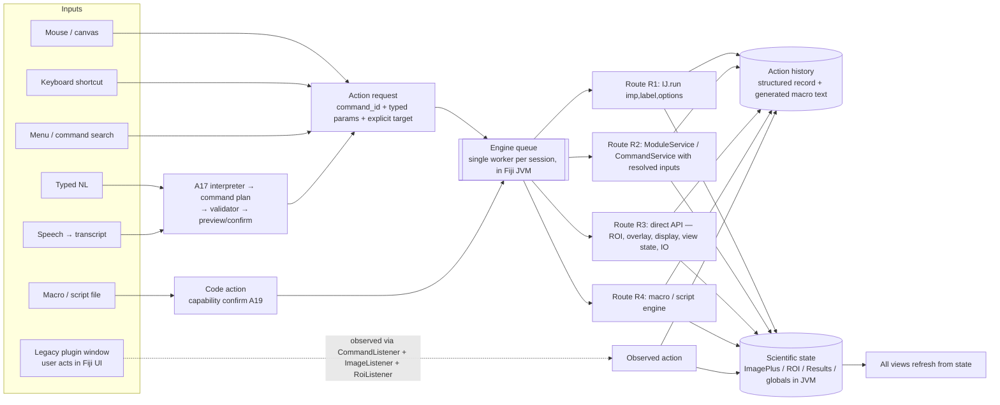

# A18 — Unified Interaction Model

## Executive Summary

All input modalities (mouse, keyboard, menus, command search, typed natural language, speech and macros) can share one scientific state if three conditions hold:

1. Every input becomes an **action request** with an explicit target.
2. The request is resolved to one of a small number of **execution routes** that call original Fiji code.
3. All execution passes through **one engine queue inside the Fiji JVM**, which also *observes* actions that bypass the product, such as legacy plugin windows, user macros and the Fiji menu if it is shown.

Fiji already has most of the machinery for this:

- the **command table** (`Menus.getCommands()`, 944 runtime labels; A08) together with the **`run(label, options)` contract**, the de facto action language (A03, A12);
- **`Executer`'s `CommandListener` chain**, which sees every IJ1 command, can rewrite or veto it (`ij/Executer.java#L54-L61`), and lets the options be read with `Macro.getOptions()` (P31);
- SciJava's `ModuleService` for ImageJ2 commands.

What Fiji lacks:

- **typed parameter schemas.** Options are untyped strings, and missing keys fall back silently (A11, A17);
- **an explicit target.** IJ1 uses an implicit current image (A09);
- **a completion and failure signal.** `IJ.run` swallows plugin exceptions (A08: `Executer.java#L74-L117`);
- **a record of direct manipulation.** ROI editing and display changes are only partly recorded (A10, A04).

The product must add these as a thin layer and must not replace the Fiji mechanisms. The prototype's design (a separate Python grammar → a macro string → a fresh headless JVM) cannot be this layer, because it has no shared state at all (F02 AS-1, A15).

## Purpose and Scope

This document analyses how the modalities map onto one state and one action layer. It asks whether Fiji's own command infrastructure can be that layer, and which gaps the product must fill. Concrete contracts are in D06 (command and operation contract) and D09 (events), and state ownership is in D05.

## Research Questions

1. Which existing mechanism can serve as the common action layer?
2. What is the source of truth for scientific state when several inputs act on it?
3. How are actions that the product did not initiate (legacy windows, plugins, macros) brought into the same history?
4. How do direct-manipulation actions (ROI drawing, B&C sliders, navigation), which are not menu commands, fit the model?

## Verified Findings

| # | Finding | Evidence |
|---|---|---|
| F1 | The IJ1 command table is populated at runtime with 944 labels: 829 IJ1, plus 62 ImageJ2 commands and 53 scripts inserted by imagej-legacy as `command:`/`script:` entries. Labels are the API, with exact whitespace (26 trim collisions). | **VERIFIED** A08, P11; `IJ1Helper.java#L874-L954` |
| F2 | `IJ.run(imp, label, options)` runs synchronously in the calling thread. It sets the thread's temp current image and macro options, and renames the thread `Run$_…`. | **VERIFIED** A15 §6; `ij/IJ.java#L310-L332` |
| F3 | `CommandListener.commandExecuting(cmd)` is invoked for every `Executer` run: menu clicks, `IJ.doCommand`, `IJ.run` and macro `run()`. Returning `null` cancels the command; returning another string substitutes it. `Macro.getOptions()` inside the listener returns the options string. It **does not** see macro built-in functions (e.g. `setAutoThreshold`), IJ2 commands run through `CommandService`, or legacy IJ1 commands run through `ModuleService`. The last case arises because `LegacyCommand` calls `IJ.runPlugIn` directly (`imagej-legacy@3.0.0:net/imagej/legacy/command/LegacyCommand.java#L57`). | **VERIFIED** `ij/Executer.java#L54-L61`; P31 (G2); P80 (G8) |
| F3b | `ImageListener` callbacks are delivered asynchronously on the EDT (`EventQueue.invokeLater`, `ij/ImagePlus.java#L3043-L3048`). `RoiListener` and `IJEventListener` fire synchronously on the calling thread. `Roi.setLocation` fires no event. SciJava module, display and dataset events arrive on the EDT. IJ2 `Dataset`/`Display` objects are created only when an IJ2 command needs them. | **VERIFIED** P80 (G8) |
| F4 | `IJ.run` does not propagate plugin exceptions. `Executer` catches `Throwable` and logs it, so success must be judged by postconditions. *Correction (Phase 8, finding 7): `Executer` logs the exception only when `IJ.getInstance()==null` (headless); in a GUI JVM (M2) it opens an "Exception" `TextWindow` instead (`Executer.java#L113-L117`; D17 §3.6).* | **VERIFIED** A08; `Executer.java#L74-L117` |
| F5 | Missing option keys fall back to remembered static values (numbers and choices) or to false (checkboxes). | **VERIFIED** A11 §4, A17 §4, HeadlessGenericDialog L325 (A15 §4.2) |
| F6 | IJ1 change events: `ImageListener` (opened/closed/updated), `RoiListener` (CREATED…DELETED), `IJEventListener` (colour/tool/log events). There is **no** `ResultsTable` listener. | **VERIFIED** `ij/ImageListener.java#L7-L15`, `ij/gui/RoiListener.java#L9-L14`, `ij/IJEventListener.java#L9-L13`; no listener in `ij/measure/ResultsTable.java` (grep) |
| F7 | In headless mode, `imageOpened`/`imageClosed` do not fire and `updateAndDraw()` is a no-op. | **VERIFIED** P32 (A09) |
| F8 | ImageJ2 modules run on `SciJava-…` threads, which never see IJ1 macro options. IJ2 module inputs are harvested only when the harvester's UI is visible. | **VERIFIED** A15 §5–6 |
| F9 | fiji-llm's `fiji_command_run` drives commands through `ModuleService.run(info, true)` with **only a menu path**. Parameters come from dialogs, answered later through UI-inspection tools, and before/after "environment impact" snapshots stand in for a typed result. | **VERIFIED** `fiji-llm@3e564f2b:src/main/java/sc/fiji/llm/macro/CommandUseToolPlugin.java#L115-L156` |
| F10 | The Recorder captures programmatic `IJ.run` calls only when `Recorder.recordInMacros` is set, because `Recorder.setCommand` skips threads named `Run$_` (`ij/plugin/frame/Recorder.java#L151-L157`). Even with that flag, it drops the options of preview-capable dialogs (Gaussian Blur, Add, …). In macro mode `GenericDialog.showDialog()` disposes first, and `finalizeRecording()` then runs while `recorderOn` is still false (`ij/gui/GenericDialog.java#L1510-L1511, L1573-L1589`). It records `roiManager("Measure")` as N×`run("Measure")`, ROIs as integers, freehand ROIs not at all, and `setAutoThreshold` only as a comment. `Recorder.recordString(...)` injects exact text from any thread. Real GUI actions (menu clicks, dialog OK) are recorded exactly. | **VERIFIED** P42 H1 (A15), P50 (A04), P81 (G8), A10 |

## Technical Details

### 1. Action model (analysis; formalised in D06)

| Action kind | Typical inputs | Execution route | Recorded as |
|---|---|---|---|
| **Command action** (a catalogue entry) | Menu, search, shortcut, NL, speech, dialog OK | R1 for IJ1 commands; R2 for IJ2 commands | `run("Label", "complete options")`, or `#@` script/IJ2 notation (A12) |
| **Direct-manipulation action** | Canvas drag (ROI), ROI list edits, B&C slider, LUT change, C/Z/T navigation, zoom/pan | R3 (Java API) | A macro equivalent when one exists and is exact (e.g. `makeSelection("polygon", xs, ys)` with float arrays, `setMinAndMax`, `Stack.setPosition`). Otherwise a structured record, with "not macro-expressible" noted (CR-A10-02). |
| **Session action** | Open, Save As, Close, Duplicate | R1 or R3 (IO API) | `open(path)`, `saveAs(format, path)`, with input hash (CR-A09-08) |
| **Code action** | Run user macro/script | R4 | Reference to the file plus its hash. Its internal commands are observed through F3 and nested under it. |
| **Observed action** | User operating a legacy (C4–C6) window or the classic Fiji menu | Not executed by the product. Observed through F3, F6 and a diff of the globals. | Recorded as *observed*, with captured options. Fidelity is flagged as partial. |

### 2. Can Fiji's own infrastructure be the common action layer?

| Candidate | Strengths | Gaps | Verdict |
|---|---|---|---|
| IJ1 command table + `run(label, options)` | Covers all 829 IJ1 commands and the legacy-wrapped IJ2/script entries (F1). It is the language users and macros already speak (PR-2, PR-6). | Untyped options, silent fallbacks (F5), implicit target, no error signal (F4) | **Use as the execution and recording language**, wrapped by a typed schema (`commands-core-parameters.csv` → D06) and postcondition checks |
| SciJava `ModuleService`/`CommandService` | Typed `@Parameter` inputs and outputs for IJ2 commands. Pre- and postprocessors. Module events. | IJ1 legacy-wrapped modules have no typed inputs. Harvesting needs a visible UI (F8). Macro options are invisible on SciJava threads (F8). | **Use for IJ2-native commands (R2)** with fully resolved inputs. Do not use it as the universal path for IJ1 commands. fiji-llm's choice (F9) leaves parameters to dialogs, which conflicts with PR-4 and CR-A11-02. |
| IJ1 Recorder | Familiar output format | Lossy (F10). Requires a hidden frame (M2). | **Do not use it as the source of truth.** It may be kept, hidden, as a cross-check (CR-A15-05). |
| `CommandListener` chain | Sees every IJ1 command from any origin, reads its options, can veto | Fires *before* execution, with no completion event | **Use for observation and gating** (observed actions; AC7 gate per A19). Combine it with SciJava `ModuleEvent` subscriptions to cover IJ2 and `ModuleService` paths, which `CommandListener` misses (F3). |
| fiji-llm `AiToolPlugin` registry | Existing, official, SciJava-discoverable tool layer with an MCP transport | Not installed on the pinned runtime. Parameterless command runs (F9). Unauthenticated loopback server (A25-style threat). | **Interoperate or learn; do not depend on it for the MVP.** Decision recorded (DEC candidate in A21). |

### 3. Source of truth and synchronisation

- The scientific state lives **in the Fiji JVM**: `ImagePlus` pixels, calibration, display range and LUTs, `Roi`/`Overlay`/hidden `RoiManager(false)`, `ResultsTable` and the global settings. **PROPOSED**, following CR-A09-02 and A15 §8.3. *Superseded in design by D04 §4 (singleton load/read-back); see Phase 8 finding 1.*
- The UI holds **views** of this state: rendered planes, ROI geometry copies, table snapshots. It refreshes them after each completed action and after observed events. Because events are incomplete (F6, F7) and `ResultsTable` has no listener, refresh is driven by **action completion** plus a **post-action state digest** (image IDs, `changes` flags, ROI and Overlay counts, Results row count, globals hash). The digest is computed on the engine worker. **PROPOSED**, comparable in spirit to fiji-llm's environment snapshots (F9).
- "Active image" becomes a **UI concept**: the focused document. It supplies the default target for new action requests and for natural-language references to "this image" (A17 §5). The engine never relies on IJ1's current image. It passes `imp` explicitly (CR-A09-01) and sets the temp current image only for the duration of a command (F2).

### 4. Concurrency model

- **One engine worker thread per session** executes every R1–R4 action in order (CR-A09-07, CR-A12-09). The reasons:
  - IJ1 statics (`WindowManager`, `Analyzer.systemRT`, `Interpreter.batchMode`, `Undo`, `Recorder`) are shared by the whole JVM (A15 §6).
  - Thread-confined macro options require the command to run on the thread that set them (F2).
- UI interactions that do not mutate scientific state, such as zoom, pan and hover readout, run entirely in the UI and are never queued.
- An in-progress ROI drag is local to the UI and is committed as one R3 action when the drag ends. This avoids flooding the queue and matches IJ1's `RoiListener.COMPLETED` semantics (F6).
- The worker must never be the AWT EDT. Legacy fallback windows still use the EDT, so dialog detection is needed. A modal dialog opened by a plugin blocks the worker, so the UI must detect it and bring it forward (CR-A15-02, R-A15-03).

### 5. Modality-specific considerations

| Modality | Preserved Fiji semantics | Added by the product |
|---|---|---|
| Mouse on the canvas | Tool semantics and modifiers (A10 CR-A10-04), area/line coordinate conventions | Float geometry committed through the API (CR-A10-01) |
| Keyboard | IJ1 shortcut table and single-key shortcuts (A04), with Fiji's `l` → search override noted | Visible shortcut hints. No silent remapping. |
| Menu / command search | Original menu paths and exact labels (A08) | Typed dialog generated from the parameter schema where one exists. Otherwise the original `GenericDialog` is shown (legacy fallback). |
| Typed NL / speech | Same commands and keys | The A17 pipeline, then preview and confirm (A19) |
| Macro | The full macro language through the original interpreter | Capability confirmation (A12, A25); internal commands observed |
| Legacy windows | Unchanged plugin behaviour | Window tracking, observed-action capture, globals diff (A19 CR-A19-10) |

## Constraints and Limitations

- Observed actions from legacy windows are **best-effort**. Commands outside `Executer` (plugins mutating images directly from their own threads) are seen only as `imageUpdated` events or as digest differences, without parameters. **INFERRED** from F3/F6. To be quantified by the G8 probes (P80) and folded into A20.
- Macro-expressibility of direct manipulation is partial. Composite ROIs, some display operations and plugin-internal actions have no exact macro form. The history must then say so rather than emit approximate macro text (PR-5).

## Requirement implications

- **CR-A18-01** — Every input modality shall produce the same action-request structure (catalogue `command_id` or direct-manipulation operation, typed parameters, explicit target). The structure shall be independent of the modality. *Rationale:* PR-3.
- **CR-A18-02** — All actions that mutate scientific state shall execute through a single per-session engine queue in the Fiji JVM. *Rationale:* §4; shared IJ1 statics.
- **CR-A18-03** — The engine shall register a `CommandListener` and SciJava module-event subscriptions. It shall record commands executed in the JVM that the product did not initiate as *observed* actions, with their captured option strings or module inputs. *Rationale:* F3, F3b, F10.
- **CR-A18-04** — After every executed or observed action, the engine shall compute a state digest (open images and `changes` flags, ROI/Overlay/ROI-list counts, Results row count, hash of result-affecting globals). It shall publish only the parts that changed, to refresh the UI. *Rationale:* F4, F6, F7; no Results listener.
- **CR-A18-05** — Command success shall be determined by postconditions defined per command family (output image exists, Results rows added, no new error lines in the log, no modal dialog pending), not by the return of `IJ.run`. *Rationale:* F4.
- **CR-A18-06** — Direct-manipulation actions (ROI edits, display range, LUT, C/Z/T position) shall be recorded in history. Exact macro equivalents shall be emitted where they exist, and the record shall be marked *not macro-expressible* where they do not. *Rationale:* PR-6, PR-5; A10.
- **CR-A18-07** — The UI's focused document shall be the default target for new actions and for deictic natural-language references. The engine shall pass this target explicitly to every route. *Rationale:* A09 CR-A09-01, A17 §5.
- **CR-A18-08** — The engine shall be able to veto or hold IJ1 commands through the `CommandListener` chain when policy requires confirmation, for example AC7 code execution started from a legacy window. *Rationale:* F3, A19, A25.

## Risks

| ID | Risk | Likelihood | Impact | Mitigation |
|---|---|---|---|---|
| R-A18-01 | Plugins mutate images outside `Executer`, so observed history is incomplete | High | Medium | Digest-based change detection; label history entries "parameters unknown" |
| R-A18-02 | A `CommandListener` veto has side effects on plugins that expect to run | Low | Medium | Use veto only for policy (AC7). Test against the A13 categories. |
| R-A18-03 | Label whitespace collisions (A08) cause the wrong command to run | Medium | High | Address commands by `command_id` in the catalogue, with the exact label string as stored data. Never use free text. |
| R-A18-04 | Queue serialisation makes the UI feel blocked during long operations | Medium | Medium | Progress and cancel (A19, A20). Read-only queries served from the last digest. |

## References

- `imagej/ImageJ@v1.54p`: `ij/Executer.java#L36-L117, L265`, `ij/IJ.java#L310-L332`, `ij/ImageListener.java`, `ij/gui/RoiListener.java`, `ij/IJEventListener.java`, `ij/measure/ResultsTable.java`.
- `fiji/fiji-llm@3e564f2b`: `src/main/java/sc/fiji/llm/macro/CommandUseToolPlugin.java#L115-L156`; `doc/TECHNICAL_SUMMARY.md`.
- A03, A04, A08, A09, A10, A11, A12, A15, A17, A19; probes P11, P31, P32, P42, P50.

## Change log

- 2026-10-17: Initial draft by the lead.
- 2026-10-17: Phase 8 review fixes (findings #1, #7).
