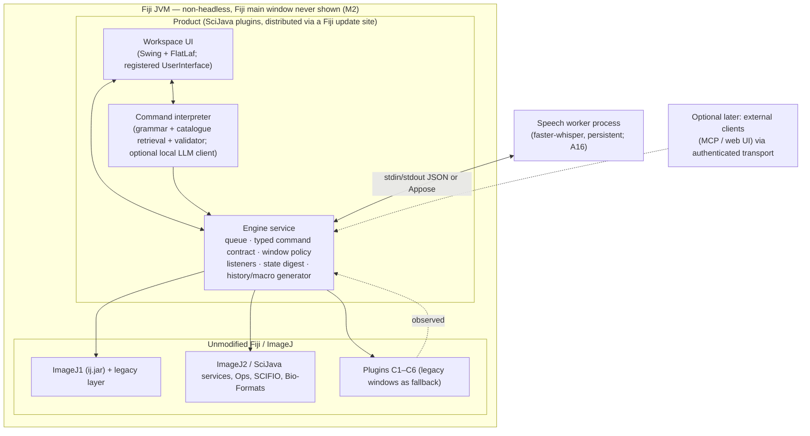

# A21 — Integration Architecture Options

## Executive Summary

The analysis leaves fewer real choices than the brief's list of eight candidates suggests:

1. **The scientific engine must be a persistent, non-headless ("GUI-capable, UI-hidden") Fiji JVM (mode M2).** Headless execution loses the ROI Manager, Recorder, non-blocking dialogs, the OME-TIFF exporter and every plugin window. Per-run processes lose all interactive state. **VERIFIED**: A15 §5–§9; P41, P42, P46, P47, P82.
2. **Every viable option needs a component inside the Fiji JVM.** This in-JVM engine adapter owns the execution queue, listeners, window policy, typed command execution and state digests. **VERIFIED** by necessity: A15 §8.3, A18. The UI technology is therefore the main open choice. It cannot remove the Java work.
3. In the pinned runtime, **Swing with FlatLaf is already the active look-and-feel**, and **JavaFX 23 with Direct3D and WebView initialises inside Fiji's JVM** with no configuration warning (P87). So a modern in-JVM UI is technically available without new native dependencies.

**Recommendation (PROPOSED — awaiting approval, DEC-010/ADR-001).** Use **option O2: a modern workspace UI that runs inside the Fiji JVM.** It is built in Swing with FlatLaf and registered as a SciJava `UserInterface` plugin. It sits on a UI-agnostic **engine service** (a SciJava `Service`) and is distributed as a **Fiji update site**. Under this option:

- legacy Fiji windows and dialogs remain available as same-process fallbacks;
- speech runs in a separate persistent worker process;
- the engine API is transport-neutral, so an out-of-process client (web UI, MCP client, fiji-llm interop) can be added later without restructuring (O4 kept open).

O4 (an out-of-process web UI over a loopback bridge) is the main alternative. It is preferable only if the owner decides the team must deliver the UI in web technology. The costs it then incurs are listed in §5.

## Purpose and Scope

This document compares feasible implementation architectures against the brief's 20 criteria (Part 12), using the evidence gathered in A07–A20, and produces a recommendation for the design stage. The detailed runtime and process design is D03, Fiji integration is D04, and the ADR text is D02 / ADR-001.

## Sources and Evidence

| Evidence | Content |
|---|---|
| A15 + P41/P42/P46/P47 | Execution modes M1–M5; subsystem behaviour per mode |
| P80–P87 (G8) | Listener coverage per execution path; Recorder loss root causes; hidden windows and batch execution; programmatic dialogs; pixel transfer and encoding cost; GUI JVM start-up and footprint; undo; JavaFX/WebView in Fiji |
| P01 (lead) | Headless process start-to-exit 4.1–4.7 s |
| A07 / P48 / P49 | UI is a SciJava plugin slot (`legacy`, `swing`, `swing-mdi`, `awt`, `headless`); runtime `UIService.addUI` works; Swing SDI UI runs with IJ1 underneath |
| A13 | Plugin compatibility categories C1–C6, S |
| A16/A17 | Speech worker measurements; NL architecture |
| A24/A25 | Licensing facts; localhost-bridge threats |
| fiji-llm source | Existing in-JVM SciJava plugin with a loopback MCP server (precedent for O2 and O4 patterns) |
| Jar inventory | `flatlaf-3.6.1`, `javafx-*-23.0.2` (+ `win64/*-win.jar` natives incl. `javafx-web`, `javafx-swing`), `appose-0.12.0`, `scijava-ui-swing-1.0.5` (SDI/MDI `UserInterface`s) |
| Platform (lead notes) | Core Ultra 9 285H, 31.4 GB RAM, RTX 5070 Laptop, Windows 11 26200, display 150 %. No Rust, Maven or Gradle installed. |

## Verified Findings that constrain the options

| # | Finding | Evidence |
|---|---|---|
| V1 | A headless JVM cannot host the ROI Manager, Recorder, `NonBlockingGenericDialog`, OME-TIFF export, or any plugin window | A15 §5; P41, P46 |
| V2 | A non-headless JVM with no UI shown runs all of these. Windows must be hidden by explicit policy (batch mode, `setVisible(false)`, hidden constructors). Histogram, Plot Profile, Results and the ROI Manager open their own windows unless driven through private-API alternatives. | A15 §7; P42, P82 |
| V3 | Dialogs blocking a worker can be found (`Window.getWindows()`, `GenericDialog.getInstance()`), read, filled and confirmed from code | P83 |
| V4 | Pixel access is cheap in the JVM: at 2048², `getPixels` plus a copy takes 0.15 / 0.37 / 1.35 ms (8/16/32-bit). `getBufferedImage` (LUT and display range applied by IJ1) takes 1.7–15 ms. PNG encoding of a 1024² crop takes 13–48 ms; JPEG takes 6–25 ms. | P84 |
| V5 | GUI JVM start-up to `IJ.getInstance()` takes 4.5–5.3 s, with a working set of 437–468 MB and about 63 MB of heap in use. The default heap cap is 75 % of RAM (`config/jaunch/fiji.toml#L81`). | P85 |
| V6 | JavaFX initialises inside Fiji in 290 ms using the `d3d` Prism pipeline. WebView loads in 769 ms. JS→Java callbacks work. The working set grows by about 256 MB. FlatLightLaf is active by default. | P87 |
| V7 | `System.exit(0)` hangs in GUI mode: the shutdown hook disposes windows through `EventQueue.invokeAndWait`. Process lifecycle needs an explicit quit path. | P85 (jstack), G8 |
| V8 | The Recorder is unreliable for programmatic calls (thread-name gating; option loss with preview dialogs) but exact for real GUI actions. `Recorder.recordString` injects exact text. | P81 |
| V9 | `CommandListener` misses macro built-ins, IJ2 commands and `ModuleService` legacy runs. SciJava module events cover IJ2. `ImageListener` fires asynchronously on the EDT. | P80 |
| V10 | A new SciJava `UserInterface` can be registered at runtime. The alternative Swing SDI UI shows Datasets while IJ1 runs underneath. | P49 (A07) |
| V11 | The official fiji-llm runs inside the Fiji JVM as SciJava plugins and exposes tools over a Jetty server on 127.0.0.1:9090. It accepts requests without an Origin header and without a token. | fiji-llm `DefaultMCPService.java#L113, L394-L397, L479-L510` |
| V12 | PyImageJ interactive mode is M2 inside a JPype-hosted JVM. It has macOS main-thread restrictions, the JVM cannot be restarted within the Python process, and ImageJ closing terminates Python. | A15 §10 |

## Options

| ID | Option | Engine location | UI location | Transport UI↔engine |
|---|---|---|---|---|
| **O1** | Modify or restyle Fiji's existing Java UI (patch IJ1 AWT windows, theme the legacy UI) | Fiji JVM | IJ1 AWT/legacy UI | in-process |
| **O2** | **Modern Java workspace inside the Fiji JVM** (Swing + FlatLaf; registered `UserInterface`), on an engine service | Fiji JVM (M2) | Same JVM | In-process Java API |
| **O3** | As O2, but JavaFX as the primary toolkit, with Swing interop for legacy dialogs | Fiji JVM (M2) | Same JVM (JavaFX) | In-process |
| **O4** | Engine service in the Fiji JVM; **out-of-process web UI** (React) in a browser, Tauri or Electron | Fiji JVM (M2) | Separate process | Authenticated loopback WebSocket/HTTP (+ shared memory for pixels) |
| **O5** | **PyImageJ-hosted Python application** (Qt/PySide, or the prototype's FastAPI + React) | JPype JVM inside Python (M5) | Python process (or browser) | In-process JPype (+ HTTP for a web UI) |
| **O6** | Prototype model: per-workflow headless Fiji processes behind an API | Short-lived M1 JVMs | Browser | Files + subprocess |
| **O7** | napari + napari-imagej (Qt viewer, PyImageJ) | JPype JVM in napari | napari Qt | In-process |
| **O8** | Hybrid of O2/O3 with **JavaFX WebView panels**: a web-technology UI rendered inside the Fiji JVM, with a native image canvas | Fiji JVM | Same JVM (WebView + native canvas) | In-process JS↔Java bridge (no network port) |

## Comparison matrix (brief Part 12 criteria)

Scale: ●●● strong · ●● adequate · ● weak · ✖ disqualifying. Each cell carries its evidence tag.

| # | Criterion | O1 | O2 | O3 | O4 | O5 | O6 | O7 | O8 |
|---|---|---|---|---|---|---|---|---|---|
| 1 | Preserve scientific algorithms | ●●● | ●●● | ●●● | ●●● | ●●● | ●●● | ●● (Ops/napari conversions; A11 CR-A11-08) | ●●● |
| 2 | Macro functionality | ●●● | ●●● | ●●● | ●●● | ●●● | ●● (no state between runs) | ●● (via `ij.py.run_macro`) | ●●● |
| 3 | ImageJ1 compatibility | ●●● | ●●● (same JVM, M2; V2) | ●●● | ●●● (adapter in JVM) | ●● (JPype; documented sync caveats, V12) | ● (M1 gaps, V1) | ● (headless default; RoiManager unavailable) | ●●● |
| 4 | ImageJ2/SciJava integration | ●● | ●●● (native `UserInterface`, input harvester, widgets; V10) | ●●● | ●● (custom remote harvester) | ●● | ● | ●● | ●●● |
| 5 | Existing plugin support | ●●● | ●●● (C1–C3 driven; C4–C6 as same-process fallback windows) | ●●● | ●● (C4–C6 appear as foreign windows outside the shell) | ●● | ✖ (C2r–C6 fail; V1) | ● | ●●● |
| 6 | GUI-dependent plugin behaviour | ●●● | ●●● (can track and parent AWT windows in-process) | ●● (Swing/AWT↔FX focus and modality interop; INFERRED) | ● (cannot manage foreign windows; INFERRED) | ●● (macOS restrictions V12) | ✖ | ● | ●● |
| 7 | Image data and metadata fidelity | ●●● | ●●● (single copy in JVM) | ●●● | ●● (UI holds copies only; risk if a copy becomes the truth) | ●● (NumPy↔Java conversions) | ●● (PNG/8-bit limits; F02 AS-7) | ●● (xarray conversion) | ●●● |
| 8 | ROI and selection consistency | ●●● | ●●● (uses `ij.gui.Roi` objects directly; IJ1 drawing code available) | ●●● | ● (A10 coordinate conventions must be reimplemented in JS; CR-A10-03) | ●● | ✖ (no ROI) | ● (napari shapes ≠ IJ1 ROIs) | ●● (canvas native; panels web) |
| 9 | Runtime performance | ●●● | ●●● (V4: in-JVM access ≤1.4 ms per 2048² plane) | ●●● | ●● (encode or transfer per frame; V4 13–48 ms PNG) | ●● | ● (4.1–4.7 s JVM start per run; P01) | ●● | ●● |
| 10 | IPC complexity | ●●● none | ●●● none (in-process) | ●●● | ● (protocol, auth, reconnect, state sync) | ●● (JPype) | ●● (files) | ●● | ●● (JS bridge on FX thread; V6) |
| 11 | Memory for large data | ●●● | ●●● (no duplication) | ●●● | ●● (viewport tiles only, if designed so) | ● (two heaps; conversions) | ●● | ● | ●●● (+256 MB WebView, V6) |
| 12 | Scientific viewer performance | ●● (IJ1 canvas) | ●● (Java2D; IJ1 rendering reuse via `getBufferedImage` 1.7–15 ms/2048²; INFERRED adequate for 2D; BigDataViewer exists for large data) | ●●● (d3d Prism, V6) | ●●● (WebGL; INFERRED) but transfer-bound | ●● | ● (static PNGs) | ●●● (vispy/OpenGL) | ●● |
| 13 | Packaging difficulty | ●● | ●●● (a Fiji update site plus a speech-worker bundle; no Fiji redistribution needed; INFERRED from the fiji-llm precedent) | ●●● | ● (Fiji + shell + worker; Tauri needs Rust, not installed) | ● (Python + JVM + Fiji + JPype per platform) | ●● | ●● (pip/napari) | ●●● |
| 14 | Windows compatibility | ●●● | ●●● (P87, P85 on Win 11) | ●●● (d3d verified) | ●●● | ●● | ●●● (tested) | ●● | ●●● |
| 15 | Voice integration | ●● | ●● (Java audio capture (INFERRED) → persistent worker; Appose available) | ●● | ●●● (browser `getUserMedia`, used by the prototype) | ●●● (Python native) | ●● | ●●● | ●●● (WebView `getUserMedia` UNKNOWN; Java capture fallback) |
| 16 | Maintainability | ✖ (patching upstream UI code; brief prohibits rewriting upstream) | ●●● (one language; SciJava conventions; upstreamable) | ●● (JavaFX is less common in Fiji) | ●● (two stacks + protocol) | ● (three runtimes) | ●● | ●● (depends on napari-imagej) | ● (three technologies in one process) |
| 17 | Development effort | ● | ●● (Swing UI work; adapter needed anyway) | ●● | ● (adapter + protocol + web viewer + ROI reimplementation) | ●● | ●●● (exists) | ●● | ● |
| 18 | Hackathon feasibility (by 18 Oct 2026) | ✖ | ●● (Groovy scripting can prototype in-JVM UI without a build; INFERRED from `--run` usage in P50/P8x) | ● | ● (much new work) | ● | ●●● (already demoed) | ● | ● |
| 19 | Licensing | ✖ (modifies GPL/PD upstream UI) | ●● (plugin links PD `ij.jar` and BSD SciJava APIs. GPL-component use must be avoided or accepted; A24 Q-list) | ●● | ●● (same adapter question; the UI could be separately licensed) | ●● | ●●● | ●● | ●● |
| 20 | Long-term extensibility | ● | ●●● (SciJava plugin points; can host fiji-llm tools in the same JVM) | ●● | ●●● (web ecosystem; any client) | ●● | ● | ●● | ●● |

O1 is excluded by maintainability and licensing (rewriting upstream UI code is out of scope; brief Rule 1). O6 is excluded by V1 and the absence of state. O7 is excluded because it replaces the ImageJ1 interaction model with napari's layer model, conflicting with PR-2 (A06 discusses napari as a reference only).

## Alternatives and Trade-offs (detailed)

### O2 versus O4: the deciding issues

| Issue | O2 (in-JVM Swing workspace) | O4 (out-of-process web UI) |
|---|---|---|
| **Display fidelity** (LUTs, composite modes, display range, overlays) | Reuses IJ1's own rendering (`ImagePlus.getImage()`/`getBufferedImage()`, overlay drawing). *Correction (Phase 8, finding 4): `getBufferedImage` excludes overlays (`ImagePlus.java#L606-L611`); in the design the viewer draws overlays from engine-supplied geometry (D13 §2.2).* What the user sees is what Fiji would show. | Either ships rendered frames from the JVM (V4: encoding cost per pan or zoom) or reimplements LUT, composite and overlay rendering in WebGL. Reimplementation is a fidelity risk (PR-1 spirit, A30 E3). |
| **ROI semantics** | Native `ij.gui.Roi` objects and IJ1 tool semantics are available. | Pixel-corner and centre conventions, modifier algebra and sub-pixel rules must be duplicated in JS and tested against `Roi.getMask()` (CR-A10-03). |
| **Legacy fallback windows** | Same process: can track, position, parent and focus AWT/Swing windows, and detect dialogs (V3). | Foreign top-level windows appear outside the browser or shell. Coordination only through engine messages. |
| **Security** | No network port needed (A25 threats T-localhost not applicable). | Needs an authenticated loopback server. A25 found that both the prototype and fiji-llm accept requests without an Origin header and without auth (V11). |
| **UI technology** | Swing + FlatLaf: dense desktop UIs are a mature pattern. Docking and theming need library choices (D12). | React ecosystem; the team may know it better (UNKNOWN). Faster visual iteration (INFERRED). |
| **Start-up** | One process: JVM start-up 4.5–5.3 s (V5) plus the UI. | The same JVM start-up, plus the shell. The UI can appear first, but stays read-only until the engine is ready. |

### Swing (O2) versus JavaFX (O3) versus WebView panels (O8) inside the JVM

- **Swing + FlatLaf** is already Fiji's look-and-feel (V6: FlatLightLaf active), shares the AWT event model with IJ1 dialogs and windows, and is the toolkit of the SciJava UIs (V10). It is the lowest-risk basis for the shell. **PROPOSED**
- **JavaFX** gives a GPU (Direct3D) scene graph and CSS styling (V6). JavaFX components can be embedded in Swing through `JFXPanel` (verified to work, P87). It is a candidate for **specific components** (for example a GPU canvas, if Java2D viewer performance proves inadequate in D13 validation), not for the shell. It adds about 256 MB of working set with WebView (V6). **PROPOSED** as a contingency.
- **WebView panels (O8)** would let the team reuse web skills without a network port. They add a third technology in the process, a JS bridge on the FX thread, and about 256 MB. **Not recommended** for the core. They could be reconsidered for documentation or help panels (D11).

### Why not O5 (PyImageJ host)?

It is M2 with an extra runtime boundary (V12). It offers no capability that O2 lacks. Python's advantage (speech, ML) is available to O2 through a separate worker process, which A16 recommends anyway (CR-A16-02). JPype couples the lifetimes of the JVM and Python, and has documented macOS limits.

## Recommended architecture (PROPOSED — DEC-010 / ADR-001)

Partitioning (brief Part 12 asks for this explicitly):

| Stays inside native Fiji, unchanged | Accessed through programmatic services (engine) | Exposed through the new UI |
|---|---|---|
| All algorithms, IO, the macro interpreter, plugin code and windows; ImageJ2/SciJava services | IJ1 commands via `IJ.run(imp, label, completeOptions)` on the engine worker (A15 CR-A15-02); IJ2 commands via `CommandService` with resolved inputs; ROIs, Overlay, `RoiManager(true)` (*superseded in design by D04 §4: the hidden singleton `RoiManager`, loaded and read back around `uses_roi_manager` actions; see Phase 8 finding 1*), private `ResultsTable` via the Java API; listeners and digests | Document workspace, viewer, tools, menus and command search generated from the catalogue, typed parameter panels for core commands (the original dialog for others), ROI list, Results, history and macro view, NL/voice panel |

Consequences:

- Every plugin keeps running in its native environment. C4–C6 plugins appear as Fiji windows tracked by the workspace (A13, CR-A15-06). *Correction (Phase 8, finding 30): this is expected, not demonstrated (INFERRED): no C4–C6 plugin was run in M2 (static scans P44/P45/P48 only); per-plugin behaviour is UNKNOWN (A13 U-A13-2).*
- The product is installed into a user's own Fiji through an update site, so the base Fiji distribution need not be redistributed. This is **INFERRED** from Fiji's update-site model and the fiji-llm precedent. A24 must still confirm the obligations for the plugin's own dependencies and the speech-worker bundle (DEC-005).
- Engine shutdown must use an explicit quit sequence. `System.exit` hangs (V7).
- The engine API is defined as Java interfaces (D06/D09) with serialisable payloads. An out-of-process transport for O4-style clients, MCP or fiji-llm interop can be added later behind authentication (A25).

## Constraints and Limitations

- Only Windows 11 was probed. macOS main-thread and AppKit constraints (V12; A15 U-A15-4) could affect O2/O3 there. Verification is required before cross-platform claims are made.
- The team's skill profile (Java/Swing versus web) is **UNKNOWN**, and it materially affects criteria 17–18. It is the main reason DEC-010 needs owner approval.
- Hackathon reality: the existing prototype (O6) is the only demonstrable artefact today. A31 separates the demonstration that can be shown on 18 October from the architecture adopted for the product.

## Requirement implications

- **CR-A21-01** — The product's scientific engine shall be the pinned Fiji running in a persistent, non-headless JVM, with the Fiji main window not shown (M2). *Rationale:* V1, V2.
- **CR-A21-02** — The product shall implement its engine as a UI-agnostic service inside the Fiji JVM, with a documented Java API whose request and event payloads are serialisable. *Rationale:* A15 §8.3. This keeps later out-of-process clients possible.
- **CR-A21-03** — The product shall be installable into an existing Fiji installation through a Fiji update site, without modifying or redistributing Fiji's own files. *Rationale:* packaging (criterion 13), F03 rules, DEC-005.
- **CR-A21-04** — The product shall not open a network listening port unless an optional external-client feature is enabled. Any such port shall require authentication. *Rationale:* A25, V11.
- **CR-A21-05** — Display rendering of image planes shall use ImageJ's own rendering of the LUT, display range, composite mode and overlay, or a renderer proven equivalent by the A30 E3 tests. *Rationale:* fidelity.
- **CR-A21-06** — The product shall terminate the engine JVM through an explicit quit sequence that saves or discards state as the user chose, and that does not depend on `System.exit` completing. *Rationale:* V7.

## Risks

| ID | Risk | Likelihood | Impact | Mitigation |
|---|---|---|---|---|
| R-A21-01 | The team lacks Swing experience, so the hackathon UI is weak | Medium | High | Prototype with Groovy-scripted Swing in Fiji; keep the existing demo as fallback (A31); O4 remains possible behind the same engine API |
| R-A21-02 | Java2D viewer performance is inadequate for large or high-zoom images | Medium | Medium | D13 performance validation; JavaFX canvas contingency (O3 component); BigDataViewer for very large data |
| R-A21-03 | IJ1 windows pop up over the workspace (V2) | High | Medium | Window policy and tracker (CR-A15-03) |
| R-A21-04 | Update-site distribution conflicts with users' other update sites (dependency versions) | Medium | Medium | Depend only on jars already in core Fiji; pin and test on a fresh Fiji (D19) |
| R-A21-05 | macOS behaviour in M2 blocks cross-platform release | Medium | High (for LONG scope) | Probe on macOS early; Jaunch launch mode |

## Decisions Required

- **DEC-010** — Architecture direction. Adopt O2 (in-JVM Swing workspace on an engine service; separate speech worker). *Proposed — awaiting approval.*
- **DEC-011** — Relationship to fiji/fiji-llm: interoperate (shared JVM; reuse `AiToolPlugin` patterns; optional MCP exposure later) rather than depend on it for the MVP. *Proposed — awaiting approval.*
- **DEC-012** — Hackathon demonstration strategy: show the existing prototype (O6) as an integration demonstration, plus a minimal O2 spike if time allows. Present the documented architecture as the product direction. *Proposed — awaiting approval* (detail in A31).

## References

- Probes P01, P41, P42, P46, P47, P48, P49, P80–P87 (`docs/01-analysis/references/probes/`).
- A07, A08, A10, A13, A15, A16, A17, A18, A19, A24, A25.
- `fiji/fiji-llm@3e564f2b`: `src/main/java/sc/fiji/llm/mcp/DefaultMCPService.java`, `doc/TECHNICAL_SUMMARY.md`.
- `Fiji/config/jaunch/fiji.toml#L81` (max heap 75 %).
- napari-imagej documentation, https://napari.imagej.net/en/latest/ (accessed 2026-10-17). PyImageJ Headless documentation, https://py.imagej.net/en/latest/Headless.html (accessed 2026-10-17).

## Change log

- 2026-10-17: Initial draft by the lead, after all research agents reported.
- 2026-10-17: Phase 8 review fixes (findings #1, #4, #30).
