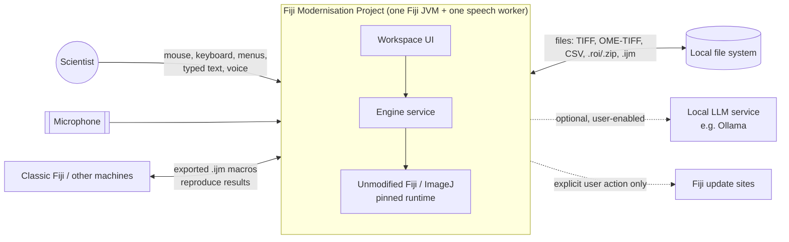
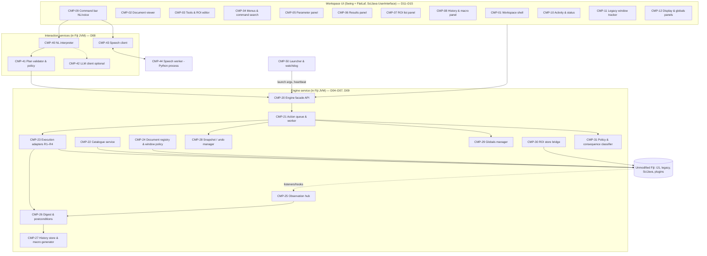

# D01 — Architecture Overview

## Executive Summary

This document defines the proposed system: its context, its major subsystems, the authoritative component list (CMP IDs) and interface list (IF IDs), and the relationships between Fiji, the workspace UI, macro handling, NL interpretation and speech. It follows A21's recommended option O2 and is **provisional until DEC-010 is approved**. Every component traces to requirements in A26/A27 (traceability in D20 and `docs/data/traceability.csv`).

The design rests on three rules:

1. **Fiji does all the science, unchanged.** It runs as a persistent, non-headless JVM with its main window hidden (FR-SYS-001, NFR-MAINT-001).
2. **The product's engine service is the only writer of scientific state.** Every input modality becomes a typed action request processed on one worker (FR-SYS-004, FR-IMG-001, A18).
3. **The UI shows truth.** Views are refreshed from engine digests and real events only (FR-VIEW-001, NFR-USE-002).

## 1. System context

External interactions are limited to:

- the file system;
- the microphone, on explicit action (FR-SPEECH-002);
- an optional local LLM (FR-NL-009/010, DEC-007);
- update sites, on explicit user action only (FR-SYS-008).

No network port is opened by default (NFR-SEC-002).

## 2. Process view

| Process | Contents | Lifetime | Owner doc |
|---|---|---|---|
| **Fiji JVM** (non-headless, Fiji main window hidden) | Pinned Fiji; product plugins: engine service, workspace UI, NL interpreter, speech client | User session | D03, D04 |
| **Speech worker** | Python 3.11 + faster-whisper (CPU int8) + pinned model | While voice is enabled; restarted on failure | D03, D08 |
| *(Optional)* local LLM server | User-installed Ollama or similar; not shipped | External | D08 |
| *(LONG, optional)* external client | MCP or web client over an authenticated loopback transport | External | D09 §8, ADR-006 |

## 3. Component model (authoritative CMP list)

| CMP | Name | Responsibility | Key requirements | Design doc |
|---|---|---|---|---|
| CMP-01 | Workspace shell | Single main window, layout, docking, menus host, keyboard dispatch, engine-state screen; registered as SciJava `UserInterface` | FR-WS-001, FR-WS-006, FR-SYS-006, NFR-PLAT-002 | D12, D14 |
| CMP-02 | Document viewer | Renders planes via IJ1 rendering with caching; zoom/pan; pixel readout; subtitle; C/Z/T navigation | FR-VIEW-001…008, NFR-A11Y-003 | D13 |
| CMP-03 | Tools & ROI editor | Selection tools, float geometry, IJ1 modifier semantics, commit on gesture end | FR-ROI-001…003 | D13 |
| CMP-04 | Menus & command search | Menu tree and search generated from the runtime catalogue; shortcuts with IJ1 precedence | FR-CMD-001, 006, 007, FR-CMD-008, FR-CMD-009 | D12, D14 |
| CMP-05 | Parameter panel | Schema-driven forms with all keys, units, consequential flags and globals display, preview control; surfaces legacy dialogs | FR-PROC-003, 007, 010, FR-MEAS-002 | D14, D15 |
| CMP-06 | Results panel | Per-image results at full precision; standard table kept in sync | FR-MEAS-003…006 | D14 |
| CMP-07 | ROI list panel | Per-image ROI list mirroring the ROI store | FR-ROI-004, 005 | D14 |
| CMP-08 | History & macro panel | Structured history, generated macro view, export, replay, undo/redo | FR-HIST-001…010 | D07, D15 |
| CMP-09 | Command bar | Typed NL input, voice control with recording indicator, transcript editing, plan preview and confirm | FR-NL-004, FR-SPEECH-002/004 | D08, D15 |
| CMP-10 | Activity & status | Engine state, operation lifecycle, real progress, pending dialogs, errors; also hosts the Log panel (UI-20, D12), which shows IJ1/SciJava log lines | FR-SYS-006, FR-PROC-007, NFR-USE-002, FR-WS-007 | D15, D17 |
| CMP-11 | Legacy window tracker | Lists and focuses visible IJ1 and plugin windows; marks external windows | FR-PLUG-001, 002, FR-PLUG-004 | D10, D12 |
| CMP-12 | Display & globals panels | B&C (display-only) with Apply, threshold preview, channels, result-affecting globals | FR-PROC-014, 015, FR-MEAS-002, FR-VIEW-006 | D13, D14 |
| CMP-20 | Engine facade API | Typed, serialisable API: submit actions, queries, event subscription | FR-SYS-003 | D09 |
| CMP-21 | Action queue & worker | Single ordered worker (not EDT); cancellation; serialises macros | FR-SYS-004, FR-MACRO-005, FR-PROC-013 | D04, D06 |
| CMP-22 | Catalogue service | Builds the runtime catalogue (Menus + ModuleService + ScriptService) and merges schemas, categories and consequence classes | FR-CMD-002…005 | D06 |
| CMP-23 | Execution adapters | R1 `IJ.run(imp,label,opts)`; R2 module run with resolved inputs; R3 direct API ops; R4 macro/script | FR-PROC-001…012 | D04, D06, D07 |
| CMP-24 | Document registry & window policy | `ImagePlus` handles, explicit targets, hidden-window/batch policy, window detection | FR-IMG-001/002, FR-PLUG-002 | D04, D05 |
| CMP-25 | Observation hub | `CommandListener`, SciJava module events, `ImageListener`, `RoiListener`, chained legacy hooks, AWT window events | FR-HIST-008, NFR-REL-004 | D04, D09 |
| CMP-26 | Digest & postconditions | Post-action state digest; per-family postconditions; failure detection | FR-PROC-005, NFR-REL-005 | D06, D09 |
| CMP-27 | History store & macro generator | Structured action records; macro generation and escaping; export, replay, provenance | FR-HIST-001…003, 009, 010, FR-MACRO-006 | D07 |
| CMP-28 | Snapshot / undo manager | Per-document snapshots within budget; undo/redo; rollback on cancel or failure | FR-HIST-004…006, NFR-PERF-003 | D05, D17 |
| CMP-29 | Globals manager | Capture, record, display and restore result-affecting globals; detect global changes | FR-MEAS-001, FR-HIST-007 | D05, D06 |
| CMP-30 | ROI store bridge | Per-document, engine-owned ordered sets of `Roi` objects; one hidden singleton `RoiManager` (created with `new RoiManager()`, window policy P-A), loaded before and read back after every `uses_roi_manager` action (D04 §4). Hidden `RoiManager(boolean)` instances are not used as the store: they are never the singleton, so commands and macros cannot see them. | FR-ROI-004 | D04, D05 |
| CMP-31 | Policy & consequence classifier | AC0–AC7 classification; confirmation policy; macro capability scan (`Tokenizer`); CommandListener veto | FR-CMD-005, FR-MACRO-002, FR-PLUG-003 | D06, D08 |
| CMP-40 | NL interpreter | Grammar fast path + catalogue retrieval/slot filling → CommandPlan; deixis and unit resolution | FR-NL-001, 005, 008 | D08 |
| CMP-41 | Plan validator & policy | Deterministic schema and live-state validation; confirm, clarify or refuse decision | FR-NL-002, 003, 006, 007 | D08 |
| CMP-42 | LLM client (optional) | Local-first provider interface; payload preview; logging | FR-NL-009…012 | D08 |
| CMP-43 | Speech client | Microphone capture (Java Sound), VAD gating via worker, worker lifecycle | FR-SPEECH-001…003 | D08 |
| CMP-44 | Speech worker | Persistent faster-whisper process; JSON protocol | FR-SPEECH-001, 005, 007 | D03, D08 |
| CMP-50 | Launcher & watchdog | Launch arguments (autocheck disabled, bundled JDK), start-up checks, heartbeat, crash recovery, bounded quit | FR-SYS-005…008, FR-SYS-007 | D03, D17 |

## 4. Interface list (authoritative IF list; contracts in D09)

| IF | Interface | Between | Form |
|---|---|---|---|
| IF-01 | Action submission API | UI, NL → CMP-20 | Java interface; `ActionRequest` (serialisable) |
| IF-02 | Engine event stream | CMP-20 → UI | Typed events: lifecycle, digest, observed actions, dialogs, engine state |
| IF-03 | Query API | UI → CMP-20 | Documents, rendered planes, ROI geometry, results, globals, catalogue, history |
| IF-04 | Command schema | CMP-22 ↔ all | JSON schema generated from the catalogue and `commands-core-parameters.csv` |
| IF-05 | History record and macro export | CMP-27 ↔ UI, files | JSON record; `.ijm` text; provenance manifest |
| IF-06 | Speech worker protocol | CMP-43 ↔ CMP-44 | JSON lines over stdin/stdout |
| IF-07 | Command plan | CMP-40/42 → CMP-41 → CMP-20 | `CommandPlan` JSON (steps of `ActionRequest` drafts plus slot provenance) |
| IF-08 | LLM provider | CMP-42 ↔ external LLM | Provider plugin interface; HTTP to localhost service |
| IF-09 | Supervisor heartbeat and quit | CMP-50 ↔ CMP-20 | In-process watchdog thread plus a start-up check of the session journal. There is no separate supervisor process in O2 (D03 §7). A JVM shutdown hook writes the journal and halts after a bound (D17). |
| IF-10 | External client transport (LONG) | external ↔ CMP-20 | Authenticated loopback; disabled by default (NFR-SEC-002) |

## 5. Relationship to existing Fiji

| Fiji element | How the design uses it | Changed? |
|---|---|---|
| ImageJ1 (`ij.jar`), legacy layer, patcher | Executes commands (R1), holds image/ROI/Results state, macro interpreter (R4) | No |
| SciJava `Context`, `UIService` | Hosts product plugins; workspace registered as `UserInterface` (P49) | No (plugin registration only) |
| SciJava `ModuleService`/`CommandService`/`ScriptService` | R2 execution; catalogue; module events | No |
| Fiji legacy UI | Not shown; its hidden `ij.ImageJ` frame keeps IJ1 in legacy mode (A15 §4.4) | No |
| IJ1 Recorder | Optional mirror via `Recorder.recordString`; never the source of truth (FR-HIST-009) | No |
| Plugins C1–C6 | C1–C3 driven through R1/R2; C4–C6 open native windows tracked by CMP-11 | No |
| Updater | Launched only on explicit action; autocheck disabled | No |

## 6. Prototype disposition (from F02)

| Prototype asset | Fate in this design |
|---|---|
| Runtime pin + `verify_runtime` | Reused for the verification harness (D18) and the reference install |
| Speech worker (`speech/worker.py`) pattern | Evolves into CMP-44 (persistent, JSON-lines protocol, D08) |
| Typed validation and grammar (`commands.py`) | The grammar ideas seed CMP-40's fast path. The validation pattern is regenerated from the catalogue schema (D06). |
| FastAPI service, React UI, per-run headless execution | Not used in the product (A21 O6 rejected). Kept in the repository as T0 demonstration and evidence (DEC-004, DEC-012). |

## 7. Key design constraints carried from analysis

| Constraint | Source | Where handled |
|---|---|---|
| Context/legacy initialisation before any `ij.*` class load | FR-SYS-002 | D03 |
| `System.exit` hangs in GUI mode | FR-SYS-005 | D03, D17 |
| Macro options are thread-bound; `IJ.run` renames threads | A15 §6, P80 | D04 |
| `IJ.run` swallows exceptions | FR-PROC-005 | D06, D17 |
| Windows are not hidden automatically | FR-PLUG-002 | D04 |
| No Results listener; asynchronous EDT image events | NFR-REL-005 | D09 |
| Recorder loss | FR-HIST-009 | D07 |

## Change log

- 2026-10-17: Initial version by the lead (provisional on DEC-010).
- 2026-10-17: Phase 8 review fixes (findings #1, #26).
