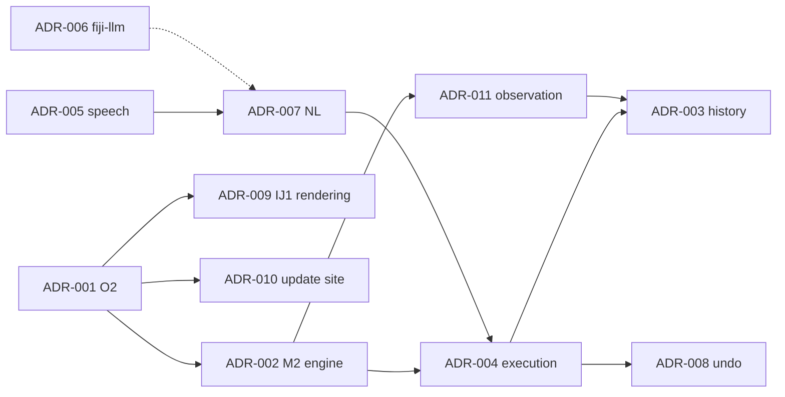

# D02 — Architecture Decision Records

This document indexes the architecture decision records. Each ADR is a separate file in [`adr/`](adr/), and each has a row in [`DECISIONS.md`](../../DECISIONS.md). **Every ADR is `Proposed — awaiting approval`.** None has been accepted.

| ADR | Decision (short) | DEC | Primary evidence | Rejected alternatives (summary) |
|---|---|---|---|---|
| [ADR-001](adr/ADR-001-architecture-direction-in-jvm-workspace-on-an-engine-service.md) | O2: in-JVM Swing/FlatLaf workspace on a UI-agnostic engine service | DEC-010 | A21 matrix; P42, P49, P84, P87 | O1 patch Fiji UI; O3 JavaFX shell; O4 web UI; O5 PyImageJ; O6 per-run headless; O7 napari; O8 WebView panels |
| [ADR-002](adr/ADR-002-engine-mode-persistent-non-headless-fiji-jvm-with-the-main-w.md) | Persistent non-headless engine JVM, main window hidden (M2) | DEC-010 | A15; P41, P42, P46, P47 | M1 per run; M1 persistent; M3 visible legacy UI |
| [ADR-003](adr/ADR-003-history-is-the-source-of-reproducibility-macros-are-generate.md) | Structured history is the source of truth; macros are generated from it | DEC-020 | P81; A10, A12 | Recorder as source; patched Recorder |
| [ADR-004](adr/ADR-004-command-execution-explicit-target-complete-options-ij-run-on.md) | `IJ.run(target, label, completeOptions)` on one non-EDT worker, with postconditions | DEC-021 | A15 §6; P80; A08; A11; A19 | `ModuleService` for IJ1 commands; direct plugin calls |
| [ADR-005](adr/ADR-005-speech-persistent-faster-whisper-worker-process-whisper-cpp.md) | Persistent faster-whisper worker process, PCM over JSON lines | DEC-022 | A16; P60–P64 | whisper.cpp (alternative); JNA in-JVM; hosted ASR |
| [ADR-006](adr/ADR-006-relationship-with-fiji-fiji-llm-and-external-clients.md) | Interoperate with fiji-llm, do not depend on it; external clients only through authenticated IF-10 later | DEC-011 | A06; fiji-llm source | Building on fiji-llm for the MVP; an unauthenticated MCP server |
| [ADR-007](adr/ADR-007-nl-interpretation-deterministic-validator-decides-llm-option.md) | A deterministic validator decides; the LLM is optional; no code generation | DEC-023 | A17; P65; A25 | LLM-generated macros; LLM-decided confirmation |
| [ADR-008](adr/ADR-008-undo-by-per-document-snapshots-independent-of-ij1-undo.md) | Per-document snapshot undo within a budget | DEC-024 | A19; P86 | IJ1 `Undo` slot |
| [ADR-009](adr/ADR-009-viewer-rendering-through-imagej-s-own-rendering-with-caching.md) | Render through IJ1 (`getBufferedImage`) with caching | DEC-025 | P84; A21 | Custom LUT/GPU renderer as the default |
| [ADR-010](adr/ADR-010-distribution-as-a-fiji-update-site-with-a-separate-reference.md) | Fiji update-site distribution plus a pinned reference install for verification | DEC-026 | A21, A22, A24 | Bundling Fiji |
| [ADR-011](adr/ADR-011-observation-through-commandlistener-scijava-module-events-an.md) | Observe via `CommandListener`, module events, IJ1 listeners and a chained legacy hook | DEC-027 | P80; A20 | Recorder-based observation; polling only |

## Dependencies between decisions

If DEC-010 is rejected in favour of O4, ADR-002/003/004/005/007/008/011 still hold, because they concern the engine. ADR-009 must be revisited (rendering transfer), and IF-10 with authentication moves into MVP scope (NFR-SEC-002).
