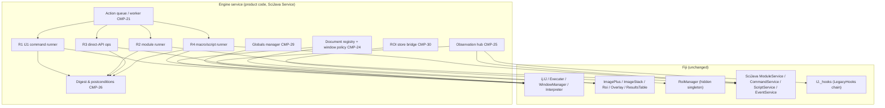

# D04 — Fiji Integration Architecture

## Executive Summary

This document specifies exactly how the engine service (CMP-20…31) interacts with unmodified Fiji. It covers:

- the four execution routes, with the APIs each uses;
- document registration and window policy;
- the ROI Manager singleton bridge;
- the globals manager;
- results capture;
- dialog handling;
- observation hooks;
- legacy fallback.

Every API named here is **VERIFIED** to exist at the pinned revisions; file and line references are given. Behaviours not yet probed are marked as validation items (V-xx), to be closed in implementation milestone 1 (D20).

## 1. Integration layers

## 2. Execution routes

### R1: IJ1 commands (the majority of user commands)

| Step | API | Evidence |
|---|---|---|
| Resolve label | Catalogue `command_id` → exact label, including whitespace (FR-CMD-003) | A08 |
| Validate | `CommandSchema` (D06) plus preconditions against the target `ImagePlus` | FR-PROC-004 |
| Prepare | `IJ.setKeyUp(IJ.ALL_KEYS)`; apply action globals through CMP-29; snapshot through CMP-28; ensure the target is registered (§3). If `imp.isLocked()`, the action fails with `PRECONDITION_FAILED` ("image locked by another operation"): `PlugInFilterRunner` otherwise returns silently on a locked image. | `ij/IJ.java#L1132-L1145`; `ij/ImagePlus.java#L242`; `ij/plugin/filter/PlugInFilterRunner.java#L57-L58`; ADR-004/008 |
| Execute | `IJ.run(ImagePlus imp, String command, String options)` on the engine worker (`ij/IJ.java#L410`). It sets the temp current image and delegates to `IJ.run(command, options)` (`#L310-L332`), which binds the macro options to the thread and runs `Executer` synchronously. | A15 §6; line reference corrected after G10 review |
| Observe | `CommandListener` sees the command and options (records the product-initiated flag); `ImageListener` events arrive on the EDT | P31, P80 |
| Complete | Per-family postconditions plus window tracker (an "Exception" `TextWindow` or a "Macro Error" window opened during the action, DEC-035) plus log-delta scan plus pending-dialog check (CMP-26). Success is never inferred from the return of `IJ.run` (it swallows `Throwable`). In M2 `IJ.getInstance()` is the hidden legacy frame, so `Executer` opens an "Exception" window and does **not** log the exception (D17 §3.6). | `ij/Executer.java#L74-L117` (A08); `#L113-L117` |

**Multi-image commands** (Image Calculator, Merge Channels and others: FR-PROC-008) run through R1 on documents under window policy P-A, which already registers every input with `WindowManager` (§3, P82). Batch mode is not used for them, because outputs created in batch mode vanish from `WindowManager` when the flag is reset (P82). They are flagged `requires_macro_registration` in the catalogue. (Phase 8 correction: the earlier R4 batch-mode route is withdrawn.)

### R2: ImageJ2 modules

`CommandService.run(Class/ModuleInfo, process=true, Map inputs)` is called with **all inputs resolved** (FR-PROC-011). The engine worker waits on the returned `Future` with the dialog watch active. If a module still needs harvesting, the product's input harvester (registered by the workspace UI as a SciJava `InputHarvester` plugin) presents a schema form.

Validation item **V-01**: confirm that a harvester registered by the product UI is selected when the product UI is the visible UI. A15 §5 shows that harvesting is tied to the visible UI (`AbstractInputHarvesterPlugin.java#L66-L71`).

### R3: direct API (no dialogs)

| Operation | API (pinned) |
|---|---|
| Open image | `IJ.openImage(path)` (IJ1 routing, with Bio-Formats delegation as in File › Open); the Bio-Formats importer via R1 `run("Bio-Formats Importer", options)` |
| Save TIFF | `IJ.saveAsTiff(imp, path)`; other formats via R1 `saveAs` |
| Set ROI | `imp.setRoi(Roi)`, with `PolygonRoi(float[] x, float[] y, n, type)`, `Roi`, `OvalRoi`, `Line`, `PointRoi`, `ShapeRoi` built from float geometry (A10) |
| Display range / LUT | `imp.setDisplayRange(min, max)`, or `CompositeImage.setDisplayRange` per channel; `setLut`; `CompositeImage.setMode` |
| Position | `imp.setPosition(c, z, t)` |
| Threshold preview | `ImageProcessor.setThreshold(lower, upper, lutUpdate)` (display only) |
| ROI sets | `RoiDecoder`/`RoiEncoder` (`.roi`/`.zip`) |
| Read results | `ResultsTable` getters at full precision (`getValueAsDouble`) |
| Rendering | `imp.getBufferedImage()` / `imp.getImage()` for viewer planes (ADR-009), called on the engine worker between actions only (rendering isolation, below). `getBufferedImage` excludes overlays (`ij/ImagePlus.java#L606-L611`); overlays and ROIs are delivered as geometry and drawn by the viewer (D13 §2.2). |

R3 actions are recorded as direct-manipulation history entries with macro equivalents where exact (FR-HIST-003).

**Rendering isolation (PROPOSED; V-11).** Rendered planes are produced on the engine worker between actions, never concurrently with a running command. After each action the worker renders the visible planes that the digest marks changed, as an internal post-action step. On-demand render requests (zoom, pan, plane change) are queued as internal AC0 tasks. The UI draws only cached ARGB copies (NFR-PERF-004) and shows the last cache while an operation runs (D09 SY-2). No product code takes `ImagePlus` locks for rendering: `ImagePlus.lock` is exclusive per thread (`ij/ImagePlus.java#L186-L221`), and a filter started while another thread holds it returns without running (`PlugInFilterRunner.java#L57-L58`). This replaces the "render proxy" with `lockSilently()` (former D13 DP-D13-01; Phase 8 finding 4).

### R4: macro and script engine

- Product-generated macros (multi-image commands, replay): run on the engine worker by an `Interpreter` instance owned by the adapter, mirroring `Macro_Runner.java#L161-L176`, so that `wasError()`/`getErrorMessage()` can be read (refined in D17). One interpreter at a time (FR-MACRO-005). `setIgnoreErrors` is not used.
- User macros: the capability scan first (CMP-31, `ij.macro.Tokenizer`), then the confirmation (FR-MACRO-002), then execution through the R4 adapter (owned `Interpreter`, DEC-034), or `ScriptService.run` for scripts with `#@` parameters (FR-MACRO-004).
- Abort: `Interpreter.abort()` (`ij/macro/Interpreter.java#L2102`); errors are captured from the interpreter error output and the log (D17).

## 3. Document registry and window policy (CMP-24)

**Registry.** Every image in the session gets a product `docId`, bound to its `ImagePlus` ID (negative, session-scoped; A09) and to provenance (path, SHA-256, reader; FR-IMG-004). Images created by commands are detected from the digest (new IDs in `WindowManager.getIDList()`) and registered as derived documents.

**Window policy (FR-PLUG-002, ADR-002).** IJ1 needs images registered with `WindowManager` for many commands. Windows are not hidden automatically in M2 (A15 §7).

| Policy | Mechanism | Pros / cons | Use |
|---|---|---|---|
| **P-A Show-then-hide** (PROPOSED default) | `imp.show()` creates the `ImageWindow`. The policy then calls `getWindow().setVisible(false)`. | The image stays in `getIDList()` and remains current. All commands work (P82). There may be a brief flash (V-02). | All documents under product control |
| P-B Batch mode | `Interpreter.batchMode=true` | No windows at all. Images vanish from `WindowManager` when the flag is reset (P82). | Inside generated macros (R4) only |
| P-C Visible legacy window | `imp.show()` and leave it visible | Needed for C5 plugins (canvas interaction) | On demand for C5 (D10) |

The **window tracker** (CMP-11 via CMP-24) registers an `AWTEventListener` for `WINDOW_EVENT_MASK` and classifies each opened window:

- product-hidden `ImageWindow` → ignore;
- `GenericDialog` or other modal dialog during an action → state `WAITING_FOR_DIALOG`, event code `DIALOG_PENDING` (FR-PROC-007);
- windows with a workspace equivalent (the Results `TextWindow`, the ROI Manager singleton) → hidden, with their content shown in product panels (P82);
- the "Exception" `TextWindow` and the "Macro Error" window → captured as a failure signal for the running action (DEC-035, D17 §3.6);
- Histogram and Plot windows → stay **visible, tracked legacy windows** until embedded panels exist (PARITY), consistent with D12 GAP-D12-03 and D15 FS-08;
- plugin `JFrame`/`Frame` → track as external (FR-PLUG-001).

Validation item **V-02**: measure the show-then-hide flash and decide whether to pre-position windows off-screen before showing them (A15 §7 notes the multi-monitor fragility of off-screen placement).

## 4. ROI store bridge (CMP-30; FR-ROI-004)

Verified facts (`ij/plugin/frame/RoiManager.java` @v1.54p):

- `new RoiManager()` creates **the** singleton and shows its window (L87–L104).
- `new RoiManager(boolean)` creates a hidden manager; **the boolean is ignored**, and it is never the singleton (L105–L112). This corrects the "`RoiManager(false)` vs `(true)`" wording in A15 and the G8 notes; both forms are equivalent.
- `RoiManager.getInstance()` returns the singleton. It returns the batch-mode manager only when no singleton exists and a macro is running (`instance==null && IJ.isMacro()`, L2081–L2086). The product's singleton therefore takes precedence, even inside macros.
- `ParticleAnalyzer.setRoiManager(RoiManager)` routes "add" output to a given manager (`ij/plugin/filter/ParticleAnalyzer.java#L1202`).

**Design (PROPOSED):**

1. The authoritative ROI sets are product-side per-document collections of `Roi` objects (float geometry), owned by the engine (FR-IMG-001).
2. The engine creates the singleton once (`new RoiManager()`) at start-up and immediately hides its window, so that every command and macro calling `getInstance()` finds a manager. This uses window policy P-A.
3. Before any action flagged `uses_roi_manager` (catalogue flag; e.g. Analyze Particles with `add`, `roiManager(...)` macros, Multi Measure), CMP-30 loads the target document's ROI set into the singleton (`reset`, then `addRoi` per ROI, preserving order and names).
4. After the action, CMP-30 reads the singleton's contents back into the document's set and diffs the changes for history.
5. For Analyze Particles run by the product, `ParticleAnalyzer.setRoiManager(singleton)` is set explicitly.

Validation item **V-03**: round-trip fidelity (order, names, positions, properties) of the load and read-back, and macro `roiManager("count"/"select")` parity (FR-ROI-004 acceptance). This is risk R-A28-02.

## 5. Globals manager (CMP-29; FR-MEAS-001, FR-HIST-007)

| Global | Read | Set | Evidence |
|---|---|---|---|
| Black background | `Prefs.blackBackground` | Assign the field, or run `Options...` (Binary) with `black` | `ij/Prefs.java#L76` |
| Measurement flags | `Analyzer.getMeasurements()` | `Analyzer.setMeasurements(int)`, or R1 `Set Measurements...` with complete keys | `Analyzer.java#L967-L972` |
| Decimal places | `Analyzer.getPrecision()` | `Analyzer.setPrecision(int)` | `Analyzer.java#L1004-L1009` |
| Redirect image | `Analyzer.getRedirectImage(imp)` | `Analyzer.setRedirectImage(ImagePlus)` | `Analyzer.java#L319-L346` |
| Conversion scaling | `ImageConverter.getDoScaling()` | `ImageConverter.setDoScaling(boolean)` | `ImageConverter.java#L385-L391` |
| Calibrate conversions | `Prefs.calibrateConversions` | Assign | `Prefs.java#L197` |
| Weighted RGB conversion | `Prefs.weightedColor`, `ColorProcessor.getWeightingFactors()` | `ColorProcessor.setWeightingFactors(r,g,b)` | `Prefs.java#L80`; `ColorProcessor.java#L1348-L1359` |
| Pad edges | `Prefs.padEdges` | Assign | `Prefs.java#L116` |
| Inverting LUT | `Prefs.useInvertingLut` | Assign | `Prefs.java#L90` |
| Binary iterations / count | **Not readable** (package-private statics `Binary.iterations`, `Binary.count`) | **Set explicitly** through R1 `run("Options...", "iterations=N count=M [black] …")` before the operations that read them (Erode, Dilate, Open, Close in `Binary`). Watershed (`EDM`) reads only `Prefs.blackBackground` and the inverting LUT (G10/D16). | `ij/plugin/filter/Binary.java#L22-L23` |
| Global calibration | `imp.getGlobalCalibration()` / `ImagePlus.getStaticGlobalCalibration()` (exists: `ij/ImagePlus.java#L2767`; V-04 closed by source) | Via Set Scale `global` | A09 |

Policy:

- Snapshot all readable globals before and after every action, and record the delta (AC5 history, FR-HIST-007).
- Before replay, restore the recorded values (FR-MEAS-001).
- For unreadable globals, record the explicit values the product set. If a legacy dialog or plugin may have changed them, mark them "unknown since action N".

## 6. Results capture (FR-MEAS-003…005)

- The primary path (fidelity) is R1 `Measure` / `Analyze Particles` / `Summarize`. In M2 these use the system `ResultsTable` and may open a Results `TextWindow`, which the window policy hides (P82). Accumulation works when a Results window exists. The headless truncation (P39) does not apply in M2 (INFERRED from the cause at `Analyzer.java#L851-L857`; **V-05** to confirm 20 sequential Measure calls in M2).
- After each action, CMP-26 copies new or changed rows into the document's result store at full precision (`getValueAsDouble`). The system table stays populated for macro compatibility (FR-MEAS-005).
- Export writes full precision (`Double.toString`); display rounding is presentation only (FR-MEAS-003).

## 7. Dialog handling (FR-PROC-007)

- Commands with a complete schema never show dialogs: their macro options cover every key (A15 §4.5; P42 E1).
- If a dialog appears during an action (no schema, a missing key, or a plugin asking a question), the watch detects it through `Window.getWindows()`/`GenericDialog.getInstance()` (P83), changes the state to `WAITING_FOR_DIALOG`, and brings the native dialog to the front, associated with the action.
- The product **does not** fill dialogs automatically. P83 shows this is possible, but it would silently choose parameters, which violates PR-4.
- **Values typed into a surfaced dialog are not captured by `CommandListener` or `Macro.getOptions()`.** The listener fires before the command and its dialog run (`ij/Executer.java#L54-L61`), and a command started with empty options has no thread options entry, because `Macro.setOptions("")` removes it (`ij/Macro.java#L97-L103`). Capture design:
  - Primary (**PROPOSED, V-10**): while `WAITING_FOR_DIALOG`, the dialog watch keeps an up-to-date snapshot of the open `GenericDialog`'s field values (P83 shows the fields are readable from code). On OK, the last snapshot is mapped to macro keys by applying `Macro.trimKey` to the labels (`ij/Macro.java#L159`), and recorded with provenance `dialog-snapshot`.
  - Fallback, when V-10 fails or the dialog is not a `GenericDialog`: the step is recorded as "parameters entered in a Fiji dialog — not captured" (provenance PARTIAL, FR-HIST-008). E7 replay flags that step as non-reproducible.
  - Mitigation: schema coverage grows so that product-initiated commands never show dialogs.

## 8. Observation hooks (CMP-25; ADR-011)

| Hook | Registration | Captures |
|---|---|---|
| `CommandListener` | `Executer.addCommandListener(l)` (`ij/Executer.java#L265`) | Command label and `Macro.getOptions()` for every `Executer` run. Veto by returning `null` (FR-PLUG-003). |
| Module events | SciJava `EventService` subscriptions to module lifecycle events (class names per P80) | IJ2 commands, `ModuleService` legacy runs, scripts |
| `ImageListener` | `ImagePlus.addImageListener(l)` (`ij/ImagePlus.java#L3072`) | Opened, closed and updated events (asynchronous on the EDT) |
| `RoiListener` | `Roi.addRoiListener(l)` (`ij/gui/Roi.java#L2920`) | ROI lifecycle, synchronous |
| `IJEventListener` | `IJ.addEventListener(l)` | Tool and colour changes |
| Legacy hooks chain | `LegacyInjector.installHooks(classLoader, delegatingHooks)`, which returns the previous hooks; every method delegates to the previous hooks and additionally reports `showProgress`/`showStatus` | IJ1 progress and status (NFR-REL-004). **V-06**: probe before adoption (A20 R-A20-01). |
| AWT windows | `Toolkit.getDefaultToolkit().addAWTEventListener(l, AWTEvent.WINDOW_EVENT_MASK)` | Window tracker and dialog watch (§3, §7) |

## 9. Legacy fallback (summary; detail in D10)

C4–C6 plugins run through R1/R2 unchanged. Their windows are tracked as external (FR-PLUG-001). For C5 plugins the document switches to policy P-C (a visible IJ1 image window) for the plugin's duration, and back afterwards.

## 10. Validation items (closed in milestone 1; D20)

| ID | Question | Method | Blocks |
|---|---|---|---|
| V-01 | Is a product input harvester used for R2 modules? | Probe with a test `@Parameter` command | FR-PROC-011 (PARITY) |
| V-02 | Does show-then-hide flash? Is off-screen pre-positioning needed? | GUI probe with frame timing | FR-PLUG-002 |
| V-03 | ROI bridge load/read-back fidelity and macro parity | Probe plus E4 | FR-ROI-004 |
| V-04 | Global-calibration read API | **Closed by source** (`ImagePlus.getStaticGlobalCalibration()`, `ij/ImagePlus.java#L2767`); runtime use is covered by E-level tests | FR-MEAS-001 |
| V-05 | Measure accumulation in M2 with a hidden Results window | Probe (20 Measure calls) | FR-MEAS-004 |
| V-06 | Legacy hook chaining safety | Probe per A20 R-A20-01 | NFR-REL-004 |
| V-07 | Jaunch `extra-*.toml` launch option delivered by an update site | Install test | DEC-028 (D03) |
| V-10 | Can the dialog watch snapshot `GenericDialog` field values while `WAITING_FOR_DIALOG` and map them to macro keys (`Macro.trimKey`) that replay to the same result? | GUI probe: surface the Gaussian Blur dialog, type values, press OK, compare the snapshot-derived line against a direct `IJ.run` with the same options (E1) | FR-HIST-008, FR-PROC-007 (§7) |
| V-11 | Render-on-worker latency: are post-action and on-demand renders on the engine worker fast enough, with no `ImagePlus` lock taken for rendering? | Timing probe on FX-001 and a large stack during zoom and pan (NFR-PERF-001) | NFR-PERF-001, NFR-PERF-004 (§2 R3) |
| V-12 | Does a bounded `context.dispose()` complete without IJ1 quit prompts once all documents are closed with `changes=false`? | GUI probe of the D03 §6 quit sequence with a jstack on timeout (P85 method) | FR-SYS-005 (D03 §6) |

## Change log

- 2026-10-17: Initial version by the lead.
- 2026-10-17: Phase 8 review fixes (findings #1, #2, #4, #7, #8, #17, #22, #25, #26, #32).
