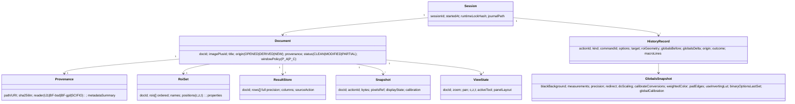

# D05 — Application State and Data Architecture

## Executive Summary

**Fiji objects inside the engine JVM are the source of truth for scientific data.** These are `ImagePlus`, its pixel arrays, `Calibration`, display range and LUTs, `Roi` and `Overlay`, `ResultsTable`, and the global settings (FR-IMG-001).

The product adds three kinds of state:

1. **engine-side bookkeeping** that Fiji lacks: document identity and provenance, per-document ROI sets, per-document result stores, snapshots, history and globals records;
2. **UI view state** (layout, zoom, selection highlights), which never holds scientific truth;
3. **persistent files**: the session journal, settings, exported workflows, and data files written by the user.

The table in §2 names the owner of every mutable object.

## 1. Conceptual model

## 2. State ownership (authoritative)

| Object | Source of truth | Owner component | Mirrors / views | Mutated by | Requirements |
|---|---|---|---|---|---|
| Pixel data, stack, dimensions | `ImagePlus`/`ImageStack` in the engine JVM | Fiji (via CMP-23) | Rendered planes in CMP-02 (copies; NFR-PERF-004) | R1–R4 on the engine worker only | FR-IMG-001, FR-SYS-004 |
| Calibration, frame interval, properties | `ImagePlus.getCalibration()` etc. | Fiji | Document header (UI-05), history | R1/R3 | FR-VIEW-002 |
| Display range, LUT, composite mode | `ImagePlus`/`CompositeImage` | Fiji | Viewer, display panel | R3 (display-only, AC1); Apply = R1 (AC3) | FR-PROC-014 |
| Document identity, provenance, status | `Document` in the engine | CMP-24 | Document tabs, status | Engine | FR-IMG-004, FR-IMG-011 |
| Active (focused) document | **UI** focus, sent as an explicit target with every request | CMP-01 | — | User | FR-IMG-002 |
| IJ1 current image | Fiji `WindowManager` (temp per thread during an action) | Fiji, set by `IJ.run(imp,…)` | Not used for targeting | R1 | ADR-004 |
| ROI set per document | `RoiSet` in the engine (float `Roi` objects) | CMP-30 | ROI list (UI-09), overlay, hidden singleton `RoiManager` (loaded and read back around actions, D04 §4) | R3, and R1 read-back | FR-ROI-004 |
| Active ROI on an image | `ImagePlus.getRoi()` | Fiji | Viewer overlay | R3 (from the ROI editor), R1 | FR-ROI-001 |
| Results per document | `ResultStore` (full precision) | CMP-26 | Results panel (UI-08); system `ResultsTable` kept populated | Copied from the system table after measurement actions | FR-MEAS-003…005 |
| Global settings | Fiji statics and prefs (D04 §5) | Fiji, read and set via CMP-29 | Globals panel (UI-17), parameter panels | R1/R3; legacy dialogs (observed) | FR-MEAS-001, FR-HIST-007 |
| Undo snapshots | `Snapshot` store (in heap, within budget) | CMP-28 | Undo/redo affordances | Engine | FR-HIST-004…006 |
| History | `HistoryRecord` list plus the journal on disk | CMP-27 | History panel (UI-10), macro view | Engine (executed and observed actions) | FR-HIST-001 |
| Catalogue and schemas | Runtime catalogue built at start-up | CMP-22 | Menus, search, NL | Rebuilt on plugin changes | FR-CMD-002 |
| View state (zoom, pan, layout, tool) | UI | CMP-01/02/03 | — | User | — |
| Operation lifecycle | Engine operation table | CMP-21 | Activity (UI-12) | Engine | NFR-REL-005 |

**Rules:**

- **S1.** No UI component writes scientific state except through an `ActionRequest` (IF-01).
- **S2.** UI views refresh from `StateDigest` events and queries (IF-02/03) after an action completes. Events received during an action are treated as hints (A20 R-A20-02).
- **S3.** The engine never relies on IJ1 focus for targeting (FR-IMG-002).
- **S4.** All pixel data crossing to the UI is a copy or a rendering (NFR-PERF-004).

## 3. Document lifecycle

```mermaid
stateDiagram-v2
  [*] --> Opening: open/new/derived
  Opening --> Clean: registered (provenance recorded)
  Opening --> [*]: IO_ERROR
  Clean --> Modified: AC3/AC4 action completed
  Modified --> Modified: further actions
  Modified --> Clean: undo to the original snapshot; or saved (Save As creates a new provenance)
  Modified --> Partial: cancelled/failed without a snapshot (FR-HIST-006)
  Partial --> Modified: user accepts the partial state
  Clean --> Closed: close
  Modified --> Closed: close after the save/discard decision
  Partial --> Closed: close after the decision
  Closed --> [*]
```

## 4. Snapshot budget (NFR-PERF-003, FR-HIST-005)

- Budget `B` = configurable fraction of `Runtime.maxMemory()`. The default is **PROPOSED** as 25 %, to be tuned with A23 measurements in milestone 1.
- Before an AC3 action, the estimated snapshot size `S` is computed. For the affected planes it is W × H × bytes per pixel. For a whole-stack action it covers all slices. Display state and calibration are added.
- If `S` is more than the remaining budget, the oldest snapshots for **other** documents are evicted first, then older snapshots of the same document. If `S` is still too large, the action is reclassified as AC4 and needs confirmation.
- Virtual stacks are always AC4 (A23).
- Snapshot storage holds pixel arrays copied with `ImageStack`/`ImageProcessor.duplicate()`-level copies. It does not reference live arrays, because of the shared-array hazards in A09 H8.

## 5. Persistence

| Artefact | Location | Format | Content | Privacy |
|---|---|---|---|---|
| Session journal | Per-user product data directory | JSON lines (`HistoryRecord`, IF-05) | Actions, input paths and hashes, globals | User-private. Not uploaded. Retention per FR-WS-004. |
| Exported workflow | User-chosen path | `.ijm` plus `.workflow.json` provenance sidecar (IF-05) | Generated macro; record with input hashes | User-controlled |
| Settings | SciJava `PrefService` (Windows: `HKCU\Software\JavaSoft\Prefs`, A22) under a product namespace | Key/value | Layout, snapshot budget, voice settings, LLM opt-in | No secrets. API keys go in the OS credential store (FR-WS-005). |
| Data outputs | User-chosen paths; never input paths by default (FR-IMG-009) | TIFF, CSV, `.zip` ROI | Science outputs | — |
| Logs | Product data directory | Text | Events with hashed or relative identifiers (NFR-PRIV-002) | Verbose mode is opt-in |
| Fiji prefs | `IJ_Prefs.txt`, registry (Fiji-owned) | Fiji formats | Fiji options | Saved at quit (D03 §6). Isolated in tests (NFR-MAINT-004). |

## 6. Identifier scheme

| ID | Form | Scope |
|---|---|---|
| `sessionId` | UUID | One engine run |
| `docId` | `doc-<n>` within a session, mapped to `ImagePlus` ID | Session |
| `actionId` / `OperationId` | `op-<sessionShort>-<n>` (monotonic) | Session |
| Saved-workflow image reference | `{path, sha256}` (FR-HIST-010) | Portable |
| ROI identity | `{docId, index, name, uuid property}` (the UUID is stored as a ROI property so it survives `.roi` round trip, A10) | Session and file |

## Change log

- 2026-10-17: Initial version by the lead.
