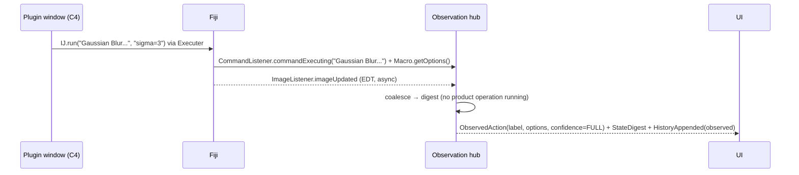

# D09 — Internal APIs and Event Contracts

## Executive Summary

The engine exposes three in-process interfaces to the UI and the interaction services:

- **IF-01**: action submission;
- **IF-02**: the event stream;
- **IF-03**: queries.

All payloads are immutable, serialisable value objects (FR-SYS-003), so the same contracts could later be carried over an authenticated external transport (IF-10, LONG scope, NFR-SEC-002). This document defines operations, message schemas, ordering guarantees, threading and versioning, and gives sequence diagrams for the key flows. It is a design contract, not code. Payloads are shown as JSON for readability; in-process they are Java value objects with the same fields.

## 1. Conventions

- **Versioning:** every message carries `"v": 1`. Fields are only ever *added* within a major version.
- **Identifiers:** `sessionId`, `docId`, `operationId`, `requestId` (D05 §6).
- **Time:** ISO-8601 UTC, plus a monotonic `seq` per session for ordering.
- **Threading:**
  - IF-01 calls return immediately with an `operationId`. They never block the caller, so they are safe on the EDT.
  - IF-03 queries are answered from the last committed digest and caches without entering the engine worker. The exceptions are a render-cache miss (`renderPlane`, `renderSnapshot`) and `previewFilter`, which are queued on the engine worker as internal AC0 tasks and run between actions, never concurrently with a running command (D04 §2 R3, rendering isolation, V-11). No product code takes `ImagePlus` locks for rendering. The UI receives ARGB copies only (NFR-PERF-004).
  - IF-02 events are delivered to UI subscribers **on the EDT** in `seq` order, and to non-UI subscribers on their own executor (NFR-PERF-005).
- **Errors:** a uniform envelope `{code, subcode?, message, details, recoverable, suggestions[], context?}` using the D06 §7 codes and the D06 §7 subcodes. This is the authoritative error payload; D17 §2.1 uses it. `context` carries, where applicable: `operationId`, `requestId`, `commandId`, the redacted `params`, `target.docId`, `phase`, `fijiMessage` (text captured from Fiji, redacted per D17 §5), `explanation` (product text naming the required state), `recovery[]` (D17 §2.2 action IDs), `snapshot` (`available` \| `restored` \| `none`) and `logExcerptRef`. `suggestions[]` holds the human-readable recovery labels.

## 2. IF-01 Action submission

| Operation | Input | Output | Notes |
|---|---|---|---|
| `submit(ActionRequest)` | D06 §2 | `{operationId}` or an immediate error (`ENGINE_NOT_READY`, `UNKNOWN_COMMAND`) | Validation proceeds asynchronously; outcomes arrive on IF-02 |
| `submitPlan(CommandPlan, confirmationToken?)` | D08 §2.3 | `{planId, operationIds[]}` | Steps are queued in order. Validation runs per step before execution (FR-NL-002). |
| `confirm(operationId, token)` / `decline(operationId)` | — | ack | Moves `AWAITING_CONFIRMATION` → `VALIDATING` / `CANCELLED` |
| `cancel(operationId)` | — | ack | Cooperative cancel (D06 §6; FR-PROC-013) |
| `undo(docId)` / `redo(docId)` | — | `{operationId}` | DIRECT operations (FR-HIST-004) |
| `quit(policy)` | `{unsaved: ASK\|SAVE\|DISCARD}` | ack | D03 §6 |

## 3. IF-02 Events (authoritative list)

| Event | Key fields | Emitted when | Requirement |
|---|---|---|---|
| `EngineStateChanged` | `state` (INITIALISING, BUILDING_CATALOGUE, READY, FAILED, QUITTING), `reason` | Start-up (D03 §3) and quit (D03 §6) transitions. The JVM start phase before the Context exists is covered by the Fiji splash screen and has no event. | FR-SYS-006 |
| `OperationStateChanged` | `operationId`, `requestId`, `state` (the canonical lifecycle, D06 §6), `error?` (envelope, §1), `consequenceClass`, `requiresConfirmation?`, `queuePosition?` (while QUEUED), `timeoutAdvisory?` (while RUNNING) | Every lifecycle transition, and on a queue-position or advisory change | NFR-REL-005 |
| `OperationProgress` | `operationId`, `kind` (DETERMINATE\|STAGE), `current`, `total`, `source` (`legacyHook`\|`productLoop`\|`planStep`), `statusText?` | Only from real counters (A20 §1) | NFR-USE-002 |
| `DialogPending` | `operationId`, `windowTitle`, `dialogClass`, `fields[]` (read-only summary) | Modal dialog detected during an operation | FR-PROC-007 |
| `StateDigest` | `operationId?`, `seq`, `documents{added, removed, changed{docId, pixelsChanged, typeChanged, displayChanged, roiChanged, dims}}`, `results{docId, rowsAdded, tableTitle}`, `rois{docId, added, removed, modified}`, `globals{delta}`, `log{newLines[] (sanitised)}`, `windows{opened[], closed[]}` | After every completed, failed or observed action | FR-IMG-001, NFR-REL-005 |
| `HistoryAppended` | `record` (IF-05) | A record is committed (executed or observed) | FR-HIST-001, FR-HIST-008 |
| `ObservedAction` | `label`, `options?`, `moduleInputs?`, `sourceWindow?`, `confidence` (FULL\|PARTIAL\|NONE), `optionsProvenance?` (`listener` \| `dialog-snapshot` \| `not-captured`) | `CommandListener` or module event not caused by the product, or a digest-only change. Options come from `Macro.getOptions()` only when the command was started with options; values typed into a dialog come only from the dialog snapshot (D04 §7, V-10), otherwise the step is PARTIAL. | FR-HIST-008 |
| `LegacyWindowChanged` | `windowId`, `title`, `class`, `category` (IJ1_TOOL\|PLUGIN\|DIALOG\|IMAGE_VISIBLE), `state` (OPENED\|CLOSED\|FOCUSED) | Window tracker | FR-PLUG-001/002 |
| `CatalogueChanged` | `added[]`, `removed[]`, `version` | Catalogue rebuilt (e.g. plugin installed) | FR-CMD-002 |
| `SnapshotBudgetChanged` | `usedBytes`, `budgetBytes` | After a snapshot or eviction | NFR-PERF-003 |
| `SpeechStateChanged` | `state` (OFF, STARTING, READY, RECORDING, TRANSCRIBING, UNAVAILABLE), `reason?` | Worker lifecycle | FR-SPEECH-002, NFR-REL-002 |

**Engine loss under O2.** The UI shares the JVM with the engine, so it cannot observe its own engine's loss. There is no LOST or RECOVERING value in `EngineStateChanged` for the in-process UI. Session recovery is offered at the next start from the journal (D03 §7, J-13). LOST and RECOVERING states apply only to IF-10 external clients (LONG) and to the start-up recovery prompt (UI-19).

**Ordering guarantees:**

1. For one operation, `OperationStateChanged(RUNNING)` precedes any `OperationProgress`, which precedes its terminal state, which precedes the corresponding `StateDigest`, which precedes `HistoryAppended`.
2. Digests are complete for the operation that produced them.
3. IJ1 `ImageListener` callbacks (asynchronous, EDT) are **not** forwarded as authoritative events. They only trigger a coalesced digest when no operation is running, to detect observed changes (A20 R-A20-02).

Example `StateDigest`:

```json
{"v":1,"type":"StateDigest","seq":512,"operationId":"op-7f3a-58",
 "documents":{"changed":[{"docId":"doc-3","pixelsChanged":true,"typeChanged":false,"displayChanged":false,"roiChanged":false,"dims":{"w":1024,"h":1024,"c":3,"z":5,"t":1,"bitDepth":16}}],"added":[],"removed":[]},
 "results":[],"rois":[],"globals":{"delta":{}},
 "log":{"newLines":[]},"windows":{"opened":[],"closed":[]}}
```

## 4. IF-03 Queries

| Query | Returns | Notes |
|---|---|---|
| `listDocuments()` | `DocumentInfo[]`: docId, title, type, dims, calibration summary, status, provenance summary, virtual-stack flag, global-calibration flag | FR-IMG-011 |
| `renderPlane(docId, c, z, t, region?, scaleHint?)` | ARGB raster copy from `getBufferedImage`-equivalent rendering, **excluding overlays and ROIs**, which are delivered as geometry (`overlay`, `rois`) and drawn by the viewer (D13 §2.2). `getBufferedImage` returns `ip.getBufferedImage()` or a `ColorProcessor` copy, with no overlay (`ij/ImagePlus.java#L606-L611`). Cached by (docId, position, displayStateHash); a miss is rendered on the engine worker between actions (§1). | ADR-009, FR-VIEW-001/005 |
| `renderSnapshot(snapshotId, c, z, t)` | ARGB raster of a stored pre-action snapshot (CMP-28), for before/after comparison | FR-PROC-010, FR-HIST-004 |
| `previewFilter(docId, commandId, params, c, z, t)` | Runs the filter on a copy of the current plane on the engine worker (AC0, never recorded) and returns a rendered ARGB copy | FR-PROC-010 |
| `macroForDraft(ActionRequest)` | The macro line(s) the D07 rules would generate for a draft request, without executing it | FR-HIST-002 |
| `histogram(docId, c, z, t, roi?)` | IJ1 `ImageStatistics` data (histogram bins, min, max, mean) for the plane and optional ROI | FR-PROC-015 |
| `overlay(docId)` | Ordered overlay elements with float geometry, stroke and fill, and positions | FR-VIEW-001 |
| `queueStatus()` | Queued operations in order, with `operationId` and position | FR-SYS-004 |
| `pixelValue(docId, x, y, c, z, t)` | `{locationString, valueString, raw[], calibrated[]}` formatted per `getLocationAsString`/`getValueAsString` | FR-VIEW-003 |
| `subtitle(docId)` | The legacy subtitle fields | FR-VIEW-002 |
| `rois(docId)` | Ordered `RoiInfo[]` with float geometry, positions, names and properties | FR-ROI-001/004 |
| `results(docId, since?)` | Rows at full precision, with column metadata | FR-MEAS-003 |
| `globals()` | `GlobalsSnapshot` plus "unknown since" markers | FR-MEAS-002 |
| `catalogue(query?)` / `schema(commandId)` | Catalogue entries and `CommandSchema` (IF-04) | FR-CMD-001…005 |
| `history(range)` / `exportMacro(range)` | `HistoryRecord[]` / `.ijm` text plus `.workflow.json` (IF-05) | FR-HIST-002 |
| `legacyWindows()` | Tracked windows | FR-PLUG-002 |
| `engineInfo()` | Fiji/ImageJ versions, runtime lock hash (if a reference install), engine mode, supported-version check | FR-SYS-010 |

## 5. IF-05 History record (summary)

The fields are listed in D06 §8. The record is serialised as JSON lines in the journal and in `.workflow.json`. Its `macroLines` are derived from the typed parameters by the D07 rules, and it carries `schemaVersion` and `catalogueVersion` for future migration.

## 6. Key sequences

### 6.1 Menu command with complete schema (J-04 Measure)

```mermaid
sequenceDiagram
  participant UI as Workspace UI (EDT)
  participant E as Engine facade (IF-01..03)
  participant W as Engine worker
  participant F as Fiji (IJ1)
  UI->>E: submit(ActionRequest{MENU, Analyze>Measure, target doc-3})
  E-->>UI: operationId op-58
  E->>W: enqueue
  W->>W: VALIDATING (schema, preconditions, consequence class + policy)
  W-->>UI: OperationStateChanged(RUNNING)
  W->>F: IJ.setKeyUp(ALL); globals snapshot; IJ.run(imp,"Measure","")
  F-->>W: returns (no exception signal)
  W->>W: postconditions RESULTS_ROWS (+1 row), log scan, dialog check
  W-->>UI: OperationStateChanged(COMPLETED)
  W-->>UI: StateDigest(results doc-3 rowsAdded=1)
  W-->>UI: HistoryAppended(record with run("Measure"))
  UI->>E: results(doc-3, since=…)
  E-->>UI: rows (full precision)
```

### 6.2 Command that unexpectedly opens a dialog

```mermaid
sequenceDiagram
  participant UI as UI
  participant W as Engine worker
  participant F as Fiji
  participant T as Window tracker / dialog watch
  Note over W: command has no schema
  W->>F: IJ.run(imp, "SomePlugin", "")
  F->>F: GenericDialog.showDialog() (modal, blocks worker)
  T-->>UI: DialogPending(op-60, "SomePlugin")
  UI->>UI: banner "Waiting for input in a Fiji dialog" + bring dialog to front
  Note over UI,F: user fills the native dialog and presses OK
  T->>T: snapshot GenericDialog field values while open (V-10)
  F-->>W: returns
  W-->>UI: OperationStateChanged(COMPLETED) + StateDigest + HistoryAppended(options from the dialog snapshot, provenance dialog-snapshot; otherwise "parameters entered in a Fiji dialog — not captured", PARTIAL)
  Note over W,F: CommandListener fired before the dialog opened, with empty options, so it cannot supply the typed values (D04 §7)
```

### 6.3 Observed action from a legacy plugin window



## 7. Synchronisation rules

| Rule | Statement |
|---|---|
| SY-1 | UI caches (rendered planes, ROI copies, result rows) are invalidated only by `StateDigest` flags or by explicit view-state changes |
| SY-2 | While an operation is RUNNING, the UI shows the pre-operation state, marked as busy. It does not render intermediate pixel states, except real per-slice progress text. |
| SY-3 | DIRECT operations from the ROI editor are optimistic in the UI (the drawn shape stays visible) and are committed on `COMPLETED`. On failure, the shape reverts. |
| SY-4 | Observed changes outside an operation are coalesced into at most one digest per 250 ms (PROPOSED) |

## 8. IF-10 External transport (LONG; disabled by default)

The transport is a transport-only adapter carrying IF-01/02/03 messages. It must:
- bind to loopback;
- check Host and Origin, including the WebSocket handshake;
- require a per-launch random token;
- enforce an allow-list of operations (no AC7).

It is required only if DEC-010 changes to O4, or for LONG-scope MCP or external clients (ADR-006, NFR-SEC-002).

## Change log

- 2026-10-17: Initial version by the lead.
- 2026-10-17: Phase 8 review fixes (findings #2, #3, #4, #5, #6, #10, #11).
