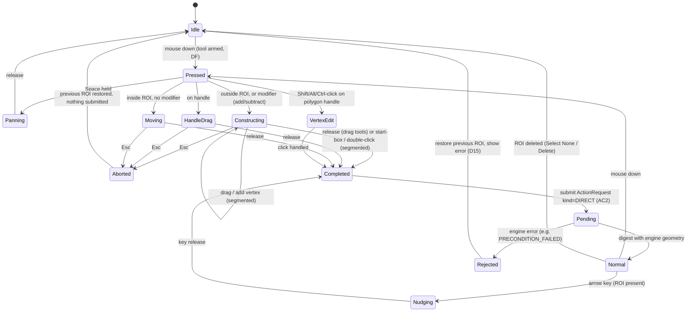

# D13 — Scientific Viewer and Interaction

## Executive Summary

This document specifies the image viewer (UI-05, CMP-02), the dimension controls (UI-06), the display panels' viewer-side behaviour (UI-13/14/15, CMP-12) and the ROI tools (UI-03, CMP-03). The rule throughout is **IJ1 semantics, reproduced exactly where they affect numbers or muscle memory**. Each rule cites the v1.54p source line it reproduces.

**Viewer behaviour:**

- **Rendering** uses IJ1's own rendering of LUT, display range, composite mode and threshold LUT. Rendered planes are cached and re-rendered only on data or display change (FR-VIEW-001/005; A23 R-a).
- **Zoom** keeps the 23-level IJ1 ladder for every command, key and wheel step. Smooth intermediate magnifications are allowed, and the next ladder step always snaps back to the ladder.
- **Read-out and subtitle** reproduce `getLocationAsString`/`getValueAsString` and `createSubtitle` character for character (FR-VIEW-002/003).
- **Navigation** keys follow `ImageJ.keyPressed` and `Animator` exactly (FR-VIEW-004).

**ROI tools** produce float geometry using IJ1's screen-to-image conversion rules, including the sub-pixel switch at magnification > 1.5. They apply the full modifier algebra. Each gesture is committed **once, at its end**, as a `DIRECT` `ActionRequest`. The engine builds the IJ1 `Roi`, so the UI never computes composite geometry itself (FR-ROI-001…003).

Two items need validation before commitment (D04/D18): **render isolation** (§2.3) and **viewer frame times** (NFR-PERF-001).

## Purpose and Scope

**In scope:** canvas rendering, zoom, pan, read-out, subtitle, C/Z/T navigation, overlays, channels and composite, display range versus data, threshold preview, ROI tools and editing, ROI-list binding, measurement interaction, input events and state machines.

**Out of scope:**

| Topic | Owner |
|---|---|
| Component visuals | D14 |
| Lifecycle feedback | D15 |
| Engine contracts (`ActionRequest` fields) | D06/D09 |
| Snapshot internals | D05 |

## Sources and Evidence

All `ij/...` references are to `imagej/ImageJ@v1.54p` (03382be1) and were read for this document on 2026-10-17 (**VERIFIED**, source).

| Source | Fact used |
|---|---|
| `ij/gui/ImageCanvas.java#L810-L813` | Zoom ladder |
| `ij/plugin/Zoom.java#L82-L130` | Zoom anchor (cursor if over the image, else the centre of the visible rect); To Selection loop; `Set...` |
| `ij/gui/ImageCanvas.java#L233-L260` | Interpolation rule; overlay and ROI painting order; zoom indicator |
| `ij/gui/ImageCanvas.java#L675-L701` | `offScreenX` (floor), `offScreenX2` (round), `offScreenXD` (float) |
| `ij/gui/Roi.java#L2417-L2469` | Area/line conventions in screen→image conversion; sub-pixel switch `magnification > 1.5` |
| `ij/gui/PolygonRoi.java#L150-L170, L1079-L1130` | Sub-pixel construction; polygon completion (start box ±5 px, same-point double-click ≤ 300 ms, confirm above 25 points; angle completes at 3 points) |
| `ij/gui/ImageCanvas.java#L1400-L1467` | Mouse-down dispatch: handle, inside, outside; `setRoiModState` tool restriction |
| `ij/ImagePlus.java#L2786-L2880` | Read-out strings |
| `ij/gui/ImageWindow.java#L309-L379`; `ij/gui/StackWindow.java#L259-L290` | Subtitle |
| `ij/ImagePlus.java#L1192-L1207` | Title decorations `(V)`, `(G)`, `(NN%)` |
| `ij/ImageJ.java#L500-L561` | Key fall-backs; arrow-key rules; Esc; Enter |
| `ij/plugin/Animator.java#L266-L320` | Next/Previous Slice semantics |
| `ij/gui/StackWindow.java#L171-L205`; `ij/gui/ImageWindow.java#L660-L685` | Wheel rules |
| A04 §5.3–§5.14; A10 §1–§8; A11; A23 §2; P84 | Tools, modifiers, ROI model, measurement paths, render cost |

## 1. Viewer anatomy

```
functional wireframe — not a visual design
+-----------------------------------------------------------------------------------+
| TARGET STRIP: <title> (id N)  <subtitle per §5>      [markers]      zoom <NN%>    |
+-----------------------------------------------------------------------------------+
| L5 zoom indicator (when srcRect < image)                                          |
|                                                                                   |
|     L0 surface.canvas (achromatic)                                                |
|        +---------------------------------------------+                            |
|        | L1 rendered plane (IJ1 rendering, cached)   |                            |
|        | L2 Overlay + Show All ROIs (+labels)        |                            |
|        | L3 active ROI, handles                      |                            |
|        | L4 transient gesture feedback               |                            |
|        +---------------------------------------------+                            |
|  [preview / comparison label, outside image bounds when possible] (D15)           |
+-----------------------------------------------------------------------------------+
| UI-06 dimension controls (only for stacks): c [..] n/N name | z [..] | t [..] ▶    |
+-----------------------------------------------------------------------------------+
```

Paint order follows `ImageCanvas.paint`: image, overlay, Show All list, ROI, then zoom indicator (`ImageCanvas.java#L233-L243`). Product-state labels are drawn outside the image rectangle where space allows. They are never drawn inside it in a chromatic state colour (D11 §7.3).

## 2. Rendering and caching (FR-VIEW-001, FR-VIEW-005; A23 R-a)

### 2.1 Pipeline (PROPOSED)

| Step | Rule | Requirement |
|---|---|---|
| R-1 Plane raster | The raster for (doc, c, z, t) is produced by IJ1: `ImagePlus.getBufferedImage()` (or `getImage()` for `CompositeImage`). It includes LUT, display range, composite mode, active channels and the threshold LUT. | FR-VIEW-001 (acceptance: equals `getBufferedImage()`) |
| R-2 Cache key | `(docId, c, z, t, pixelVersion, displayVersion)`. `displayVersion` covers per-channel min/max, LUT identity, composite mode, active-channels string, threshold state and inverting-LUT flag. `pixelVersion` advances on a `StateDigest` pixel-hash change for that plane or stack. | FR-VIEW-005 |
| R-3 Invalidation | Only from (i) `StateDigest` deltas published after each action (NFR-REL-005), or (ii) `ImageListener.imageUpdated` hints. Hints schedule a re-render; they are not trusted alone (A20 R-A20-02). | FR-IMG-001, NFR-REL-005 |
| R-4 Zoom and pan | Zoom and pan draw the cached raster through Java2D with the IJ1 interpolation rule (§3.4). They never call `getBufferedImage` (FR-VIEW-005 acceptance). | FR-VIEW-005 |
| R-5 Thread rules | No rendering and no engine call on the EDT. Rasters are rendered on the engine worker between actions (§2.3). The EDT only blits cached images and paints vectors (L2–L5). Listener callbacks only enqueue (NFR-PERF-005). | NFR-PERF-005, NFR-PERF-006 |
| R-6 Copies | The UI receives a rendered `BufferedImage` and, for the read-out, a raw-value copy of the displayed plane (§4.3). It never holds live references to engine arrays. | NFR-PERF-004 |
| R-7 Pre-fetch | When a stack is focused, the planes adjacent to the current position (±1 along the dimension last navigated) may be pre-rendered when the engine is idle. | FR-VIEW-005 (performance), INFERRED benefit |

Measured cost of R-1 at 2048²: 1.7 / 12.6 / 15.1 ms for 8/16/32-bit (P84, **VERIFIED**). Frame-time targets are set only after the NFR-PERF-001 measurement. Until then, no frame-rate claim is made.

### 2.2 Overlays (L2) and the active ROI (L3)

- **Who draws them.** IJ1 draws Overlays and ROIs in `ImageCanvas` (`drawOverlay`, `drawRoi`), not into `getBufferedImage()` (**VERIFIED**: `getBufferedImage` returns `ip.getBufferedImage()` or a `ColorProcessor` copy with no overlay, `ImagePlus.java#L606-L611`; paint order `ImageCanvas.java#L233-L243`). The viewer therefore draws L2/L3 as vectors at screen resolution from engine-supplied geometry (`overlay`, `rois`; D09 §4), following IJ1 conventions:
  - area outlines on pixel corners; line coordinates on pixel centres (+0.5) (A10 §6);
  - stroke colour, width and fill from the `Roi`; labels as Show All (*Labels* option);
  - position filtering: an Overlay ROI is shown only at matching C/Z/T, and 0 means all (A10 §5);
  - the active ROI is shown regardless of position.
- **Equivalence test.** At magnification 1, the overlay rendering is compared against `ImagePlus.flatten()` on fixtures (FR-VIEW-001 permits a "renderer proven equivalent by A30 E3"). **UNKNOWN** until tested. This product-side drawing reimplements a Fiji behaviour, so the D18 equality test is a **gate**: the path is not used for results-relevant display until it passes. The alternative is to drive IJ1's own `drawOverlay` with a canvas instance (DP-D13-02).

### 2.3 Render isolation (validation item)

- **The problem.** Rendering another hyperstack plane through IJ1 requires `setPosition`, which mutates the engine's `ImagePlus`. That `ImagePlus` is also the target of commands, which act on the current position (A17 §5).
- **PROPOSED approach (Phase 8; replaces the former render proxy).** Rendered planes are produced **on the engine worker between actions**, never concurrently with a running command (D04 §2 R3, rendering isolation). After each action the worker renders the visible planes that the digest marks changed, as an internal post-action step. Zoom, pan and plane-change requests that miss the cache are queued as internal AC0 tasks. To render a plane other than the engine's current position, the worker sets the position, renders and restores it within the same task; because no command runs concurrently, no command sees the temporary position. The engine `ImagePlus` position otherwise changes only through committed `DIRECT` actions (§6.4).
- **Concurrency.** No product code takes `ImagePlus` locks for rendering. `ImagePlus.lock` is exclusive per thread (`ImagePlus.java#L186-L221`), and `PlugInFilterRunner` returns without running when the image is locked by another thread (`PlugInFilterRunner.java#L57-L58`), so a render lock could silently suppress a command. While an operation runs, the viewer keeps the last cached raster and marks the strip *updating* (D09 SY-2, D15 §2). There is no blocking and no partial frame. The UI holds only cached ARGB copies (NFR-PERF-004).
- **Status.** **PROPOSED**, validation item **V-11** in D04 §10 (render-on-worker latency; E3 fixtures, A30). The cost is stale planes during long operations, which are labelled as such.

### 2.4 Large data

Planes above 4096² and pyramidal or multi-GB data are outside the measured range (A23). Contingencies are R-b (GPU raster with a proven-equivalent LUT) and R-d (BigDataViewer as a C4 legacy window), per A23 §2. Neither is designed here.

## 3. Zoom (FR-VIEW-004; PAR-008)

### 3.1 Levels and commands

**Ladder (VERIFIED, `ImageCanvas.java#L810-L813`):**

`1/72, 1/48, 1/32, 1/24, 1/16, 1/12, 1/8, 1/6, 1/4, 1/3, 1/2, 0.75, 1, 1.5, 2, 3, 4, 6, 8, 12, 16, 24, 32`

Magnification is clamped to [1/72, 32].

| Trigger | Behaviour | Fiji equivalent | Requirement |
|---|---|---|---|
| `In [+]` (menu, `+`, `=`, ↑ when the §6.2 zoomKey condition holds) | New magnification = `getHigherZoomLevel(current)`, the next ladder level strictly above the current value, even if the current value is off-ladder. Anchor: the cursor position if the cursor is over the image, else the centre of the visible source rectangle. | `Zoom.run("in")`, `ImageCanvas.zoomIn` | FR-VIEW-004 |
| `Out [-]` (menu, `-`, ↓) | `getLowerZoomLevel(current)`, same anchor rule | `Zoom.run("out")` | FR-VIEW-004 |
| Ctrl- or Shift-wheel over the canvas | One ladder step per wheel notch, anchored at the cursor. On a **hyperstack**, Ctrl is ignored for zoom (Ctrl+wheel moves position, §6.3), so only Shift+wheel zooms. | `ImageWindow.mouseWheelMoved#L665-L672`; `StackWindow.mouseWheelMoved#L171-L186` | FR-VIEW-004 |
| Magnifier tool click / Alt-, Ctrl- or Meta-click / Shift-click | Zoom in / zoom out / zoom to selection | `ImageCanvas#L1177-L1189` | FR-VIEW-004 |
| `Original Scale[4]` | Restore the magnification the document had when first shown | `ImageCanvas.unzoom()` | FR-VIEW-004 |
| `View 100%[5]` | Magnification 1.0 (one image pixel per logical pixel) | `zoom100Percent()` | FR-VIEW-004, NFR-PLAT-002 |
| `To Selection` | Highest ladder level at which the ROI bounds fit the viewport, centred on the ROI | `Zoom.zoomToSelection` | FR-VIEW-004 |
| `Scale to Fit` | Fit the whole image in the viewport (off-ladder value allowed, as in IJ1) | `Zoom.scaleToFit` | FR-VIEW-004 |
| `Set... ` | Form: zoom (%), centre x, centre y. Arbitrary magnification; the centre defaults to the ROI centre if a ROI exists. | `Zoom.setZoom` | FR-VIEW-004 |
| `Maximize` | Collapse docks so the focused pane fills the window | Workspace analogue (D12 §5.3) | FR-WS-001 |
| **Smooth zoom** (PROPOSED): precision-touchpad pinch only | Continuous magnification, anchored at the gesture centre. Any following ladder command snaps to the ladder. Mouse wheels and keys always use ladder steps. | None (IJ1 `Set...` permits off-ladder values) | FR-VIEW-004; PAR-008 ("smooth zoom optional but IJ1 levels available") |

### 3.2 Deliberate deviation

IJ1 `zoomIn` first tries to **enlarge the window** (`canEnlarge`, A04 §5.5). Docked panes cannot grow, so the viewer always zooms within the pane. This is recorded as a deliberate deviation (R-A04-06) and has no effect on results.

### 3.3 Zoom display

- The target strip shows the zoom as `NN%` using IJ1's title rule: 0 decimals when the percentage is above 100 or an integer, otherwise 1 decimal (`ImagePlus.java#L1202-L1204`).
- When the source rectangle is smaller than the image, a non-interactive zoom indicator is drawn as IJ1 does (`drawZoomIndicator`).
- Zoom is AC1, local to the UI and not queued (A18 §4). It is not recorded in history: FR-HIST-003 lists display range, LUT and C/Z/T, not zoom.

### 3.4 Interpolation and HiDPI

| Magnification | Rule (`ImageCanvas.java#L250-L260`) |
|---|---|
| = 1 | No hint |
| < 1 | `RENDER_QUALITY` |
| > 1 | Nearest neighbour, unless `Prefs.interpolateScaledImages` is set |

- **Logical pixels.** Magnification is defined in logical pixels. Java2D maps logical to device pixels (D11 H-01/H-02).
- **Validation item (NFR-PLAT-002).** At 150 % OS scaling, nearest-neighbour blocks at magnification 1 are 1 or 2 device pixels wide (**INFERRED**). Whether this matches what classic Fiji shows under the same launcher settings is **UNKNOWN**. Verify by rendering a checkerboard fixture at 100/150/200 % in both and comparing.

## 4. Pan and pixel read-out

### 4.1 Pan

| Trigger | Behaviour | Fiji equivalent |
|---|---|---|
| Hand tool drag | Move the source rectangle; clamped to image bounds | Tool 12 |
| **Space held** with any tool, then drag | Temporary hand. Releasing Space restores the tool. During polygon construction, Space-drag pans without adding a vertex. | `IJ.spaceBarDown()`; `ImageCanvas#L1136-L1139`; `PolygonRoi#L1095-L1096` |
| Plain wheel on a single image | Vertical scroll. With Space held, or when the full height is visible, horizontal scroll. The step is `max(height/200, 1)` image pixels per notch (width for horizontal). | `ImageWindow.java#L673-L682` |
| Viewport smaller than the image at fit | Image centred in `surface.canvas` | — |

Pan is AC1 and UI-local (A18 §4).

### 4.2 Read-out format (FR-VIEW-003)

The read-out slot (UI-12 slot 1) shows `getLocationAsString(x,y) + getValueAsString(x,y)` while the cursor is over the image and no ROI is being constructed or moved (`ImagePlus.mouseMoved#L2786-L2792`). The leading space in IJ1's string is trimmed for display only.

**Location** (`#L2823-L2842`):

```
x=<X>[ (<x>)], y=<Y>[ (<y>)][, z=<Z>[ (<z>)]]
```

- `X = cal.getX(x)` and `Y = cal.getY(y,height)`. The raw pixel value in brackets appears only when `cal.scaled()`.
- Numbers use the private `d2s`: integers without decimals, otherwise `IJ.d2s(n)`, which is **2 decimals** (`ij/IJ.java#L992-L994`).
- `z` appears only when the stack size is > 1 and the ROI is null or `NORMAL`. It is **0-based**: `getSlice()-1` for displayed hyperstacks, `getCurrentSlice()-1` otherwise. The subtitle, by contrast, is 1-based (§5). Both are reproduced as-is (**VERIFIED**).
- When the `FHT` property is present (FFT window), the format is `r=<p/c or unit/c> (<r>), theta= <deg>°` (`getFFTLocation`).

**Value** (`#L2848-L2879`):

| Type | String |
|---|---|
| 8/16-bit, uncalibrated | `, value=<v>` |
| 8/16-bit, calibrated | `, value=<IJ.d2s(cal,2)> (<raw>)` |
| COLOR_256, uncalibrated | `, index=<i>, value=<r>,<g>,<b>` |
| 32-bit | `, value=<n>.0` when integer-valued, else `IJ.d2s(value,4,7)` |
| RGB | `, value=<rrr>,<ggg>,<bbb> (<#hex>)` (3-digit padded); single-channel RGB processor `, value=<v>` |
| Plot window | empty |

- Holding **Alt** appends ` (<title>)`.
- **Composite images** report the current channel's value (`getPixel` semantics). No all-channels read-out is designed (no requirement).

### 4.3 Read-out data source and test

- **Data source (PROPOSED).** `getValueAsString` is private (`#L2848`), so the viewer formats values with a product formatter that reproduces the table above. Location is formatted by the same formatter, reproducing the public `getLocationAsString` (`ImagePlus.java#L2823-L2842`) from the calibration, image height and stack position delivered with the cached raster (the render proxy was withdrawn in Phase 8, §2.3). Values come from the raw-plane copy delivered with the cached raster (R-6), so the read-out always describes the plane on screen. Both formatters reimplement Fiji behaviour, so the golden-string test below is a **gate** for this path.
- **Stale marking.** While the plane is stale (an operation is running on the document), the read-out shows the cached values with the suffix ` (before current operation)`. This is truthful labelling, not suppression (D15).
- **Test.** FR-VIEW-003 acceptance: golden strings for sampled points on calibrated 8/16/32-bit and signed-16 fixtures. They are produced in classic Fiji by `ImagePlus.mouseMoved` status capture and compared character by character.
- **During ROI gestures.** The slot shows IJ1's ROI geometry status instead of the read-out: size, calibrated together with raw (`Roi.java#L1713-L1731`, A10 §6). For lines it shows length and angle.

## 5. Subtitle line (FR-VIEW-002; PAR-010)

The target strip reproduces `ImageWindow.createSubtitle()` (`#L309-L379`), with `StackWindow.createSubtitle()` for hyperstacks (`#L259-L290`), as **selectable text**.

1. **Stacks.** `n/N`, plus ` (<short slice label>)` if one exists (`;` replaced by a space for hyperstacks), then `; `.
2. **Single images.** `"<Slice_Label>"; ` if a label exists. The label is truncated at the first newline. A 3-letter extension is removed. The label is cut at 60 characters plus `...`.
3. **Size.** Calibrated: `<W>x<H> <units> (<w>x<h>); ` with at most 2 decimals; mismatched X/Y units are written out per axis. Uncalibrated: `<w>x<h> pixels; `.
4. **Type.** `8-bit` / `16-bit` / `32-bit` / `RGB` / `32-bit (int)`, plus ` (inverting LUT)` when applicable.
5. **Memory.** `; ` + `getImageSize` (for example `64K`, `8.8MB`).
6. **Hyperstacks.** The prefix is replaced by `c:<c>/<C> z:<z>/<Z> t:<t>/<T>`, listing only dimensions larger than 1, 1-based. Example observed in P50: `c:2/3 z:4/8 t:3/5 ("2,4,3"); 320x240 pixels; 8-bit; 8.8MB`.

**Product additions (PROPOSED), outside the subtitle string:**

- markers for virtual stack `V` and global calibration `G` (the IJ1 title decorations, FR-IMG-011), the unsaved marker `*`, and the external and partial badges;
- in composite mode, a channel-colour swatch beside the subtitle. IJ1 draws the subtitle text in the channel colour (A04 §5.4); the product uses neutral text plus a swatch (D11 A-05).

**Truncation order** at narrow widths:

1. memory size;
2. slice label;
3. calibrated size (the raw size is kept).

The `c:/z:/t:` part, the type and the title are never truncated. The full string is always in the tooltip and the accessible description (D11 A-02).

## 6. C/Z/T navigation (FR-VIEW-004; PAR-011)

### 6.1 Dimension controls (UI-06)

- **One slider per dimension.** There is one slider for each non-singleton dimension, in the order `c`, `z`, `t` (`StackWindow.java#L69-L103`). Each is labelled with the letter, `n/N` (1-based), and the channel name or slice label when present. The `z`/`t` label shows calibrated depth and time when the calibration defines them (`cal.getZ`, frame interval).
- **Plain stacks.** A non-hyperstack stack has a single slider labelled with the stack index.
- **Play control.** On `t` (or on `z` when there is no `t`), toggling `Start Animation [\]`. Alt-click opens `Animation Options...`. Animation is **deferred** (PAR-011 *partial*): until it is designed, the control is absent. No inert button is shown.

### 6.2 Keyboard rules (exactly `ImageJ.keyPressed#L530-L557`)

Let `stackKey = stackSize>1 && (roi==null || Shift)` and `zoomKey = roi==null || Shift || Ctrl`.

| Key | Condition | Effect |
|---|---|---|
| → / ← | `stackKey` | `Next Slice [>]` / `Previous Slice [<]` (rules in §6.3) |
| ↑ / ↓ | `zoomKey`, the active tool id < `Toolbar.SPARE6`, and not `ignoreArrowKeys(imp)` | `In [+]` / `Out [-]` |
| Any arrow | ROI present, no Shift; Alt or Ctrl held | `roi.nudgeCorner(key)`: resize by 1 px |
| Any arrow | ROI present, no modifier | `roi.nudge(key)`: move by 1 px |
| `>` `.` `;` / `<` `,` | Stack | Next / Previous Slice |
| `\` | Stack | Start Animation (deferred) |

### 6.3 Next/Previous Slice semantics (`Animator.java#L266-L320`)

| Image | Modifier held | Steps |
|---|---|---|
| Hyperstack, C > 1, and (Z > 1 or T > 1) | none | **channel** |
| Hyperstack, C > 1, and (Z > 1 or T > 1) | Ctrl or Space (or Alt when T = 1) | **z** |
| Hyperstack | Alt, with T > 1 | **t** |
| Hyperstack, C = 1, Z > 1 | none | **z** (Alt with T > 1 → t) |
| Hyperstack, C = 1, Z = 1, T > 1 | any | **t** |
| Plain stack | none / Alt | ±1 / ±10 |

Positions are **clamped** at the ends; there is no wrap-around.

**Wheel:**

- **Hyperstacks.** The plain wheel issues Next/Previous Slice with the currently held modifiers, so Ctrl+wheel moves z and Alt+wheel moves t (`StackWindow#L171-L194`, when `Prefs.mouseWheelStackScrolling`).
- **Plain stacks.** The wheel moves the slice by ±1 per notch.

### 6.4 Committing position (FR-HIST-003; A18 §4)

- **Viewer first.** The viewer changes position locally: it shows the cached raster for the new position, or requests a render on the engine worker (§2.3). The engine `ImagePlus` position is updated by **one `DIRECT` `ActionRequest` (AC1) at gesture end**: slider release, key release after a key-repeat run, or wheel idle. The PROPOSED wheel-idle threshold is 250 ms, justified as the typical inter-notch interval of continuous wheel motion. **INFERRED**; tune in usability tests.
- **Recording.** History records the final position with the exact macro equivalent `Stack.setPosition(c,z,t)` (hyperstacks) or `setSlice(n)`. Consecutive position entries for one document with no intervening action are coalesced into one entry (**PROPOSED**; the replay result is identical).
- **Ordering.** A command issued during a scrub first flushes the pending position commit. The engine then runs the command at the position the user sees (FR-IMG-002 spirit: the target is what is shown).

## 7. Overlays (PAR-023)

- **Showing overlays.** The image `Overlay` is shown when present. `Image>Overlay>Show Overlay` / `Hide Overlay` and the other Overlay commands run unchanged (R1).
- **Show All and Labels.** These toggles in UI-09 draw ROI Manager ROIs as the Show All list (A04 §5.8, Fig. 3).
- **Deleting overlay ROIs.** Backspace or Delete with no modifier deletes the selected overlay ROI. If none is selected, they run `Clear` (Edit) on the selection. `Clear` changes pixels (AC3) and is immediate and undoable, as in IJ1 (`ImageJ.java#L514-L522`).
- **Selectable overlay ROIs.** When the Overlay's `selectable` flag is set, they can be picked with the selection tools, as in IJ1. Picking is a `DIRECT` action (AC2).

## 8. Channels and composite modes (UI-13; FR-VIEW-001; PAR-012)

| Control | Values | Engine effect | History (macro equivalent) | Class |
|---|---|---|---|---|
| Mode | `Composite`, `Color`, `Grayscale`, `Composite Max`, `Composite Min`, `Composite Invert` (`Channels.java#L11-L12`) | Display mode, plus the composite projection for Max/Min/Invert | `Stack.setDisplayMode("composite"|"color"|"grayscale")`. The macro form for the Max/Min/Invert projections is **UNKNOWN**; check `Channels.java` recording. Until verified, these entries are marked *not macro-expressible*. | AC1 |
| Channel visibility (composite) | One checkbox per channel; at most 8 (`CompositeImage.MAX_CHANNELS`) | Active-channels string | `Stack.setActiveChannels("101")` | AC1 |
| Per-channel LUT | The `More »` LUT list (Red, Green, Blue, Cyan, Magenta, Yellow, Grays) | LUT for channel c | `Stack.setChannel(c); run("<LUT>");` | AC1 |
| Per-channel range | Min/max (UI-14 bound to the current channel) | Display range | `Stack.setChannel(c); setMinAndMax(min,max);` | AC1 |
| Colour-blind-safe option (FR-WS-003, PARITY) | Replaces *displayed* channel colours with a colour-blind-safe set | Display only. Stored LUTs and pixels unchanged. Implemented in the engine-worker render step (§2.3) without modifying the document's stored LUTs. | Not recorded: it is a viewer preference, not image state | AC0 |

`More »` commands (`Make Composite`, `Split Channels`, `Merge Channels...`, `Create RGB Image`, …) run as ordinary commands (R1), with their AC classes from the catalogue.

## 9. Display range versus pixel data (UI-14, UI-15; FR-PROC-014/015/016, FR-VIEW-006)

### 9.1 Brightness/Contrast (UI-14)

| Control | Behaviour | Recorded as | Class |
|---|---|---|---|
| Minimum / Maximum / Brightness / Contrast sliders | Change the display range of the focused document (current channel for composites). The cache re-renders the plane. Pixels are unchanged (FR-PROC-014 acceptance: pixel hash constant). | Committed at slider release as `setMinAndMax(min,max)`. Fiji itself records only Set/Auto/Apply (UP-10a), so this is a superset. | AC1 |
| Auto | Runs `Enhance Contrast` with `saturated=0.35` through R1, which is what Fiji records for the B&C Auto button (`ContrastAdjuster.java#L860-L862`). The repeated-click escalation of the IJ1 dialog (`autoAdjust`, package-private and stateful, `ContrastAdjuster.java#L815-L825`) is not reproduced: a documented deviation. | `run("Enhance Contrast", "saturated=0.35")`. **Verify** that replaying it reproduces the same range (PAR-013 note). Until verified, the record also stores the resulting `setMinAndMax`. | AC1 |
| Reset | Full range (respecting the 16-bit "default range" semantics, A04 §5.11) | `resetMinAndMax()` | AC1 |
| Set | Form with min, max, "propagate to all open images", "16-bit range" | `setMinAndMax(...)` | AC1 |
| **Apply** (`marker.pixels`) | Shows an inline, non-blocking warning next to the button: "Pixel values will be rewritten using the current display range" (A26 §14 C5; NFR-USE-001: no confirmation step for AC3 from direct modalities). For stacks the scope is an explicit parameter in the same inline form (`stack` key). Refused for 32-bit images with the IJ1 explanation. Above the snapshot budget the action is AC4 and takes the AC4 inline confirmation (D06 §4). | `run("Apply LUT"[, "stack"])` | AC3, or AC4 when above the snapshot budget (FR-HIST-005) |

**Label.** The panel header reads "DISPLAY ONLY — pixel values unchanged" (D11 UXP-05).

**Conversion warning (FR-VIEW-006).** For 16→8-bit or 32→8/16-bit conversions, the conversion form shows: "Display range <min>–<max> will be mapped to 0–255 (Scale when converting: on/off)". The scaling flag is shown as a global (FR-MEAS-002; A05 UP-06).

### 9.2 Threshold (UI-15)

| Control | Behaviour | Recorded as | Class |
|---|---|---|---|
| Lower/upper sliders and fields; method; Dark background; display mode Red / B&W / Over/Under; Stack histogram; Don't reset range; Raw values; 16-bit histogram | Sets the threshold **display state** (IJ1 threshold LUT), rendered by R-1. Pixels are unchanged (FR-PROC-015 acceptance). | `setAutoThreshold("<Method>[ dark]")` or `setThreshold(lo,hi[,"raw"])` at gesture end | AC1 (display state that later commands read) |
| Apply | Opens the `Convert to Mask` form (or `NaN Background` for 32-bit), with `method`, `background` (dark), `black` (BlackBackground) and the scope shown explicitly and marked consequential (A17 §4; FR-NL-003 rule applied to forms for consequential slots). | `run("Convert to Mask", "method=… background=… black")`, with globals recorded (FR-MEAS-001) | AC3/AC4 |

`Convert to Mask`, `Analyze Particles...` and binary operations on an image **without** a threshold show the FR-PROC-016 warning before execution (D15 §7).

## 10. ROI tools (UI-03; CMP-03; FR-ROI-001…003; A10)

### 10.1 Tool inventory

| Tool (Toolbar id) | Variants (right-click / long-press / Alt-click) | Result (`Roi` class / type) | Image-coordinate rule (from screen `sx`) | Tier (FR-ROI-001) |
|---|---|---|---|---|
| Rectangle (0) | Rectangle / Rounded / Rotated | `Roi` RECTANGLE (`cornerDiameter` when rounded); `RotatedRectRoi` | Area convention: `offScreenX2` (round to the nearest pixel border) for interactive drags (`Roi.java#L1599`, **INFERRED** from `offScreenX` → `offScreenX2` for area ROIs). Rotated: parameters. | MVP (rectangle), PARITY (rounded, rotated) |
| Oval (1) | Oval / Elliptical / Selection Brush | `OvalRoi`; `EllipseRoi` (parameters); brush → `ShapeRoi` | Area convention | HACK (oval), PARITY (others) |
| Polygon (2) | — | `PolygonRoi` POLYGON | Float `offScreenXD` when magnification > 1.5 (`Roi.java#L2467-L2469`; `PolygonRoi#L152-L153`), else integer `offScreenX2` | MVP |
| Freehand (3) | — | `FreehandRoi` FREEROI | As polygon | HACK |
| Straight line (4) / Segmented (5) / Freehand line (6) / Arrow | Straight / Segmented / Freehand / Arrow | `Line` (double end points; line convention −0.5, `Roi.java#L2433-L2438`); POLYLINE; FREELINE; `Arrow` | Line convention. **Ctrl while drawing** gives integer coordinates (`Line.java#L127`). | HACK (straight), PARITY (others) |
| Angle (14) | — | `PolygonRoi` ANGLE; completes at 3 points | Line convention | PARITY (PAR-021) |
| Point / Multi-point (7) | Point / Multi-point | `PointRoi` | Line convention (pixel centres; `Roi.java#L532` "for PointRois & open lines") | HACK |
| Wand (8) | — | Traced `PolygonRoi` via `IJ.doWand(imp,x,y,tolerance,mode)` | The engine runs the wand (R3). The UI sends the click point and the options. | PARITY (PAR-021) |
| Text (9) | — | `TextRoi` | — | PARITY |
| Magnifier (11), Hand (12) | Magnifier popup items (A04 §5.3) | View only | — | MVP |
| Colour picker (13) | Colour menu | Foreground/background colour (AC5-like preference) | — | PARITY |
| Macro/plugin tool slots (15–21) | — | — | Not executed by the palette (PAR-049 *deferred*) | — |

**Shared behaviour:**

- **Hints.** Hover hint text is IJ1's `Toolbar.showMessage` text (A04 §5.3).
- **Options.** Double-click a tool to open its options (threshold: a second press within 650 ms, `Toolbar.java#L47`). The options open as UI-07 forms where a schema exists, otherwise as the IJ1 dialog.
- **Scope.** The active tool is global across documents (A04 §5.3), as in IJ1.

### 10.2 Mouse-down dispatch (`ImageCanvas.java#L1400-L1450`)

1. **Pan override.** If Space is held, pan (§4.1).
2. **Handle.** If the pointer is on a handle of the active ROI: handle drag (resize or vertex move). For polygons, Shift-click on a handle **adds a vertex** and Alt- or Ctrl-click **deletes the vertex** (`PolygonRoi.java#L800-L805`).
3. **Full-image rectangle.** If the active ROI is a full-image rectangle that is not pasting, delete it.
4. **Inside the ROI.** If the press is inside the active ROI and there is **no modifier**, move the ROI. If there is a modifier, start a **new** ROI with the add or subtract state.
5. **Outside the ROI.** If the press is outside, start a new ROI. The previous ROI is replaced unless Shift (add) or Alt (subtract) is held.

**Hit-testing.** "Inside" uses the IJ1 area convention (pixel centre inside the outline, `PolygonFiller` tie-breaking). It **never** uses `Roi.containsPoint`, which is defective for sub-pixel ROIs (FR-ROI-002, FR-ROI-007).

### 10.3 Modifier algebra (FR-ROI-003; A04 §5.7; A10 §2)

| Modifier | When | Effect | Restriction |
|---|---|---|---|
| Shift at press (existing ROI) | New area/wand/point gesture | **Add** (`ADD_TO_ROI`): engine `ShapeRoi.or`, then `trySimplify` | Only tools ≤ FREEROI, WAND or POINT (`setRoiModState`, `ImageCanvas.java#L1458-L1460`); not while constructing |
| Alt at press | Same | **Subtract** (`SUBTRACT_FROM_ROI`): engine `ShapeRoi.not` | Same |
| Shift during drag | Rectangle/oval | Square/circle; move constrained to 90° | `Roi.java#L1282`, `#L882`, `#L1141` |
| Ctrl during drag | Rectangle/oval | Grow from the centre | `Roi.java#L1283` |
| Alt during drag | Rectangle/oval | Keep aspect ratio | `Roi.java#L1284` |
| Ctrl while drawing a line | Line tools | Integer coordinates | `Line.java#L127` |
| Shift-click on a polygon handle | Polygon family | Add vertex | `PolygonRoi.java#L803-L805` |
| Alt- or Ctrl-click on a polygon handle | Polygon family | Delete vertex | `PolygonRoi.java#L800-L802` |
| Esc during construction or modification | Any | `abortModification`: restore the previous ROI | `ImageJ.java#L645-L653` |

**Discoverability (PROPOSED).** While a modifier is held over the canvas, the read-out slot appends the active mode in text ("Shift: add to selection"). There is no on-canvas glyph (D11 UXP-01). This addresses A04 §5.7 ("modifier semantics are invisible") without remapping any key. On macOS, Meta replaces Ctrl as in IJ1 (platform untested, NFR-PLAT-001).

### 10.4 Polygon and segmented-line construction

- Click to add a vertex.
- The ROI **completes** when one of these happens (`PolygonRoi.java#L1104-L1125`):
  - a click within the 10×10 screen-pixel start box;
  - a click exactly on the start point;
  - a double-click on the same point within 300 ms.
- A POLYGON double-click finish with more than 25 points asks "Complete the selection?". An ANGLE completes at 3 points.
- A freehand ROI completes at mouse-up.
- Space during construction pans and does not add a vertex.

### 10.5 Commit on gesture end (A18 §4; FR-ROI-001)

- **Local until gesture end.** During a gesture, all geometry is local to CMP-03. Nothing is queued.
- **One request per gesture.** At gesture end (mouse-up for drag tools, completion for segmented tools, mouse-up after a handle or move drag, a nudge key release), CMP-03 submits **one `ActionRequest`**: `kind = DIRECT`, `origin = canvas` (or keyboard for nudges), `target = {docId, c,z,t scope, roiRef}`, consequence class AC2.
- **Payload content required by this design.** Field names are owned by D06/D09:
  - ROI type and subtype;
  - vertex arrays as **32-bit floats**, or native parameters (ellipse, rotated rectangle, rounded rectangle), with no rounding;
  - the sub-pixel flag per the §10.1 rule;
  - the modifier operation (none, add, subtract);
  - for vertex edits, the edited vertex index and operation;
  - stroke attributes when changed;
  - position (A10 §5).
- **Engine-side construction (FR-ROI-001, CR-A10-02).** The engine constructs the IJ1 `Roi` through the Java API and applies add or subtract with IJ1's `Roi.modifyRoi` semantics (`Roi.java#L1633-L1672`). It sets the ROI and returns the resulting geometry in the digest. The UI does **not** compute composite geometry.
- **Provisional style.** Between submit and digest, the gesture's outline is drawn in a *pending* style: dashed, `state.preview` semantics. It is replaced by the engine geometry when the digest arrives. If the engine rejects the request (for example `PRECONDITION_FAILED`), the previous ROI is restored and the error is shown (D15 §7).
- **History (FR-HIST-003).** History records an exact macro equivalent where one exists: `makeRectangle` / `makeOval` (double arguments, any precision) and `makePolygon` / `makeLine` for integer geometry, with float `makeSelection("<type>", xs, ys)` for non-integer polygon, line and point types (D07 G5), and add/subtract via `Roi.update` semantics (`setKeyDown("shift")` + `make…`, A10 §2). Otherwise it marks *not macro-expressible*, for example brush strokes and composite results without an exact macro form.

### 10.6 ROI list binding (UI-09; FR-ROI-004/005/006)

| Action | Request | Engine effect | Macro equivalent |
|---|---|---|---|
| `Add [t]` (key `t`, button) | `DIRECT`, AC2 | Adds a copy of the active ROI, with its position from `setPosition(imp)` (`RoiManager.java#L418`), to the document's engine ROI set (D04 §4). The hidden singleton `RoiManager` is loaded from that set before, and read back after, every `uses_roi_manager` action (CMP-30). Default label `ZZZZ-YYYY-XXXX` (A10 §3). | `roiManager("add")` |
| Select row(s) | `DIRECT`, AC1/AC2 | Selects the ROI. The document moves to the ROI's position, as IJ1 does (`RoiManager.java#L705-L733`). The viewer follows. | `roiManager("select", i)` (multi: array) |
| Update, Delete, Rename..., Properties..., More » items | COMMAND or `DIRECT` per item | Same semantics as `RoiManager.runCommand`. Delete with nothing selected asks, as IJ1 does. | `roiManager("update")` etc. |
| Measure (none selected → all) | COMMAND (Measure via the ROI Manager), AC0 for data plus a Results delta | One Results row per ROI, labelled `image:roi` | `roiManager("measure")` |
| Show All / Labels | View state | Draws L2 | `roiManager("Show All")` / `roiManager("Show All with labels")` |
| Open... / Save... (`.roi`/`.zip`) | COMMAND, AC6 for save | `RoiDecoder` / `RoiEncoder`. A single-position `PointRoi` triggers the FR-ROI-006 flag before saving. | `roiManager("open"/"save", path)` |

**Ordering and macro visibility.** The list shows the 0-based index used by `roiManager("select", i)` (D14 §4.5). Order is the API: there is no drag reordering, and `Sort` is the only reorder (A04 §5.8).

## 11. Measurement interaction (FR-MEAS-002…005; A10 §8; A11)

| Trigger | Behaviour | Requirement |
|---|---|---|
| `m` / `Analyze>Measure` | COMMAND on the focused document with its active ROI, immediate (AC0 on data; appends Results). The measurement-settings strip of UI-08 is visible before and after, showing the measurement set, Limit to threshold, Redirect and Decimal places (FR-MEAS-002). | FR-MEAS-002, FR-MEAS-004, NFR-USE-001 |
| ROI type dispatch | Point → coordinates and value. Angle → angle. Line → length (and angle). Area → statistics with the mask (A10 §8). Shown in the Results columns Fiji produces. | FR-MEAS-005 |
| `Set Measurements...` | Form (AC5). The change is recorded with old and new values (FR-HIST-007). The UI-17 globals table updates. | FR-HIST-007, FR-MEAS-001 |
| Results display | Rows bound to the source document. Presentation rounding follows Decimal places; full double values are available (D14 §4.4). | FR-MEAS-003, FR-MEAS-005 |
| Row ↔ ROI | Selecting a Results row whose record links a ROI reference highlights that ROI in L3 and, if needed, moves to its position | FR-MEAS-005 (binding), FR-ROI-004 |
| `Analyze Particles...` | Form with consequential parameters and an explicit threshold check (FR-PROC-016). Outputs (Results, ROI list, masks) arrive via the digest. | FR-MEAS-002, FR-PROC-016 |

## 12. Input event table

Abbreviations: DF = document focus; TF = text focus.

| # | Event | Behaviour | Fiji equivalent | Requirement |
|---|---|---|---|---|
| E1 | Mouse move over the image (DF or not) | Update the read-out (§4.2) from the cached plane | `ImagePlus.mouseMoved` | FR-VIEW-003 |
| E2 | Mouse move + Alt | Read-out plus ` (<title>)` | `#L2789` | FR-VIEW-003 |
| E3 | Press/drag/release with an area tool | Construct; commit `DIRECT` AC2 at release (§10.5) | `ImageCanvas.mousePressed` → `Roi` | FR-ROI-001/002 |
| E4 | Shift+press with an area/wand/point tool, existing ROI | Add mode | `ADD_TO_ROI` | FR-ROI-003 |
| E5 | Alt+press, same | Subtract mode | `SUBTRACT_FROM_ROI` | FR-ROI-003 |
| E6 | Shift / Ctrl / Alt during a rect/oval drag | Square / centre / aspect | `Roi.java#L1282-L1284` | FR-ROI-003 |
| E7 | Press inside the ROI (no modifier) and drag | Move; commit at release | `Roi.handleMouseDown` | FR-ROI-003 |
| E8 | Press on a handle and drag | Resize or move vertex; commit at release | `mouseDownInHandle` | FR-ROI-003 |
| E9 | Shift-click a polygon handle | Add vertex; commit | `PolygonRoi#L803-L805` | FR-ROI-003 |
| E10 | Alt/Ctrl-click a polygon handle | Delete vertex; commit | `PolygonRoi#L800-L802` | FR-ROI-003 |
| E11 | Click in the start box / double-click | Complete the polygon; commit | `PolygonRoi#L1104-L1125` | FR-ROI-001 |
| E12 | Ctrl while drawing a line | Integer coordinates | `Line.java#L127` | FR-ROI-003 |
| E13 | Esc during construction or modification (DF) | Abort, restore the previous ROI; no request sent | `abortModification` | FR-ROI-003, CR-A04-13 |
| E14 | Esc with no ROI gesture (DF) | Cancel the running operation on the focused document (D15) | `abortPluginOrMacro` | FR-PROC-013 |
| E15 | Space held + drag | Pan | `IJ.spaceBarDown` | FR-VIEW-004 |
| E16 | Hand-tool drag | Pan | Tool 12 | FR-VIEW-004 |
| E17 | Wheel, single image | Scroll vertical (Space: horizontal) | `ImageWindow#L673-L682` | FR-VIEW-004 |
| E18 | Ctrl/Shift+wheel, single image or plain stack | Ladder zoom at the cursor | `#L665-L672` | FR-VIEW-004 |
| E19 | Shift+wheel, hyperstack | Ladder zoom at the cursor | `StackWindow#L171-L186` | FR-VIEW-004 |
| E20 | Wheel, plain stack | Slice ±1 (local); commit at idle | `StackWindow#L195-L203` | FR-VIEW-004, FR-HIST-003 |
| E21 | Wheel (+Ctrl/Alt), hyperstack | Next/Previous Slice per §6.3; commit at idle | `#L189-L193` | FR-VIEW-004 |
| E22 | `+` `=` / `-` (DF) | Ladder zoom (cursor anchor or centre) | `Zoom.run` | FR-VIEW-004 |
| E23 | ↑/↓ with zoomKey (DF) | Ladder zoom | `ImageJ#L547-L550` | FR-VIEW-004 |
| E24 | →/← with stackKey (DF) | Next/Previous Slice | `ImageJ#L543-L546` | FR-VIEW-004 |
| E25 | Arrow with ROI, no modifier (DF) | Nudge 1 px; commit at key release | `roi.nudge` | FR-VIEW-004, FR-ROI-003 |
| E26 | Alt/Ctrl+arrow with ROI (DF) | Nudge corner; commit at key release | `roi.nudgeCorner` | FR-VIEW-004 |
| E27 | `>` `.` `;` / `<` `,` (DF) | Next/Previous Slice | `ImageJ#L502-L503` | FR-VIEW-004 |
| E28 | Slider drag in UI-06 | Local position; commit at release | `ScrollbarWithLabel` | FR-VIEW-004 |
| E29 | `4` / `5` (DF) | Original Scale / View 100% | IJ_Props zoom03/zoom04 | FR-VIEW-004 |
| E30 | Magnifier click / Alt- or Ctrl-click / Shift-click | Zoom in / out / to selection | `ImageCanvas#L1177-L1189` | FR-VIEW-004 |
| E31 | Double-click a tool button | Tool options (form or IJ1 dialog) | `Toolbar` 650 ms rule | FR-ROI-003 |
| E32 | Right-click or long-press a tool button | Variant menu | `Toolbar#L167-L240` | NFR-A11Y-001 (also keyboard-reachable) |
| E33 | Right-click on the canvas | Image popup (D12 M-07) | IJ_Props `popup01…11` | FR-CMD-001 |
| E34 | `t` (DF) | Add to ROI Manager | `Add [t]` | FR-ROI-004 |
| E35 | `m` (DF) | Measure | `Measure [m]` | FR-MEAS-004 |
| E36 | Backspace/Delete (DF, no modifier) | Delete the selected overlay ROI, else `Clear` (AC3, undoable) | `ImageJ#L514-L522` | FR-CMD-007 |
| E37 | Any single-key or Shift-key shortcut (DF) | IJ1 precedence: macro → menu → hard-coded | `ImageJ.keyPressed` | FR-CMD-007 |
| E38 | Same key with TF | Goes to the text field; no command | — | D11 §5 |
| E39 | Pinch on a precision touchpad | Smooth zoom (§3.1) | None (cf. `Set...`) | FR-VIEW-004 |
| E40 | Click on a Results row linked to a ROI | Highlight the ROI and go to its position | — | FR-MEAS-005, FR-ROI-004 |

## 13. State machines

### 13.1 ROI tool (CMP-03)



### 13.2 Viewer navigation (CMP-02)

```mermaid
stateDiagram-v2
  [*] --> Showing
  state Showing {
    [*] --> Fresh
    Fresh --> Rendering: displayVersion/pixelVersion changed (digest) or new position
    Rendering --> Fresh: raster cached
    Fresh --> Stale: operation RUNNING on this document (image locked)
    Stale --> Rendering: operation finished, digest received
  }
  Showing --> Zooming: In/Out, wheel+mod, magnifier, pinch
  Zooming --> Showing: magnification set (ladder or smooth); cached raster reused
  Showing --> Panning: Space-drag, hand, wheel scroll
  Panning --> Showing: release / scroll idle
  Showing --> Scrubbing: slider drag, arrows, < >, wheel on stack
  Scrubbing --> Scrubbing: local position change, render requested
  Scrubbing --> Committing: gesture end (release / key-up / wheel idle)
  Committing --> Showing: DIRECT AC1 position committed (Stack.setPosition)
  Showing --> Committing: command issued during scrub (flush first)
```



## Constraints and Limitations

- **Unverified dependencies.** Render isolation (§2.3), vector overlay equivalence (§2.2) and HiDPI pixel mapping (§3.4) are **UNKNOWN** until validated. The design gives a fallback for each.
- **Single rule, one test.** The interactive integer-versus-sub-pixel rules for rectangles and ovals are **INFERRED** from source reading. The FR-ROI-003 acceptance test (scripted pointer sequences compared with IJ1) is the authority and may refine §10.1.
- **Deferred tools and features.** Animation, macro/plugin toolbar tools (PAR-049), wand, text and angle (PAR-021) are deferred. Their palette slots are absent rather than inert.

## Requirement gaps

| ID | Gap | Candidate requirement |
|---|---|---|
| GAP-D13-01 | No FR states that zoom and pan are *not* recorded. Several IJ1 Zoom commands call `Recorder.recordCall`. | "View-only zoom and pan shall not be recorded in history." (Or require recording; owner decision.) |
| GAP-D13-02 | No FR covers the read-out while an operation runs on the displayed document | "When the displayed plane is stale, the read-out shall state that it describes the state before the running operation." |
| GAP-D13-03 | FR-ROI-003 does not say how modifier modes are made discoverable | "The active ROI modifier mode shall be shown in text while the modifier is held." |
| GAP-D13-04 | No NFR covers the latency between position commit and engine position | Covered later by NFR-PERF-001 targets |

## Decisions proposed

| ID | Decision | One-line rationale |
|---|---|---|
| DP-D13-01 | Raster via IJ1 rendering (R-a), rendered on the engine worker between actions, with a stale-labelled cache while an operation runs; no product rendering lock (Phase 8: the render proxy with `lockSilently()` is withdrawn) | FR-VIEW-001 fidelity; a render lock could make `PlugInFilterRunner` skip a command silently. Validation V-11 (D04 §10). |
| DP-D13-02 | Draw Overlay and ROI as vectors following IJ1 conventions, validated against `flatten()`. Fallback: IJ1 `drawOverlay` via a canvas instance. | Screen-resolution interaction and handles; the equivalence route is permitted by FR-VIEW-001 |
| DP-D13-03 | Keep the 23-level ladder for all commands, keys and wheels; smooth zoom only for precision pinch; snap back on the next ladder step | Preserves `Image>Zoom` semantics and macros (PAR-008) |
| DP-D13-04 | Commit ROI and C/Z/T changes as one `DIRECT` request per gesture; coalesce consecutive position entries | Avoids queue flooding (A18 §4); matches `RoiListener.COMPLETED` |
| DP-D13-05 | The engine computes add/subtract with IJ1 `modifyRoi`; the UI never computes composite geometry | FR-ROI-001/002 fidelity; FR-PROC-001 spirit |
| DP-D13-06 | Read-out from the raw-plane copy of the displayed raster, with a product formatter golden-tested against IJ1 strings | `getValueAsString` is private; avoids reading live arrays on the EDT (NFR-PERF-004) |
| DP-D13-07 | Record B&C slider changes as `setMinAndMax` (a superset of the Fiji Recorder) | FR-HIST-003; UP-10a |

## References

- `imagej/ImageJ@v1.54p` (03382be1): `ij/gui/ImageCanvas.java#L222-L260, L675-L701, L810-L830, L1136-L1139, L1177-L1189, L1400-L1467`; `ij/plugin/Zoom.java#L82-L175`; `ij/gui/ImageWindow.java#L257-L379, L660-L685`; `ij/gui/StackWindow.java#L69-L103, L165-L205, L255-L290`; `ij/ImagePlus.java#L1192-L1207, L2786-L2880`; `ij/IJ.java#L992-L994, L1114-L1119`; `ij/ImageJ.java#L495-L563, L645-L653`; `ij/plugin/Animator.java#L266-L320`; `ij/gui/Roi.java#L1282-L1284, L1599-L1601, L1633-L1672, L1713-L1731, L2417-L2469`; `ij/gui/PolygonRoi.java#L150-L170, L800-L805, L1079-L1130`; `ij/gui/Line.java#L57, L127`; `ij/plugin/frame/RoiManager.java#L418, L511-L535, L705-L733`; `ij/plugin/frame/Channels.java#L11-L15`; `ij/CompositeImage.java#L13-L14`; `ij/gui/Toolbar.java#L47, L167-L240`; `IJ_Props.txt` (`zoom01…08`, `popup01…11`).
- A04 §5.3–§5.14, §5.18; A09; A10 §1–§8; A11; A17 §4–§5; A18 §4; A19 §1, §3, §5; A20; A23 §2; A28 / `parity-matrix.csv` (PAR-007…014, 021–023, 049); A30 (E3, E4).
- Probes: P35 (ROI round trip), P50 (subtitle example), P80 (listener threads), P84 (render cost).
- D01 (CMP-02, CMP-03, CMP-12, CMP-24, CMP-26, CMP-28, CMP-30); D11; D12; D14; D15.

## Phase 8 requirement mapping (lead)

Requirements added from the design gaps: FR-VIEW-007 (comparison mode, specified in D15), FR-VIEW-008 (linked navigation) and NFR-A11Y-003 (accessible canvas: document identity, C/Z/T, read-out under a keyboard cursor, ROI summary). The canvas specification here must provide the keyboard cursor and the accessible-description hooks.

## Change log

- 2026-10-17: Phase 8 review fixes (findings #1, #4, #9, #13, #31, #32).
