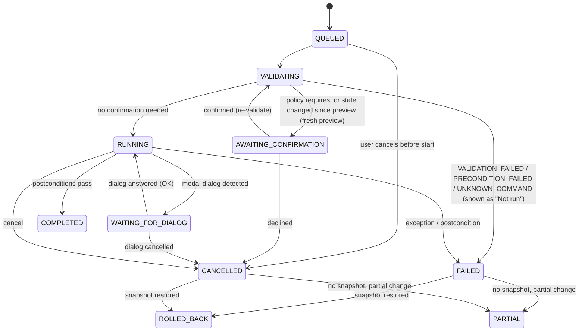

# D15 — Visual Feedback and Workflow Experience

## Executive Summary

This document defines how real processing is represented in the workspace. Every visible state is driven by an engine signal: a lifecycle event or `StateDigest` (IF-02), a `HistoryRecord` (IF-05), or a real counter. A state with no such signal is not shown (D11 UXP-06; NFR-USE-002).

It specifies:

- the mapping of the operation lifecycle (`QUEUED → VALIDATING → AWAITING_CONFIRMATION → RUNNING → (WAITING_FOR_DIALOG) → COMPLETED | FAILED | CANCELLED | ROLLED_BACK | PARTIAL`) to UI treatments (§2);
- the engine start-up and loss states (§3);
- progress truthfulness, following A20's four classes (§4);
- previews (§5);
- **before/after comparison as a live viewer mode on real documents and snapshots**, never static pictures (§6);
- warnings (§7) and errors for every engine error code (§8);
- undo and redo affordances (§9);
- observed actions from legacy windows (§10).

§11 lists the forbidden fake states, which serve as review gates. Provisional on DEC-010.

## Purpose and Scope

**In scope:** visual treatment and user actions for every lifecycle, engine, digest and history event.

**Out of scope:**

| Topic | Owner |
|---|---|
| Event contracts | D09 |
| Error-handling logic and recovery internals | D17 |
| Component anatomy | D14 |

## Sources and Evidence

| Source | Use |
|---|---|
| A20 §1–§3 | Observable versus unobservable signals; truthfulness classes; what can be shown per operation (**VERIFIED** signals, P31/P32/P80/P83) |
| A19 §1, §3–§6 | Cancellation semantics (`PlugInFilterRunner` checks Esc between slices, `#L161-L200`); consequence classes; undo model; transactional execution |
| A18 F4, §3 | `IJ.run` swallows exceptions; digest-driven refresh |
| A23 | Snapshot memory cost; heap budget |
| P85 | Engine start 4.5–5.3 s to IJ1 ready (**VERIFIED**) |
| P60 | Warm transcription 0.18–0.21 s (**VERIFIED**) |
| F02 | Prototype anti-patterns: polling timeline, static stage previews |
| Brief engine contract | Lifecycle states, error codes, `OperationId`, `StateDigest`, `HistoryRecord` |

## 1. Signal sources

| Signal (IF) | Drives | Truthfulness class (A20 §1) |
|---|---|---|
| Lifecycle event with `OperationId` (IF-02) | Activity slot, History row state, form and sheet state, document markers | Stage-based / indeterminate |
| Progress `(i, n)` from the chained legacy hook (NFR-REL-004, if validated), or from the product's own slice or file loop | Determinate bar | Determinate |
| `StateDigest` (IF-02) | View refresh (D13 R-3), Results and ROI lists, globals table, "observed change" entries | After the fact |
| Observed action (`CommandListener`, module events) | History "observed" entries, toasts | Observed |
| Engine state (CMP-50/CMP-20) | UI-19, status slot 5 | Stage-based |
| Speech worker state (CMP-43) | C-11 | Stage-based / indeterminate |

## 2. Lifecycle event → visual treatment → requirement

UI labels follow D11 T-06. "Activity" is status slot 2 (UI-12). "Doc" means the target document's tab, target strip and banner.

| Lifecycle event | Activity slot | History row (UI-10) | Doc and originating component | User actions | Requirement |
|---|---|---|---|---|---|
| **QUEUED** | "Queued: <label> (<doc>)", position in queue if > 1 (`queuePosition`, D09 §3), `state.neutral` | A row appears with the step number and "Queued" | Form or sheet: busy, inputs locked. The document is not marked yet. | Cancel (removes from the queue; becomes CANCELLED with no effect) | NFR-REL-005, FR-SYS-004 |
| **VALIDATING** | "Checking: <label>" | "Checking" | — | Cancel | FR-PROC-004, FR-NL-002 |
| → `VALIDATION_FAILED` / `PRECONDITION_FAILED` / `UNKNOWN_COMMAND` | Cleared | Row outcome "Not run: <reason>" (`state.error`). No macro line, because nothing executed. | Form: error state at the field or header (D14 F-11). Sheet: refused. | Edit and resubmit; run the offered preparatory command | FR-PROC-004, FR-CMD-003 |
| **AWAITING_CONFIRMATION** (`CONFIRMATION_REQUIRED`, `CAPABILITY_CONFIRMATION_REQUIRED`) | "Needs confirmation: <label>", `state.attention` | "Needs confirmation" | C-08 sheet (V1/V3/V4) or C-03 inline AC4 (F-12) | Confirm (consequence-named) / Cancel | FR-NL-004, FR-HIST-005, FR-MACRO-002, FR-IMG-006, FR-IMG-009 |
| **RUNNING** | "Running: <label> (<doc>)" plus the C-10 indicator: determinate only with a counter source; stage-based for plans and replays; otherwise indeterminate with real elapsed time. Cancel button, with a tooltip on cancellation semantics. | "Running" plus elapsed time | Doc: target strip "Updating…"; viewer raster **stale** (D13 §2.3); read-out suffix "(before current operation)" (D13 §4.3); the document's tools are locked. Other documents stay interactive (NFR-PERF-006). | Cancel / Esc (K-02) | NFR-USE-002, FR-PROC-013, NFR-PERF-006 |
| **WAITING_FOR_DIALOG** (`DIALOG_PENDING`) | "Waiting for Fiji dialog", `state.attention` | "Waiting for Fiji dialog: <title>" | C-09 workspace banner; UI-16 modal row; status slot 3 | Bring to front; answer in the dialog | FR-PROC-007 |
| **COMPLETED** (postconditions passed) | "Done: <label> (<doc>) <duration>", `state.success`, until the next event | Outcome "Done", duration, exact macro line or "not macro-expressible" | Viewer re-renders from the digest; markers update (`*` unsaved); Results and ROI lists update and new rows are marked (D14 §4.4) | Undo (if a snapshot exists); Compare with previous state (§6) | FR-PROC-005, FR-HIST-001, FR-HIST-003 |
| `TIMEOUT` advisory (operation still RUNNING, D06 §6) | "<label> has run for <elapsed> with no progress reported", `state.attention`, with Cancel, Keep waiting and Restart engine (D17 §3.10) | "Running" plus elapsed time | Target document marked "state unknown until the operation ends" | Cancel; keep waiting; restart engine | NFR-REL-001, FR-PROC-013 |
| **FAILED** (`EXECUTION_FAILED`, `POSTCONDITION_FAILED`, `IO_ERROR`) | "Failed: <label>", `state.error`; persists until the next operation **or** dismissal | Outcome "Failed: <code>", with the captured exception text or log excerpt linked to UI-20 | If a snapshot existed, it is restored → ROLLED_BACK row. Otherwise a document banner states what may have changed (digest delta). | Show log; retry (opens the form with the same values); Undo if applicable | FR-PROC-005, NFR-REL-001, FR-HIST-006 |
| **CANCELLED** | "Cancelled: <label>" | Outcome "Cancelled" | If nothing changed (digest shows no delta): no document marker. Otherwise → ROLLED_BACK or PARTIAL. | — | FR-PROC-013 |
| **ROLLED_BACK** | "Restored: <doc> to the state before <label>" | Outcome "Cancelled — restored" or "Failed — restored" | Document banner "Restored to the state before <label> (step n)", informational and dismissible | Show log (for failure) | FR-HIST-006 |
| **PARTIAL** (`PARTIAL_RESULT`) | "Partial: <label>", `state.warning` | Outcome "Partial: slices <a>–<b> of <N> modified" (range when known) | Persistent document banner, tab marker "partial" (text glyph), C-13 marker. It remains until undo, revert or close. | Undo (if possible); Revert (`File>Revert`); keep | FR-HIST-006; A19 §1 |
| Digest received after an action | — | Row detail updated (globals delta, Results delta) | View refresh (D13 R-3) | — | NFR-REL-005 |

The states and transitions are exactly the canonical lifecycle in D06 §6 (Phase 8 alignment):



The UI applies **only** the transitions reported by the engine. It never infers COMPLETED from elapsed time, from the absence of errors, or from `imageUpdated` alone (A18 F4; A20 R-A20-02).

## 3. Engine start-up, loss and recovery (UI-19)

| Engine state | Shown as (UI-19 and status slot 5) | Commands | Requirement |
|---|---|---|---|
| (JVM start, before the Context) | Not shown by the product: the Fiji/Jaunch splash screen covers this phase (D03 §3). The product UI is a SciJava `UserInterface` and cannot exist yet. | — | FR-SYS-006 |
| INITIALISING | UI-19 appears as soon as the Context and legacy layer are up (D03 §3). Phase lines are added only as real checks pass: legacy active (`LegacyService.isActive`, FR-SYS-002), self-test, listeners registered. Real elapsed time. | Refused: `ENGINE_NOT_READY`, with "Fiji is starting; commands run when it is ready" | FR-SYS-006, FR-SYS-002 |
| BUILDING_CATALOGUE | Phase line "Loading Fiji commands…"; menus show the same (D14 §4.1) | Refused as above | FR-SYS-006 |
| READY | UI-19 is replaced by the workspace. Slot 5: "Engine: ready". A version-mismatch banner appears if FR-SYS-010 detects one. | Accepted | FR-SYS-006, FR-SYS-010 |
| FAILED (start-up) | UI-19 failure: which check failed, the log excerpt, and the actions "Show log" and "Quit". No retry loop is hidden behind a spinner. | — | FR-SYS-002, FR-SYS-006 |
| QUITTING | Quit dialog progress: documents closing, prefs saved, journal closed (D03 §6) | Refused | FR-SYS-005 |
| Engine lost (`ENGINE_LOST`: crash, plugin `System.exit`) | **Not shown in the same session**: under O2 the UI shares the JVM and is lost with it (D17 §3.11). Recovery is offered at the next start from the journal (J-13): UI-19 states the cause if known and what replay can restore. The only in-session cases are the `TIMEOUT` advisory, Cancel, and the controlled restart-with-replay (RA-RS, D03 §7), whose last in-session message is "Restarting Fiji; the session will be rebuilt by replay". | Refused | FR-SYS-007 |
| Replaying (start-up recovery) | UI-19 replay view: stage-based "Replaying step k of n: <label>", with each step's outcome. At the end it states exactly what was and was not recovered. It never says "fully recovered" unless replay reproduced every step (A19 §6.4). | Refused until done | FR-SYS-007 |

- **No percentage bar during start-up.** No counter exists; P85 measured 4.5–5.3 s to IJ1 ready.
- **Elapsed time is shown** because it is real.

## 4. Progress truthfulness

| Class (A20 §1) | When | Visual (C-10) | Accessible value |
|---|---|---|---|
| **Determinate** | A counter exists: `showProgress(i,n)` via the chained hook, **only if** NFR-REL-004 validation passes; or the product's own loops (batch over files, per-slice replay) | Filling bar plus "i / n" (slices, files). The unit is always named. | Numeric value |
| **Stage-based** | Plans, replays, multi-step recovery | "Step k of n: <label>"; a step list in C-08 or UI-19 | "Step k of n" |
| **Indeterminate (honest)** | 2D filter passes, plugins without progress, IJ2 modules without status, NL interpretation, transcription | Minimal non-filling cue, "Running" and real elapsed seconds | "Running, no progress measure, <n> s" |
| **Observed** | Actions outside product control | No progress. A History entry appears after the fact (§10). | — |

**Rules:**

- **P-01.** No percentage, bar fill or ETA without a counter (NFR-USE-002). This holds even where a duration could be predicted from history.
- **P-02.** If NFR-REL-004 validation fails, stack filters show indeterminate progress, and the cancel tooltip says "per-slice progress is not available for this command" (NFR-REL-004 fallback text).
- **P-03.** Each progress display is scoped to one `OperationId` and labelled with its command and document. There is no global "busy" overlay. Other documents remain usable (NFR-PERF-006).
- **P-04.** Status text from `IJ.showStatus`, when captured by the hook, is shown in the activity slot's secondary line, prefixed by the command label. It never replaces the read-out slot (D11 §3.2).

## 5. Previews

| Preview kind | Mechanism | Visual | Recorded? | Requirement |
|---|---|---|---|---|
| Filter preview (commands with IJ1 preview: Gaussian, Median, Subtract Background, …) | The engine computes it on a **copy** of the current plane on the engine worker (`previewFilter`, D09 §4; FR-PROC-010); the viewer displays the copy's rendering | Viewer label "Preview — not applied" (`state.preview`, dashed frame outside the image bounds); target strip "Preview: <label> <params>"; read-out shows preview values with the suffix "(preview)" | No | FR-PROC-010 |
| Display preview (B&C, channels, LUT) | Display state only (AC1); the actual state is changed, so there is no "preview" label | "DISPLAY ONLY" header (D13 §9.1) | Yes, as AC1 macro equivalents | FR-PROC-014, FR-HIST-003 |
| Threshold preview | IJ1 threshold LUT (display state) | Threshold panel header "Preview — pixels unchanged until Apply" | The threshold call is recorded; Apply is separate | FR-PROC-015 |
| Plan preview | C-08 V1 (text and parameters, not pixels) | — | No (until Run) | FR-NL-004 |

**Rules:**

- **Lifetime.** A filter preview ends on Cancel, on form close or on any parameter change, which recomputes it. The image hash is unchanged throughout (FR-PROC-010 acceptance).
- **Errors.** A failing preview shows the error on the preview toggle and never touches the document.
- **Stacks.** Previews of stacks show the current plane only, matching IJ1 `PlugInFilterRunner` preview. The label says "current plane".

## 6. Before/after comparison: a live viewer mode

Comparison is a **mode of the viewer on real data**. It is not a static picture (D11 AP-03). Both sides are rendered by the same IJ1 rendering path (FR-VIEW-001). They support zoom, pan, C/Z/T navigation and read-out (FR-VIEW-003/004).

### 6.1 Sources of "before"

| Source | Availability | Label |
|---|---|---|
| **Snapshot**: the pre-action state held by the undo manager (CMP-28) for an AC3 step, rendered through `renderSnapshot` (D09 §4) | Only for steps that have a snapshot (not AC4; not evicted from the budget) | "Before step n: <label> (snapshot)" |
| **Source document**: the input of a step that created a new document (for example the original versus the `Convert to Mask` output, or raw versus `Z Project`) | While both documents are open | "<source title> (id) → <result title> (id)" |
| **Any two open documents** | Always | Their titles |

### 6.2 Layouts

| Layout | Behaviour | Keys |
|---|---|---|
| Side by side | Two panes, linked zoom, pan and position (D12 §7 linking) | Ctrl+Alt+C toggles comparison (reserved space) |
| Flip (A/B) | One pane. A key or button switches between before and after at the same view. The label always states which is shown. | Ctrl+Alt+B flips |

A difference image is **not** computed by the UI. If the user wants one, the comparison toolbar offers `Image Calculator...` with `Difference` and both images pre-filled. That runs as a real, recorded command producing a new document (FR-PROC-001 spirit, FR-PROC-008).

### 6.3 Display and read-out

- **Shared display range by default.** Both sides use the **same** display range and LUT by default, so visible differences reflect data rather than display (UP-07). A toggle "use each image's own display" is labelled.
- **Read-out.** It shows both values: "before value=<v> | after value=<v>", each formatted by the D13 §4.2 rules.

### 6.4 State

- Comparison is AC0 (read-only) and is not recorded.
- Snapshot sides are read-only. Tools are disabled on them, with the reason "snapshot".
- Exiting comparison restores the previous layout.
- If the snapshot is evicted while it is shown (budget), the side shows "Snapshot no longer available".
- Requirements: FR-VIEW-001, FR-VIEW-003, FR-VIEW-004, FR-HIST-004. No requirement asks for comparison explicitly (GAP-D15-01).

```
functional wireframe — not a visual design
+-------------------------------------------+-------------------------------------------+
| BEFORE step 4: Subtract Background...     | AFTER  step 4  cells.tif (id 4)           |
|  (snapshot, read-only)       [linked ⇄]   |                                           |
| 512x512 pixels; 16-bit; 512K   zoom 200%  | 512x512 pixels; 16-bit; 512K   zoom 200%  |
|                                           |                                           |
|            IMAGE (snapshot)               |            IMAGE (current)                |
|                                           |                                           |
+-------------------------------------------+-------------------------------------------+
| Display: shared range 120-3400 [use own]  [Flip A/B]  [Image Calculator... Difference]  [Exit] |
+-----------------------------------------------------------------------------------------------+
| x=210, y=96, before value=1288 | after value=402 | ...                                         |
+-----------------------------------------------------------------------------------------------+
```

## 7. Warnings (before execution)

Warnings appear **before** execution, inline in the originating form or sheet. A warning blocks execution only when a confirmation is required.

| Condition | Treatment | Blocking? | Requirement |
|---|---|---|---|
| Convert to Mask, Analyze Particles or a binary operation with no threshold or foreground definition | Inline: "No threshold set: Fiji will choose one automatically (method Default)." Offer: "Set threshold first" (opens UI-15) | No: inline and non-blocking, shown before OK/Apply (A26 §14 C5; NFR-USE-001). In an NL plan it appears in the plan preview. | FR-PROC-016 |
| Snapshot over budget, or a virtual stack (AC4) | Inline: "Cannot be undone: needs <N> MB, budget <M> MB" (D14 F-12) | Confirmation | FR-HIST-005 |
| Lossy save | C-08 V3 loss list | Confirmation | FR-IMG-006 |
| Save over a session input | C-08 V3 per-document decision | Confirmation | FR-IMG-009 |
| Conversion with display-range scaling | Inline: "Display range <a>–<b> will be mapped to 0–255 (Scale when converting: on)" | No | FR-VIEW-006 |
| A result-affecting global differs from the Fiji default | Globals section, `state.warning` plus "differs from Fiji default" | No | FR-MEAS-002 |
| Macro with dangerous functions | C-08 V4 named confirmations | Confirmation | FR-MACRO-002 |
| Shadowed or duplicate label | Palette and menu marker; the form header names the class that will run | No | FR-CMD-004 |
| Point ROI position loss on `.roi` save | ROI list flag before Save | No | FR-ROI-006 |
| Image larger than the configured heap fraction (from metadata) | Before loading: "Estimated <N> GB; available <M> GB. Open as virtual stack?" | Confirmation | FR-IMG-010 |
| Host Fiji version mismatch | Workspace banner at start-up, listing the components | No | FR-SYS-010 |

## 8. Errors (engine error codes)

Every error message names three things:

1. **what** failed: the exact label and the document;
2. **why**: the code and the required state, or the log excerpt;
3. **what state remains**: unchanged, restored, partial, or unknown.

Errors are never auto-dismissed (D14 §4.7).

| Code | Where shown | Message template (provisional wording) | Recovery actions | Requirement |
|---|---|---|---|---|
| `ENGINE_NOT_READY` | Originating control; slot 5 | "Fiji is still starting. <label> was not run." | Retry when ready (the button enables at READY) | FR-SYS-006 |
| `UNKNOWN_COMMAND` | Palette or sheet | "No Fiji command '<label>' in this installation." | Nearest commands | FR-CMD-003 |
| `VALIDATION_FAILED` | Form field or sheet step | "<field label> (<key>): <value> is outside <range>." | Edit | FR-NL-002, FR-PROC-003 |
| `PRECONDITION_FAILED` | Form header or sheet | "<label> needs <required state> (for example an 8-bit binary image); <doc> is <actual state>." | Offer the preparatory command as a separate step | FR-PROC-004 |
| `CONFIRMATION_REQUIRED` | Sheet or inline | (Not an error: AWAITING_CONFIRMATION, §2) | Confirm / Cancel | FR-NL-004, FR-HIST-005 |
| `CAPABILITY_CONFIRMATION_REQUIRED` | C-08 V4 | (Not an error: §2) | Named confirmations | FR-MACRO-002 |
| `DIALOG_PENDING` | C-09 | (Not an error: WAITING_FOR_DIALOG) | Bring to front | FR-PROC-007 |
| `EXECUTION_FAILED` | Activity, History, Log | "<label> on <doc> failed. Fiji reported: <first line of the captured exception text or log>." | Show log; retry; Undo/restored note | FR-PROC-005, NFR-REL-001 |
| `POSTCONDITION_FAILED` | Same | "<label> finished but <expected effect> did not occur (for example no output image, no Results rows)." | Show log; inspect digest delta | FR-PROC-005 |
| `CANCELLED` | Activity, History | "Cancelled: <label>." Plus the state note (§2) | — | FR-PROC-013 |
| `PARTIAL_RESULT` | Document banner, History | "<label> stopped after slices <a>–<b> of <N>; these are modified." | Undo if possible; Revert | FR-HIST-006 |
| `TIMEOUT` | Activity, History | "<label> did not finish within <bound>; it may still be running in Fiji." State unknown until the digest. | Wait; cancel; show log | NFR-REL-001 |
| `ENGINE_LOST` | Workspace banner, UI-19 | §3 | Recover by replay | FR-SYS-007 |
| `SNAPSHOT_BUDGET_EXCEEDED` | Inline (pre-execution) | Converted to the AC4 warning (§7). If raised during execution: "Undo snapshot could not be stored; this step cannot be undone." | Continue or cancel | FR-HIST-005, NFR-PERF-003 |
| `IO_ERROR` | Activity, History | "Could not read/write <path>: <OS message>." Paths are shown only in the UI, never logged absolutely (NFR-PRIV-002). | Choose another path | FR-IMG-003/005 |
| `UNSUPPORTED_IN_MODE` | Form or sheet | "<label> cannot run in <mode> (for example headless batch); it needs the GUI-capable engine." | Run in the interactive engine | FR-PROC-009 |

## 9. Undo and redo affordances (FR-HIST-004…006)

| Element | Specification | Requirement |
|---|---|---|
| Scope | Per document, independent of the IJ1 `Undo` slot. Not reset when switching documents. | FR-HIST-004 |
| Invocation | `Edit>Undo` (label unchanged) and `z`/Ctrl+Z with document focus, rebound to product undo (D12 §5.3). **Redo**: a *Workspace* menu item, the History button and Ctrl+Alt+Z. IJ1 Ctrl+Shift+Z is *Channels Tool* and Ctrl+Y is *Selection Properties*, so neither is used (D11 §5). | FR-HIST-004, FR-CMD-007 |
| Feedback after undo | A brief activity line "Undone: <label> (step n) on <doc>". The document re-renders from the restored state (a real digest). The History row shows "Undone". | FR-HIST-004 |
| Redo | Re-executes the recorded action (A19 §5), so it goes through the **normal lifecycle** (§2), with real progress and possible failure. It is never shown as instantaneous restoration. | FR-HIST-004 |
| Unavailable undo | The tooltip and History row give the reason: "Step 3 cannot be undone: snapshot over budget (AC4)", "observed action: no snapshot", or "virtual stack" | FR-HIST-005 |
| ROI undo | AC2 ROI history has the same affordance with a lightweight snapshot; the label is "Undo selection change" | FR-HIST-004 |
| Budget meter | Status slot 4: "Undo <depth> · <used>/<budget>". Clicking opens UI-17 (budget setting). It reaches `state.warning` when the next likely snapshot would not fit. | NFR-PERF-003 |
| Rollback on cancel or failure | ROLLED_BACK treatment (§2) | FR-HIST-006 |

## 10. Observed actions from legacy windows (FR-HIST-008)

| Observation | History entry | Other feedback | Requirement |
|---|---|---|---|
| A command observed via `CommandListener` (a legacy plugin window, the Fiji menu inside a plugin, a user macro) | `state.external` "Observed: <label>" with captured options, or "options unavailable". Nested under the code action or the Fiji-window step. | Toast "Observed in <window>: <label>" (also in History) | FR-HIST-008 |
| A module run observed via SciJava module events | Same, with inputs where available | Same | FR-HIST-008 |
| A pixel or overlay change in the digest with no product action | "Observed change: pixels/overlay of <doc> changed (parameters unknown)" | Document re-renders; tab marker `*` | FR-HIST-008 |
| A global change from a legacy dialog, plugin or macro | "Setting changed: <name> <old> → <new> (by <source>)" | UI-17 updates; affected forms' globals sections update | FR-HIST-007 |
| A legacy window opened or closed | "Fiji window opened: <title>" / "closed" | UI-16 count | FR-PLUG-001, FR-PLUG-002 |

Observed entries carry the **partial-provenance label** wherever parameters are incomplete. The exported macro includes an observed command only where its options were captured exactly. Otherwise it emits a comment naming the gap; it never approximates (FR-HIST-002 "never fabricate options").

## 11. Forbidden fake states (review gates)

| ID | Forbidden | Why | Check |
|---|---|---|---|
| FS-01 | Percentage, bar fill or ETA without a counter source | NFR-USE-002 | The C-10 rejects-without-counter test |
| FS-02 | Showing Done before postconditions pass, or inferring completion from time or `imageUpdated` alone | FR-PROC-005; A18 F4 | Event-sequence test (NFR-REL-005) |
| FS-03 | Static or pre-rendered before/after images | D11 AP-03; FR-VIEW-001 | UI review |
| FS-04 | Timeline or history entries composed by the UI rather than from `HistoryRecord`s and IF-02 events | D11 AP-04 | Inspection: History is backed only by IF-05 |
| FS-05 | Decorative or "thinking" animations during NL interpretation, transcription or start-up; typing-effect text | NFR-USE-002; D11 A-07 | UI review |
| FS-06 | Optimistic rendering of scientific results (drawing an expected result before the digest) | FR-IMG-001 | Inspection. ROI pending outlines are explicitly marked provisional (D13 §10.5). |
| FS-07 | Claiming full recovery after replay unless every step was reproduced | FR-SYS-007; A19 §6.4 | Recovery test |
| FS-08 | Hiding a legacy window that the user opened, or that a plugin opened for interaction, or presenting it as embedded. (Windows with a workspace equivalent, such as the Results `TextWindow` and the ROI Manager singleton, are hidden by policy; Histogram and Plot windows stay visible and tracked; D04 §3.) | FR-PLUG-001/002; D11 UXP-14 | Tracker test |
| FS-09 | Auto-dismissing errors, or showing information only in a toast | D14 §4.7 | UI review |
| FS-10 | A cancel affordance that does nothing, or implies instant stop where cancellation is cooperative | FR-PROC-013; A19 §1 | Cancel tooltip per family |
| FS-11 | Approximate macro text for actions without an exact equivalent | FR-HIST-002/003 | E7 replay; inspection |
| FS-12 | Inert placeholder controls for deferred features (animation, macro tools) | D13 §6.1; PAR-049 | UI review |

## Constraints and Limitations

- **Per-slice progress** depends on the NFR-REL-004 hook-chaining validation. Without it, stack filters are indeterminate.
- **`TIMEOUT` advisory.** After a timeout, the true state is unknown until a digest can be computed. The UI states this rather than guessing.
- **Comparison** requires snapshots (budget-bound) or open source documents. AC4 steps have no "before" view.

## Requirement gaps

| ID | Gap | Candidate requirement |
|---|---|---|
| GAP-D15-01 | No FR requires before/after comparison | "The viewer shall compare a document with its pre-step snapshot or source document as a live, navigable view using IJ1 rendering." |
| GAP-D15-02 | No FR states that the UI must not report completion before postconditions. It is implied by FR-PROC-005 but not stated for the UI. | Add to NFR-USE-002 acceptance |
| GAP-D15-03 | No FR defines what the UI shows after `TIMEOUT` | "After a timeout, the UI shall mark the target document's state as unknown until a digest is received." |
| GAP-D15-04 | No requirement covers recovery-completeness wording | Covered in spirit by FR-SYS-007 ("stating which unsaved changes are lost"); keep as an acceptance detail |

## Decisions proposed

| ID | Decision | One-line rationale |
|---|---|---|
| DP-D15-01 | Map the lifecycle 1:1 to plain labels (D11 T-06); render only engine-reported transitions | NFR-USE-002; NFR-REL-005 |
| DP-D15-02 | Comparison is a viewer mode on snapshots or source documents with a shared display range by default; difference images only via `Image Calculator...` | FR-VIEW-001; no UI-side computation (FR-PROC-001 spirit) |
| DP-D15-03 | Redo is shown as a normal re-execution with full lifecycle feedback | A19 §5 (redo re-executes); truthfulness |
| DP-D15-04 | Errors always state what, why and the remaining state, and are never auto-dismissed | FR-PROC-005, CR-A20-07 |
| DP-D15-05 | Adopt FS-01…FS-12 as UI review and test gates | NFR-USE-002; brief §1.4 |

## References

- A18 F4, §1, §3; A19 §1, §3–§6; A20 §1–§3; A23; A26; A27; P60; P80; P83; P85; F02 §Frontend.
- D01 (CMP-08, CMP-09, CMP-10, CMP-11, CMP-20, CMP-25, CMP-26, CMP-27, CMP-28, CMP-50; IF-02, IF-03, IF-05); D11; D12; D13; D14.
- `imagej/ImageJ@v1.54p` (03382be1): `ij/plugin/filter/PlugInFilterRunner.java#L124-L200`, `ij/Executer.java#L74-L117`, `ij/IJ.java#L774-L785` (showProgress).
- `imagej/ij1-patcher@ij1-patcher-2.0.0` (70e570dc): `LegacyInjector.java#L177-L185, L443-L451`; `imagej/imagej-legacy@imagej-legacy-3.0.0` (fc31a563): `DefaultLegacyHooks.java`.

## Change log

- 2026-10-17: Phase 8 review fixes (findings #3, #5, #7, #10, #11, #13, #22).
