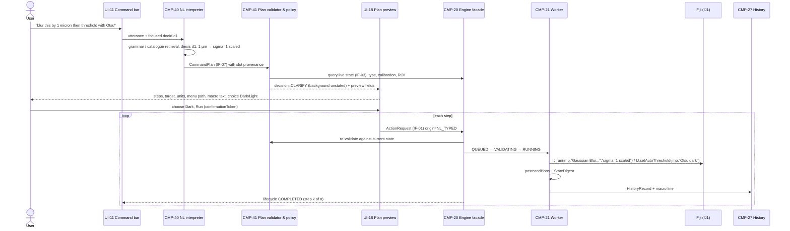
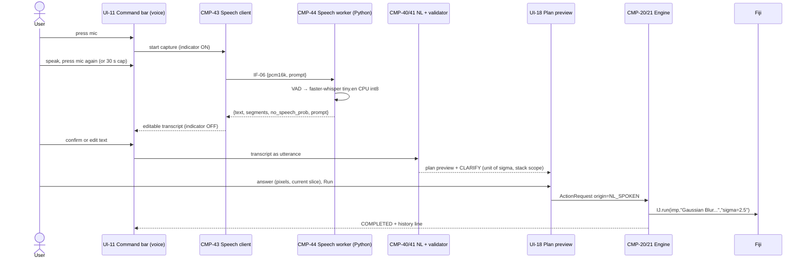
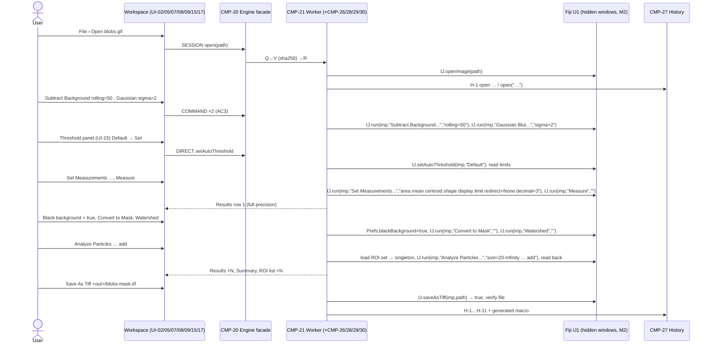

# D16 — End-to-End User Journeys

## Executive Summary

This document specifies the fourteen end-to-end journeys J-01…J-14 that other design documents reference. Each journey is written as a sequence of steps. For every step it states what the user does; what the system does (UI surface UI-xx, engine route R1–R4, `ActionRequest` kind, lifecycle states shown); the Fiji command and option keys actually invoked; and the history entry and macro line produced. Each journey also lists its preconditions, postconditions, failure branches (error codes defined in D17), the requirements it covers, and how it is verified (A30 dimensions E1–E9, fixtures from `docs/data/datasets.csv`, rows of `docs/data/verification-coverage.csv`).

Design content is **PROPOSED** and provisional on DEC-010. Facts about Fiji cite analysis documents or the pinned source. Option keys come from `commands-core-parameters.csv`. Where a key comes only from a naming rule and has not been probed (the Bio-Formats importer keys), it is tagged **INFERRED**.

J-12 is the MVP acceptance journey. It uses exactly the ten commands of A31 §3 on FX-003 (Blobs) and FX-030 (BBBC001, cache-only, CC BY-NC-SA 3.0). Its reference execution must run in **GUI-mode** Fiji, because `Analyze Particles...` with `add` fails headless (A08 op 11).

## Purpose and Scope

**In scope:** user-visible behaviour from first action to result. Every journey is traced to FR/NFR IDs and to verification.

**Out of scope:**
- visual design (D12–D15);
- engine contracts (D06/D09);
- the error taxonomy, which this document references by code (D17);
- test mechanics (D18).

D12 owns the UI surfaces UI-01…UI-20. This document uses them only by ID.

## 1. Conventions

| Item | Convention |
|---|---|
| Step table columns | **#**. **User action**. **System response**: UI surface, route (R1 `IJ.run(imp,label,options)`; R2 module; R3 direct API; R4 macro/script, as defined in A18/D04), `ActionRequest.kind`, consequence class (A19 §3), and lifecycle states shown on UI-12. **Fiji invocation**: exact label and option string. **History / macro line**: the `HistoryRecord` summary and the macro line the CMP-27 generator emits. |
| Option strings | Keys are as in `commands-core-parameters.csv`. Value keys are always emitted. Boolean keys follow IJ1 macro semantics: present means true and absent means false (`commands-core-parameters.csv` "present=true; absent=false in macro mode"). The generator decides **every** schema key explicitly (FR-PROC-003) and never relies on a remembered static value. |
| Lifecycle | `QUEUED → VALIDATING → (AWAITING_CONFIRMATION) → RUNNING → (WAITING_FOR_DIALOG) → COMPLETED / FAILED / CANCELLED / ROLLED_BACK / PARTIAL`: the canonical lifecycle in D06 §6. For brevity a step that passes straight through is written `Q→V→R→C`. |
| Paths | Macro lines show `<in>/…` and `<out>/…` placeholders. Generated macros contain absolute, escaped paths (FR-MACRO-006). Logs and manifests store project-relative or hashed paths (NFR-PRIV-002). |
| Record IDs | `H-n` is the n-th `HistoryRecord` of the session (FR-HIST-001). |
| Origin | `origin` is the `ActionRequest` modality, using the D06 §2 enum verbatim: `MENU`, `SEARCH`, `SHORTCUT`, `CANVAS`, `PANEL`, `NL_TYPED`, `NL_SPOKEN`, `MACRO`, `REPLAY`, `OBSERVED`. |
| Macro lines | Generated per D07 G1–G11: globals block first, `idN = getImageID()` after each image-creating step, `selectImage(idN)` before every step, ROIs per G5 (rectangles and ovals through `makeRectangle`/`makeOval` with doubles; non-integer polygons through `makeSelection`), ROI-list entries inline (G11). The J-06 example shows a complete generated macro. |
| Tags | Each journey's design is PROPOSED unless a step is tagged otherwise. |

### 1.1 Common preconditions (apply to every journey)

| ID | Precondition | Requirement |
|---|---|---|
| PC-1 | The product has been launched through its launch mode, with the bundled Zulu 21 and `-Dimagej.updater.disableAutocheck=true` (D03 §2, D19). | FR-SYS-008, NFR-PLAT-003 |
| PC-2 | The Fiji splash screen covered the JVM start, then UI-19 has shown `INITIALISING → BUILDING_CATALOGUE → READY` (D03 §3). Any action submitted earlier is rejected with `ENGINE_NOT_READY` (D17 §3.1). | FR-SYS-006 |
| PC-3 | The Fiji JVM is non-headless, `LegacyService` is active and the Fiji main frame is hidden (start-up self-test). | FR-SYS-001, FR-SYS-002 |
| PC-4 | Fixtures that are not redistributable (FX-003, FX-030) come from the git-ignored cache and are verified by SHA-256 before use (D18 §5). | NFR-PKG-007, NFR-MAINT-002 |

## 2. Journey index

| ID | Journey | Tier | Persona (A02) | Main routes | Key requirements | Verification (summary) |
|---|---|---|---|---|---|---|
| J-01 | Import a microscopy image (TIFF; OME-TIFF via Bio-Formats importer) | MVP (TIFF); HACK (Bio-Formats) | PER-2 | R3, R1 | FR-IMG-003, FR-IMG-004, FR-VIEW-001/002 | L2 E1/E3 on FX-005, FX-075, FX-040/041 |
| J-02 | Adjust display: B&C, channels, LUT; explicit Apply | HACK | PER-1, PER-2 | R3, R1 | FR-PROC-014, FR-VIEW-006 | L2 T (hash unchanged), E1 (Apply) on FX-005, FX-013 |
| J-03 | Create and edit ROIs; ROI list | MVP | PER-2 | R3 | FR-ROI-001…005, FR-HIST-003/004 | L2 E4 on FX-077, FX-003 |
| J-04 | Measure selected regions | MVP | PER-2, PER-5 | R1 | FR-MEAS-001…005 | L2 E5/E6 on FX-077, FX-003 |
| J-05 | Execute an existing Fiji macro (capability confirmation) | MVP | PER-4 | R4 | FR-MACRO-001…003, 005 | L2 E1/E3/E5 on FX-051/052 subset |
| J-06 | Record; export and replay as a macro | MVP | PER-3, PER-4 | all; R4 replay | FR-HIST-001/002/009/010 | L3 E7 on FX-003 |
| J-07 | Typed natural-language instruction | MVP | PER-1, PER-5 | NL → R1 | FR-NL-001…009 | L5 E8; L2 E1 on FX-077 |
| J-08 | Spoken instruction | MVP | PER-1 | speech → NL → R1 | FR-SPEECH-001…007 | L5 E8 on FX-002/FX-060 |
| J-09 | Stack processing with progress, cancel and undo budget | HACK | PER-2 | R1 | FR-PROC-013, FR-HIST-004…006 | L2 T on FX-006, FX-005 |
| J-10 | Legacy plugin (TrackMate C4; Cell Counter C5) | HACK | PER-3 | R1 + legacy window | FR-PLUG-001/002, FR-HIST-008 | L3 D + E3/E6 |
| J-11 | Export images and measurement results | HACK | PER-2 | R3 | FR-IMG-005/006/009, FR-MEAS-003, FR-ROI-005 | L2 E1/E3/E4/E5 round trips |
| J-12 | Cell counting end to end with the MVP command set | MVP | PER-2 (PER-1 assisted) | R3, R1 | FR-PROC-001/003/015/016, FR-MEAS-001…004, FR-HIST-002 | L3 E1–E7 (GUI reference) + L4 E9 on FX-003, FX-030 |
| J-13 | Recover after an engine crash (replay) | PARITY | PER-2 | journal + R4 replay | FR-SYS-007 | L3 E1–E6 |
| J-14 | Apply a recorded workflow to a folder | PARITY | PER-2, PER-3 | R4 / M1 batch | FR-MACRO-007, FR-PROC-009 | L3 E1/E3/E5/E7 |

## 3. Journeys

### J-01 — Import a microscopy image

**Tier:** MVP (IJ1 TIFF routing); HACK (Bio-Formats importer). **Persona:** PER-2 (regular quantitative user; A02). **Addresses:** UP-08 (Bio-Formats option persistence) and UP-18 (dimension ambiguity) (A05).

**Preconditions:** PC-1…PC-4. A readable file exists.

**Steps — MVP (TIFF, `File › Open...`)**

| # | User action | System response | Fiji invocation | History / macro line |
|---|---|---|---|---|
| 1 | `File › Open...` (UI-02), or drag a file onto UI-04 | Native file chooser. The selection is converted into `ActionRequest{kind=SESSION, operation=OPEN, params{path}, origin=MENU}`. UI-12 shows `Q→V`. | — | — |
| 2 | — | VALIDATING: the path exists and is readable, and its SHA-256 is computed (FR-IMG-004). RUNNING: R3 on the engine worker (D04 §2 R3). | `IJ.openImage(path)` (`ij/IJ.java#L1982`), the same routing as `File › Open` including Bio-Formats delegation (FR-IMG-003; A14). `run("Open...")` is **not** used because it produces no `ImagePlus` headless (A08 op 30b); the macro form `open(path)` passes (op 30c). | — |
| 3 | — | Document registered (CMP-24, policy P-A show-then-hide, D04 §3). UI-04 gains a tab. UI-05 renders the plane through `getBufferedImage()` (FR-VIEW-001). The UI-05 subtitle shows C/Z/T, calibrated size, type, LUT inversion and memory (FR-VIEW-002). UI-06 shows C/Z/T sliders for hyperstacks. Lifecycle `C`. | — | `H-1 open docId=d1 path=<rel> sha256=… reader=IJ1 (or Bio-Formats formats-bsd/gpl) dims=W×H×C×Z×T type calibration units finterval` (FR-IMG-004). Macro: `open("<in>/hela-cells.tif"); id1 = getImageID();` |

**Steps — HACK (Bio-Formats importer for OME-TIFF)**

| # | User action | System response | Fiji invocation | History / macro line |
|---|---|---|---|---|
| 1 | `File › Import › Bio-Formats` (UI-02) | UI-07 shows a schema form for the importer: series, colour mode, view, stack order, autoscale, ROI import. No Bio-Formats dialog is shown (FR-IMG-003). | — | — |
| 2 | Chooses `color_mode=Default`, `view=Hyperstack`, `stack_order=XYCZT`, and **unticks** `autoscale`, then clicks Open | `ActionRequest{kind=COMMAND, commandId=ij1:Plugins>Bio-Formats>Bio-Formats Importer}`. R1 on the worker. `Q→V→R`. | `IJ.run(null-target, "Bio-Formats Importer", "open=[<in>/multi-channel-4D-series.ome.tif] color_mode=Default view=Hyperstack stack_order=XYCZT")`. Key names are **INFERRED** from `Macro.trimKey` applied to `importer-options.txt` (A14 §5) and must be confirmed in milestone 1 (gap G-D16-01). The plugin is GPL (`bio-formats_plugins`) and is invoked only by command string, never by class import (NFR-PKG-003; A24 Q-01). | — |
| 3 | — | The new `ImagePlus` is detected in the digest (new ID; D04 §3) and registered. The reader jar variant is recorded. `C`. | — | `H-1 open … reader=Bio-Formats formats-bsd-8.5.0` (FR-IMG-004, CR-A24-07). Macro: `run("Bio-Formats Importer", "open=[…] color_mode=Default view=Hyperstack stack_order=XYCZT"); id1 = getImageID();` |

**Postconditions:** one document is focused. Its provenance (path, SHA-256, reader, metadata) is in history. No pixel is modified. The input file is registered as a session input for the overwrite policy (FR-IMG-009).

**Failure branches**

| Condition | Code (D17) | User-visible treatment |
|---|---|---|
| Path missing, unreadable, zero-byte or truncated (FX-079) | `IO_ERROR` | UI-12 error with the path (relative) and the reader message. No document is created. |
| `IJ.openImage` returns `null` with no exception | `IO_ERROR` (D17 §3.15) | As above, plus the captured reader message |
| An importer key is missing or unrecognised, so a Bio-Formats dialog opens | `DIALOG_PENDING` | The native dialog is brought forward. UI-12 shows "waiting for input in a Fiji dialog" (FR-PROC-007). |
| Header implies a size above the configured heap fraction (FX-080) | PARITY only (FR-IMG-010): `CONFIRMATION_REQUIRED` | Offer a virtual stack, or cancel |

**Requirements:** FR-IMG-003, FR-IMG-004, FR-IMG-001, FR-IMG-002, FR-VIEW-001, FR-VIEW-002, FR-VIEW-004, FR-VIEW-005, FR-PLUG-002, FR-WS-001, NFR-PKG-003.

**Verification:**
- L2 E1/E3 of the product open against reference `open(path)` (GUI reference per DEC-043, because `ij1:File>Open...` has `headless_probe=fail`) on FX-001, FX-003, FX-005, FX-014, FX-070, FX-072 and FX-075;
- HACK: the importer against reference `run("Bio-Formats Importer", …)` on FX-040, FX-041, FX-044 and FX-045;
- history-field test on FX-001 and FX-040;
- subtitle test on FX-075 (FX-008 in the scheduled tier).

Coverage rows are the FR-IMG-003/004 and FR-VIEW-* rows of `verification-coverage.csv`.

### J-02 — Adjust display (B&C, channels, LUT) with explicit Apply

**Tier:** HACK. **Personas:** PER-1 and PER-2. **Addresses:** UP-07 (display adjustment conflated with data modification) and UP-06 (type conversion depends on display range) (A05).

**Preconditions:** J-01 completed on FX-005 (16-bit, 3-channel composite) or FX-013 (16-bit single channel).

| # | User action | System response | Fiji invocation | History / macro line |
|---|---|---|---|---|
| 1 | Drags the min/max sliders for channel 2 in UI-14 | Local preview while dragging. On release, one `ActionRequest{kind=DIRECT, params{c=2,min,max}}`, AC1. R3. `Q→V→R→C`. No confirmation (NFR-USE-001). UI-14 states "display only — pixel values unchanged" (FR-VIEW-006). | `CompositeImage.setDisplayRange(min,max)` on channel 2 (`ij/CompositeImage.java#L683`) after `imp.setPosition(2,z,t)` | `H-n display c=2 min=… max=…`. Macro: `selectImage(id1); Stack.setChannel(2); setMinAndMax(110, 2100);` |
| 2 | Switches the composite mode in UI-13 to *Composite* and the LUT of channel 1 to *Fire* | Mode change: DIRECT/R3, AC1. LUT: COMMAND/R1 `ij1:Image>Lookup Tables>Fire`, AC1. | `IJ.run(imp, "Fire", "")` | `selectImage(id1); Stack.setDisplayMode("composite");` / `selectImage(id1); run("Fire");` |
| 3 | Reads the warning next to **Apply** in UI-14 (FX-013) | UI-14 shows an inline warning before anything changes: "Apply rewrites pixel values to the current display range [min–max]; this changes data" (FR-PROC-014). It names the type and range. The warning is non-blocking: AC3 from a direct modality takes no confirmation step (A26 §14 C5, NFR-USE-001, D06 §4). | — | — |
| 4 | Clicks **Apply** | COMMAND/R1 `ij1:Image>Lookup Tables>Apply LUT`. Precondition: 8/16-bit or RGB, and the display range differs from the full range (`LutApplier.java#L19, L37`; commands.csv). `Q→V→R→C`. Snapshot taken (CMP-28). | `IJ.run(imp, "Apply LUT", "")`. On a stack the user's scope choice is explicit: `"stack"` is present or absent. | `H-n Apply LUT range=[110,2100]`. Macro: `selectImage(id1); setMinAndMax(110, 2100); run("Apply LUT");` |

**Postconditions:**
- After steps 1–2, the pixel hash is unchanged.
- After step 4, the pixels are changed, the action can be undone (FR-HIST-004), and the macro reproduces the result.

**Failure branches:**

| Condition | Code | Treatment |
|---|---|---|
| Apply on a 32-bit image, or with the display range equal to the full range | `PRECONDITION_FAILED` | Message in UI-14 explaining the condition |
| User does not press Apply after reading the warning | Nothing is submitted (no state change) | — |
| Snapshot exceeds the budget | `SNAPSHOT_BUDGET_EXCEEDED` → AC4 confirmation | — |

Applying a LUT to one channel of a multi-channel composite affects only the current channel (**UNKNOWN**; verify against `LutApplier` before HACK).

**Requirements:** FR-PROC-014, FR-VIEW-006, FR-VIEW-001, FR-HIST-003, FR-HIST-004, NFR-USE-001, FR-WS-001.

**Verification:**
- L2 T: the pixel hash is unchanged after B&C, mode and LUT changes (FX-005).
- L2 E1/E3: Apply against a reference `setMinAndMax(a,b); run("Apply LUT")` run headless (A08 op 22 passes headless) on FX-013 and FX-005.
- L2 T: render equality with `getBufferedImage` (FX-004, FX-074).

### J-03 — Create and edit ROIs; ROI list

**Tier:** MVP (rectangle, polygon, single document); HACK (ROI list UI-09; oval, freehand, line, point; Shift/Alt modifiers). **Persona:** PER-2. **Addresses:** UP-09 (global ROI Manager not bound to an image), A10 F1–F4 (sub-pixel geometry).

**Preconditions:** J-01 on FX-077 (200×100, 0.25 µm pixels, known rectangle) or FX-003.

| # | User action | System response | Fiji invocation | History / macro line |
|---|---|---|---|---|
| 1 | Selects the rectangle tool in UI-03 and drags on UI-05 | During the drag, the geometry is local to the UI (A18 §4). Hit-testing follows the IJ1 pixel-corner convention (FR-ROI-002). On release: `ActionRequest{kind=DIRECT, params{type=rect, x,y,w,h as float}}`, AC2, R3. `Q→V→R→C`. | `imp.setRoi(new Roi(x, y, w, h))` with double coordinates (`ij/gui/Roi.java#L140`) | `H-n roi rect (12.5, 8.25, 40.0, 20.0)`. Macro (D07 G5, type-preserving): `selectImage(id1); makeRectangle(12.5, 8.25, 40, 20);` |
| 2 | Polygon tool; clicks five vertices at sub-pixel zoom; double-clicks to close | DIRECT/R3, AC2. The float vertices are sent without rounding (FR-ROI-001). | `new PolygonRoi(float[] xs, float[] ys, 5, Roi.POLYGON)` → `imp.setRoi(...)` | Macro: `selectImage(id1); makeSelection("polygon", newArray(10.25,30.5,…), newArray(…));` with float arrays (FR-HIST-003) |
| 3 | Drags a vertex, then Alt-clicks a vertex to delete it (HACK) | Modifier semantics per `ImageCanvas.setRoiModState` (FR-ROI-003). One DIRECT action is committed per gesture. | `PolygonRoi` vertex edit through the API | The edited `makeSelection(...)` replaces the previous line in the generated macro. The record keeps both states for undo. |
| 4 | Clicks **Add** in UI-09 (HACK), or presses Ctrl+T (the IJ1 shortcut of `ij1:Edit>Selection>Add to Manager`; commands.csv) | DIRECT, AC2. The ROI is appended to the document's ROI set (engine-owned, D04 §4). UI-09 lists it bound to `d1`. The singleton `RoiManager` is synchronised only when an action needs it. | Product ROI set; CMP-30 sync on demand. The shortcut resolves to the catalogue command and keeps IJ1 precedence (FR-CMD-007, PARITY for the full table). | `H-n roi-list add index=0 name=0001-…`. No macro line of its own: the set is emitted where a step uses it (D07 G11). |
| 5 | Selects ROI 0 in UI-09, then presses Ctrl+Z | Undo restores the previous ROI state (product snapshot of the ROI history). The IJ1 `Undo` slot is not used (FR-HIST-004). | — | `H-n undo of H-(n-1)` |

**Postconditions:** the ROI geometry in the engine equals the drawn float geometry. `roiManager("count")` in a macro equals the length of UI-09 (FR-ROI-004).

**Failure branches:**

| Condition | Code | Treatment |
|---|---|---|
| Polygon with fewer than 3 vertices | `VALIDATION_FAILED` | Gesture discarded; status hint |
| ROI list operation while a macro runs | Queued (`QUEUED`, FR-MACRO-005) | Shown on UI-12 |
| A composite-ROI operation with no exact macro form | Not an error | The history entry is marked *not macro-expressible* (FR-HIST-003) |

**Requirements:** FR-ROI-001, FR-ROI-002, FR-ROI-003, FR-ROI-004, FR-ROI-007, FR-HIST-003, FR-HIST-004, FR-IMG-002, NFR-USE-001, FR-NL-013.

**Verification:**
- L2 E4: exact float vertices and `Roi.getMask()` equality against a reference macro using `makeSelection` (headless) on FX-077 and FX-070.
- L3 E4 for gestures: GUI reference on a visible `ImageCanvas`.
- L2 T: `roiManager("count"/"select")` parity in GUI mode (validation item V-03, D04).

### J-04 — Measure selected regions

**Tier:** MVP. **Personas:** PER-2 and PER-5. **Addresses:** UP-05 (measurement settings global and invisible) and UP-09 (A05).

**Preconditions:** J-03 completed on FX-077, with two ROIs in the document's set.

| # | User action | System response | Fiji invocation | History / macro line |
|---|---|---|---|---|
| 1 | `Analyze › Set Measurements...` (UI-02, or command search UI-11) | UI-07 shows the schema form with **every** key of `ij1:Analyze>Set Measurements...` and the current global values (FR-MEAS-002). UI-17 highlights that this is a result-affecting global (AC5). | — | — |
| 2 | Ticks Area, Mean, Min & max, Centroid, Display label; leaves Redirect = None and Decimal = 3; OK | `ActionRequest{kind=COMMAND, commandId=ij1:Analyze>Set Measurements...}`, AC5. Immediate, no confirmation (NFR-USE-001). R1. `Q→V→R→C`. CMP-29 records the old and new globals. | `IJ.run(imp, "Set Measurements...", "area mean min centroid display redirect=None decimal=3")` | `H-n globals measurements: old={area,mean,min} new={area,mean,min,centroid,display}` (FR-HIST-007). Macro: `run("Set Measurements...", "area mean min centroid display redirect=None decimal=3");` |
| 3 | Selects ROI 0 in UI-09; `Analyze › Measure` (Ctrl+M) | COMMAND/R1, AC0 (Results append; same class as D13 §11). The UI-07 strip shows the target `d1`, the ROI, the measurement set and the C/Z/T position (FR-MEAS-002). `Q→V→R→C`. CMP-26 copies the new row at full precision (`getValueAsDouble`) into the document's result store. UI-08 shows it bound to `d1`, rounded only in presentation (FR-MEAS-003). | `IJ.run(imp, "Measure", "")`, with the ROI set on `imp` | `H-n measure roi=0 rows+1`. Macro (ROI inline, D07 G11): `selectImage(id1); makeSelection("polygon", newArray(10.25,30.5,…), newArray(…)); run("Measure");` |
| 4 | Repeats for ROI 1 | Accumulates (row 2). The system Results table stays populated with unchanged column names (FR-MEAS-005). | as above | `selectImage(id1);` + ROI 1 in its G5 form + `run("Measure");` |

**Postconditions:**
- The Results in UI-08 equal `nResults`/`getResult(...)` read by a macro (FR-MEAS-005).
- The globals snapshot is stored with each row (FR-MEAS-001).
- The values are full double precision.

**Failure branches:**

| Condition | Code | Treatment |
|---|---|---|
| `redirect=<title>` names a closed image | `PRECONDITION_FAILED` | Explanation in UI-07 |
| No ROI | Not an error | IJ1 measures the whole image. UI-07 states "whole image" before running. |
| Results row count unchanged after Measure | `POSTCONDITION_FAILED` | Log excerpt shown (D17 §3.7) |

**Requirements:** FR-MEAS-001…006 (FR-MEAS-006: Results copied to the clipboard at full precision), FR-HIST-007, FR-CMD-001, FR-CMD-006, NFR-USE-001, FR-NL-013.

**Verification:**
- L2 E5/E6: Results values and globals against a reference macro. The reference runs in GUI mode because Measure accumulation is truncated headless (P39; FR-MEAS-004).
- L2 T: 20 sequential Measure calls.
- L2 E5: CSV round trip (FX-003, FX-072).

### J-05 — Execute an existing Fiji macro, with capability confirmation

**Tier:** MVP (FR-MACRO-001, 003, 005). The capability confirmation (FR-MACRO-002) is HACK, and until then every user macro takes the generic "this runs code with full privileges" confirmation. **Persona:** PER-4. **Addresses:** A25 T-05/T-07/T-08.

**Preconditions:** a `.ijm` file. At least one document open, if the macro needs one.

| # | User action | System response | Fiji invocation | History / macro line |
|---|---|---|---|---|
| 1 | `Plugins › Macros › Run...` (UI-02), or opens a `.ijm` in UI-10 | The file is read and hashed (SHA-256). **Nothing executes** on open or preview (FR-MACRO-003). | — | — |
| 2 | — | CMP-31 scans the text with `ij.macro.Tokenizer` for `exec`, `eval`, `call`, `runMacro`, `File.delete/rename/copy/append/saveString`, `File.openUrlAsString` (FR-MACRO-002). UI-18 lists the capabilities found, the file hash and the AC7 class. `AWAITING_CONFIRMATION` with code `CAPABILITY_CONFIRMATION_REQUIRED`. | — | — |
| 3 | Confirms (a separate confirmation names each dangerous function) | `ActionRequest{kind=CODE, origin=MACRO, params{fileHash}}`, AC7. R4 on the engine worker. One interpreter at a time (FR-MACRO-005). `RUNNING`. Commands the macro calls are observed through `CommandListener` and nested under the CODE record (A18 F3). | R4 adapter (owned `Interpreter`, DEC-034), mirroring `Macro_Runner.runMacro` (`ij/plugin/Macro_Runner.java#L161-L176`), on the worker (D04 R4). `IJ.runMacro` is not used (D17 §3.8). | `H-n code file=<rel> sha256=… capabilities=[…]`, with nested `H-n.k observed run("…","…")` entries |
| 4 | Clicks Measure in the menu while the macro runs | The request is `QUEUED` behind the macro (FR-MACRO-005). UI-12 shows the queue position (`queuePosition`, D09 §3). | — | — |
| 5 | — | The macro finishes; the digest refreshes UI-05, UI-08 and UI-09. `C`. The queued Measure then runs. | — | — |

**Postconditions:** outputs, Results column names and macro semantics are as in classic Fiji (FR-MACRO-001). The history references the file by hash, and its internal commands are observed entries.

**Failure branches:**

| Condition | Code | Treatment |
|---|---|---|
| User declines | `CANCELLED` | Nothing runs |
| Interpreter error (`Interpreter.error` shows the modal "Macro Error" dialog with "<message> in line N", then throws `RuntimeException("Macro canceled")`; `ij/macro/Interpreter.java#L1357-L1408`; `ij/Macro.java#L17`) | `EXECUTION_FAILED` / `MACRO_ERROR` (D17 §3.8; read from the owned interpreter's `wasError()`/`getErrorMessage()`) | The dialog is detected as `DIALOG_PENDING` titled "Macro Error". Its text (message, line number, line) is shown in UI-10 next to the source line. Snapshots of documents modified by the macro are offered for rollback. |
| Macro calls `exit` or `IJ.getImage()` with no image | `EXECUTION_FAILED`, or `ENGINE_LOST` if the JVM terminates | D17 §3.11 |
| Macro opens a modal dialog | `DIALOG_PENDING` | Brought forward |

**Requirements:** FR-MACRO-001, FR-MACRO-002, FR-MACRO-003, FR-MACRO-005, FR-HIST-008, FR-MEAS-005, NFR-SEC-001.

**Verification:**
- L2 E1/E3/E5: a reviewed subset of FX-051/FX-052 macros, run through the product and in classic Fiji, compared (GUI reference). FX-050 is used only for tokenizer/capability scans and is never executed (A29 §5.5; gap G-D16-03).
- L2 T: `exec("cmd")` triggers a named confirmation, and cancelling prevents it.
- L2 T: a sentinel macro is never executed on preview.

### J-06 — Record an operation sequence; export and replay it as a macro

**Tier:** MVP. **Personas:** PER-3 and PER-4. **Addresses:** UP-10 (Recorder gaps and replay divergence) and UP-15 (no automatic provenance) (A05); P81.

**Preconditions:** a session in which J-01, J-03 and J-04 were performed on FX-003, plus `Gaussian Blur...`.

| # | User action | System response | Fiji invocation | History / macro line |
|---|---|---|---|---|
| 1 | Works normally (open, blur, ROI, Set Measurements, Measure) | History is always on (FR-HIST-001). Each completed action appends a `HistoryRecord` to UI-10 and to the session journal (D03 §7). The IJ1 Recorder is not the source (FR-HIST-009). If the user has the classic Recorder open, exact lines are mirrored with `Recorder.recordString` (A18 F10; D07 §3 (a)). The optional cross-check uses a separate hidden Recorder with `recordInMacros=true` (D07 §3 (b)). | as in J-01, J-03, J-04 | per step |
| 2 | Opens the *Macro* tab of UI-10 | Shows the macro generated from the structured records. Globals are set first. Images are addressed without relying on focus. Records that are not macro-expressible are marked (FR-HIST-002/003). | — | see the example below |
| 3 | **Export…** | `ActionRequest`, AC6. Writes `.ijm` plus a provenance manifest (lock hash, input SHA-256s, product version). Refuses a path that is a session input (FR-IMG-009). | — | `H-n export macro path=<rel> sha256=…` |
| 4 | **Replay on original inputs** | UI-18 lists the inputs (resolved by SHA-256, FR-HIST-010), the output locations and the globals to be set. One confirmation. `kind=CODE, origin=REPLAY`. R4 runs the generated macro. No capability prompt, because the macro contains only catalogue commands and was generated by the product (A19 §4). | R4 adapter (owned `Interpreter`, DEC-034) with the generated text | `H-n replay of export … result=equal/different` |

Example of a generated macro (FX-003), following D07 G1–G11 strictly:

```
// generated by the product; runtime lock f6695397…; input sha256 <blobs.gif sha256>
// ---- Result-affecting settings (values at the first step; restored before replay) ----
setOption("BlackBackground", true);
run("Set Measurements...", "area mean min redirect=None decimal=3");
run("Options...", "iterations=1 count=1 black");
// ---- Inputs ----
open("<in>/blobs.gif");   // sha256: <blobs.gif sha256>
id1 = getImageID();
// ---- Steps ----
selectImage(id1);
run("Gaussian Blur...", "sigma=2");
// AC5 record: Set Measurements changed mid-session (G1)
run("Set Measurements...", "area mean min centroid display redirect=None decimal=3");
// Measure on ROI 0 of the document's ROI set, emitted inline (G5, G11)
selectImage(id1);
makeSelection("polygon", newArray(10.25,30.5,40.75), newArray(12.0,8.5,30.25));
run("Measure");
```

**Postconditions:** the exported macro, run in classic Fiji on the original inputs, reproduces E1–E6 (FR-HIST-002).

**Failure branches:**

| Condition | Code | Treatment |
|---|---|---|
| Input hash mismatch at replay | `PRECONDITION_FAILED` | The mismatching input is listed. Replay is refused unless the user re-points it. |
| A record is not macro-expressible | Not an error | The export contains a comment marker and the manifest lists the record. The E7 claim excludes the journey (D18). |
| Recorder cross-check difference | Warning in UI-10 (FR-HIST-009) | — |

**Requirements:** FR-HIST-001, FR-HIST-002, FR-HIST-003, FR-HIST-009, FR-HIST-010, FR-MACRO-006, FR-MEAS-001, FR-IMG-009.

**Verification:**
- L3 E7: the exported macro in GUI-mode classic Fiji against the product outputs on FX-003.
- L1 T: the generator's escaping, fuzzed with FX-081 names (FR-MACRO-006).
- L2 T: the Recorder cross-check with the lossy Gaussian line from P81.

### J-07 — Run a typed natural-language instruction

**Tier:** MVP (no LLM required; FR-NL-009). **Personas:** PER-1 and PER-5. **Addresses:** UP-12 (command discoverability); A17 P65 (over-asking, placeholder values).

**Preconditions:** J-01 on FX-077 (calibrated 0.25 µm/px). The document is focused.

| # | User action | System response | Fiji invocation | History / macro line |
|---|---|---|---|---|
| 1 | Types "blur this by 1 micron then threshold with Otsu" in UI-11 | CMP-40 grammar fast path plus catalogue retrieval. Deixis: "this" resolves to the focused document `d1` (FR-NL-005). Unit: "1 micron" resolves against the calibration to `sigma=1 scaled` (FR-NL-008; the D08 rule). | — | — |
| 2 | — | CMP-41 validates against the schema and the live state (FR-NL-002). The threshold's dark-background flag (`dark` of `SET_AUTO_THRESHOLD`, as in `setAutoThreshold("Otsu dark")`) is consequential and not stated, so the plan gets a **clarify** slot (FR-NL-003). The decision is made by deterministic policy (FR-NL-006). | — | — |
| 3 | — | UI-18 shows step 1, `Gaussian Blur...` on `d1` (title and ID), scope "current slice", `sigma=1 µm (4 px)`, menu path `Process › Filters › Gaussian Blur...`, macro text. It shows step 2, the threshold, with "Background: Dark / Light?" (choices displayed). `AWAITING_CONFIRMATION` (AC3 from NL; FR-NL-004). | — | — |
| 4 | Picks *Dark* and clicks **Run** | Re-validation immediately before each step (FR-NL-002). Step 1: `ActionRequest{kind=COMMAND, origin=NL_TYPED, commandId=ij1:Process>Filters>Gaussian Blur..., params{sigma:1, scaled:true}}`. R1. Step 2: `ActionRequest{kind=DIRECT, origin=NL_TYPED, operation=SET_AUTO_THRESHOLD, params{method:"Otsu", dark:true}}` with no `commandId` (D06 §2). R3. If the live state changed since the preview, the plan returns to `AWAITING_CONFIRMATION` with a fresh preview (D06 §3). Progress is stage-based ("step 1 of 2"; NFR-USE-002). | `IJ.run(imp, "Gaussian Blur...", "sigma=1 scaled")`; `IJ.setAutoThreshold(imp, "Otsu dark")` (`ij/IJ.java#L1492`) | `H-n origin=NL_TYPED utterance="…" plan=… → selectImage(id1); run("Gaussian Blur...", "sigma=1 scaled");` and `selectImage(id1); setAutoThreshold("Otsu dark");` |



**Postconditions:** two history entries with `origin=NL_TYPED`, the utterance and the plan. The same macro lines are produced as if the menu had been used. No AC2+ step ran without the confirm event.

**Failure branches:**

| Condition | Code | Treatment |
|---|---|---|
| No catalogue match | No action. The validator returns *refuse* with suggestions (command search results). | — |
| Out-of-range value, or a placeholder from an LLM | `VALIDATION_FAILED` | The offending slot is highlighted in UI-18 |
| Document changed between preview and Run | Re-validation returns the plan to `AWAITING_CONFIRMATION` with a fresh preview (D06 §3) | UI-18 is re-shown with the change |
| Document closed between preview and Run | `PRECONDITION_FAILED` on re-validation | UI-18 states that the target is gone |
| LLM configured but unreachable | Degrades to the grammar/retrieval path (D17 §3.14) | — |
| A request that would need code (for example "delete the files") | Refused; AC7 is never generated (FR-NL-007) | — |

**Requirements:** FR-NL-001…009, FR-NL-013, FR-SYS-004, FR-HIST-001, FR-IMG-002, NFR-USE-002.

**Verification:**
- L5 E8 on the labelled NL set: exact-plan accuracy, clarify precision/recall, unsafe executions = 0 (A17 §12).
- L2 E1: `sigma=1 scaled` output against reference on FX-077.
- L1 T: validator and policy unit tests.
- L3 T: all MVP journeys pass with no LLM.

### J-08 — Run a spoken instruction

**Tier:** MVP. **Persona:** PER-1 at the microscope bench, hands occupied (A02). **Addresses:** A16 R-A16-01 (accuracy on real users); A25 T-03/T-04.

**Preconditions:** J-01 done. Voice enabled in UI-17. The speech worker is started (lazily on first use) and has passed its model-hash handshake (FR-SPEECH-001).

| # | User action | System response | Fiji invocation | History / macro line |
|---|---|---|---|---|
| 1 | Presses the microphone button in UI-11 | Capture starts only now (FR-SPEECH-002). A persistent recording indicator appears in UI-11 and UI-12. CMP-43 captures 16 kHz mono PCM with Java Sound (ADR-005). | — | — |
| 2 | Says "Gaussian blur sigma two point five"; presses the button again (or stops at 30 s) | CMP-43 sends the PCM to CMP-44 over IF-06, with a vocabulary prompt from the catalogue and the session (FR-SPEECH-005). Silero VAD gates the clip (FR-SPEECH-003). | — | — |
| 3 | — | The transcript appears as **editable text** in UI-11 (FR-SPEECH-004). Spoken numbers are normalised: "two point five" becomes 2.5 (FR-SPEECH-006). No action yet. | — | — |
| 4 | Corrects nothing; presses Enter | Same pipeline as J-07: plan and validation. No unit was spoken for the unit-sensitive `sigma`, and, when the document is a stack, `stack` (consequential) is unresolved too. The validator therefore raises a **clarification** before anything runs (D08 §2.3, §2.4: "No unit given for a unit-sensitive parameter: Clarify … Always"). UI-18 asks "sigma 2.5 in pixels or in calibrated units?" and, for a stack, "Apply to the current slice only, or to all N slices?" | — | — |
| 5 | Chooses *pixels* and *current slice*; clicks **Run** | UI-18 preview confirmed (FR-NL-004). `ActionRequest{kind=COMMAND, origin=NL_SPOKEN, commandId=ij1:Process>Filters>Gaussian Blur..., params{sigma:2.5, scaled:false, stack:false}}`. R1. `Q→V→R→C`. | `IJ.run(imp, "Gaussian Blur...", "sigma=2.5")` | `H-n origin=NL_SPOKEN transcriptRef=… prompt-id=… → selectImage(id1); run("Gaussian Blur...", "sigma=2.5");` Audio is not persisted. The transcript text is **not** persisted (record, journal or export) unless the user opted in; the record holds only a `transcriptRef` ID (FR-SPEECH-002; D06 §8). |



**Postconditions:** as J-07, plus no audio file remains after processing and no transcript text is persisted without opt-in (FR-SPEECH-002). The worker is still alive for the next request.

**Failure branches:**

| Condition | Code / treatment |
|---|---|
| Worker missing, crashed or failing its hash check | UI-11 shows "voice unavailable (reason)". One automatic restart, then voice is disabled. All other functions are unaffected (NFR-REL-002; D17 §3.13). |
| Silence or no speech | Empty transcript. Nothing is sent to NL (FR-SPEECH-003). |
| Worker timeout on a request | `TIMEOUT` on the speech request only. The engine is unaffected. |
| Mis-transcription ("median" for "mean") | Caught only by the user at step 3 or in UI-18. This is why speech never executes directly (FR-SPEECH-004). |

**Requirements:** FR-SPEECH-001…007, FR-NL-001…004, NFR-PERF-002, NFR-REL-002, NFR-PRIV-001.

**Verification:**
- L2 T: no network egress; the worker is a separate PID; a hash mismatch is refused.
- L2 T: warm latency, median of 20 runs ≤ 0.5 s (NFR-PERF-002), on FX-002 now and FX-060 when created.
- L5 E8 on FX-060 (and FX-061/062 for PARITY).
- L3 T: kill-worker resilience.

### J-09 — Process an image stack (progress, cancel, undo budget)

**Tier:** HACK. **Persona:** PER-2. **Addresses:** UP-03 (single-level undo, no stack undo); A19 §1 (cancellation leaves a partially processed stack).

**Preconditions:** J-01 on FX-006 (T1 Head, 256×256×129, 16-bit, 2.5 MB zip). Undo budget configured (NFR-PERF-003).

| # | User action | System response | Fiji invocation | History / macro line |
|---|---|---|---|---|
| 1 | `Process › Filters › Median...` | UI-07 schema form: `radius`, scope "current slice / whole stack" (the `stack` key made explicit), and "cancellation: cooperative between slices; partial results possible" (FR-PROC-013). It shows the snapshot cost (129 × 256 × 256 × 2 B ≈ 16.9 MB) against the remaining budget (NFR-PERF-003). | — | — |
| 2 | radius = 2, whole stack, OK | Snapshot fits the budget, so AC3. `ActionRequest{kind=COMMAND, commandId=ij1:Process>Filters>Median...}`. R1. `Q→V→R`. Progress: determinate per slice **only** if the chained legacy hook is validated (NFR-REL-004, V-06); otherwise indeterminate (NFR-USE-002). | `IJ.run(imp, "Median...", "radius=2 stack")` | `H-n selectImage(id1); run("Median...", "radius=2 stack");` |
| 3 | Presses **Cancel** in UI-12 after about 40 slices | The engine sets the IJ1 Escape flag (`IJ.setKeyDown(KeyEvent.VK_ESCAPE)`, A19 §6). `PlugInFilterRunner` stops after the current slice (`PlugInFilterRunner.java#L200`). The engine detects the "INTERRUPTED" status and restores the snapshot (FR-HIST-006). `CANCELLED → ROLLED_BACK`. | — | `H-n run("Median...", …) outcome=CANCELLED, rolled back` (excluded from the generated macro) |
| 4 | Repeats with the budget set below 16.9 MB | `SNAPSHOT_BUDGET_EXCEEDED`. UI-18 shows "cannot be undone: 16.9 MB > budget" (AC4; FR-HIST-005). `AWAITING_CONFIRMATION`. | — | — |
| 5 | Confirms, then cancels mid-run | No snapshot exists, so the document is marked **partially processed, slices 1–k** where k is known from the progress hook; otherwise "slice range unknown". `PARTIAL`. | — | `H-n … outcome=PARTIAL slices=1-41` |
| 6 | Opens a different document, returns, and presses Ctrl+Z after a successful 2D filter | Per-document undo is not reset by switching (FR-HIST-004). | — | `H-n undo` |

**Postconditions:** after a cancel with a snapshot, the pixel hash equals the hash before the command. After a cancel without a snapshot, the document carries the PARTIAL flag, and its history entry is flagged and excluded from the replayable macro.

**Failure branches:** `CANCELLED`, `ROLLED_BACK`, `PARTIAL`, `SNAPSHOT_BUDGET_EXCEEDED`, and `TIMEOUT` (a watchdog advisory when no progress and no completion arrive within the family limit; D17 §3.10).

**Requirements:** FR-PROC-013, FR-HIST-004, FR-HIST-005, FR-HIST-006, FR-IMG-011, NFR-PERF-003, NFR-PERF-005, NFR-PERF-006, NFR-REL-004, NFR-USE-002.

**Verification:**
- L2 T, cancel → hash equality (FX-006);
- L2 T, budget → confirmation (FX-005, 2 MB with a 1 MB budget);
- L2 T, hook-chaining probe;
- L3 T, EDT stall ≤ 100 ms during the filter;
- L2 E1, the completed Median against reference (headless; A08 op 04 passes).

### J-10 — Use a legacy plugin (TrackMate C4; Cell Counter C5)

**Tier:** HACK (one C4 and one C5 example; FR-PLUG-001). **Persona:** PER-3. **Addresses:** UP-01 (floating windows); A13 categories; R-A28-03.

**Preconditions:** a document open: FX-075 (5-D synthetic) for TrackMate, FX-003 for Cell Counter. The catalogue marks `ij1:Plugins>Tracking>TrackMate` as C4 and `ij1:Plugins>Analyze>Cell Counter>Cell Counter` as C5, with evidence (FR-CMD-005).

| # | User action | System response | Fiji invocation | History / macro line |
|---|---|---|---|---|
| 1 | `Plugins › Tracking › TrackMate` | UI-07 notice: "Opens a Fiji window; actions inside it are recorded as observed, with partial provenance" (A20 §3). `ActionRequest`. R1. `Q→V→R`. | `IJ.run(imp, "TrackMate", "")` (class `fiji.plugin.trackmate.TrackMateRunner`; commands.csv) | `H-n run("TrackMate");` marked *opens external window* |
| 2 | — | The window tracker (CMP-11/CMP-24 `AWTEventListener`) detects the TrackMate `JFrame`. UI-16 lists it as **external**, linked to `H-n`, and brings it to the front (FR-PLUG-001/002). The R1 call returns when the wizard is shown (**INFERRED**; verify). The action becomes `COMPLETED (external window open)`. | — | — |
| 3 | Works through the TrackMate wizard; exports tracks | Not executed by the product. `CommandListener` and module events, `ImageListener` and the globals diff produce *observed* entries (FR-HIST-008). | — | `H-n.k observed …` with options where available, otherwise "parameters unknown" |
| 4 | `Plugins › Analyze › Cell Counter › Cell Counter` on FX-003 | C5 needs a visible IJ1 `ImageWindow`, so the document switches to window policy P-C (visible legacy window) for the plugin's duration (D04 §3, §9). UI-05 shows "document shown in a Fiji window". The document is marked externally controlled and read-only until the plugin window closes; workspace edits to it are refused with an explanation (FR-PLUG-004, A26 §13a). | `IJ.run(imp, "Cell Counter", "")` | `H-n run("Cell Counter");` |
| 5 | Clicks counter markers in the legacy window; closes Cell Counter | Overlay and ROI changes are observed through `RoiListener` and the digest. On close, the document returns to policy P-A. The digest refreshes UI-05 and UI-09. | — | `H-n.k observed overlay change (n markers)`, partial provenance |
| 6 | Changes *Black background* in a legacy `Process › Binary › Options...` dialog | The globals diff records old and new values (FR-HIST-007). The dialog-entered options themselves come from the dialog snapshot (V-10, D04 §7), or are recorded as "parameters entered in a Fiji dialog — not captured" (partial). | — | `H-n observed globals blackBackground false→true` |

**Postconditions:** no untracked visible Fiji window remains (FR-PLUG-002). The history contains observed entries labelled with their provenance level.

**Failure branches:**

| Condition | Code / treatment |
|---|---|
| Plugin opens a modal dialog | `DIALOG_PENDING` |
| Plugin throws (swallowed by `Executer`) | `EXECUTION_FAILED` via the "Exception" window captured by the window tracker (M2), the log scan and postconditions (D17 §3.6) |
| Plugin calls `System.exit` | `ENGINE_LOST` → J-13 |
| Plugin unsupported in the current mode (for example C6 without OpenGL) | `UNSUPPORTED_IN_MODE` (D17 §3.9) |

**Requirements:** FR-PLUG-001, FR-PLUG-002, FR-PLUG-004, FR-HIST-007, FR-HIST-008, FR-IMG-001, FR-PROC-007, FR-CMD-005.

**Verification:**
- L3 D: TrackMate and Cell Counter function and appear in UI-16.
- L3 E3/E6: image metadata and globals are unchanged around the session, except for observed changes.
- L2 T: tracker entries for Histogram, Results, ROI Manager and a C4 plugin.

FX-023 (TrackMate-style time series, 9.7 MB) is used in the scheduled tier only (NFR-MAINT-005).

### J-11 — Export images and measurement results

**Tier:** HACK. **Persona:** PER-2. **Addresses:** A14 (lossy formats); P37 (CSV rounding); A19 §7 (file safety).

**Preconditions:** J-12 completed (mask document `d2`, Results, ROI set) or J-02 on FX-005.

| # | User action | System response | Fiji invocation | History / macro line |
|---|---|---|---|---|
| 1 | `File › Save As › Tiff...` with a new path | `kind=SESSION`, AC6. The path is checked against the session inputs (FR-IMG-009). R3. `Q→V→R→C`. The postcondition is a file that exists, is non-empty, and has its SHA-256 recorded. | `IJ.saveAsTiff(imp, path)` returns a boolean (`ij/IJ.java#L2155`) | `H-n save tiff path=<rel> sha256=…`. Macro: `selectImage(id1); saveAs("Tiff", "<out>/blobs-mask.tif");` |
| 2 | `File › Save As › PNG...` on 16-bit composite FX-005 | **Before writing**, UI-18 lists what will be lost: bit depth reduced, composite flattened, calibration and overlay dropped (FR-IMG-006). `AWAITING_CONFIRMATION`. | `IJ.saveAs(imp, "PNG", path)` (`ij/IJ.java#L2078`) after confirmation | `selectImage(id1); saveAs("PNG", "<out>/hela.png");` |
| 3 | Chooses a path equal to the input `<in>/hela-cells.tif` | Refused by default: `CONFIRMATION_REQUIRED` with reason `OVERWRITE_INPUT`. An explicit per-document override is offered (FR-IMG-009, A26 §14-C3). | — | If overridden: `H-n save … overwrite-input=true input-sha-before=… after=…` |
| 4 | **Export Results…** in UI-08 | Product CSV writer at full precision (`Double.toString`; FR-MEAS-003). | Not `File › Save As › Results...` (`ij.plugin.MeasurementsWriter`), which writes display-rounded values (P37) | `H-n export results path=<rel> rows=N precision=full`. The macro line `saveAs("Results", path)` is emitted **with a comment**: classic Fiji writes rounded values, so E7 compares the in-memory table, not the file (gap G-D16-02). |
| 5 | **Export ROIs…** in UI-09 | `.zip` through `RoiEncoder` (FR-ROI-005). | `RoiEncoder` per ROI into a zip stream (D04 R3) | Per D07 G11, `roiManager("reset");` then each ROI in its G5 form followed by `roiManager("add");`, then `roiManager("save", "<out>/blobs-rois.zip");` |

**Postconditions:** every written file has its path and SHA-256 recorded in provenance. No input was overwritten without an explicit choice.

**Failure branches:**

| Condition | Code / treatment |
|---|---|
| Disk full, permission denied, or `saveAsTiff` returns `false` | `IO_ERROR`. The partial file is removed if it was created by this action. |
| OME-TIFF export (PARITY) produces a missing or empty file | `POSTCONDITION_FAILED`. The headless exporter fails silently (P46), and success is reported only after verification (FR-IMG-007). |

**Requirements:** FR-IMG-005, FR-IMG-006, FR-IMG-009, FR-MEAS-003, FR-ROI-005, FR-HIST-001, NFR-PRIV-002.

**Verification:**
- L2 E1/E3/E4: TIFF save → re-open round trip against P43 (FX-005, FX-018, FX-075).
- L2 E5: CSV values equal API doubles.
- L2 E4: `.zip` round trip.
- L3 T: loss list (FX-005).
- L2 T: overwrite refusal (FX-001).

### J-12 — Cell-counting workflow end to end with the MVP command set

**Tier:** MVP (the architecture acceptance journey; A31 §3). **Persona:** PER-2, with PER-1 able to complete it through the same panels. **Covers:** A03 W02 (threshold and Analyze Particles cell counting). **Addresses:** UP-04 (binary polarity depends on hidden globals), UP-05, UP-09, UP-10 and UP-17.

**Commands used: exactly the ten commands of A31 §3, in this order:**
1. `ij1:File>Open...`
2. `ij1:Process>Subtract Background...`
3. `ij1:Process>Filters>Gaussian Blur...`
4. `ij1:Image>Adjust>Threshold...` (set through `setAutoThreshold`, non-destructive)
5. `ij1:Analyze>Set Measurements...`
6. `ij1:Analyze>Measure`
7. `ij1:Process>Binary>Convert to Mask`
8. `ij1:Process>Binary>Watershed`
9. `ij1:Analyze>Analyze Particles...`
10. `ij1:File>Save As>Tiff...`

The BlackBackground global is set through the globals manager (CMP-29) as a recorded AC5 setting, `setOption("BlackBackground", true)`. That is a macro built-in (`ij/macro/Functions.java`, `setOption` → `Prefs.blackBackground`), not a catalogue command, so the command set stays exactly the MVP set.

**Fixtures:**
- **FX-003** Blobs (`blobs.gif`, 256×254 8-bit indexed; licence UNKNOWN; cache only);
- **FX-030** BBBC001 image `AS_09125_050118150001_A03f00d0.tif` (512×512 8-bit; CC BY-NC-SA 3.0; cache only, never committed, never redistributed; NFR-PKG-007).

**Preconditions:** PC-1…PC-4. The Results table is empty. Both fixtures are present in the cache with verified SHA-256 (D18 §5).

**Steps (FX-003; the FX-030 differences follow the table)**

| # | User action | System response (UI · route · kind · AC · lifecycle) | Fiji invocation (exact label and options) | History / macro line |
|---|---|---|---|---|
| 1 | `File › Open...` → `blobs.gif` | UI-02 → UI-04/05 · R3 · SESSION · AC1 · `Q→V→R→C` | `IJ.openImage("<cache>/blobs.gif")` | `H-1 open sha256=… reader=IJ1 8-bit 256×254 invertedLut=<as read>` · `open("<in>/blobs.gif"); id1 = getImageID();` |
| 2 | `Process › Subtract Background...`; rolling = 50; *Light background* left unticked; Preview (HACK) checked, then OK | UI-07 form shows every key: `rolling`, `light`, `separate` (RGB only, hidden), `create`, `sliding`, `disable` (all consequential). Preview runs on a copy (FR-PROC-010, HACK). · R1 · COMMAND · AC3 (snapshot 65 KB) · `Q→V→R→C` | `IJ.run(imp, "Subtract Background...", "rolling=50")`. Booleans absent mean false. No `stack` key, because this is a single image. | `H-2` · `selectImage(id1); run("Subtract Background...", "rolling=50");` |
| 3 | `Process › Filters › Gaussian Blur...`; sigma = 2 | UI-07 shows `sigma` in **pixels** because the image is uncalibrated. `scaled` is not offered: it is shown only when the image has a spatial scale (`GaussianBlur.java#L89-L91`). · R1 · COMMAND · AC3 · `Q→V→R→C` | `IJ.run(imp, "Gaussian Blur...", "sigma=2")` | `H-3` · `selectImage(id1); run("Gaussian Blur...", "sigma=2");` |
| 4 | `Image › Adjust › Threshold...` → UI-15; method *Default*; inspects the red overlay; **Set** | The overlay preview is non-destructive (FR-PROC-015). The pixel hash is unchanged. · R3 · DIRECT (`operation=SET_AUTO_THRESHOLD`, `params{method:"Default", dark:false}`, no `commandId`; D06 §2) · AC1 · `Q→V→R→C`. The engine reads back the resulting limits. | `IJ.setAutoThreshold(imp, "Default")` (`ij/IJ.java#L1492`). The `ThresholdAdjuster` frame is **not** opened (it fails headless, A08 op 27, and would add a window in M2). Whether *dark* is needed depends on FX-003's inverting LUT (UNKNOWN; `datasets.csv` note). The user decides from the overlay, and the choice is recorded. | `H-4 threshold method=Default dark=false lower=… upper=… blackBackground=<value>` (all four values; FR-PROC-015) · `selectImage(id1); setAutoThreshold("Default");` (always emitted, D07 G4/G6) |
| 5 | `Analyze › Set Measurements...`; ticks Area, Mean, Centroid, Shape descriptors, Display label, Limit to threshold; Redirect None; Decimal 3 | UI-07 lists every key and the current globals (FR-MEAS-002). · R1 · COMMAND · AC5 · `Q→V→R→C` | `IJ.run(imp, "Set Measurements...", "area mean centroid shape display limit redirect=None decimal=3")` | `H-5 globals measurements old→new` (FR-HIST-007) · `run("Set Measurements...", "area mean centroid shape display limit redirect=None decimal=3");` |
| 6 | `Analyze › Measure` (Ctrl+M) | Measures the thresholded area of the whole image (`limit`). UI-08 row 1 is bound to `d1`, at full precision. · R1 · COMMAND · AC0 (Results append; D13 §11) · `Q→V→R→C`. The postcondition is Results rows +1. | `IJ.run(imp, "Measure", "")` | `H-6` · `selectImage(id1); run("Measure");` |
| 7 | UI-17 shows *Black background* = false; the user sets it to **true**. Then `Process › Binary › Convert to Mask` | The FR-PROC-016 check passes (a threshold is set). UI-07 shows BlackBackground and the inverting LUT state before running (FR-MEAS-002; UP-04). The globals change is DIRECT/R3/AC5. Convert to Mask is R1 · COMMAND · AC3 · `Q→V→R→C`. | `Prefs.blackBackground = true` (CMP-29; D04 §5). Then `IJ.run(imp, "Convert to Mask", "")`: no keys for single images (`commands-core-parameters.csv`; `Thresholder.java#L40-L51`). | `H-7 globals blackBackground false→true` · `setOption("BlackBackground", true);` and `H-8` · `selectImage(id1); run("Convert to Mask");` |
| 8 | `Process › Binary › Watershed` | Precondition: an 8-bit binary image (commands.csv). The result depends on `Prefs.blackBackground` and the inverting LUT (`EDM.java#L137, L428`). Output is always overwrite (`EDM.java#L122`). · R1 · COMMAND · AC3 · `Q→V→R→C` | `IJ.run(imp, "Watershed", "")` | `H-9` · `selectImage(id1); run("Watershed");` |
| 9 | `Analyze › Analyze Particles...`; Size 20–Infinity px²; Circularity 0.00–1.00; Show Nothing; Display results, Exclude on edges, Summarize, Add to Manager | UI-07 shows every key. `size` is in pixel² because the image is uncalibrated; `pixel` is shown only for scaled images. `uses_roi_manager`, so CMP-30 loads the document's ROI set into the hidden singleton and reads it back afterwards (D04 §4). · R1 · COMMAND · AC2 · `Q→V→R→C`. Results rows +N, Summary +1 row, ROI set +N. | `IJ.run(imp, "Analyze Particles...", "size=20-Infinity circularity=0.00-1.00 show=Nothing display exclude summarize add")`. `clear`, `include`, `overlay`, `composite`, `record`, `in_situ` and `stack` are absent (false). | `H-10 particles=N roi-set+N` · `selectImage(id1);` + the same `run(...)` line. The ROIs it adds are not re-emitted (D07 G11). |
| 10 | `File › Save As › Tiff...` → `<out>/blobs-mask.tif` | Overwrite policy check (FR-IMG-009). · R3 · SESSION · AC6 · `Q→V→R→C`. The postcondition is that the file exists, is non-empty, and its SHA-256 is recorded. | `IJ.saveAsTiff(imp, "<out>/blobs-mask.tif")` | `H-11 save sha256=…` · `selectImage(id1); saveAs("Tiff", "<out>/blobs-mask.tif");` |
| 11 | UI-10 → Export macro | As in J-06 | — | The generated macro is the sequence above, with globals first (`setOption("BlackBackground", false)` initially and `run("Set Measurements...", …)` placed as recorded; ordering per D07) |

**FX-030 differences:**
- Step 1 opens the BBBC001 TIFF.
- Step 4 uses `IJ.setAutoThreshold(imp, "Otsu dark")`. Hoechst nuclei are bright on a dark background (INFERRED from the stain; confirm visually in UI-15).
- Step 9 uses `size=20-Infinity` px² (BBBC001 is uncalibrated in the TIFF; UNKNOWN until fetched).
- E9 compares the particle count with the two manual counts for `A03f00d0` (350 and 362; A29 §5.3). This is a band, reported and not pass/fail (A30 E9).



**Postconditions:**
- Document `d1` holds the watershed mask, saved to `<out>/blobs-mask.tif`.
- The Results contain 1 + N rows (image-level row from step 6, then N particles). The Summary holds one row. The ROI set holds N ROIs, bound to `d1`.
- The history holds H-1…H-11, each with a globals snapshot.
- The generated macro reproduces the outputs in classic Fiji.
- `blobs.gif` is unchanged (input hash recorded before and after; FR-IMG-009).

**Failure branches (D17 codes):**

| Step | Condition | Code | Recovery |
|---|---|---|---|
| any | Engine not ready | `ENGINE_NOT_READY` | Wait for UI-19 `READY` |
| 1 | Cache file missing or hash mismatch | `IO_ERROR` (the fixture layer refuses before the product sees the file) | Re-fetch into the cache (D18 §5) |
| 7 | Convert to Mask with no threshold set (the user skipped step 4) | Inline, non-blocking warning in UI-07 before OK (FR-PROC-016; A26 §14 C5); no confirmation step | Set a threshold first, or press OK and accept the IJ1 auto-threshold |
| 8 | Watershed on a non-binary image | `PRECONDITION_FAILED` | Explanation: "requires an 8-bit binary image; run Convert to Mask" (UP-17) |
| 9 | ROI set read-back differs from the singleton | `POSTCONDITION_FAILED` | Snapshot rollback of the ROI set; flagged (V-03 risk R-A28-02) |
| 9 | Analyze Particles dialog appears (a key not recognised) | `DIALOG_PENDING` | Native dialog brought forward |
| 10 | Target is an input path | `CONFIRMATION_REQUIRED` (OVERWRITE_INPUT) | Choose a new path or override explicitly |
| 10 | `saveAsTiff` returns false, or the file is empty | `IO_ERROR` | Retry with a new path |

**Requirements:** FR-PROC-001, FR-PROC-002, FR-PROC-003, FR-PROC-004, FR-PROC-005, FR-PROC-006, FR-PROC-010, FR-PROC-015, FR-PROC-016, FR-IMG-003, FR-IMG-004, FR-IMG-005, FR-IMG-009, FR-MEAS-001, FR-MEAS-002, FR-MEAS-003, FR-MEAS-004, FR-ROI-004, FR-HIST-001, FR-HIST-002, FR-HIST-007, FR-NL-009, FR-NL-013, FR-WS-001, FR-SYS-001, NFR-FID-001, NFR-REL-005, NFR-PRIV-001, NFR-PRIV-002.

**Verification (D18):**
- **L3 E1/E3/E4/E5/E6 against a GUI-mode reference run.** The independent reference generator emits the same sequence with all keys and globals explicit. The reference mode is GUI because `Analyze Particles...` with `add` fails headless (A08 op 11) and Watershed is untested headless (commands.csv), and DEC-043 assigns a GUI reference to anything other than `headless_probe=pass`. Tolerances: exact for E1 (8-bit), E3, E4 (float vertices and masks), E5 and E6 (NFR-FID-002).
- **L3 E7:** the exported macro in classic Fiji.
- **L4 E9:** FX-030 count against the manual band.
- **L2 equivalence per command (DEC-043):** a headless reference for steps 2, 3, 5, 6, 7 and 10 (`headless_probe=pass`), and a GUI reference for steps 1 (`File>Open...`, fail), 4 (`Threshold...`, fail), 8 (Watershed, untested) and 9 (Analyze Particles, partial; `add` fails headless).
- **Fixtures and tiers:** FX-003 (25 KB) and FX-030 (854 KB zip) qualify for the per-commit tier by size (< 5 MB, NFR-MAINT-005). Both are cache-only and are fetched by hash in CI.

### J-13 — Recover after an engine crash (replay)

**Tier:** PARITY (FR-SYS-007). **Persona:** PER-2. **Addresses:** A19 §6.4; PAR-050; A15 (`IJ.getImage()` exit hazard).

**Preconditions:** J-12 steps 1–9 completed. The session journal holds H-1…H-10 (D03 §7). An unsaved mask is in memory.

| # | User action | System response | Fiji invocation | History / macro line |
|---|---|---|---|---|
| 1 | — (a plugin calls `System.exit`, or the JVM crashes) | Product JVM lost. The UI is lost with it (same JVM, O2). The journal lacks its clean-close marker. | — | — |
| 2 | Relaunches the product | UI-19 → READY. Unclean journal detected. A recovery sheet (UI-18) offers "Rebuild session by replay". It lists the inputs (resolved by SHA-256) and **what cannot be restored**: the unsaved mask is rebuilt only by replay; observed entries without parameters and edits inside plugin windows are lost (FR-SYS-007; A19 §6.4). | — | — |
| 3 | Confirms | Inputs are re-opened with a hash check. Recorded globals are restored (FR-MEAS-001 HACK). The records are replayed in order through R4 (generated macro) or per record through R1/R3. Stage-based progress "record k of n". | R4 adapter (owned `Interpreter`, DEC-034) with the generated text | `H-1' replay-of-journal session=<id>` |
| 4 | — | Final state compared with the journal's last digest (image hashes, ROI count, Results row count). Differences are listed. | — | `H-n' replay result=equal / differences=[…]` |

**Failure branches:**

| Condition | Code / treatment |
|---|---|
| Input missing or hash changed | `PRECONDITION_FAILED` for that input. Replay stops before it. |
| Replay record fails | `EXECUTION_FAILED`. Stop, keep the reached state, and report the record. |
| Second crash during replay | `ENGINE_LOST`. The journal is kept, with no automatic loop. |

**Requirements:** FR-SYS-007, FR-HIST-001, FR-HIST-010, FR-MEAS-001.

**Verification:** L3 E1–E6. The test harness kills the product JVM after step 9 of J-12 and compares the replay's final state with an uninterrupted run (GUI mode).

### J-14 — Apply a recorded workflow to a folder (test on one, run on all)

**Tier:** PARITY (FR-MACRO-007). **Personas:** PER-2 and PER-3. **Addresses:** UP-11 (batch processing requires macro editing).

**Preconditions:** J-12 exported as a workflow (history plus generated macro). A folder of inputs.

| # | User action | System response | Fiji invocation | History / macro line |
|---|---|---|---|---|
| 1 | UI-10 → **Apply to folder…**, choosing an input folder and an output folder | UI-18 plan: the list of inputs, the output file names per input, the overwrite/skip decision per file (none silent), and the globals to be set. Execution mode: headless batch (M1) **only if every step is VERIFIED headless-safe** (FR-MACRO-007, FR-PROC-009). J-12 contains `Analyze Particles...` with `add` (A08 op 11 fails headless), so the plan states "runs in the GUI engine". | — | — |
| 2 | **Test on first image** | Runs the workflow on input 1 in the product engine. Shows the outputs for inspection. | per J-12 | `H-n test-run input=1` |
| 3 | **Run on all** | Per input: open, replay and save. Determinate progress over files (a real counter). Cancel stops between files. Per-file postconditions: outputs exist with hashes recorded. | R4 adapter (owned `Interpreter`, DEC-034) with the generated text, per file | `H-n batch inputs=k outputs=[…]` |

**Failure branches:**
- A step not headless-safe in M1: `UNSUPPORTED_IN_MODE` → GUI engine.
- A per-file failure: `EXECUTION_FAILED` is recorded for that file, and the batch continues or stops as the user chose in the plan.
- An output exists: per the plan, never silent (`CONFIRMATION_REQUIRED`).

**Requirements:** FR-MACRO-007, FR-PROC-009, FR-HIST-010, FR-IMG-009.

**Verification:** L3 E1/E3/E5/E7. A folder of three fixtures (FX-001, FX-003, FX-077) is compared with three reference runs. The plan screen lists the outputs.

## 4. Requirement coverage summary

The journeys exercise every MVP FR whose acceptance names a demonstration (FR-WS-001 "journeys marked MVP in D16"): J-01, J-03, J-04, J-05, J-06, J-07, J-08 and J-12. FR-NL-013 is met because J-01, J-03, J-04, J-05, J-06 and J-12 can be completed without UI-11. The full requirement-to-test mapping is the authoritative `docs/data/verification-coverage.csv` (D18).

## Requirement gaps

| ID | Gap | Evidence | Suggested resolution (owner: A26/A27 maintainer) |
|---|---|---|---|
| G-D16-01 | The Bio-Formats importer option keys are INFERRED from `Macro.trimKey`, and `commands-core-parameters.csv` has no row for `Bio-Formats Importer`. FR-PROC-003 (HACK, core set) cannot be tested for it. | A14 §5; core-parameters file | Add importer rows after a key probe in milestone 1 |
| G-D16-02 | No requirement says how a full-precision Results export is expressed in the generated macro, given that `saveAs("Results")` rounds (P37). FR-HIST-002 ("never fabricate options") and FR-MEAS-003 conflict for E7 on exported CSVs. | P37; FR-MEAS-003; FR-HIST-002 | Clarify FR-HIST-002: Results-file exports are excluded from E7 and compared in memory, or the export is emitted as `saveAs("Results")` after setting `decimal=9` (not equivalent; reject) |
| G-D16-03 | FR-MACRO-001 acceptance runs "FX-050/051" macros, but A29/datasets.csv say FX-050 must never be executed automatically (CR-A25-05). | datasets.csv FX-050; A29 §5.5 | Amend FR-MACRO-001 acceptance to a reviewed, hashed executable subset (FX-051/052 plus project macros) |
| G-D16-04 | No requirement fixes the consequence class of Open, Measure and Analyze Particles (Results append). A19's AC table does not list Results appends. | A19 §3 | Assign in D06; consider extending CR-A19-01. Interim (Phase 8): Measure is AC0 in D13 §11 and in this document. |
| G-D16-05 | `commands-core-parameters.csv` lists "Binary iterations/count" as a hidden dependency of Watershed. `EDM.java` at v1.54p references only `Prefs.blackBackground`, the inverting LUT and the static `outputType` (not used for Watershed, `EDM.java#L122`). | `imagej/ImageJ@v1.54p:ij/plugin/filter/EDM.java#L122, L137, L428` (grep) | Correct the CSV row (data owner G5/lead) |

## Decisions proposed

| Candidate | Proposal | Rationale |
|---|---|---|
| DEC-032 (was DEC-cand-D16-1) | J-12 is the MVP architecture acceptance test, and its reference runs in GUI mode | It uses exactly the A31 §3 set. `Analyze Particles … add` fails headless (A08 op 11), so a headless-only reference would not cover the MVP set. |
| DEC-033 (was DEC-cand-D16-2) | Threshold (MVP command 4) executes through `IJ.setAutoThreshold`/`setThreshold` (R3), never by opening `ThresholdAdjuster` | The frame fails headless (A08 op 27). The Recorder writes only a comment for manual thresholds (A03 W02). The R3 form is exact and macro-expressible. |
| DEC-040 (was DEC-cand-D16-3) | Results are exported by the product at full precision, not through `MeasurementsWriter` | FR-MEAS-003; P37 |

## References

- `imagej/ImageJ@v1.54p` (03382be1): `ij/IJ.java#L153, L410, L1132, L1492, L1982, L2078, L2155`; `ij/gui/Roi.java#L140`; `ij/CompositeImage.java#L683`; `ij/macro/Interpreter.java#L1357-L1428`; `ij/Macro.java#L17`; `ij/plugin/filter/EDM.java#L122, L137, L428`; `ij/plugin/filter/GaussianBlur.java#L89-L91`; `ij/plugin/Thresholder.java#L40-L51`; `ij/plugin/filter/PlugInFilterRunner.java#L161-L200`.
- `docs/data/commands.csv`, `docs/data/commands-core-parameters.csv`, `docs/data/datasets.csv`, `docs/data/parity-matrix.csv`, `docs/data/verification-coverage.csv`.
- A02, A03 (W02), A05 (UP-01…19), A08 §7 (headless matrix), A10, A12, A14 §5, A15, A17 §12, A18, A19, A20, A25, A29, A30, A31 §3.
- D01, D03, D04; ADR-002…ADR-011; probes P37, P39, P43, P46, P60, P81, P83, P85.

## Change log

- 2026-10-17: Initial version (G10).
- 2026-10-17: Phase 8 review fixes (findings #2, #3, #5, #7, #8, #9, #10, #12, #13, #15, #20, #21, #24, #26, #32).
