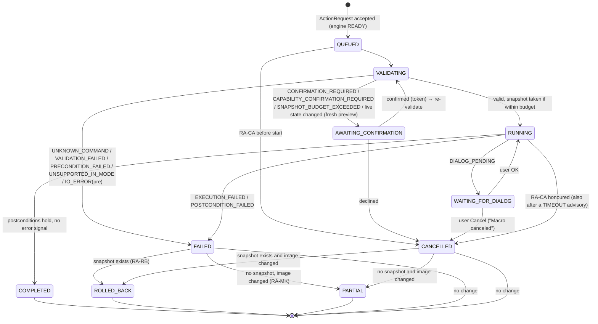
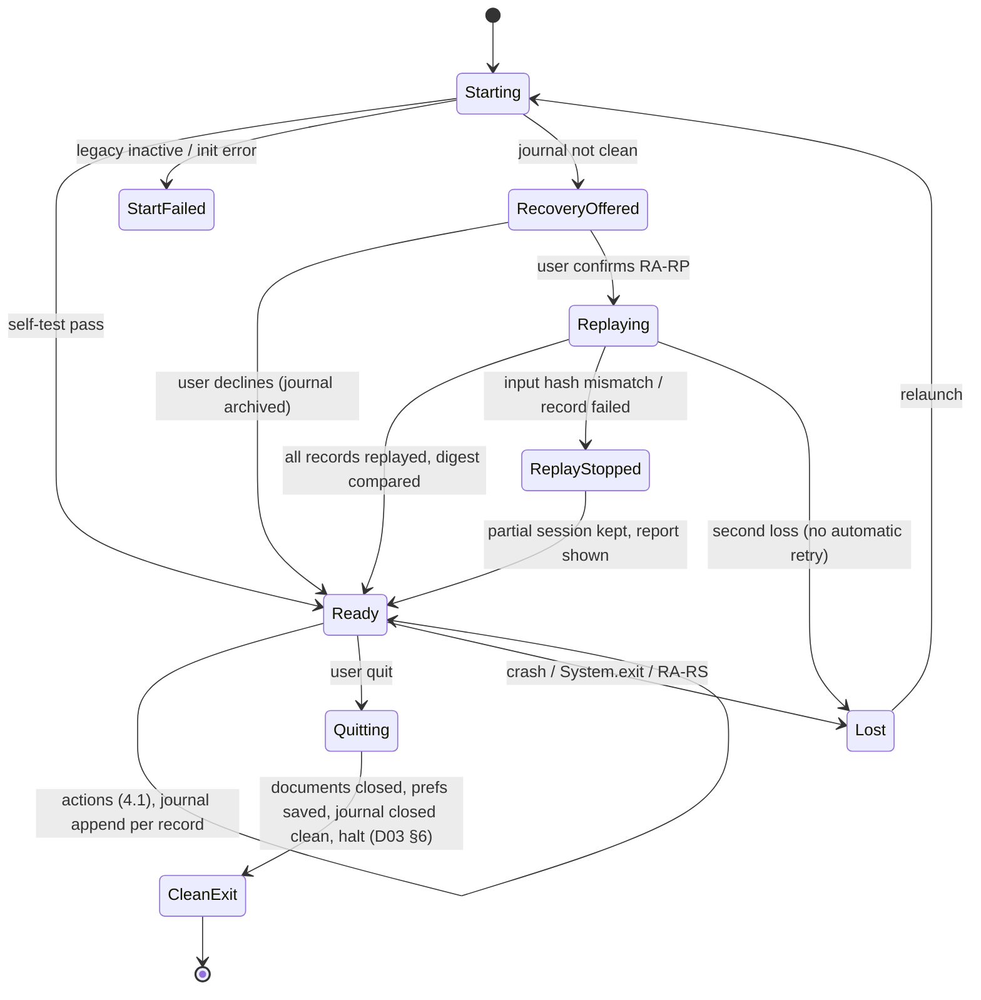

# D17 — Error Handling and Recovery

## Executive Summary

Fiji gives a caller almost no error signal:

- `IJ.run` swallows every `Throwable` (`ij/Executer.java#L74-L117`).
- In a non-headless JVM, an exception opens an "Exception" `TextWindow` instead of propagating (`Executer.java#L113-L115`).
- `IJ.error` shows a modal message, or aborts the running macro (`ij/IJ.java#L834-L854`).
- Macro errors show a modal "Macro Error" dialog and then throw `RuntimeException("Macro canceled")` (`ij/macro/Interpreter.java#L1357-L1408`). `Macro_Runner.runMacro` turns that into the return value `"[aborted]"` (`ij/plugin/Macro_Runner.java#L161-L176`).

All of this is **VERIFIED** from source at v1.54p.

The product therefore detects failure **positively**. It combines:
- postconditions and the state digest (CMP-26);
- the window tracker, which recognises dialogs, "Exception" windows and "Macro Error" dialogs (CMP-24/CMP-11);
- log capture through the chained legacy hook (CMP-25);
- interpreter state (`wasError()`, `getErrorMessage()`);
- a watchdog (D03 §4).

This document defines a taxonomy keyed by the sixteen engine error codes. For each code it gives the detection mechanism and evidence, the user-visible treatment (UI-xx), the recovery action, what is logged (NFR-PRIV-002), and the requirements served. It ends with a recovery state machine.

The governing rules are:
1. No success is ever inferred from a call returning (FR-PROC-005).
2. One failed action never disables the engine (NFR-REL-001).
3. If a snapshot exists, a failed or cancelled action is rolled back by default (FR-HIST-006).
4. The product never fills a Fiji dialog with parameters on the user's behalf (D04 §7; PR-4).
5. Recovery after a lost runtime is by replay from the original inputs, and the product says what cannot be restored (FR-SYS-007).

All design is **PROPOSED**, provisional on DEC-010.

## Purpose and Scope

**In scope:** errors and recovery for every engine route (R1–R4), the speech worker, the optional LLM, file IO, and the engine runtime itself. The journeys (D16) reference sections of this document by number.

**Out of scope:**
- event and record schemas (D09);
- visual treatment of messages (D15);
- the test implementation (D18; fault-injection rows in §7).

## 1. Principles (each tied to evidence and a requirement)

| # | Principle | Evidence | Requirement |
|---|---|---|---|
| P1 | Success requires positive evidence: the expected postcondition holds, no new error log lines appeared, no "Exception" window opened, and no modal dialog is pending. | `Executer.java#L74-L117` (A08 obs. 1; P13 ops 12, 26, 27) | FR-PROC-005, NFR-REL-005 |
| P2 | Validation errors are explained in terms of the **required state**, not Fiji's internal message alone. | UP-17 (preconditions not explained before failure; A05) | FR-PROC-004 |
| P3 | A failure leaves the engine able to accept the next action. The worker thread is never left blocked invisibly. | P83 (dialogs block the worker); A18 §4 | NFR-REL-001, FR-PROC-007 |
| P4 | Partial modification is undone when possible, and otherwise labelled. | `PlugInFilterRunner.java#L161-L200` (A19 §1) | FR-HIST-006, FR-PROC-013 |
| P5 | Isolated subsystems fail alone. Speech or LLM failure degrades only that modality. | Process isolation (A16 CR-A16-02) | NFR-REL-002, FR-NL-009 |
| P6 | Recovery never hides data loss. The UI states what replay cannot restore. | A19 §6.4 | FR-SYS-007 |
| P7 | Messages and logs carry no absolute user paths, titles or metadata by default. | A25 T-02, T-19 | NFR-PRIV-002 |
| P8 | Progress and status during recovery are real. Replay shows record k of n, never estimated time. | A20 §1 | NFR-USE-002 |

## 2. Taxonomy overview

| Code | Phase | Terminal lifecycle state | Retry by the user? | Section |
|---|---|---|---|---|
| `ENGINE_NOT_READY` | Submission | rejected (never QUEUED) | Yes, after READY | §3.1 |
| `UNKNOWN_COMMAND` | VALIDATING | FAILED (no execution) | No | §3.2 |
| `VALIDATION_FAILED` | VALIDATING | FAILED (no execution) | Yes, with corrected parameters | §3.3 |
| `PRECONDITION_FAILED` | VALIDATING, or reported by Fiji at RUNNING | FAILED (rolled back if any change) | Yes, after changing the state | §3.4 |
| `CONFIRMATION_REQUIRED` | VALIDATING → AWAITING_CONFIRMATION | not terminal | Confirm or cancel | §3.5 |
| `CAPABILITY_CONFIRMATION_REQUIRED` | VALIDATING → AWAITING_CONFIRMATION | not terminal | Confirm or cancel | §3.5 |
| `SNAPSHOT_BUDGET_EXCEEDED` | VALIDATING → AWAITING_CONFIRMATION | not terminal | Confirm (AC4) or cancel | §3.5 |
| `EXECUTION_FAILED` | RUNNING | FAILED → ROLLED_BACK, or FAILED + PARTIAL | Yes | §3.6, §3.8 |
| `POSTCONDITION_FAILED` | after RUNNING | FAILED → ROLLED_BACK | Yes | §3.7 |
| `UNSUPPORTED_IN_MODE` | VALIDATING | FAILED (no execution), or rerouted | Via another mode | §3.9 |
| `DIALOG_PENDING` | RUNNING → WAITING_FOR_DIALOG | not terminal | User answers the dialog | §3.10 |
| `TIMEOUT` | RUNNING | advisory; then CANCELLED, or ENGINE_LOST on restart | Cancel, wait or restart | §3.10 |
| `ENGINE_LOST` | any | session lost | Replay (J-13) | §3.11 |
| `CANCELLED` | AWAITING_CONFIRMATION or RUNNING | CANCELLED → ROLLED_BACK, or PARTIAL | Yes | §3.12 |
| `PARTIAL_RESULT` | RUNNING | PARTIAL | Undo impossible; redo from inputs | §3.12 |
| `IO_ERROR` | VALIDATING or RUNNING | FAILED | Yes | §3.15 |

Speech (§3.13) and LLM (§3.14) failures are reported on their own request channels (IF-06, IF-08). They map to the codes above only when an `ActionRequest` is involved: none is created from a failed transcription.

### 2.1 Error payload (merged into the D09 §1 envelope)

The authoritative error envelope is D09 §1 (`code`, `subcode?`, `message`, `details`, `recoverable`, `suggestions[]`, `context?`); the subcodes are listed in D06 §7. The fields below are carried in `code`, `subcode` and `context` (Phase 8 merge). Every `FAILED`, `CANCELLED`, `PARTIAL` or `AWAITING_CONFIRMATION` lifecycle event carries:

- `code` and, optionally, `subcode`;
- `operationId` and `requestId`;
- `commandId` and the redacted `params`;
- `target.docId`;
- `phase`;
- `fijiMessage`, the text captured from Fiji (redacted, §5);
- `explanation`, the product text naming the required state (P2);
- `recovery[]`, the offered actions from §2.2;
- `snapshot`: `available`, `restored` or `none`;
- `logExcerptRef`.

### 2.2 Recovery actions

| ID | Action | Mechanism | Requirement |
|---|---|---|---|
| RA-RB | Roll back to the pre-command snapshot | CMP-28 restores pixels, calibration, display range and the ROI set through the Java API (A19 §5) | FR-HIST-006, FR-HIST-004 |
| RA-RT | Retry, with the inputs corrected in UI-07 or UI-18 | Re-submit the `ActionRequest` with a new `requestId` | NFR-REL-001 |
| RA-LD | Open the Fiji dialog | On explicit user request only: R1 with options omitted, so the native `GenericDialog` appears. Handled as `DIALOG_PENDING`, and the outcome is recorded as legacy dialog input (FR-HIST-008). | FR-PROC-007, FR-PLUG-001 |
| RA-CA | Cancel the running action (also a QUEUED one, which is removed before it starts, D06 §6) | IJ1 filters: `IJ.setKeyDown(KeyEvent.VK_ESCAPE)` (`IJ.java#L1098-L1124`). Macros: `Interpreter.abort()` (`Interpreter.java#L2102`). Modules: `Future.cancel` (A19 §6). | FR-PROC-013 |
| RA-MK | Mark the document partially processed | Document flag plus slice range, if the progress hook reports one | FR-HIST-006 |
| RA-RS | Restart the engine | Flush the journal, spawn a new product launch with the same arguments, then `Runtime.halt` (D03 §7) | FR-SYS-007 |
| RA-RP | Rebuild the session by replay | Journal → re-open the inputs by SHA-256 → restore the recorded globals → replay (J-13) | FR-SYS-007, FR-HIST-010 |
| RA-DG | Degrade a modality | Voice or LLM marked unavailable. Menus, typed grammar and macros stay available. | NFR-REL-002, FR-NL-009 |

## 3. Error codes

### 3.1 `ENGINE_NOT_READY`

| Aspect | Specification |
|---|---|
| Detection | The engine state is not `READY`: during `INITIALISING` or `BUILDING_CATALOGUE` (D03 §3), during `QUITTING` (D03 §6 step 1), or after `FAILED`. CMP-20 checks the state before queuing. Before the Context exists no product UI is shown (the Fiji splash screen covers the JVM start, D03 §3), so no request can arrive then. |
| Evidence | GUI JVM start-up takes 4.5–5.3 s (P85). The legacy layer can be inactive if `ij.*` loads before the Context (P42 attempt 1; FR-SYS-002). |
| User-visible | UI-19 shows the state and elapsed time from `INITIALISING` onwards. Controls that mutate state are disabled. A request arriving through a shortcut produces a UI-12 message: "Fiji is starting (loading commands); action not run". At `FAILED`, UI-19 shows the self-test result, for example "Legacy layer inactive: ImageJ classes were loaded before the SciJava context". |
| Recovery | Wait. At `FAILED`: relaunch; the self-test result names the cause. |
| Logged | State transitions with timestamps; the self-test results. |
| Requirements | FR-SYS-006, FR-SYS-002, FR-SYS-001 |

### 3.2 `UNKNOWN_COMMAND`

| Aspect | Specification |
|---|---|
| Detection | `commandId` is not in the runtime catalogue, or it resolves to a label absent from `Menus.getCommands()` (whitespace-exact; 26 trim collisions, A08). Checked before execution (FR-CMD-003). NL plans that name non-catalogue commands are rejected by CMP-41 (FR-NL-001). |
| Evidence | Unknown labels abort or do nothing in IJ1 (A08 §2; FR-CMD-003 rationale). |
| User-visible | UI-12 (or UI-18 for NL): "No command '<label>' in this Fiji installation". UI-11 search results are offered. For a stale saved workflow, the record is named (FR-HIST-010). |
| Recovery | RA-RT with a chosen command. For a replay: stop before the record and report it. |
| Logged | `commandId`, the catalogue version hash (lock hash plus the update-site list). |
| Requirements | FR-CMD-003, FR-CMD-002, FR-NL-001 |

### 3.3 `VALIDATION_FAILED`

| Aspect | Specification |
|---|---|
| Detection | Deterministic schema check (D06) of type, range, enumeration (per target image, for example `redirect` titles) and required keys. ROI geometry validity, for example a polygon with fewer than 3 vertices. For NL: placeholders, out-of-range values and slots without provenance (FR-NL-002). LLM output that is not valid `CommandPlan` JSON. |
| Evidence | P65 (placeholder values from a local LLM); missing keys fall back silently to remembered statics (A11 §4, A18 F5). |
| User-visible | UI-07 or UI-18 highlights the offending field with its allowed range and unit. Nothing runs. |
| Recovery | RA-RT. |
| Logged | Field name, the rule violated, and the value class (number or enumeration). Free-text values are hashed. |
| Requirements | FR-PROC-003, FR-NL-002, FR-NL-003, FR-NL-006 |

### 3.4 `PRECONDITION_FAILED`

| Aspect | Specification |
|---|---|
| Detection | (a) **Product check before execution:** the catalogue preconditions (image present, type, dimensionality, binary state, ROI required, display range for Apply LUT; `commands.csv` `preconditions` column) are evaluated against the target `ImagePlus` (FR-PROC-004). (b) **Fiji-side errors at run time:** for product-initiated R1 actions, the engine sets `IJ.redirectErrorMessages(true)` (`IJ.java#L2406`) so that an `IJ.error` is logged instead of shown modally, then reads `IJ.getErrorMessage()` (`IJ.java#L868`, which returns and clears `lastErrorMessage`) after the call. A message is classified as a precondition failure when it matches the command's precondition vocabulary, for example "This command requires a selection" (A08 op 16b). (c) Replay inputs whose SHA-256 differs (FR-HIST-010). |
| Evidence | `IJ.error` sets `lastErrorMessage` and either shows a message or logs it when redirection is on (`IJ.java#L834-L854`). Under `IJ.run` from Java a precondition error surfaces as `RuntimeException("Macro canceled")` (A08 obs. 2, ops 16b and 25). `IJ.getImage()` with no image calls `System.exit(0)` when `ij==null` (M1) (`IJ.java#L1806-L1816`, A15). Check (a) prevents it. |
| User-visible | UI-07, or UI-12 for shortcuts: "Watershed requires an 8-bit binary image. The target 'blobs.gif' is 8-bit greyscale. Run Process › Binary › Convert to Mask first." Fiji's own message is shown beneath. |
| Recovery | No change was made in case (a). In case (b), RA-RB if the digest shows a change. Then RA-RT. |
| Logged | Precondition ID, observed state class (type, dimensions), Fiji message (redacted). |
| Requirements | FR-PROC-004, FR-PROC-016 (the unthresholded-binary warning is an inline, non-blocking warning, A26 §14 C5, not a failure), FR-HIST-010 |

The redirection in (b) is process-global. **Validation item VD17-1:** confirm that redirection set and cleared around each product action does not suppress messages from legacy windows that the user is operating at the same moment. If it does, use the window tracker to capture the message dialog instead. Note (Phase 8): `IJ.error` resets `redirectErrorMessages=false` after each error (`IJ.java#L851`), so the DEC-041 wrapper redirects only the first error message of an action; a second `IJ.error` in the same action is shown modally and must be caught by the window tracker. VD17-1 covers this case too.

### 3.5 Gating codes: `CONFIRMATION_REQUIRED`, `CAPABILITY_CONFIRMATION_REQUIRED`, `SNAPSHOT_BUDGET_EXCEEDED`

These are not failures. They move the action to `AWAITING_CONFIRMATION` and require a `confirmationToken`.

| Code | Raised when | Surface | Requirements |
|---|---|---|---|
| `CONFIRMATION_REQUIRED` | NL/voice plans with AC2–AC6 steps (FR-NL-004). AC6 writes: subcode `OVERWRITE_INPUT` when the path is a session input (FR-IMG-009) and `LOSSY_FORMAT` with the loss list (FR-IMG-006). `UNTHRESHOLDED_BINARY` before Convert to Mask, Analyze Particles or binary operations with no threshold (FR-PROC-016) only inside an NL plan preview; from direct modalities it is an inline, non-blocking warning with no confirmation step (A26 §14 C5, D06 §4). The plan of a replay or batch, once per run (A19 §4). | UI-18 | FR-NL-004, FR-IMG-006, FR-IMG-009, FR-PROC-016, NFR-USE-001 (never for AC0–AC3 from direct modalities) |
| `CAPABILITY_CONFIRMATION_REQUIRED` | A user macro or script, AC7. The `Tokenizer` scan finds `exec`, `eval`, `call`, `runMacro` or `File.*` mutators, each named separately (FR-MACRO-002). | UI-18, with the function list and the file hash | FR-MACRO-002, FR-MACRO-003 |
| `SNAPSHOT_BUDGET_EXCEEDED` | The estimated snapshot size is above the remaining budget, or the target is a virtual stack, so the action is AC4 (FR-HIST-005). | UI-07 inline, or UI-18: "cannot be undone: 16.9 MB > 8 MB budget" | FR-HIST-005, NFR-PERF-003 |

Declining gives `CANCELLED` with no state change. A changed live state between preview and confirmation invalidates the token: re-validation returns the operation to `AWAITING_CONFIRMATION` with a fresh preview and a new token (D06 §3). Only a check that now fails outright gives its error code, for example `PRECONDITION_FAILED` (FR-NL-002).

### 3.6 `EXECUTION_FAILED` (commands and modules)

| Aspect | Specification |
|---|---|
| Detection | Any of the following during the action window (from `RUNNING` to completion of the worker call): (1) **"Exception" window.** In M2, `IJ.getInstance()` is the hidden `ij.ImageJ` frame, so `Executer` opens `new TextWindow("Exception", trace)` rather than logging (`Executer.java#L113-L115`). The window tracker (AWT `WINDOW_EVENT_MASK` listener, D04 §3) recognises a `TextWindow` titled "Exception" opened on any thread during the action, reads its text (`TextWindow.getTextPanel().getText()`), and closes it. (2) **Log capture.** New lines from the chained `LegacyHooks.log` delegate (`DefaultLegacyHooks.java#L213`; NFR-REL-004) containing exception traces or "<Out of memory>" (`IJ.outOfMemory`, `IJ.java#L752-L760`). (3) **Exception propagated to the worker,** other than `"Macro canceled"`. (4) **R2:** the module `Future` completes exceptionally, or the module is cancelled with a reason. (5) **Interpreter errors in R4** (§3.8). |
| Evidence | `Executer` catches `Throwable` (A08; P13 ops 12, 26, 27 were swallowed headless). The M2 branch is source-verified; its runtime behaviour in M2 is INFERRED and to be probed (VD17-2). OOM handling is from source. |
| User-visible | UI-12 error entry and UI-10 history entry (state FAILED) with the command, the parameters, Fiji's exception class and first message line, and "Show details" (the redacted trace). If a snapshot was restored: "Image restored to its state before the command". |
| Recovery | RA-RB by default (FR-HIST-006). Without a snapshot: RA-MK. Then RA-RT, or RA-LD (try the Fiji dialog). For `OutOfMemoryError`: RA-RB, release the preview and undo caches, and suggest a virtual stack or a smaller budget (A23). |
| Logged | Exception class, message (redacted), stack frames (class and method names only by default), operationId, commandId, digest delta. |
| Requirements | FR-PROC-005, NFR-REL-001, FR-HIST-006, NFR-PRIV-002 |

### 3.7 `POSTCONDITION_FAILED`

| Aspect | Specification |
|---|---|
| Detection | Per command family (CMP-26; D06): - an expected output image exists (new ID in `WindowManager.getIDList()`) or the target's pixels changed (hash of the affected planes); - the Results row count increased (Measure; there is no Results listener, A20); - the ROI set grew (Analyze Particles with `add`; ROI bridge read-back equals the singleton, D04 §4); - a written file exists, is non-empty and is readable (IO, §3.15); - no modal dialog is pending; - the globals delta is as expected (AC5). A command that returns normally but violates its postcondition is a failure, not a success. |
| Evidence | A18 CR-A18-05; A20 §2; the prototype's progress-file pattern, which proved stages by output (F02). |
| User-visible | UI-12: "Measure completed without adding a Results row" (or "…without changing the image"), with the log excerpt if any. |
| Recovery | RA-RB, then RA-RT or RA-LD. |
| Logged | Failed predicate, expected and observed digest fields. |
| Requirements | FR-PROC-005, NFR-REL-005, FR-ROI-004, FR-IMG-007 |

### 3.8 Macro errors (R4): `EXECUTION_FAILED` / subcode `MACRO_ERROR`, and `CANCELLED` / subcode `MACRO_ABORTED`

| Aspect | Specification |
|---|---|
| Detection | The R4 adapter mirrors `Macro_Runner.runMacro(String, String)` (`Macro_Runner.java#L161-L176`) but **holds its own `Interpreter` instance**, so that the instance can be inspected afterwards. A return value of `"[aborted]"` or a caught `RuntimeException("Macro canceled")` (`ij/Macro.java#L17`) is classified as follows: - `interp.wasError()` (`Interpreter.java#L2355`) true → `MACRO_ERROR`, with `interp.getErrorMessage()` (`#L2528`); - otherwise → `MACRO_ABORTED`: the user cancelled a dialog (P83 D3 observed `RuntimeException: Macro canceled` on Cancel) or `Interpreter.abort()` was called. The **line number and source line** come from the "Macro Error" `GenericDialog`, whose message is `"<message> in line <n>\n…\n<line>"` (`Interpreter.java#L1395`). The dialog is modal and blocks the worker (`showError`, `#L1410-L1428`). The window tracker detects it as `DIALOG_PENDING` with title "Macro Error", captures its message text, and disposes it. This dialog contains only a message and a "Show Debug window" checkbox, so disposing it chooses no scientific parameter (P83 D4 showed that `dispose()` from code resumes the worker). |
| Rejected alternative | `Interpreter.setIgnoreErrors(true)` (`#L2524`). With it, `error()` returns immediately and execution **continues** (`#L1357-L1360`), which changes macro semantics. That violates FR-MACRO-001. |
| User-visible | UI-10 shows the macro source with the failing line highlighted and the interpreter message ("')' expected in line 12"). UI-12 shows FAILED. Documents changed by the macro are listed, with "Restore" for those that have snapshots. |
| Recovery | RA-RB per document with a snapshot (per-step snapshots within the budget, A19 §4). Otherwise RA-MK. RA-RT after editing. For replays of generated macros, a `MACRO_ERROR` is a product defect and is reported as such, together with the generator version. |
| Logged | Macro file hash, line number, message (redacted). The macro text is not logged unless verbose mode is on. |
| Requirements | FR-MACRO-001, FR-MACRO-005, FR-HIST-006, NFR-REL-001, FR-PROC-005 |

**Validation item VD17-3:** probe whether the dialog text can be read through `GenericDialog` accessors (for example its message component) in M2, and whether `getLineNumber()` (`#L2309`) remains valid after an abort. If neither holds, parse the line number from the dialog text only.

### 3.9 `UNSUPPORTED_IN_MODE` (C4–C6 fallback, M1 restrictions)

| Aspect | Specification |
|---|---|
| Detection | From catalogue metadata, before execution: (a) the headless (M1) batch runner receives a step whose `headless_probe` is not `pass` (`commands.csv`; FR-PROC-009, FR-MACRO-007), for example `Analyze Particles...` with `add` (A08 op 11), `Histogram` (op 12), Brightness/Contrast and Threshold frames (ops 26, 27), `run("Open...")` (op 30b, where `open(path)` is the substitute), and the OME-TIFF exporter (P46); (b) a C6 command (Java 3D/JOGL) when no OpenGL context is available (A13); (c) an IJ2 command needing input harvesting before the product harvester is validated (V-01, D04; PARITY). |
| Treatment of C4/C5 | **Not an error.** C4 commands run through R1 and open their native window, tracked as external (FR-PLUG-001). C5 commands switch the document to window policy P-C (visible legacy image window) for the plugin's duration (D04 §3/§9). UI-07 shows "Opens in a Fiji window" before running. |
| User-visible | For (a): UI-18 batch plan, "Step 9 cannot run headless (Analyze Particles with 'Add to Manager'); the batch will use the interactive engine" (J-14). For (b) and (c): UI-12 names the missing capability. |
| Recovery | Reroute to the GUI engine (M2). For (b): none in-product, and the compatibility category is shown (PR-9). |
| Logged | commandId, mode, catalogue evidence reference. |
| Requirements | FR-PROC-009, FR-MACRO-007, FR-PLUG-001, FR-CMD-005, FR-IMG-007 |

### 3.10 `DIALOG_PENDING` and `TIMEOUT` (blocked or hung worker)

| Aspect | `DIALOG_PENDING` | `TIMEOUT` |
|---|---|---|
| Detection | While an action runs: an AWT window-opened event, plus a `Window.getWindows()` and `GenericDialog.getInstance()` scan every 250 ms (D03 §5). A visible modal `Dialog` owned by no product window counts. P83 detected `GenericDialog` "Gaussian Blur..." and "Subtract Background..." this way, while `WindowManager.getWindow(title)` returned `null`. Bound: reported within two scan periods (PROPOSED, 500 ms). | The engine watchdog (D03 §4): no completion, no pending dialog and no progress event within the family limit. The limit is k × the measured p95 duration for the family (from the D18 benchmark suite; k = 10 PROPOSED). Until measurements exist, 120 s is used, the same per-operation bound the analysis harness used (A08 §7, "killed at 120 s"). |
| User-visible | UI-12: "Waiting for input in a Fiji dialog: Gaussian Blur…". The native dialog is brought to the front and associated with the operation in UI-16. The lifecycle shows `WAITING_FOR_DIALOG` (FR-PROC-007). | UI-12: "Operation running for 2 min 14 s with no progress reported", with **Cancel**, **Keep waiting** and **Restart engine**. This is an advisory: the worker is never killed silently (D03 §4). |
| Recovery | The user answers. OK: execution resumes. The values entered are **not** captured by `CommandListener`/`Macro.getOptions()`: the listener fired before the dialog opened (`Executer.java#L54-L61`), and empty options leave no thread entry (`ij/Macro.java#L97-L103`). They come from the dialog snapshot taken while the dialog was open (provenance `dialog-snapshot`, V-10); otherwise the step is recorded as "parameters entered in a Fiji dialog — not captured" (PARTIAL, excluded from E7; D04 §7, FR-HIST-008). Cancel: `RuntimeException("Macro canceled")` (P83 D3) → `CANCELLED` (§3.12). The product never fills the dialog. | Cancel → RA-CA. If the action does not stop within the cancel grace period (PROPOSED: 10 s), offer RA-RS. RA-RS leads to `ENGINE_LOST` (controlled) → J-13 replay. |
| Logged | Dialog class and title (titles hashed if they contain a document title). | Elapsed time, family limit, thread state summary (no stack contents by default). |
| Requirements | FR-PROC-007, NFR-REL-001 | FR-PROC-013, FR-SYS-007, NFR-REL-003 |

### 3.11 `ENGINE_LOST` (crash, `System.exit`, hang at quit)

| Cause | Detection | Evidence | Treatment | Recovery |
|---|---|---|---|---|
| JVM crash (native fault, OOM kill by the OS) | None in-process: the UI dies with the JVM (O2). On the next launch the session journal lacks its clean-close marker (D03 §7). | A21 O2 topology | UI-19, then the recovery sheet (UI-18) listing what replay can and cannot restore | RA-RP (J-13) |
| Plugin or macro calls `System.exit` | The product registers its own JVM shutdown hook. A shutdown that the product did not initiate marks the journal "interrupted by System.exit from <thread>", flushes it, and starts a bounded halt timer (PROPOSED 10 s) ending in `Runtime.halt`. **Rationale:** in GUI mode `System.exit` hangs, because the IJ1 shutdown path calls `EventQueue.invokeAndWait` after `Prefs.savePreferences()` (P85 jstack). Without a timer the JVM would hang with a dead UI. The hook adds a JVM hook and patches nothing (NFR-MAINT-001). | P85 (`P85-run2-jstack.txt`); A15 (`IJ.getImage()` → `System.exit` when headless); PAR-050 | Next launch: as for a crash, with the cause named | RA-RP |
| `File › Quit` from a legacy window (IJ1 command) | `CommandListener` sees "Quit". PARITY: veto and route to the product quit (FR-PLUG-003). Before PARITY: treated like `System.exit`. | `Executer.java#L54-L61` (veto) | Product quit dialog | Bounded quit |
| Product quit hangs | The optional bounded `context.dispose()` attempt times out (D03 §6, V-12) | P85 | None: state was persisted in D03 §6 steps 3–5 before the halt | `Runtime.halt(0)`. The next start finds a clean journal. |
| Engine restart chosen after a `TIMEOUT` (RA-RS) | Controlled | D03 §7 | Journal flushed; new process | RA-RP |

| Aspect | Specification |
|---|---|
| User-visible | UI-19 on relaunch: "The previous session ended unexpectedly (cause if known). 11 actions can be replayed from 2 input files. Not recoverable: unsaved edits made inside plugin windows (2 observed entries without parameters)." |
| Logged | Cause, journal record count, list of non-replayable records by ID. No image content. |
| Requirements | FR-SYS-005, FR-SYS-007, NFR-REL-003, FR-HIST-001, FR-HIST-010 |

D01 IF-09 is an in-process watchdog thread plus a start-up check of the session journal; there is no separate supervisor process in O2 (D03 §7). Detection outside the JVM is therefore limited to the next launch. A separate supervisor is a requirement gap (G-D17-03).

### 3.12 Partial operations: `CANCELLED`, `PARTIAL_RESULT`, `ROLLED_BACK`

| Situation | Detection | Outcome | Evidence | Requirement |
|---|---|---|---|---|
| Stack filter cancelled with a snapshot | Escape flag set (RA-CA). `PlugInFilterRunner` breaks after the current slice and shows "INTERRUPTED" (`PlugInFilterRunner.java#L161-L171, L200`). The engine sees the status through the chained hook, or infers it from the cancel request plus the return. | `CANCELLED → ROLLED_BACK`, with the hash checked against the pre-command hash | A19 §1 (VERIFIED) | FR-HIST-006, FR-PROC-013 |
| Stack filter cancelled without a snapshot (AC4) | As above | `PARTIAL_RESULT`. The document is flagged with "slices 1–k" (k from `showProgress` if the hook is validated, NFR-REL-004; otherwise "range unknown"). The history entry is flagged and excluded from generated macros. | A19 §6.3 | FR-HIST-006, FR-HIST-005 |
| 2D filter pass | Not interruptible part-way (A19 §1) | Cancel takes effect after the pass, then `ROLLED_BACK` | Escape only sets a flag (`IJ.java#L1098-L1124`); `PlugInFilterRunner` polls it between slices only (`PlugInFilterRunner.java#L186-L201`; A19 §1) | FR-PROC-013 (UI states "cancel takes effect after the current pass") |
| Multi-step NL plan or replay, cancelled or failed at step k | Stage counter | Steps 1…k−1 stay COMPLETED (each undoable individually). Step k is ROLLED_BACK. The plan is reported as `PARTIAL_RESULT` ("2 of 4 steps applied"). | A20 §1 (stage-based) | FR-NL-004, FR-HIST-004 |
| Batch over files (J-14) | Per-file postconditions | `PARTIAL_RESULT`, with the completed outputs listed and their hashes; none silent | A19 §4 | FR-MACRO-007 |
| Plugin ignores `IJ.escapePressed()` | TIMEOUT after cancel (§3.10) | RA-RS | R-A19-04 | FR-PROC-013 |
| User cancels a dialog during R1 | `RuntimeException("Macro canceled")` (P83 D3) and no pending error | `CANCELLED` (no change; RA-RB if the digest shows a change) | P83 | NFR-REL-001 |

User-visible (UI-12, UI-05 badge, UI-10):
- "Cancelled — image restored", or
- "Cancelled — slices 1–41 were processed and cannot be undone".

The badge stays on the document until the user saves or explicitly accepts it.

### 3.13 Speech worker failure (no `ActionRequest` involved)

| Failure | Detection | Treatment (UI-11, UI-12) | Recovery |
|---|---|---|---|
| Environment missing (no venv or model) | Spawn fails, or the handshake reports a missing file | "Voice unavailable: speech runtime not installed (see Setup)" | RA-DG; setup instructions (D19 §4) |
| Model hash mismatch | Worker handshake verifies the SHA-256 against `stt-model.sha256.json` (the prototype pattern, `speech/worker.py`) | "Voice unavailable: model files do not match the pinned hashes" | RA-DG; re-install the pinned model |
| Crash or EOF on stdout | IF-06 reader sees EOF or a non-JSON line | "Voice restarted" (one automatic restart, D03 §5), then "Voice unavailable" | RA-DG after the second failure |
| Request exceeds bounds (over 30 s, empty) | Client-side cap at 30 s (FR-SPEECH-002) and a worker-side check (the prototype rejects 0 or over 30 s) | Capture stops at 30 s; nothing is transcribed for an empty clip | — |
| Request timeout | No response within the request bound (PROPOSED: 10 × the measured warm latency, NFR-PERF-002) | "Transcription timed out" | Worker restart |
| Microphone unavailable | Java Sound `LineUnavailableException` when opening the line | "Microphone unavailable" | — |
| No speech detected | VAD output has zero duration (P61) | Empty transcript; nothing sent to NL (FR-SPEECH-003) | — |

No speech failure affects the engine, documents or other modalities (NFR-REL-002). Logged: failure class, worker exit code, model revision. **Never audio or transcript text** unless the user opted in (FR-SPEECH-002). Requirements: NFR-REL-002, FR-SPEECH-001, FR-SPEECH-002, FR-SPEECH-003, NFR-PRIV-002.

### 3.14 LLM unavailable or misbehaving (optional component)

| Failure | Detection | Treatment | Recovery |
|---|---|---|---|
| Not configured | Configuration | No message. The deterministic path is used (FR-NL-009). | — |
| Connection refused or loopback timeout (Ollama not running) | IF-08 client error | UI-11 note: "Language model unavailable; using built-in interpretation" | RA-DG for the session; retry on demand |
| Output not valid `CommandPlan` JSON, or naming non-catalogue commands | CMP-41 schema validation | `VALIDATION_FAILED` / `UNKNOWN_COMMAND` in UI-18. The raw output is visible in details. | RA-RT. The grammar result is offered if any. |
| Output contains code or AC7 intent | CMP-41 policy (FR-NL-007) | Refused | — |
| Hosted provider without consent | Policy (DEC-007, FR-NL-010) | The request is not sent | — |

Logged (FR-NL-011): model identity and digest, prompt-template version, raw output, the user's edits and the final command. Payload text has the NFR-PRIV-002 redaction applied, and no pixel data is ever included (FR-NL-010). Requirements: FR-NL-009, FR-NL-010, FR-NL-011, FR-NL-007.

### 3.15 `IO_ERROR` and file-safety gates

| Situation | Detection | Code | Treatment | Recovery | Requirement |
|---|---|---|---|---|---|
| Read failure (missing, permission, truncated: FX-079) | `IJ.openImage` returns `null`; reader exception captured from the log or the Exception window; file checks before the call | `IO_ERROR` | UI-12 with the relative path and the reader message | RA-RT | FR-IMG-003 |
| Write failure | `IJ.saveAsTiff` returns `false` (`IJ.java#L2155`); `IOException`; post-write check (file exists, size > 0, re-open of the header succeeds) | `IO_ERROR` | A partial file created by this action is deleted | RA-RT with another path | FR-IMG-005 |
| Lossy format | Before writing: format capabilities against document properties (A14) | `CONFIRMATION_REQUIRED` / `LOSSY_FORMAT` | UI-18 lists what will be lost | Confirm or choose TIFF | FR-IMG-006 |
| Path is a session input | Before writing: path canonicalised and compared with the input registry | `CONFIRMATION_REQUIRED` / `OVERWRITE_INPUT` (refused by default) | UI-18: "This would overwrite the original input. Choose another file, or allow overwriting this document's input" | Explicit per-document override. Input SHA-256 recorded before and after. | FR-IMG-009 |
| OME-TIFF export | `IJ.run("OME-TIFF...")` returns; the output is verified to exist, be non-empty, and be readable by the Bio-Formats importer header read. In M1 → `UNSUPPORTED_IN_MODE` (P46: the headless exporter fails with an NPE, "checkboxes is null"). | `POSTCONDITION_FAILED` / `OUTPUT_NOT_VERIFIED`, shown as "export failed" | UI-12 | RA-RT in the GUI engine | FR-IMG-007 (PARITY) |
| Results export | CSV re-read and compared with the in-memory doubles (round trip) | `POSTCONDITION_FAILED` | UI-08 | RA-RT | FR-MEAS-003 |
| Cache fixture hash mismatch (tests) | Harness (D18 §5) | Harness failure, not a product code | — | Re-fetch | NFR-PKG-007 |

Logged: operation, relative or hashed path, error class. Never absolute paths by default (NFR-PRIV-002).

## 4. Recovery state machines

### 4.1 Action-level (lifecycle with recovery)

The states and transitions are exactly the canonical lifecycle in D06 §6; this diagram only adds the error codes and recovery actions on each transition. `ENGINE_NOT_READY` rejects a request before QUEUED. The postcondition check and the `TIMEOUT` advisory happen inside RUNNING (D06 §6); after a `TIMEOUT`, the user may keep waiting, cancel (→ CANCELLED) or restart the engine (RA-RS → `ENGINE_LOST`, session-level, §4.2).

### 4.2 Session-level (runtime loss and replay)

## 5. Logging policy (NFR-PRIV-002)

| Item | Default | Verbose (opt-in, per session) |
|---|---|---|
| File paths | Project-relative, or `path#<sha256-prefix>` | Absolute |
| Image titles | `docId`, plus a title hash | Title |
| Image metadata (`Info`, DICOM tags, OME annotations) | Never | Never in crash reports. Verbose shows key names only. |
| Fiji messages and exception messages | Absolute-path patterns (`[A-Za-z]:\\…`, `\\\\server\\…`, `/Users/…`, `/home/…`) replaced by `<path#hash>` | Raw |
| Stack traces | Class and method names and line numbers | Full |
| Parameters | Numbers and enumerations as values; free strings hashed | Raw |
| Audio and transcripts | Never | Transcript only, if the user opted in (FR-SPEECH-002) |
| LLM payloads | As FR-NL-011, after redaction | Raw payload (only when the user is also shown it, FR-NL-010) |
| Session journal (D03 §7) | Stores absolute paths, because replay needs them. User-private file, excluded from crash reports and support bundles. | — |

Logs are written to the product's per-user data directory, never into the Fiji installation (FR-SYS-008). The workspace Log panel (FR-WS-007, A26 §13a) shows IJ1 and SciJava log lines with the same path sanitisation. A scripted session followed by a log scan for absolute paths verifies the policy (VC rows for NFR-PRIV-002).

## 6. Mapping from Fiji signals to codes (summary)

| Fiji signal (pinned source) | Code |
|---|---|
| `TextWindow("Exception", …)` opened (`Executer.java#L113-L115`) | `EXECUTION_FAILED` |
| `IJ.log` line containing a stack trace or `<Out of memory>` | `EXECUTION_FAILED` (subcode `OUT_OF_MEMORY` for the latter) |
| `IJ.getErrorMessage()` non-null after the action (`IJ.java#L868`) | `PRECONDITION_FAILED` (precondition vocabulary) or `EXECUTION_FAILED` |
| `RuntimeException("Macro canceled")` with a user Cancel observed | `CANCELLED` |
| `"[aborted]"` / `Interpreter.wasError()==true` | `EXECUTION_FAILED` / `MACRO_ERROR` |
| Modal `GenericDialog` visible during the action (P83) | `DIALOG_PENDING` |
| "INTERRUPTED" status after Escape (`PlugInFilterRunner.java#L161-L171`) | `CANCELLED` → `ROLLED_BACK` or `PARTIAL_RESULT` |
| `IJ.saveAsTiff` returns `false` | `IO_ERROR` |
| JVM shutdown not initiated by the product | `ENGINE_LOST` |

## 7. Fault-injection matrix (inputs to D18)

| Fault | Injection | Expected code and outcome | Requirement |
|---|---|---|---|
| Plugin throws in `run()` | Test-only plugin jar in the test install | `EXECUTION_FAILED`; ROLLED_BACK; next action succeeds | FR-PROC-005, NFR-REL-001 |
| Command with empty options | `IJ.run(imp,"Gaussian Blur...","")` | `DIALOG_PENDING` within the bound | FR-PROC-007 |
| Precondition | Watershed on 8-bit greyscale; Measure redirect to a closed image | `PRECONDITION_FAILED`, with no state change | FR-PROC-004 |
| Macro syntax error | Macro with a missing `)` at line 3 | `MACRO_ERROR`, line 3 reported | FR-MACRO-001 |
| Hang | Test plugin that sleeps without progress | `TIMEOUT` advisory; RA-CA; RA-RS | NFR-REL-003 |
| `System.exit` from a plugin | Test plugin | `ENGINE_LOST`; bounded halt; journal unclean; replay offered | FR-SYS-007 |
| Cancel mid-stack | Escape after k slices on FX-006 | `ROLLED_BACK` (hash equal), or `PARTIAL_RESULT` with snapshots disabled | FR-HIST-006 |
| Speech worker killed | Terminate the PID | Voice unavailable after one restart; other journeys pass | NFR-REL-002 |
| LLM endpoint down | No listener on the configured port | Deterministic path used | FR-NL-009 |
| Disk write refused | Read-only output directory | `IO_ERROR`; no partial file left | FR-IMG-005 |
| Overwrite input | Save to the input path | `CONFIRMATION_REQUIRED` / `OVERWRITE_INPUT` | FR-IMG-009 |
| Ten consecutive failures | The above in one session | The engine accepts and completes action 11 | NFR-REL-001 |

## Requirement gaps

| ID | Gap | Evidence | Suggested resolution |
|---|---|---|---|
| G-D17-01 | No requirement bounds the time to detect a pending dialog. FR-PROC-007 says "a bounded time" without a value, and the verification needs one. | FR-PROC-007 | Set from the milestone-1 measurement. 500 ms is PROPOSED here. |
| G-D17-02 | No requirement covers the "Exception" `TextWindow` that IJ1 opens in non-headless mode. FR-PLUG-002 would merely track it as a legacy window, while FR-PROC-005 needs it treated as a failure signal. | `Executer.java#L113-L115` | Extend FR-PROC-005 acceptance: an exception window during an action is a failure signal and is not left visible |
| G-D17-03 | IF-09 is an in-process watchdog plus a start-up journal check (D01 IF-09: "no separate supervisor process in O2", D03 §7). No requirement or component provides an out-of-JVM supervisor. Hangs that freeze the whole JVM (including the watchdog) are not detectable until relaunch. | D01 IF-09; D03 §7 | Decide whether a tiny external supervisor (or the speech worker's parent-liveness check) is required (PARITY) |
| G-D17-04 | No requirement states what happens to the Fiji `IJ_Prefs.txt` write when the JVM is lost, or when a plugin's `System.exit` triggers the IJ1 shutdown hook. | P85 | Add an acceptance criterion to FR-SYS-005/007: prefs are either fully written or unchanged |
| G-D17-05 | No requirement governs the redaction of Fiji-originated message text (only "logs, manifests and crash reports" in NFR-PRIV-002). The UI shows Fiji messages that may contain absolute paths. | NFR-PRIV-002; A25 T-19 | Clarify whether on-screen messages are redacted too (PROPOSED: no; only persisted text is) |

## Decisions proposed

| Candidate | Proposal | Rationale |
|---|---|---|
| DEC-034 (was DEC-cand-D17-1) | The R4 adapter owns its `Interpreter` instance, mirroring `Macro_Runner.runMacro(String,String)`, and does not call `IJ.runMacro`. This refines D04 R4. | Only an owned instance exposes `wasError()`/`getErrorMessage()`. `IJ.runMacro` returns only `"[aborted]"`. |
| DEC-035 (was DEC-cand-D17-2) | The product auto-dismisses only message-only dialogs ("Macro Error", "Exception" `TextWindow`) after capturing their text. Parameter dialogs are never filled. | Keeps PR-4 (no silently chosen parameters) while preventing the worker from blocking on information-only dialogs (P83 D4) |
| DEC-041 (was DEC-cand-D17-3) | For product-initiated R1 actions, wrap execution in `IJ.redirectErrorMessages(true)` and read `IJ.getErrorMessage()` (subject to VD17-1) | Converts modal `IJ.error` messages into a programmatic signal without changing the science |
| DEC-036 (was DEC-cand-D17-4) | The product registers a JVM shutdown hook that journals and halts after a bound | P85: `System.exit` hangs in GUI mode. A plugin's exit must not leave a hung, UI-less JVM. |
| DEC-042 (was DEC-cand-D17-5) | Rollback is the default after a failure or cancellation when a snapshot exists. Users opt out per action only by AC4 confirmation. | FR-HIST-006; A19 §6 |

## References

- `imagej/ImageJ@v1.54p` (03382be1): `ij/Executer.java#L54-L61, L74-L117`; `ij/IJ.java#L752-L760, L834-L854, L868, L1098-L1124, L1806-L1816, L2155, L2388-L2408`; `ij/Macro.java#L17, L71-L78`; `ij/macro/Interpreter.java#L1357-L1428, L2102-L2130, L2309, L2350-L2357, L2524-L2530`; `ij/plugin/Macro_Runner.java#L161-L176`; `ij/plugin/filter/PlugInFilterRunner.java#L161-L200`.
- `imagej/imagej-legacy@imagej-legacy-3.0.0`: `DefaultLegacyHooks.java#L213`. `imagej/ij1-patcher@ij1-patcher-2.0.0`: `LegacyInjector.java#L177-L185`.
- Probes P13–P15 (A08 §7), P42, P46, P61, P80, P83, P85 (`P85-run2-jstack.txt`).
- A08, A13, A15, A18, A19, A20, A23, A25; D01, D03, D04; D16.

## Change log

- 2026-10-17: Initial version (G10).
- 2026-10-17: Phase 8 review fixes (findings #2, #3, #5, #6, #13, #17, #28, #32; S14 nuance on VD17-1).
