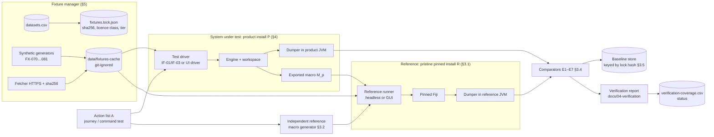

# D18 — Scientific Verification and Testing Design

## Executive Summary

This document turns A30's evaluation strategy into a test architecture. Equivalence with Fiji is established by **numerical comparison against a reference execution of the same pinned Fiji**, driven by an **independently generated** reference macro, under the tolerances of A30 §1 (NFR-FID-001…003). Visual similarity is never evidence (NFR-FID-003).

The architecture has six layers, L0–L5, matching A30 §3, and these components:
- a **reference runner** that launches the pinned Fiji headless or in GUI mode, with the updater autocheck disabled, prefs isolated and lock checks around every run (NFR-MAINT-004, NFR-FID-004);
- an **independent reference macro generator** (CR-A30-02);
- an **output dumper**, a probe-style Groovy script that writes pixels, metadata, ROI geometry and masks, and Results at full double precision;
- **comparators** per dimension E1–E7, plus metric evaluators for E8 and E9;
- a **baseline store** keyed by the runtime lock hash;
- a **fixture manager** with a git-ignored cache, SHA-256 pinning and licence gating (NFR-MAINT-002, NFR-PKG-007).

CI has three tiers (NFR-MAINT-005):
- per-commit, fixtures under 5 MB;
- scheduled, the full cache up to 50 MB;
- manual, larger data and human speech.

The authoritative requirement-to-test mapping is the new [`docs/data/verification-coverage.csv`](../../data/verification-coverage.csv). At design hand-off it has 158 rows covering all 132 MVP- and HACK-priority FR/NFR in A26/A27 (current generator output; D20 §9), including the requirements added in A26 §13a during design, plus rows for two PARITY requirements used by J-13 and J-14. The generator script extracts the IDs and their priorities from A26/A27 and fails if any is uncovered (§11).

Two findings shape the design. First, for the MVP set the reference **must** include GUI-mode runs, because `Analyze Particles...` with `add` fails headless (A08 op 11). Second, headless macro runs of Gaussian Blur and Median leave the Fiji process alive (A08 ops 02/04, "exit-hang"), so every reference run needs an explicit termination path and a timeout. Design content is **PROPOSED**.

## Purpose and Scope

**In scope:**
- test layers and harness components;
- fixture management and CI tiers;
- NL/speech evaluation sets;
- UI tests;
- reuse of prototype tooling;
- the coverage data file.

**Out of scope:**
- the meaning of equivalence and the tolerances, which A30 defines and this document applies;
- error semantics (D17);
- packaging of the reference install (D19).

## 1. Architecture

Two Fiji installations are used, and both start as byte-identical copies of the pinned archive (lock `f6695397…`):

| Install | Contents | Lock check | Requirement |
|---|---|---|---|
| **R — reference** | The pinned Fiji exactly as locked. Never modified. No product jars. | Full lock (`verify_runtime`) before and after every run | NFR-FID-004, FR-SYS-008 |
| **P — product test install** | A copy of R plus the product artefacts installed through the update-site mechanism (D19) | Lock over all non-product files before and after each run | FR-SYS-009 (PARITY), NFR-FID-004 |

The reference must not contain the product, so that a product defect cannot alter the oracle (common-mode protection, A30 §2 note 1).

## 2. Test layers

| Layer | Scope (A30 §3) | Also contains (non-equivalence tests at the same scope) | Runs in | Typical dimensions |
|---|---|---|---|---|
| **L0 Static** | Catalogue integrity: every MVP/HACK command has a schema and an AC class | Licence and import scans (`jdeps`), fixture-catalogue checks, lock/baseline-key check, terminology and doc-ID checks, static code rules (no `Roi.containsPoint`) | No JVM, or a JVM without Fiji | T, I |
| **L1 Invocation unit** | Option-string generation: every key present, booleans decided | Validator and policy units, macro escaping fuzz against `ij.macro.Tokenizer`, JSON round trip of contract types, VAD and number normalisation, progress-component rules | Plain JVM or Python; `ij.jar` on the classpath for `Tokenizer` | T |
| **L2 Engine equivalence** | E1–E6 per supported command on edge-case fixtures, against a reference run | Engine integration in install P: lifecycle events, digests, fault injection (D17 §7), dialog detection, ROI bridge, undo, budget, speech worker process tests | Install P (M2) plus install R | E1–E6, T |
| **L3 Workflow equivalence** | E1–E7 for the D16 journeys on real samples | UI-driven journeys, one-window demonstrations, privacy scans (packet capture, log scan), HiDPI rendering | Install P with the workspace UI, plus install R in GUI mode | E1–E7, T, D |
| **L4 Plausibility** | E9 against BBBC ground truth | — | Install P | E9 (reported) |
| **L5 Interaction evaluation** | E8 on labelled NL and speech sets | Latency reporting per model and prompt configuration | Product NL pipeline; speech worker | E8 |

## 3. Harness components

### 3.1 Reference runner

| Concern | Design | Evidence / requirement |
|---|---|---|
| Launch, headless | `fiji-windows-x64.exe --java-home=<R>/java/win64/zulu21.42.19-ca-jdk21.0.7-win_x64 --allow-multiple --headless -Dimagej.updater.disableAutocheck=true -Duser.home=<run-dir>/home --run <run-dir>/dump.groovy` (or `-macro <file.ijm>` for pure-macro runs). The working directory is `<run-dir>`, not the Fiji folder (see prefs). | Launcher flags VERIFIED (A22; P40/P41 commands in `probes/README-G3.md`); FR-SYS-008, NFR-MAINT-004 |
| Launch, GUI | Same command without `--headless`. GUI references run classic Fiji (M3), which is the oracle users know. | P83/P85 driver commands (`P85-gui-driver.ps1`) |
| Mode choice | Per command from `commands.csv` `headless_probe` (DEC-043, canonical). `pass` → headless. `fail`, `partial` or `untested` → GUI, until a headless probe passes. Recorded per test (NFR-FID-002). | A30 §2 note 3; CR-A30-07; DEC-043 |
| Termination | The dumper writes `done.json` and then calls `Runtime.halt(0)` in GUI mode (`System.exit` hangs, P85) and `System.exit(0)` in headless mode. The runner waits for `done.json`, with a timeout (PROPOSED default 120 s, the bound used by the A08 harness), then kills the process tree. A run that times out is a harness failure, never a pass. | P85; A08 §7 ("exit-hang", killed at 120 s); NFR-REL-003; A26 §14-C4 |
| Output capture | File-based only. The launcher is a GUI-subsystem executable on Windows, so stdout is not captured (`probes/README-G3.md`, P41 row). | VERIFIED (probe README) |
| Pin, before | `verify_runtime(<R>/fiji-windows-x64.exe)` must return the lock hash (currently `f6695397…`). Fail if `<R>/update/` contains any file, because Jaunch's `apply-update` would mutate the install at launch (A22). | NFR-FID-004; `backend/src/fidelis/adapters/fiji.py` `verify_runtime` |
| Pin, after | Re-run `verify_runtime`; the hash must be unchanged. Also assert that no `IJ_Prefs.txt` exists in the Fiji root, which the lock does not cover (F02 §6.1). | NFR-FID-004 |
| IJ1 prefs isolation | `Prefs.getPrefsDir()` looks for `IJ_Prefs.txt` first in `user.dir`, then in the ImageJ directory, then in `user.home/.imagej` (`ij/Prefs.java#L411-L440`). The runner therefore sets `user.dir` to the empty run directory and `-Duser.home=<run-dir>/home`. Whether `-Duser.home` passes through Jaunch unchanged, and whether other Fiji components read `user.home` (for example `.plugins`), is **UNKNOWN**: validation item VD18-1. | NFR-MAINT-004; P52, G8 (prefs written by GUI runs) |
| SciJava prefs isolation | SciJava `DefaultPrefService` uses `java.util.prefs.Preferences.userRoot()` (`scijava-common@2.101.0:DefaultPrefService.java#L266-L277`), which on Windows is `HKCU\Software\JavaSoft\Prefs`. The runner exports that key (`reg export`) before the run, exports again after, compares, and restores with `reg import` if they differ. A difference is reported as a harness warning, because it means a test changed the user's settings. A custom `java.util.prefs.PreferencesFactory` would avoid the registry but needs a test-only class on the boot path (UNKNOWN feasibility; VD18-2). | NFR-MAINT-004; A22 |
| Fresh state per run | One JVM per reference run, so remembered plugin statics cannot leak between tests (R-A30-04) | A30 R-A30-04 |
| Concurrency | `--allow-multiple` is always passed. Runs use separate run directories. GUI runs are serialised per desktop session to avoid focus interference (R-A30-01). | AGENT-BRIEF launch rule; A30 R-A30-01 |

### 3.2 Independent reference macro generator (CR-A30-02)

| Property | Design |
|---|---|
| Independence | A separate module in the test tree. It must **not** import, call or share templates with CMP-27 (the product generator). An L0 check enforces the import rule. Another reviewer reviews its code. |
| Input | The abstract action list `A` used to drive the product: command ID, typed parameters, explicit target, ROI geometry, globals. |
| Key completeness | Table-driven from `commands-core-parameters.csv`: every key of the command is emitted, value keys always and booleans when true. An L1 test asserts that every schema key is decided (mitigates R-A30-04, a shared omission). |
| Globals | Emitted at the start, explicitly: `setOption("BlackBackground", b)`, `run("Set Measurements...", <all keys>)`, `run("Options...", "iterations=… count=… [black] [pad] edm=… do=Nothing")` for binary families, `run("Conversions...", …)` when type conversion is involved. For journeys, the values come from the action list's initial-globals record (FR-MEAS-001). |
| IO forms | `open(path)`, never `run("Open...")` (A08 op 30b fails headless; 30c passes). `saveAs("Tiff", path)`. |
| Thresholds | `setAutoThreshold("<method>[ dark]")` or `setThreshold(lower, upper)` with exact values |
| ROIs | Same rule as D07 G5 (corrected in Phase 8): rectangles and ovals → `makeRectangle`/`makeOval` with double arguments (type preserved); polygon, line and point types → `makePolygon`/`makeLine`/`makePoint` when integer, `makeSelection(type, xs, ys)` when non-integer. E4 also asserts that the ROI **type** is equal. |
| Seeds | `random("seed", n)` before nondeterministic commands. Commands without a seed mechanism are excluded from E1/E2 and listed in the report (CR-A30-05; NFR-FID-003). |
| Golden macros | For the ten MVP commands (A31 §3), the reference macros are also **hand-written** and stored with the test. The generator output must equal them textually (L1). |
| Escaping | Its own minimal string quoting, tested against `ij.macro.Tokenizer` |

### 3.3 Output dumper (probe-style Groovy)

The dumper is a Groovy script run in the same JVM after the macro, in both installs. It writes `dump/<test-id>/`:

| Artefact | Content | Encoding |
|---|---|---|
| `images.json` | Per open image: ID, title hash, type, bit depth, W/H/C/Z/T, stack order, `Calibration` fields (pixel width/height/depth, units, x/y/z origin, value function and coefficients, `isSigned16Bit()`), frame interval, composite mode, per-channel display range, LUT bytes SHA-256 per channel, `isInvertedLut()`, `Info` SHA-256, slice-label hashes, overlay element count | JSON |
| `pixels/<id>/<c>-<z>-<t>.sha256` | SHA-256 of the raw plane buffer, little-endian (8-bit `byte[]`, 16-bit `short[]`, 32-bit `float[]` as IEEE bits, RGB `int[]`) | Text |
| `pixels/<id>/<c>-<z>-<t>.raw` | The raw buffer, written only when the plane is ≤ 1 MiB and the test asks for diffs, so that E1/E2 failures show a per-pixel difference | Binary; never committed |
| `rois.json` | Image ROI and every ROI of the ROI Manager (index order): type, `getFloatPolygon()` x/y arrays (float bits as hex), native parameters for oval and rotated rectangle, C/Z/T position, name, group, stroke width and colour, properties; mask SHA-256 from `Roi.getMask()` plus the mask bounds | JSON |
| `results.json` | Every table: the system `Results` and the `Summary` (and other named tables, found through non-image frames in GUI mode). Column names in order, row count, and each numeric cell as `Double.doubleToRawLongBits` hex (`ResultsTable.getValueAsDouble`). String cells (`Label`) are kept verbatim. CSV export is never used, because it rounds (P37; CR-A30-03). | JSON |
| `globals.json` | The result-affecting globals of D04 §5 (`Prefs.blackBackground`, `Analyzer.getMeasurements()`, precision, redirect, `ImageConverter.getDoScaling()`, `Prefs.calibrateConversions`, RGB weights, `padEdges`, `useInvertingLut`). Binary iterations and count are **not readable** (package-private statics, D04 §5), so they are compared through the explicitly set values only. | JSON |
| `log.txt` | New Log-window lines, redacted (D17 §5) | Text |
| `done.json` | Runtime identity (`IJ.getFullVersion()`, Java version), the lock hash passed in, the dumper version, timings | JSON |

**Common-mode safeguard.** The same dumper code runs on both sides, so a dumper bug could hide a difference. The dumper therefore has its own L2 self-test on analytic fixtures with known values:
- FX-001: means 18.75 and 236.25 after Invert;
- FX-070: a ramp;
- FX-075: pixel value = 1000c + 100z + t.

In the product, the dumper reads engine state through the query API (IF-03) in a test-only plugin loaded only in install P. It reads the same Fiji objects, because the engine owns real `ImagePlus`/`RoiManager`/`ResultsTable` instances (FR-IMG-001).

### 3.4 Comparators and tolerances

| Dim | Comparator | Default criterion (A30 §1) | Notes |
|---|---|---|---|
| E1 | Plane SHA-256 equality. On mismatch, raw diff: count, maximum absolute difference, first differing coordinates. | Exact | Integer types and RGB |
| E2 | Float planes: bit equality. NaN positions are compared exactly. If the command is flagged `thread_order_sensitive` in the catalogue, the maximum difference is ≤ 4 ULP of the reference value. | Exact by default | The flag is set only from evidence (R-A30-02) |
| E3 | Field-by-field JSON equality on `images.json` | Exact | Volatile fields (timestamps inside `Info`) are excluded only by an explicit per-fixture list in the test |
| E4 | Exact float-bit equality of vertices, type, position and name; mask SHA-256 equality; ROI Manager order | Exact | |
| E5 | Column names and order; row count; per-cell raw-bits equality. A relative 1e-12 tolerance applies only to columns flagged thread-order sensitive. | Exact | Covers the Summary table |
| E6 | `globals.json` before and after each step | Exact; any unexpected change fails | |
| E7 | The product's exported macro `M_p` (from history) run in install R, compared with the reference outputs under E1–E6 | As E1–E6 | Journeys containing records marked *not macro-expressible* are excluded and listed (FR-HIST-003) |
| E8 | Metric evaluator (§7) | Unsafe executions = 0; accuracies reported | Not numerical equivalence |
| E9 | Count or mask against ground truth | Reported, not pass/fail | FX-030 band 350–362 for `A03f00d0` |
| — | **Forbidden:** screenshot or PNG similarity registered as E1–E7 evidence | L0 lint (NFR-FID-003) | UI render equality (§8) is UI fidelity only |

**Reference mode per MVP command** (from `commands.csv` / A08 §7; re-evaluated whenever a probe changes the classification):

| MVP command | Headless evidence | Reference mode for L2 |
|---|---|---|
| `File>Open...` (as `open(path)`) | op 30c pass for `open(path)`; `commands.csv` `headless_probe=fail` (op 30b) | **GUI** (DEC-043), until the catalogue row's probe passes |
| `Subtract Background...` | op 03 pass | headless |
| `Gaussian Blur...` | op 02 pass, exit-hang | headless, with the explicit-exit dumper and timeout |
| `Threshold...` (`setAutoThreshold`) | op 07 pass for `setAutoThreshold`; `commands.csv` `headless_probe=fail` (op 27, the frame) | **GUI** (DEC-043), until the catalogue row's probe passes |
| `Convert to Mask` | op 05 pass | headless |
| `Watershed` | untested | **GUI**, until a headless probe passes |
| `Set Measurements...` | op 08 pass | headless |
| `Measure` | op 09 pass; accumulation truncated headless (P39) | headless for single calls; **GUI** for multi-call accumulation (FR-MEAS-004) |
| `Analyze Particles...` | op 10 pass (no `add`); op 11 fail (`add`); `headless_probe=partial` | **GUI** (DEC-043) |
| `Save As>Tiff...` | op 30a pass | headless |

### 3.5 Baseline store (NFR-FID-004, CR-A30-04)

| Aspect | Design |
|---|---|
| Location | `tests/baselines/<lock-sha256>/<test-id>.json`. Each file holds hashes and compact JSON: the `images.json`, `rois.json`, `results.json` and `globals.json` content, never raw planes. |
| Key | The lock hash returned by `verify_runtime` (the SHA-256 of `external/fiji.lock.json`). Each baseline file also records the fixture SHA-256 values, the reference generator version and the dumper version. |
| Check | An L0 CI step compares the current lock hash with the baseline directory key. A mismatch fails with "pin changed: regenerate baselines". There is no silent fallback. |
| Regeneration | After an approved repin (`scripts/pin_fiji.py --accept-current-installation`, an explicit maintenance operation), run the full reference suite in install R. Write the new directory, diff it against the previous baselines, and review every difference before committing (F03 change rules). |
| Use | A reference run is normally regenerated on every test run (cheap headless), and baselines are used for (a) drift detection between runs and (b) tiers where install R is not available. A GUI-mode reference may be served from the baseline in the per-commit tier and re-run in the scheduled tier. |
| Licence | Baselines contain hashes and numbers derived from fixtures, not the fixtures. For NC-licensed FX-030/031, committing derived hashes and counts is **INFERRED** acceptable. Confirm under DEC-005, and never include them in a release artefact. |

## 4. Product-side drivers

| Driver | Layer | Mechanism |
|---|---|---|
| API driver | L2 | A test plugin in install P submits `ActionRequest`s through IF-01 and reads state through IF-03. It asserts the lifecycle event sequence (NFR-REL-005) and the digests. |
| UI driver | L3 | Real AWT/Swing events dispatched on the EDT to the workspace (menus, panels, canvas). The library choice is left to implementation (UNKNOWN; it must work with FlatLaf and at 150 % scaling). |
| Fault injector | L2 | Test-only plugin jar in install P: throwing plugin, sleeping plugin, `System.exit` plugin, dialog plugin (D17 §7) |
| Speech driver | L2/L5 | Feeds recorded 16 kHz PCM to CMP-44 over IF-06, bypassing the microphone. For L3 it also drives the capture state machine with a virtual audio line (UNKNOWN feasibility with Java Sound; fallback is IF-06 injection). |

## 5. Fixture management (NFR-MAINT-002, NFR-MAINT-003, NFR-PKG-007)

| Aspect | Design |
|---|---|
| Catalogue | `docs/data/datasets.csv` is authoritative. A test can reference only fixture IDs present there (L0 check, NFR-MAINT-002). |
| Lock | `tests/fixtures.lock.json`: `fixture_id`, member path (for zip fixtures), URL, size, SHA-256, licence class, tier. Pinning a new fixture's hash is an explicit maintenance command with an `--accept` flag, mirroring `pin_fiji.py`. CI only verifies and never pins (no trust on first use in CI). |
| Cache | `data/fixtures-cache/<fixture_id>/…`, git-ignored by the existing `data/` rule in `.gitignore` (VERIFIED). Every use re-verifies the SHA-256. A mismatch fails the test before the product sees the file (D16 J-12). Fetching uses HTTPS where the host supports it; `imagej.net/ij/images` is served over HTTPS (A29 §6.3). |
| Licence classes | **REPO**: original synthetic work (FX-001, FX-002 and the generator scripts for FX-070–081), subject to DEC-005. **CACHE**: fetch-on-demand, never committed, never in a release: FX-003–023 (licence UNKNOWN), FX-030/031 (CC BY-NC-SA 3.0), FX-040–045 (CC BY 4.0, kept cache-only until DEC-005 decides attribution handling), FX-050/051. **MANUAL**: over 50 MB (FX-043 zip, FX-046, FX-047, FX-048), header-only checks in CI. **CONSENT**: FX-061 (NFR-PRIV-003). |
| Gate | An L0 CI check: every file committed under `fixtures/` or `tests/` that matches a fixture must be REPO class in `datasets.csv` (NFR-PKG-007). A release-packaging check rejects any CACHE or CONSENT fixture (D19). |
| Synthetic | FX-070–FX-081 are produced by versioned generator scripts: reference-Fiji macros (`newImage`, `setPixel`, `setVoxelSize`, `run("Properties...")`) or Python writers. The generator runs twice and the SHA-256 values must be equal (NFR-MAINT-003). FX-052 is generated in install R at test time. |
| ML | No fixture is used for training or fine-tuning (NFR-FID-005). Evaluation sets are evaluation only. |

## 6. CI tiers (NFR-MAINT-005)

| Tier | Trigger | Fixtures | Layers | Environment |
|---|---|---|---|---|
| **Per-commit** | Every push | REPO plus CACHE fixtures under 5 MB (PROPOSED threshold, NFR-MAINT-005): FX-001–007, 009–022, 030 (854 KB zip), 040, 044, 045, 070–081 | L0, L1; L2 headless; L2/L3 GUI for the MVP set (J-12) using GUI baselines; E8 on the typed NL set | Windows 11 x64 runner with an interactive desktop session (required for non-headless JVMs), with installs R and P provisioned from the pinned archive (D19) |
| **Scheduled** (nightly) | Timer | All CACHE fixtures ≤ 50 MB: adds FX-008 (27 MB), FX-023, FX-031 (one overlap subset), FX-041/042 | Full L2; L3 E1–E7 for every MVP/HACK journey with **fresh GUI references**; L4 E9; performance benchmarks (NFR-PERF-002/005/006, family timeouts for D17 §3.10); speech E8 on FX-060 | Same |
| **Manual / release** | Release candidate | MANUAL and CONSENT fixtures (FX-043, 046–048, FX-061) | L5 on human speech (NFR-USE-003), accessibility checks (PARITY), HiDPI demonstrations | Same; human operator |

Tier membership is computed from the `size` column of `datasets.csv` and the lock file. It is not maintained by hand. CI provider and runner hosting are **UNKNOWN**. A hosted runner must provide a desktop session; otherwise a self-hosted Windows runner is required.

## 7. NL and speech evaluation sets (E8; NFR-USE-003)

| Set | Content | Source / rules | Metrics | Gate |
|---|---|---|---|---|
| NL typed | `docs/data/nl-eval/*.jsonl` (A17 §12 schema: `utterance`, `state` snapshot, `expected.status`, `expected.steps[]`, `clarify_slots`, `tags` for ambiguity class A1–A11) | Back-translated recorded macros; paraphrased tutorial steps (tutorials@586267dc); user sessions; adversarial and injection prompts (FX-081 texts). Every consequential slot and every ambiguity class is covered. | Exact-plan accuracy; slot precision/recall; clarify precision/recall; refusal accuracy; **unsafe-execution rate**; latency | Unsafe = 0 in every tier (FR-NL-007). Accuracy reported per model and template version. |
| Speech synthetic (FX-060) | Commands from the catalogue vocabulary, with numbers and units; several TTS engines, voices and rates; engine, voice and version recorded | Generated deterministically, with hashes stored | Word error rate on command words; command-level accuracy after NL; latency | Reported. Regression is flagged when command accuracy drops versus the stored baseline for the same model and prompt. |
| Speech human (FX-061) | Consented recordings, with metadata limited to accent group and condition (NFR-PRIV-003) | Stored outside the repo unless the consent allows otherwise | As above, per accent group and noise level | PARITY: sets exist. LONG: release gate (NFR-USE-003). |
| Noise (FX-062) | Lab noise mixed at fixed SNRs; includes a pure-silence clip for FR-SPEECH-003 | Self-recorded or CC0 | VAD false-trigger rate | Silence → empty transcript |

The prompt-bias comparison (FR-SPEECH-005) runs each speech set with and without the generated vocabulary prompt, and records both. For each plan in the NL set that reaches execution, the scientific check is an L2 comparison against the reference (A17 §12). Text equality of macros is not used.

## 8. UI tests

| Test | Method | Requirement |
|---|---|---|
| Rendering equality | For fixtures with 8-, 16- and 32-bit data, composite and inverting LUT (FX-001, 004, 070, 071, 074, 018): the viewer's rendered **raster without overlay** at 100 % zoom must equal `ImagePlus.getBufferedImage()` pixel-for-pixel (ARGB), in image coordinates. `getBufferedImage` contains no overlay (`ij/ImagePlus.java#L606-L611`). The product-drawn overlay layer is tested separately against `ImagePlus.flatten()` (D13 §2.2), and that test is a gate for the vector overlay path. This proves UI fidelity, **not** scientific equivalence (NFR-FID-003). | FR-VIEW-001 (ADR-009) |
| Render caching | Instrumented count of `getBufferedImage` calls during zoom and pan without a data change = 0 | FR-VIEW-005 |
| HiDPI | The rendering-equality and layout tests repeated at 100/150/200 % Windows scaling. The logical-to-device transform is checked (the P87 normalising transform was 1.333 at 150 %). | NFR-PLAT-002 |
| Pixel readout | Strings equal `getLocationAsString`/`getValueAsString` at sampled points (FX-070, 071, 072, 077) | FR-VIEW-003 |
| ROI gestures | Scripted pointer sequences (press, drag, release, with Shift/Alt/Ctrl) on the product canvas at several zoom levels. The same sequences go to an IJ1 `ImageCanvas` in a visible legacy window in install R (GUI). The resulting ROIs are compared with E4 (vertices and `getMask()`). | FR-ROI-001…003 |
| Modifier hygiene | Stale `IJ.setKeyDown(VK_ALT)` before a programmatic command does not change the path (`Duplicate...`) | FR-PROC-006 |
| Responsiveness | EDT stall probe ≤ 100 ms during a long stack filter (FX-006; FX-008 scheduled). Listener time per event ≤ 5 ms. | NFR-PERF-005/006 |
| No fake progress | Determinate progress updates without a counter source are rejected by the component (L1), plus a UI checklist review | NFR-USE-002 |

## 9. Reuse of prototype assets (F02 §7)

| Asset (snapshot 08a1433) | Reuse in D18 | Change needed (implementation stage) |
|---|---|---|
| `external/fiji.lock.json`, `verify_runtime`, `runtime_files` (`backend/src/fidelis/adapters/fiji.py#L19-L45`) | The pin check for installs R and P, and the baseline key (§3.5) | Extend `runtime_files` to cover the root `fiji` script, `db.xml.gz` and `licenses/` (F02 §6.1 gap). That changes the lock hash, so it is a deliberate repin with regenerated baselines. `licenses/` also serves NFR-PKG-006. |
| `scripts/pin_fiji.py --accept-current-installation` | The model for every explicit pinning operation (Fiji, fixtures, models) | None. Its review-then-record pattern is the policy. |
| `tests/backend/test_runtime_failures.py::test_runtime_changes_are_rejected` | Pattern for the NFR-FID-004 lock-mismatch test of the reference runner | Re-target to the runner |
| `…::test_timeout_terminates_a_real_worker_process` | Pattern for runner timeouts and process-tree kill (NFR-REL-003) | Apply to Fiji processes. F02 notes that it substitutes a sleeping Python process, so a real hanging-macro case is added (D17 §7). |
| `…::test_api_surfaces_worker_failure` | Pattern for speech-worker failure surfacing (NFR-REL-002) | Re-target to IF-06 |
| `tests/backend/test_integration.py` (FX-001 Invert exactness; FX-002 speech smoke) | FX-001 analytic oracle for the dumper self-test; FX-002 for the speech smoke test | — |
| `scripts/check_fiji.py` | Not reused as is: it omits `--allow-multiple` and `--java-home` (F02 §6.2) | The runner supersedes it |
| `external/stt.lock.json`, `stt-model.sha256.json`, `scripts/setup_speech.py` | Model pin and verification for the speech tests (FR-SPEECH-001) | — |

## 10. Reporting

Each verification run writes `docs/04-verification/<date>-<lock-prefix>/report.md` plus machine-readable results. Per command it lists the reference mode, the tolerance applied and any exclusion (seeded or excluded nondeterministic commands; NFR-FID-002, CR-A30-07). It records the lock hash, the fixture hashes, the generator and dumper versions, and the counts of pass, fail and skip with reasons. The `status` column of `verification-coverage.csv` moves from `planned` to `passing`/`failing` only by tooling that reads these reports. Parity status may be advertised only from passing rows (R-A28-01).

## 11. `docs/data/verification-coverage.csv`

| Column | Meaning |
|---|---|
| `coverage_id` | `VC-nnnn`, stable once published |
| `requirement_id` | FR/NFR ID, extracted from A26/A27 |
| `parity_id` | `PAR-nnn` values whose `requirements` cell names the requirement (ranges `..` expanded), from `parity-matrix.csv`; `n/a` if none |
| `test_level` | L0–L5 (§2) |
| `dimension` | E1–E9, T, D or I; `;`-separated |
| `fixtures` | FX IDs (`;`-separated), validated against `datasets.csv`; `none` if no fixture |
| `reference_mode` | `headless`, `gui` or `n/a` |
| `tolerance` | `exact`, a stated bound, or `n/a` |
| `journey` | J-xx (`;`-separated) or `n/a` |
| `status` | `planned` (all rows at this stage) |
| `check` | **Added column** (same practice as the five added columns in A08): a one-line statement of what the row verifies. Without it, T/D/I rows could not be implemented from the file alone. |

Generation: the file is produced by a Python script (kept in the G10 scratch area for this stage; to be moved under `scripts/` at implementation). The script:
- parses the A26/A27 requirement tables;
- selects every ID whose `Pri` cell contains `MVP` or `HACK`, including split priorities such as "MVP (TIFF/PNG); HACK (Bio-Formats importer)" and conditional ones such as "MVP (if any LLM is enabled)";
- fails if any selected ID lacks a row, if a row names an unknown requirement, fixture or journey, or if a level or dimension value is invalid.

First result on 2026-10-17: 160 requirements parsed, 129 MVP/HACK selected, all 129 covered, 154 rows. Current generator output at design hand-off (Phase 8): **162 requirements parsed, 132 MVP/HACK selected, all 132 covered, 158 rows** (D20 §9). FR-SYS-007 and FR-MACRO-007 (PARITY) are also included, for J-13/J-14. A26 changed during this work (§13a added FR-WS-006/007, FR-VIEW-007, FR-PLUG-004, FR-CMD-008, FR-MEAS-006); the generator detected the six new IDs as uncovered, and rows were added. Re-run the generator whenever A26/A27 change. 51 covered requirements have no PAR row; most are NFRs, engine internals or §13a additions, but see G-D18-03.

## Requirement gaps

| ID | Gap | Evidence | Suggested resolution |
|---|---|---|---|
| G-D18-01 | FR-SPEECH-003 needs a silence clip and FR-MACRO-002 needs a capability-macro fixture (`exec`, `File.delete`). Neither has a `datasets.csv` row, which NFR-MAINT-002 requires. The coverage file temporarily points at FX-062 and FX-081. | datasets.csv | Add rows (synthetic, REPO class) |
| G-D18-02 | No requirement states that the reference install must contain no product artefacts. This is the common-mode protection relied on in §1. | A30 §2 note 1 | Add to NFR-FID-004 acceptance |
| G-D18-03 | `FR-PROC-001` (the core rule "invoke original Fiji") is not linked from any `parity-matrix.csv` row, although PAR-014…020 depend on it. | Generator output (§11) | Add FR-PROC-001 to the processing PAR rows |
| G-D18-04 | NFR-MAINT-004 covers prefs isolation but not the working directory: an `IJ_Prefs.txt` in the Fiji root would be used and is outside the lock (`Prefs.java#L411-L420`; F02 §6.1). | Source | Extend the acceptance criterion |
| G-D18-05 | No requirement sets the CI environment (an interactive desktop session for GUI-mode references), although NFR-FID-001 MVP needs GUI references. | §3.4 table | Add to NFR-MAINT-005, or record as a D19/D20 constraint |
| G-D18-06 | NFR-USE-003 places the evaluation-set existence at PARITY, but FR-NL-001/007 (MVP) acceptance already uses "the labelled set". The MVP needs at least the typed NL set. | A26/A27 | Bring the typed NL set to MVP |

## Decisions proposed

| Candidate | Proposal | Rationale |
|---|---|---|
| DEC-037 (was DEC-cand-D18-1) | Two installs: a pristine reference R and a product test install P, both from the pinned archive | Prevents common-mode faults. Matches ADR-010. |
| DEC-043 (was DEC-cand-D18-2) | Reference mode per command is taken from `commands.csv` `headless_probe`. Anything other than `pass` uses a GUI reference. | A08 §7; CR-A30-07 |
| DEC-037 (was DEC-cand-D18-3; merged into DEC-037 with DEC-cand-D18-1, see `DECISIONS.md`) | Results are compared as raw IEEE bits through the API, never through CSV | P37; CR-A30-03 |
| DEC-044 (was DEC-cand-D18-4) | GUI references terminate through `Runtime.halt` after writing `done.json`, with a hard timeout | P85 exit hang; A08 exit-hangs |
| DEC-045 (was DEC-cand-D18-5) | A dedicated Windows CI runner with a desktop session | GUI-mode references are mandatory for the MVP set |

## References

- A30 (dimensions, protocol, levels), A29 (fixtures and download policy), A08 §7 (headless matrix), A17 §12 (NL evaluation design), A16 (speech), A22 (launcher, prefs), A28 and `parity-matrix.csv`, F02 §6–§7, F03.
- `imagej/ImageJ@v1.54p`: `ij/Prefs.java#L411-L440`; `ij/measure/ResultsTable.java#L57` (CSV precision); `ij/macro/Functions.java#L1194-L1201` (random seed).
- `scijava/scijava-common@scijava-common-2.101.0`: `src/main/java/org/scijava/prefs/DefaultPrefService.java#L266-L277`.
- Repository: `backend/src/fidelis/adapters/fiji.py#L19-L45`; `scripts/pin_fiji.py`; `tests/backend/test_runtime_failures.py`; `tests/backend/test_integration.py`; `.gitignore` (`data/`).
- Probes P37, P39, P40, P41, P52, P83, P85, P87 (`docs/01-analysis/references/probes/`).
- `docs/data/verification-coverage.csv`, `docs/data/datasets.csv`, `docs/data/commands.csv`, `docs/data/commands-core-parameters.csv`.

## Change log

- 2026-10-17: Initial version (G10). Created `docs/data/verification-coverage.csv`.
- 2026-10-17: Phase 8 review fixes (findings #9, #10, #15, #16, #27).
- 2026-10-17: Phase 8 clarification of DEC-043. The reference mode is decided by the probe result of the form used in the reference macro: `open(path)` and `setAutoThreshold` pass headless (A08 P13), whereas the menu commands `File > Open...` and `Threshold...` fail. VC-0040/VC-0045 (headless) are therefore consistent.
