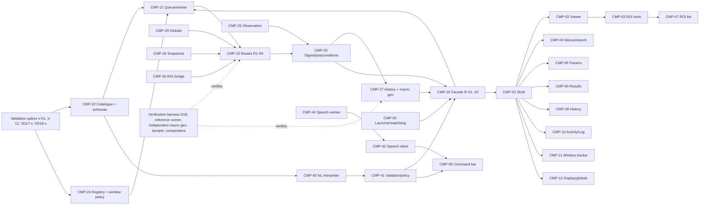

# D20 — Implementation Readiness and Design Handoff

## Executive Summary

The design is **ready to be converted into milestones**, subject to owner approval of DEC-010 (architecture) and the decisions listed in §7. Every one of the 162 requirements (116 FR, 46 NFR) traces to at least one design document. Every MVP- and HACK-priority requirement has at least one planned verification row (`docs/data/traceability.csv`, `docs/data/verification-coverage.csv`; both generated by tools in `docs/tools/`).

**No application code exists for the proposed architecture.** The only implementation in the repository is the prototype (T0, F02).

This document proposes:
- a **validation-first integration order** (milestone groupings M1–M6, §4);
- the parallelisable work streams;
- the verification obligations;
- the open blockers.

Detailed milestones, with acceptance gates, commit boundaries and Git workflow, are deliberately left to the next stage (brief Part 9 D20).

## 1. Architecture summary (PROPOSED — DEC-010 / ADR-001)

| Layer | Contents | Defined in |
|---|---|---|
| Workspace UI (Swing + FlatLaf, SciJava `UserInterface`) | CMP-01…12; UI-01…UI-20; layout DEC-029 | D11–D15 |
| Engine service (SciJava `Service` in the Fiji JVM) | CMP-20…31; routes R1–R4; window policy P-A/B/C; ROI bridge; globals manager; observation; digest; history; snapshots | D04–D07, D09, D10 |
| Interaction services | CMP-40…43 (NL interpreter, validator, optional LLM client, speech client) | D08 |
| Speech worker (Python process) | CMP-44, faster-whisper, IF-06 | D08, D19 |
| Launcher / watchdog | CMP-50; Jaunch launch option (DEC-028); journal recovery | D03, D17 |
| Unmodified Fiji | Pinned runtime (F03) | A07–A15 |

System boundaries:
- The product never modifies Fiji files (NFR-MAINT-001/007).
- It opens no network listener (NFR-SEC-002).
- It sends no pixels to any model (FR-NL-010).
- It produces all science through Fiji code (FR-PROC-001).

## 2. Interface contracts (ready for implementation)

| IF | Contract | Spec | Readiness |
|---|---|---|---|
| IF-01 | Action submission (`ActionRequest`, `CommandPlan` submit, confirm, cancel, undo, quit) | D06 §2, D09 §2 | Ready after the Phase 8 fixes (canonical lifecycle D06 §6; threshold operations D06 §2); V-10/V-11 open |
| IF-02 | Engine events (11 event types; ordering guarantees) | D09 §3 | Ready after the Phase 8 fixes (error envelope with `subcode`/`context`, D09 §1; engine states incl. QUITTING); V-10/V-11 open |
| IF-03 | Queries (documents, rendering, read-out, ROIs, overlay, histogram, preview, draft macro line, snapshot render, queue status, results, globals, catalogue, history) | D09 §4 | Ready after the Phase 8 fixes; V-10/V-11 open. Rendering runs on the engine worker between actions (V-11; the DP-D13-01 render proxy is withdrawn) and depends on V-02. |
| IF-04 | `CommandSchema` | D06 §1 | Ready for the 54-command core set; generation from the catalogue CSVs is defined |
| IF-05 | History record and macro export | D06 §8, D07 §4 | Ready. Float ROI macro form confirmed (V-08 closed). |
| IF-06 | Speech worker JSON lines | D08 §1.1 | Ready. Audio capture rate is V-09. |
| IF-07 | `CommandPlan` | D08 §2.3 | Ready |
| IF-08 | LLM provider (optional) | D08 §2.6 | Ready, pending DEC-007 |
| IF-09 | Watchdog, journal and shutdown hook | D03 §5–7, D17 | Ready |
| IF-10 | External transport | D09 §8 | LONG scope; not to be built for MVP/HACK |

## 3. Component dependency graph (implementation order basis)

## 4. Integration order and recommended feature groupings (PROPOSED)

Each grouping below is a candidate milestone. Gates refer to verification rows in `verification-coverage.csv` (VC-xxxx), and tiers to A31.

| Grouping | Scope | Exit evidence (summary) | Tier |
|---|---|---|---|
| **M1 Validation spikes and toolchain** | Maven Wrapper and pom-scijava 45.1.0 with version overrides (DEC-038, NFR-PKG-008). Close the open §6 items: V-01…V-03, V-05…V-07, V-09…V-12, VD17-1…VD17-3, VD18-1 and VD18-2. Minimal reference runner (D18) reusing the prototype's pin verifier. | Probe reports in `docs/04-verification/`. Build fails on a version mismatch. Reference runner reproduces one MVP command with E1 equality. | Pre-MVP |
| **M2 Engine core** | CMP-20…31 for routes R1, R3 and the R4 adapter (owned `Interpreter`, DEC-034): queue and worker; catalogue and schemas for the MVP set; registry and window policy; globals; snapshots; digest and postconditions; history and macro generator; observation hooks. No product UI yet: drive through a test client. | E1–E6 equivalence for the MVP commands that need no ROI bridge (NFR-FID-001); Analyze Particles with `add` moves to the M4 exit. E7 replay of generated macros. Event-ordering tests (D09 §3). Fault injection (D17). | MVP |
| **M3 Workspace shell and viewer** | CMP-01/02/04/05/06/08/10/11; IJ1-rendered viewer with cache; menus and search from the catalogue; parameter panel; Results; history panel; activity and log; window tracker | Rendering equality with `getBufferedImage`. Read-out string equality. Single-window journeys J-01 and J-04; J-05 (macro execution through the M2 R4 adapter) and J-06 (record, export and replay). | MVP |
| **M4 ROI and measurement** | CMP-03/07/30; rectangle and polygon tools with float geometry; ROI bridge; Measure and Analyze Particles | E4 mask equality. Macro `roiManager` parity (V-03). E1–E6 for Analyze Particles with `add` (ROI bridge, FR-ROI-004 MVP). J-03, J-04, J-12. | MVP |
| **M5 NL and speech** | CMP-40/41/43/44; grammar and retrieval front ends; validator and policy; preview sheet; persistent speech worker | FX-064 typed NL set with zero unsafe executions (NFR-USE-003 MVP). NFR-PERF-002 latency. J-07, J-08. | MVP |
| **M6 HACK completion** | Core set of 54 schemas. B&C/threshold/channels panels (DEC-030 reroutes). Multi-step undo. Cancellation. Stack processing. C4/C5 fallback demos (TrackMate, Cell Counter, with FR-PLUG-004). OME-TIFF export. Exports. | HACK rows of `verification-coverage.csv`. Journeys J-02, J-09, J-10, J-11. | HACK |

PARITY and LONG items (A31 §1) follow after M6. They include the full catalogue, accessibility (NFR-A11Y-*), batch on folder (J-14), recovery replay (J-13), cross-platform probes and external clients.

## 5. Parallelisable work streams

| Stream | Can start | Depends on |
|---|---|---|
| S1 Verification harness (D18: reference runner, independent macro generator, dumper, comparators, fixture cache) | Immediately after M1 toolchain | Pinned reference install (DEC-047) |
| S2 Engine core (M2) | After the V-01…V-06 spikes (V-04 closed by source) and V-10/V-11 | Catalogue CSVs (exist) |
| S3 Speech worker persistence and protocol (CMP-44, IF-06) | Immediately (Python; reuses the prototype worker) | None. Licence questions (DEC-005) do not block development. |
| S4 NL grammar and retrieval with the FX-064 evaluation set | Immediately (catalogue-driven) | `CommandSchema` format (D06 §1) |
| S5 Workspace UI shell (M3) against a mocked IF-01…03 | After the IF contracts are frozen (D09) | Swing/FlatLaf skills (R-A21-01) |
| S6 Fixture generators FX-070…081, FX-063, FX-082 | Immediately | None |

## 6. Open validation items (must close in M1)

| ID | Question | Source |
|---|---|---|
| V-01 | Product input harvester selection for R2 modules | D04 §10 |
| V-02 | Show-then-hide flash; off-screen pre-positioning | D04 §10 |
| V-03 | ROI bridge load/read-back fidelity; macro parity | D04 §10 (risk R-A28-02) |
| V-04 | Global-calibration read API | **Closed** by source (`ImagePlus.getStaticGlobalCalibration()`, `ij/ImagePlus.java#L2767`); D04 §10 |
| V-05 | Measure accumulation in M2 with a hidden Results window | D04 §10 |
| V-06 | Safety of chaining legacy hooks (progress and status) | D04 §10, NFR-REL-004 |
| V-07 | Jaunch `extra-*.toml` launch option delivered through an update site | D03 §2, DEC-028 |
| V-08 | Float `makeSelection` | **Closed** (source, D07 §4); a runtime E4 test remains in D18 |
| V-09 | Java Sound 16 kHz capture support | D08 §1 |
| VD17-1 | `IJ.redirectErrorMessages` behaviour for R1 failures, including the reset after the first error (`IJ.java#L851`) | D17 §3.4 (DEC-041) |
| VD17-2 | Runtime behaviour of the M2 "Exception" `TextWindow` (source-verified, runtime INFERRED) | D17 §3.6 (DEC-035) |
| VD17-3 | Readability of the "Macro Error" dialog text and validity of `getLineNumber()` after an abort | D17 §3.8 |
| VD18-1 | `-Duser.home` pass-through in Jaunch and other `user.home` readers (prefs isolation) | D18 §3.1 |
| VD18-2 | Feasibility of a test-only `PreferencesFactory` for SciJava prefs isolation | D18 §3.1 |
| V-10 | Capture of values typed into a surfaced `GenericDialog` (dialog snapshot mapped with `Macro.trimKey`) | D04 §7, §10 |
| V-11 | Render-on-worker latency with no product rendering lock (replaces DP-D13-01 "render proxy", withdrawn) | D04 §2 R3, §10; D13 §2.3 |
| V-12 | Bounded `context.dispose()` without IJ1 quit prompts (optional quit step) | D03 §6; D04 §10 |

## 7. Unresolved decisions and blockers

| Item | Blocks | Owner action |
|---|---|---|
| **DEC-010** Architecture O2 (plus ADR-001…011, DEC-020…047 that depend on it) | All implementation milestones | Approve, modify (for example O4 behind the same engine API) or reject |
| **DEC-030** Menu items rerouted to workspace equivalents | M6 B&C/threshold/channels panels | Explicitly accept or reject the deviation |
| DEC-012 Hackathon strategy (whether a spike may be built now) | Any work before M1 | Decide |
| DEC-007 Hosted LLM policy, including the FR-NL-010 preview-scope clarification (D08) | Optional LLM front end (M5 optional part) | Decide |
| DEC-005 Licence and distribution, including PyAV/FFmpeg GPL codecs (ADR-005 correction) | Public update site; releases (not development) | Decide (legal advice recommended) |
| DEC-001 Product name | Branding only | Decide |
| DEC-006, DEC-011, DEC-029, DEC-031 … DEC-047 | Corresponding design details | Review |
| Java build toolchain (Maven Wrapper) | M1 | Approve adding the toolchain to the repository |
| Windows CI runner with a desktop session (DEC-045) | GUI reference tests in CI | Provision |

## 8. Critical risks carried into implementation

These come from `docs/data/risks.csv` and A31 §5, filtered to those that affect the order of work:
- R-A28-02 ROI bridge (M1 V-03);
- R-A15-01 / R-A21-03 window pop-ups (V-02);
- R-A21-01 Swing skills (S5);
- R-A16-01 human-speech accuracy (FX-061 collection);
- R-F02-02 global-preference side effects (M2 globals manager first);
- R-A21-02 viewer performance (NFR-PERF-001 measurement in M3).

## 9. Scientific verification obligations (summary of D18)

- **Reference oracle:** the pinned Fiji, running an independently generated macro (A30, DEC-037). Baselines are keyed by the lock hash (NFR-FID-004).
- **MVP gate:** E1–E6 for each MVP-set command; E7 replay for J-12; E8 on FX-064 with zero unsafe executions.
- **Coverage:** `verification-coverage.csv` has 158 rows covering all 132 MVP/HACK requirements. PARITY rows are added as those requirements are scheduled.

## 10. Design gate assessment (brief Part 17)

| Gate item | Status | Notes |
|---|---|---|
| Architecture based on documented findings | **Satisfied** | A21 matrix; ADR-001…011 cite probes |
| Major trade-offs recorded | **Satisfied** | ADRs, DEC register |
| Runtime responsibilities clear | **Satisfied** | D03 process and thread model; D05 ownership table |
| Command contracts defined | **Satisfied** | D06; schemas for the core set |
| Macro and voice interaction designed | **Satisfied** | D07, D08 |
| Application state ownership unambiguous | **Satisfied** (after the Phase 8 fix: one ROI-store design, D04 §4) | D05 §2; D04 §4 |
| UI information architecture documented | **Satisfied** | D12 (layout comparison, UI-01…20, wireframes W-1…W-5) |
| Main user journeys specified | **Satisfied** | D16 (J-01…J-14) |
| Error handling and verification designed | **Satisfied** | D17, D18 |
| Implementation dependencies understood | **Satisfied** | §3–§5 |
| Remaining decisions clearly marked | **Satisfied** | §7; all non-owner decisions are *Proposed* |
| Future development can be divided into independently testable milestones | **Satisfied, conditionally** | M1–M6 proposed with exit evidence. Conditional on DEC-010 and the closure of the M1 validation items. |

**Overall:** the design stage is **complete as a proposal** and **blocked for implementation** on DEC-010. It is not approved.

## Change log

- 2026-10-17: Initial version by the lead.
- 2026-10-17: Phase 8 review fixes (findings #1, #3, #4, #14, #16, #18, #26, #32).
